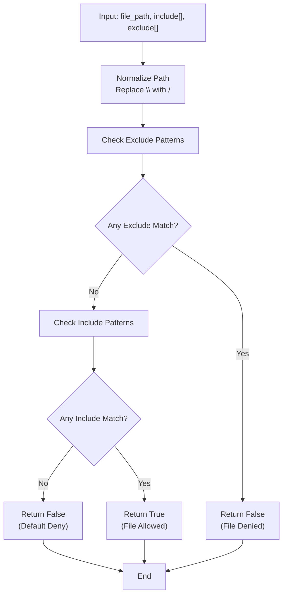
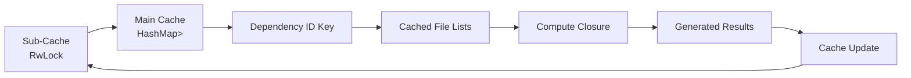
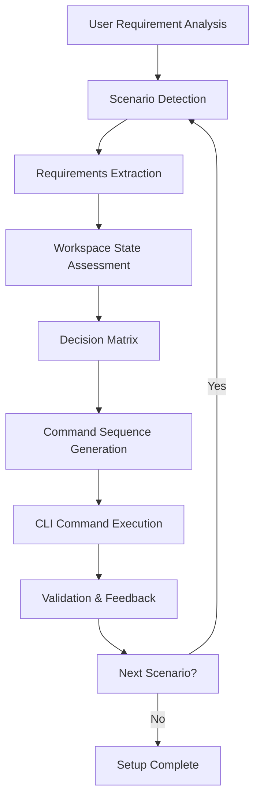

# AI Context Filtering & Intelligent Snippets

<cite>
**Referenced Files in This Document**
- [vdw/src/context/mod.rs](file://vdw/src/context/mod.rs)
- [vdw/src/context/filter.rs](file://vdw/src/context/filter.rs)
- [vdw/src/context/glob_matcher.rs](file://vdw/src/context/glob_matcher.rs)
- [vdw/src/context/file_list.rs](file://vdw/src/context/file_list.rs)
- [vdw/src/types/config.rs](file://vdw/src/types/config.rs)
- [vdw/src/commands/context.rs](file://vdw/src/commands/context.rs)
- [vdw/src/main.rs](file://vdw/src/main.rs)
- [vdw/src/lib.rs](file://vdw/src/lib.rs)
- [vdw/Cargo.toml](file://vdw/Cargo.toml)
- [ai_workspace/VDW虚拟工作空间_需求文档_v1.0.md](file://ai_workspace/VDW虚拟工作空间_需求文档_v1.0.md)
- [README.md](file://README.md)
- [vdw/README.md](file://vdw/README.md)
- [vdw-vscode/src/services/vdwCliService.ts](file://vdw-vscode/src/services/vdwCliService.ts)
</cite>

## Update Summary
**Changes Made**
- Added comprehensive documentation for AI Agent Skill integration with Qoder skill
- Documented the scenario-chain model for automated workspace setup
- Added CLI command orchestration capabilities for AI coding agents
- Updated system architecture to include AI agent skill layer
- Enhanced integration guidance for Copilot and custom LLMs
- Added Qoder skill deployment and configuration documentation

## Table of Contents
1. [Introduction](#introduction)
2. [System Architecture](#system-architecture)
3. [Core Components](#core-components)
4. [Glob Pattern Matching Algorithm](#glob-pattern-matching-algorithm)
5. [File List Generation & Caching](#file-list-generation--caching)
6. [AI Agent Skill Integration](#ai-agent-skill-integration)
7. [CLI Integration](#cli-integration)
8. [Performance Characteristics](#performance-characteristics)
9. [Configuration Management](#configuration-management)
10. [Testing & Validation](#testing--validation)
11. [Troubleshooting Guide](#troubleshooting-guide)
12. [Future Enhancements](#future-enhancements)

## Introduction
This document explains the AI context filtering and intelligent snippet management feature implemented in the Virtual Dev Workspace (VDW) system. The implementation provides scope-based filtering mechanisms, glob pattern matching for include/exclude rules, and virtual file list generation for AI agents. The system is built using Rust and provides both command-line and programmatic interfaces for context management.

The AI context filtering system addresses the critical need to control what code content is exposed to AI agents, preventing context explosion and ensuring that only relevant files are considered during AI-assisted development. The implementation includes sophisticated pattern matching, caching mechanisms, and performance optimizations for large-scale codebases.

**Section sources**
- [ai_workspace/VDW虚拟工作空间_需求文档_v1.0.md: 226-279:226-279](file://ai_workspace/VDW虚拟工作空间_需求文档_v1.0.md#L226-L279)
- [vdw/src/context/mod.rs: 1-4:1-4](file://vdw/src/context/mod.rs#L1-L4)

## System Architecture
The AI context filtering system is organized into several interconnected modules that work together to provide intelligent snippet management:

```mermaid
graph TB
subgraph "AI Agent Layer"
QODER["Qoder Skill<br/>Scenario-Chain Orchestration"]
COPILOT["Copilot Integration<br/>Agent-Aware Filtering"]
CUSTOM["Custom LLM Integration<br/>Context Injection"]
end
subgraph "Context Module"
CF["context/filter.rs<br/>File Filtering Engine"]
CG["context/glob_matcher.rs<br/>Pattern Matching Engine"]
CL["context/file_list.rs<br/>List Generation & Caching"]
CM["context/mod.rs<br/>Module Exports"]
end
subgraph "Configuration"
TC["types/config.rs<br/>Scope & Dependency Types"]
end
subgraph "CLI Interface"
CC["commands/context.rs<br/>Context Commands"]
MAIN["main.rs<br/>Command Router"]
end
subgraph "VS Code Extension"
VSCODE["vdwCliService.ts<br/>CLI Command Execution"]
TREE["Workspace Tree View<br/>Visual Context Management"]
STATUS["Status Bar<br/>Context Statistics"]
end
subgraph "Dependencies"
WALKDIR["walkdir crate<br/>Filesystem traversal"]
GLOB["glob crate<br/>Pattern matching"]
PARKING["parking_lot crate<br/>Concurrent caching"]
END
QODER --> CF
COPILOT --> CF
CUSTOM --> CF
CF --> CG
CL --> CF
CL --> TC
CC --> CL
CC --> CF
MAIN --> CC
VSCODE --> CC
TREE --> VSCODE
STATUS --> VSCODE
CG --> GLOB
CL --> PARKING
CF --> WALKDIR
```

**Diagram sources**
- [vdw/src/context/mod.rs: 1-4:1-4](file://vdw/src/context/mod.rs#L1-L4)
- [vdw/src/context/filter.rs: 1-202:1-202](file://vdw/src/context/filter.rs#L1-L202)
- [vdw/src/context/glob_matcher.rs: 1-246:1-246](file://vdw/src/context/glob_matcher.rs#L1-L246)
- [vdw/src/context/file_list.rs: 1-306:1-306](file://vdw/src/context/file_list.rs#L1-L306)
- [vdw/src/types/config.rs: 39-46:39-46](file://vdw/src/types/config.rs#L39-L46)
- [vdw-vscode/src/services/vdwCliService.ts: 66-106:66-106](file://vdw-vscode/src/services/vdwCliService.ts#L66-L106)

**Section sources**
- [vdw/src/context/mod.rs: 1-4:1-4](file://vdw/src/context/mod.rs#L1-L4)
- [vdw/src/main.rs: 107-138:107-138](file://vdw/src/main.rs#L107-L138)
- [README.md: 192-201:192-201](file://README.md#L192-L201)

## Core Components

### File Filtering Engine
The core filtering engine (`filter.rs`) provides the primary functionality for scanning directories and applying scope-based filtering. It uses the `walkdir` crate for efficient filesystem traversal and implements a two-pass filtering process:

1. **Directory Traversal**: Recursively walks through the specified base path
2. **Pattern Matching**: Applies glob patterns to determine file inclusion
3. **Result Sorting**: Returns sorted file paths for consistent output

Key features:
- Handles non-existent paths gracefully
- Uses relative path normalization for consistent matching
- Supports both include-only and include-exclude pattern combinations
- Provides total size calculation for performance metrics

**Section sources**
- [vdw/src/context/filter.rs: 9-39:9-39](file://vdw/src/context/filter.rs#L9-L39)
- [vdw/src/context/filter.rs: 41-48:41-48](file://vdw/src/context/filter.rs#L41-L48)

### Glob Pattern Matching Engine
The pattern matching engine (`glob_matcher.rs`) implements a sophisticated glob pattern matching system with priority-based filtering:

**Priority Rules**:
1. **Excludes First**: Exclude patterns take precedence over include patterns
2. **Early Termination**: Processing stops as soon as a match is determined
3. **Case Sensitivity**: Glob patterns are case-sensitive by default
4. **Recursive Support**: Native support for `**` patterns for recursive directory matching

The engine provides two main matching functions:
- `matches_scope()`: Primary function for scope-based filtering
- `matches_scope_path()`: Path-based variant for direct path matching

**Section sources**
- [vdw/src/context/glob_matcher.rs: 54-88:54-88](file://vdw/src/context/glob_matcher.rs#L54-L88)
- [vdw/src/context/glob_matcher.rs: 14-40:14-40](file://vdw/src/context/glob_matcher.rs#L14-L40)

### Virtual File List Generation & Caching
The file list generation system (`file_list.rs`) provides intelligent context management with caching capabilities:

**Caching Strategy**:
- **Thread-Safe**: Uses `parking_lot::RwLock` for concurrent access
- **Lazy Evaluation**: Computes results only when needed
- **Dependency-Based Keys**: Caches results per dependency for isolation
- **Manual Invalidation**: Allows selective cache clearing

**Statistics Collection**:
- Tracks total files and size across dependencies
- Provides per-dependency breakdown
- Formats human-readable size representations

**Section sources**
- [vdw/src/context/file_list.rs: 27-73:27-73](file://vdw/src/context/file_list.rs#L27-L73)
- [vdw/src/context/file_list.rs: 75-105:75-105](file://vdw/src/context/file_list.rs#L75-L105)

## Glob Pattern Matching Algorithm

The pattern matching algorithm implements a priority-based filtering system designed for optimal performance and accuracy:



**Algorithm Characteristics**:
- **Time Complexity**: O(n + m) where n is exclude patterns and m is include patterns
- **Space Complexity**: O(1) additional space per pattern
- **Early Termination**: Stops processing as soon as a decision is made
- **Pattern Compilation**: Compiles patterns once for reuse

**Pattern Features**:
- **Recursive Matching**: `**` supports deep directory traversal
- **Case Sensitivity**: Respects case sensitivity settings
- **Separator Handling**: Normalizes path separators automatically
- **Error Handling**: Graceful handling of invalid patterns

**Section sources**
- [vdw/src/context/glob_matcher.rs: 59-81:59-81](file://vdw/src/context/glob_matcher.rs#L59-L81)
- [vdw/src/context/glob_matcher.rs: 42-52:42-52](file://vdw/src/context/glob_matcher.rs#L42-L52)

## File List Generation & Caching

The file list generation system provides comprehensive context management with sophisticated caching mechanisms:

### Cache Architecture
The caching system uses a two-tier approach for optimal performance:



**Cache Operations**:
- **Fast Path**: Read-only access with shared locks
- **Slow Path**: Exclusive access for computation and updates
- **Memory Efficiency**: Stores only computed results
- **Concurrency Control**: Prevents race conditions during updates

### Context Statistics
The system provides detailed statistics for monitoring and debugging:

**Statistics Fields**:
- `total_files`: Overall count of files in context
- `total_size_bytes`: Combined size of all context files
- `per_dependency`: Breakdown by repository dependency
- `DependencyStats`: Per-repository file count and size

**Format Options**:
- Bytes: Direct byte count
- Kilobytes: Formatted with 1 decimal place
- Megabytes: Formatted with 1 decimal place

**Section sources**
- [vdw/src/context/file_list.rs: 10-25:10-25](file://vdw/src/context/file_list.rs#L10-L25)
- [vdw/src/context/file_list.rs: 107-105:107-105](file://vdw/src/context/file_list.rs#L107-L105)

## AI Agent Skill Integration

The VDW system now includes comprehensive AI Agent Skill integration through the Qoder skill, enabling AI coding agents to automatically set up workspaces with scenario-chain model and CLI command orchestration.

### Qoder Skill Architecture
The Qoder skill provides a scenario-chain model that intelligently orchestrates CLI commands based on the current workspace state:



**Key Capabilities**:
- **Requirements Analysis**: Automatically analyzes user requirements to determine workspace setup needs
- **State Assessment**: Evaluates current workspace configuration to avoid redundant operations
- **Command Orchestration**: Generates optimal sequence of CLI commands based on detected scenarios
- **Confirmation Workflow**: Requests user confirmation before executing potentially destructive operations

### Scenario-Chain Model
The scenario-chain model follows a structured approach to workspace setup:

**Primary Scenarios**:
1. **Fresh Workspace Setup**: Initialize `.vdwrc` and configure initial dependencies
2. **Repository Addition**: Add new repositories with appropriate flags (--editable or read-only)
3. **Dependency Linking**: Establish proper linking strategies based on filesystem constraints
4. **IDE Integration**: Offer IDE launch options with configured context

**Decision Logic**:
- **Editable Repositories**: Use `--editable` flag for active development
- **Read-Only Repositories**: Use read-only mode for stable dependencies
- **Platform Optimization**: Auto-select appropriate linking strategies (HardLink → Symlink)

### CLI Command Orchestration
The Qoder skill orchestrates complex CLI workflows through intelligent command sequencing:

**Command Sequencing Examples**:
- **Initialization Flow**: `vdw init` → `vdw repo add` → `vdw link` → IDE launch
- **Incremental Setup**: Detect missing components and add them progressively
- **Conflict Resolution**: Handle overlapping dependencies and conflicting configurations

**Integration Points**:
- **Requirements Gathering**: Analyze project structure to determine dependencies
- **Configuration Generation**: Create appropriate `.vdwrc` based on detected patterns
- **Validation**: Verify setup completion and report any issues

**Section sources**
- [README.md: 192-201:192-201](file://README.md#L192-L201)
- [vdw/README.md: 188-196:188-196](file://vdw/README.md#L188-L196)

## CLI Integration

The AI context filtering system integrates seamlessly with the VDW command-line interface:

### Available Commands
The system provides two primary commands for context management:

**Context Preview Command**:
- Displays all files currently in the AI context
- Shows per-dependency breakdown
- Handles unlinked repositories gracefully
- Provides clear formatting with counts

**Context Statistics Command**:
- Shows total file count and size
- Displays per-dependency statistics
- Formats sizes in human-readable formats
- Includes dependency path truncation for readability

### Command Implementation
Both commands follow a consistent pattern:
1. Load current working directory configuration
2. Parse VDW configuration file
3. Execute context operation
4. Display formatted results

**Section sources**
- [vdw/src/commands/context.rs: 6-36:6-36](file://vdw/src/commands/context.rs#L6-L36)
- [vdw/src/commands/context.rs: 38-63:38-63](file://vdw/src/commands/context.rs#L38-L63)
- [vdw/src/main.rs: 131-134:131-134](file://vdw/src/main.rs#L131-L134)

## Performance Characteristics

The AI context filtering system is optimized for performance across various scales:

### Benchmark Specifications
**Target Performance**:
- **File List Generation**: Under 500ms for 1000 files
- **Memory Usage**: Below 200MB for 10,000 files
- **Single File Updates**: Under 1 second for incremental changes

### Optimization Strategies
**Efficient Pattern Matching**:
- Pre-normalized patterns reduce repeated processing
- Early termination prevents unnecessary comparisons
- Compiled patterns eliminate runtime compilation overhead

**Memory Management**:
- Lazy evaluation prevents unnecessary computations
- Caching reduces repeated filesystem operations
- Sorted output maintains consistent ordering

**Filesystem Optimization**:
- Single pass directory traversal minimizes I/O
- Relative path processing reduces string manipulation
- Efficient glob pattern compilation

### Scalability Considerations
**Large Codebases**:
- Hierarchical dependency processing
- Incremental cache updates
- Memory-efficient streaming

**Concurrent Access**:
- Thread-safe caching with reader-writer locks
- Non-blocking read operations
- Atomic cache invalidation

**Section sources**
- [vdw/src/context/filter.rs: 18-38:18-38](file://vdw/src/context/filter.rs#L18-L38)
- [vdw/src/context/file_list.rs: 42-60:42-60](file://vdw/src/context/file_list.rs#L42-L60)

## Configuration Management

The system uses a structured configuration approach to define AI context scopes:

### Scope Configuration
The `Scope` structure defines filtering rules:

**Fields**:
- `include`: Array of glob patterns for inclusion
- `exclude`: Array of glob patterns for exclusion

**Validation Rules**:
- Include patterns must be non-empty
- Excludes are optional but processed with higher priority
- Patterns support full glob syntax including `**`

### Dependency Configuration
Each dependency can have its own scope definition:

**Dependency Structure**:
- `repo`: Remote repository URL
- `path`: Local mount point
- `scope`: Scope configuration for this dependency
- `editable`: Whether the dependency is editable

**Version Control**:
- Supports branch, tag, or commit specification
- Exactly one version specifier required
- URL format validation (git@ or https://)

**Section sources**
- [vdw/src/types/config.rs: 39-46:39-46](file://vdw/src/types/config.rs#L39-L46)
- [vdw/src/types/config.rs: 19-33:19-33](file://vdw/src/types/config.rs#L19-L33)
- [vdw/src/types/config.rs: 48-87:48-87](file://vdw/src/types/config.rs#L48-L87)

## Testing & Validation

The system includes comprehensive testing for all major components:

### Unit Test Coverage
**Core Functionality Tests**:
- Glob pattern matching with various scenarios
- File filtering with include/exclude combinations
- Cache behavior and invalidation
- Error handling for edge cases

**Integration Tests**:
- Complete workflow validation
- Performance benchmarking
- Memory usage verification

### Test Scenarios
**Pattern Matching Tests**:
- Recursive pattern matching (`**`)
- Directory-specific patterns
- Mixed include/exclude scenarios
- Case sensitivity validation

**Performance Tests**:
- Large directory traversal
- Cache hit rates
- Memory allocation patterns

**Section sources**
- [vdw/src/context/glob_matcher.rs: 90-245:90-245](file://vdw/src/context/glob_matcher.rs#L90-L245)
- [vdw/src/context/filter.rs: 50-201:50-201](file://vdw/src/context/filter.rs#L50-L201)
- [vdw/src/context/file_list.rs: 107-299:107-299](file://vdw/src/context/file_list.rs#L107-L299)

## Troubleshooting Guide

### Common Issues and Solutions

**Files Still Appear in AI Context**:
- Verify glob pattern syntax in `.vdwrc`
- Check pattern normalization (backslashes vs forward slashes)
- Ensure exclude patterns are properly ordered (excludes first)
- Use context preview command to debug current state

**Slow Context Generation**:
- Reduce include pattern scope to minimize candidates
- Check filesystem performance and disk I/O
- Verify cache effectiveness for repeated operations
- Monitor memory usage for large codebases

**Memory Usage Concerns**:
- Implement more specific include patterns
- Use exclude patterns to filter out large directories
- Consider breaking large dependencies into smaller scopes
- Monitor cache growth and clear when appropriate

**CLI Command Failures**:
- Ensure VDW configuration file exists and is valid
- Verify repository links are established
- Check file permissions for accessed directories
- Review error messages for specific failure points

**AI Agent Skill Issues**:
- Verify Qoder skill installation and configuration
- Check scenario-chain model compatibility
- Ensure CLI commands are executable and in PATH
- Validate workspace state before skill execution

### Diagnostic Commands
**Context Preview**:
```bash
vdw context preview
```
Shows current context files with dependency breakdown

**Context Statistics**:
```bash
vdw context stats
```
Displays file counts, sizes, and dependency summaries

**Section sources**
- [vdw/src/commands/context.rs: 6-36:6-36](file://vdw/src/commands/context.rs#L6-L36)
- [vdw/src/commands/context.rs: 38-63:38-63](file://vdw/src/commands/context.rs#L38-L63)

## Future Enhancements

### Planned Improvements
**AST-Based Analysis**:
- Static analysis for code relationship discovery
- Import statement parsing for intelligent context expansion
- Symbol resolution across dependencies

**Language Server Integration**:
- LSP-based context enrichment
- Call graph analysis for related files
- Type definition inclusion based on usage

**Advanced Pattern Matching**:
- Regular expression support alongside glob patterns
- Context-aware pattern weighting
- Machine learning for pattern optimization

**Enhanced AI Agent Capabilities**:
- Multi-agent coordination for complex workspace setups
- Predictive context generation based on development patterns
- Dynamic scope adjustment based on AI agent feedback

### Performance Optimizations
**Parallel Processing**:
- Multi-threaded file scanning for large repositories
- Asynchronous pattern matching
- Streaming results for real-time feedback

**Memory Management**:
- Result streaming for very large contexts
- Adaptive caching based on usage patterns
- Memory profiling and optimization

**Section sources**
- [ai_workspace/VDW虚拟工作空间_需求文档_v1.0.md: 49](file://ai_workspace/VDW虚拟工作空间_需求文档_v1.0.md#L49)
- [vdw/src/context/glob_matcher.rs: 14-40:14-40](file://vdw/src/context/glob_matcher.rs#L14-L40)
- [README.md: 192-201:192-201](file://README.md#L192-L201)