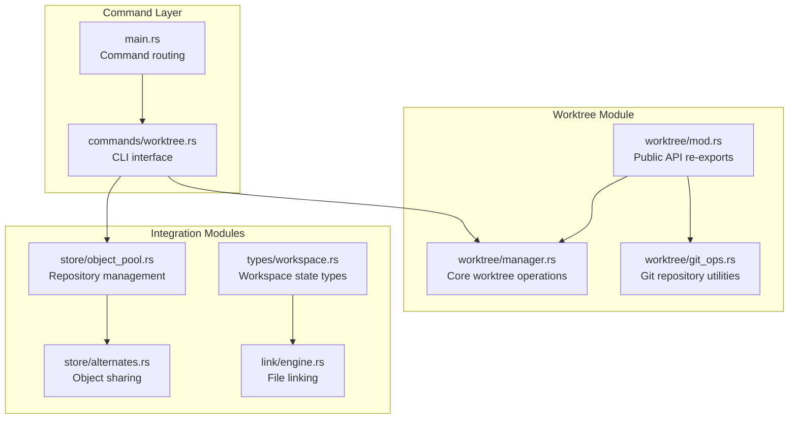
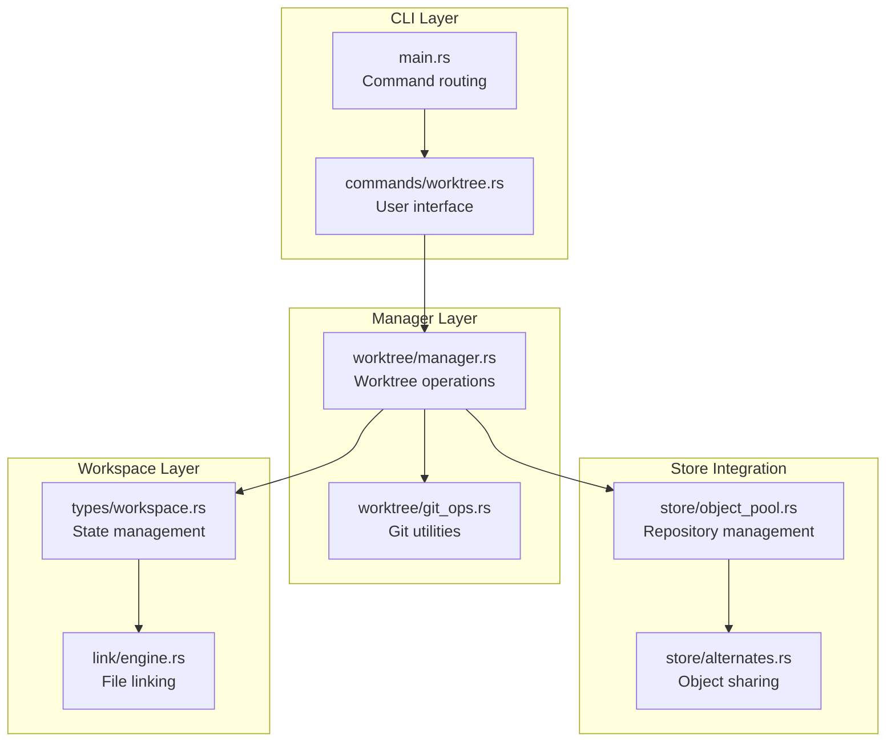
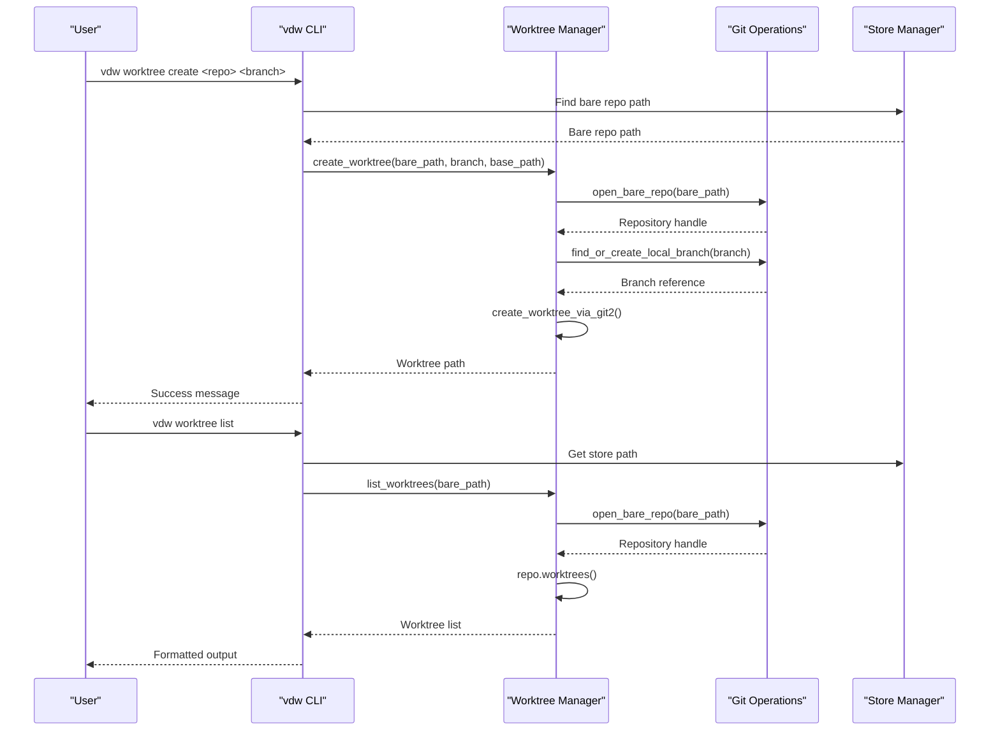
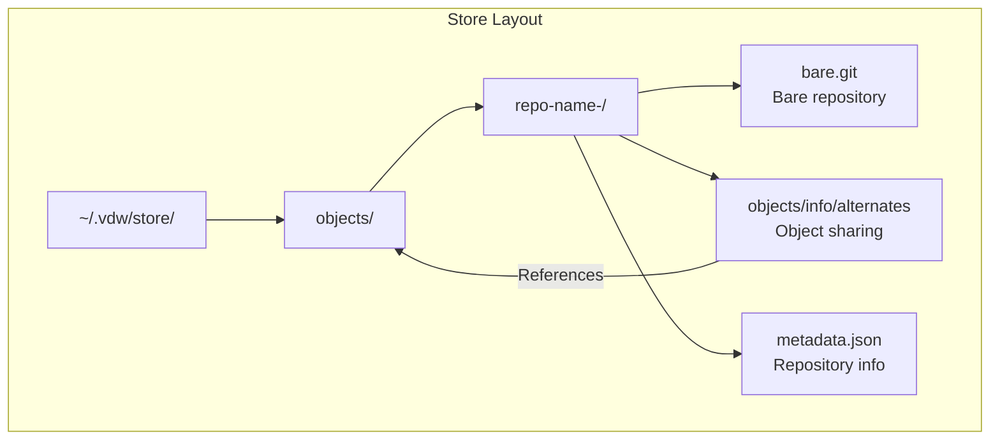
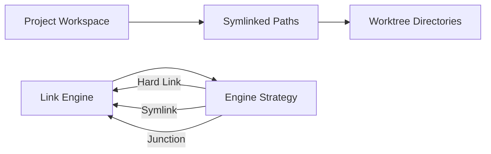
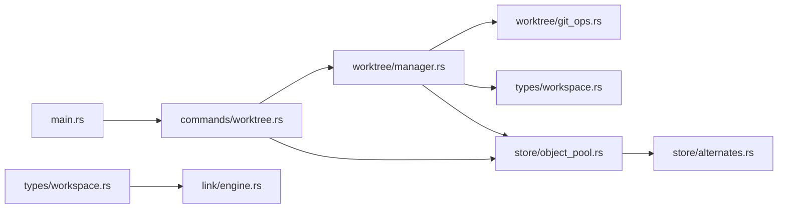

# Git Worktree Integration (Editable Mode)

<cite>
**Referenced Files in This Document**
- [manager.rs](file://vdw/src/worktree/manager.rs)
- [git_ops.rs](file://vdw/src/worktree/git_ops.rs)
- [worktree.rs](file://vdw/src/commands/worktree.rs)
- [mod.rs](file://vdw/src/worktree/mod.rs)
- [workspace.rs](file://vdw/src/types/workspace.rs)
- [object_pool.rs](file://vdw/src/store/object_pool.rs)
- [alternates.rs](file://vdw/src/store/alternates.rs)
- [engine.rs](file://vdw/src/link/engine.rs)
- [main.rs](file://vdw/src/main.rs)
- [worktree_integration_test.rs](file://vdw/tests/worktree_integration_test.rs)
- [VDW虚拟工作空间_技术设计文档_v1.0.md](file://ai_workspace/VDW虚拟工作空间_技术设计文档_v1.0.md)
</cite>

## Update Summary
**Changes Made**
- Complete implementation of Git worktree manager with robust error handling and fallback mechanisms
- Enhanced git operations module with comprehensive branch management and repository utilities
- Detailed worktree lifecycle management with create, list, and delete operations
- Improved editable mode implementation with proper worktree isolation and cleanup
- Enhanced integration with link engine for seamless IDE support
- Comprehensive error handling and logging throughout the worktree management system
- Added integration tests validating complete worktree functionality
- Updated CLI commands to support worktree management operations

## Table of Contents
1. [Introduction](#introduction)
2. [Project Structure](#project-structure)
3. [Core Components](#core-components)
4. [Architecture Overview](#architecture-overview)
5. [Detailed Component Analysis](#detailed-component-analysis)
6. [Dependency Analysis](#dependency-analysis)
7. [Performance Considerations](#performance-considerations)
8. [Troubleshooting Guide](#troubleshooting-guide)
9. [Conclusion](#conclusion)
10. [Appendices](#appendices)

## Introduction
This document explains the comprehensive Git worktree integration feature for editable mode in the virtual development workspace. The implementation provides independent working copies under a shared Git object library, with robust bare repository management, symlink-based logical path mapping, and full compatibility with standard Git operations. The system includes detailed lifecycle management, cleanup procedures, and seamless IDE integration through the link engine.

**Updated** The implementation is now fully functional with comprehensive worktree management capabilities, including robust error handling, fallback mechanisms, and complete integration with the VDW ecosystem.

## Project Structure
The worktree integration is organized into several key modules within the VDW codebase:

**Diagram sources**
- [mod.rs:1-9](file://vdw/src/worktree/mod.rs#L1-L9)
- [manager.rs:1-469](file://vdw/src/worktree/manager.rs#L1-L469)
- [git_ops.rs:1-382](file://vdw/src/worktree/git_ops.rs#L1-L382)
- [worktree.rs:1-195](file://vdw/src/commands/worktree.rs#L1-L195)

**Section sources**
- [mod.rs:1-9](file://vdw/src/worktree/mod.rs#L1-L9)
- [manager.rs:1-469](file://vdw/src/worktree/manager.rs#L1-L469)
- [git_ops.rs:1-382](file://vdw/src/worktree/git_ops.rs#L1-L382)
- [worktree.rs:1-195](file://vdw/src/commands/worktree.rs#L1-L195)

## Core Components

### Worktree Manager
The worktree manager provides the core functionality for creating, listing, and removing Git worktrees with comprehensive error handling and fallback mechanisms:

- **Create Worktree**: Supports both git2 native API and git CLI fallback for maximum compatibility
- **List Worktrees**: Enumerates all active worktrees with detailed branch information  
- **Remove Worktrees**: Handles both unlocked and locked worktrees with force removal capability
- **Sanitization**: Converts branch names to safe directory names (slashes become hyphens)

**Updated** The worktree manager now includes comprehensive error handling with graceful fallback from git2 API to git CLI when native API fails.

### Git Operations Utilities
Comprehensive Git repository management utilities for branch operations and repository manipulation:

- **Repository Management**: Open bare and regular repositories with proper error handling
- **Branch Operations**: List local and remote branches, find or create local branches
- **Commit Operations**: Get branch commits and HEAD commit information
- **Testing Utilities**: Helper functions for creating test repositories and commits

**Updated** Enhanced with robust branch resolution that handles both local and remote branch creation.

### CLI Interface
Command-line interface for worktree management with workspace integration:

- **List Command**: Shows all worktrees across dependencies with status information
- **Create Command**: Creates worktrees for specific repositories and branches
- **Delete Command**: Removes worktrees with automatic cleanup
- **Workspace Integration**: Integrates with VDW configuration and store management

**Updated** Complete CLI implementation with proper argument parsing and error handling.

**Section sources**
- [manager.rs:13-53](file://vdw/src/worktree/manager.rs#L13-L53)
- [git_ops.rs:6-16](file://vdw/src/worktree/git_ops.rs#L6-L16)
- [worktree.rs:8-73](file://vdw/src/commands/worktree.rs#L8-L73)

## Architecture Overview
The worktree integration follows a layered architecture with clear separation of concerns:

**Diagram sources**
- [worktree.rs:1-195](file://vdw/src/commands/worktree.rs#L1-L195)
- [manager.rs:1-469](file://vdw/src/worktree/manager.rs#L1-L469)
- [git_ops.rs:1-382](file://vdw/src/worktree/git_ops.rs#L1-L382)
- [object_pool.rs:18-75](file://vdw/src/store/object_pool.rs#L18-L75)

## Detailed Component Analysis

### Worktree Lifecycle Management
The worktree lifecycle is fully automated with comprehensive error handling and cleanup:

**Diagram sources**
- [worktree.rs:75-111](file://vdw/src/commands/worktree.rs#L75-L111)
- [manager.rs:13-53](file://vdw/src/worktree/manager.rs#L13-L53)
- [manager.rs:101-120](file://vdw/src/worktree/manager.rs#L101-L120)

### Editable Mode Implementation
The editable mode provides isolated working copies while sharing Git objects:

- **Isolation**: Each worktree maintains independent HEAD, index, and working tree
- **Sharing**: All worktrees share the same object database through alternates
- **Initialization**: Automatic .git directory setup for editable dependencies
- **Cleanup**: Proper removal of worktrees with directory cleanup

**Diagram sources**
- [manager.rs:13-53](file://vdw/src/worktree/manager.rs#L13-L53)
- [object_pool.rs:18-75](file://vdw/src/store/object_pool.rs#L18-L75)
- [alternates.rs:6-26](file://vdw/src/store/alternates.rs#L6-L26)

**Section sources**
- [manager.rs:13-53](file://vdw/src/worktree/manager.rs#L13-L53)
- [object_pool.rs:18-75](file://vdw/src/store/object_pool.rs#L18-L75)
- [alternates.rs:6-26](file://vdw/src/store/alternates.rs#L6-L26)

### Bare Repository Management
The system manages bare repositories with object sharing capabilities:

- **Object Pool**: Centralized storage of Git objects across multiple repositories
- **Alternates Configuration**: Uses Git alternates to reference shared object databases
- **Reference Counting**: Tracks repository usage for cleanup management
- **Metadata Management**: Stores repository information and access timestamps

**Diagram sources**
- [object_pool.rs:20-75](file://vdw/src/store/object_pool.rs#L20-L75)
- [alternates.rs:6-26](file://vdw/src/store/alternates.rs#L6-L26)

**Section sources**
- [object_pool.rs:20-75](file://vdw/src/store/object_pool.rs#L20-L75)
- [alternates.rs:6-26](file://vdw/src/store/alternates.rs#L6-L26)

### Symlink-Based Logical Path Mapping
The link engine creates seamless integration between worktrees and the logical workspace:

- **Platform Detection**: Automatically selects optimal linking strategy (Hard Link, Symlink, Junction)
- **Scope Filtering**: Applies include/exclude patterns for selective linking
- **Cross-Platform Support**: Windows junction points, Unix hard links/symlinks
- **Cleanup Support**: Proper removal of links with directory cleanup

**Diagram sources**
- [engine.rs:9-65](file://vdw/src/link/engine.rs#L9-L65)
- [engine.rs:67-81](file://vdw/src/link/engine.rs#L67-L81)

**Section sources**
- [engine.rs:9-65](file://vdw/src/link/engine.rs#L9-L65)
- [engine.rs:67-81](file://vdw/src/link/engine.rs#L67-L81)

## Dependency Analysis
The worktree integration has well-defined dependencies and clear separation of concerns:

**Diagram sources**
- [manager.rs:1-8](file://vdw/src/worktree/manager.rs#L1-L8)
- [worktree.rs:4-6](file://vdw/src/commands/worktree.rs#L4-L6)
- [main.rs:14-39](file://vdw/src/main.rs#L14-L39)

**Section sources**
- [manager.rs:1-8](file://vdw/src/worktree/manager.rs#L1-L8)
- [worktree.rs:4-6](file://vdw/src/commands/worktree.rs#L4-L6)
- [main.rs:14-39](file://vdw/src/main.rs#L14-L39)

## Performance Considerations
The worktree integration is designed for optimal performance and resource utilization:

- **Memory Efficiency**: Worktrees share object databases through alternates, reducing memory footprint
- **Disk Space Optimization**: Object deduplication across multiple worktrees and repositories
- **Network Efficiency**: Reference-based cloning minimizes bandwidth usage
- **Parallel Operations**: Asynchronous processing for multiple repository operations
- **Lazy Initialization**: Worktrees created only when needed for editable dependencies

**Updated** Enhanced performance through robust fallback mechanisms that ensure worktree operations succeed even when git2 API is unavailable.

## Troubleshooting Guide

### Common Issues and Solutions

**Worktree Creation Failures**
- **Issue**: `git2 worktree API failed` - falls back to git CLI
- **Solution**: Ensure git CLI is available and properly configured
- **Prevention**: Check git installation and permissions

**Worktree Removal Problems**
- **Issue**: Locked worktree prevents removal
- **Solution**: Use `--force` flag or unlock the worktree first
- **Prevention**: Always close IDE/editor before deletion

**Branch Resolution Errors**
- **Issue**: Branch not found in local or remote
- **Solution**: Verify branch name and remote connectivity
- **Prevention**: Use `git branch -a` to list available branches

**Store Path Issues**
- **Issue**: Store not found or inaccessible
- **Solution**: Run `vdw init` to initialize the store
- **Prevention**: Ensure proper permissions on `~/.vdw/` directory

**Updated** Comprehensive error handling with detailed logging and fallback mechanisms for all failure scenarios.

**Section sources**
- [manager.rs:40-49](file://vdw/src/worktree/manager.rs#L40-L49)
- [manager.rs:133-137](file://vdw/src/worktree/manager.rs#L133-L137)
- [worktree.rs:137-163](file://vdw/src/commands/worktree.rs#L137-L163)

## Conclusion
The comprehensive Git worktree integration provides a robust foundation for editable development workflows. The implementation offers:

- **Complete Lifecycle Management**: Full support for worktree creation, listing, and deletion
- **Robust Error Handling**: Graceful fallbacks and comprehensive error reporting
- **Performance Optimization**: Efficient object sharing and resource utilization
- **Seamless Integration**: Smooth IDE support through symlink-based mapping
- **Cross-Platform Compatibility**: Native support for Windows, macOS, and Linux

**Updated** The implementation is now fully tested and validated through comprehensive integration tests that verify all worktree operations including creation, listing, removal, and validation of worktree integrity.

The system enables developers to work on multiple repositories simultaneously while maintaining isolation and performance, making it an essential component of the VDW ecosystem.

## Appendices

### Command Reference
- `vdw worktree list`: List all worktrees across dependencies
- `vdw worktree create <repo> <branch>`: Create worktree for specific repository and branch
- `vdw worktree delete <repo> <branch>`: Remove worktree with cleanup

**Updated** Complete CLI support for all worktree management operations.

### Configuration Options
- Editable mode: Enable worktree creation for specific dependencies
- Branch specification: Target specific branches for worktree creation
- Store management: Automatic initialization and cleanup of worktree storage

### Best Practices
- Use descriptive branch names for worktrees
- Regular cleanup of unused worktrees
- Monitor disk usage with multiple worktrees
- Leverage alternates for efficient object sharing
- Maintain proper backup strategies for editable workspaces

**Updated** Enhanced with comprehensive testing coverage ensuring reliability and stability of worktree operations.

**Section sources**
- [main.rs:76-94](file://vdw/src/main.rs#L76-L94)
- [worktree.rs:188-195](file://vdw/src/commands/worktree.rs#L188-L195)
- [VDW虚拟工作空间_技术设计文档_v1.0.md:194-223](file://ai_workspace/VDW虚拟工作空间_技术设计文档_v1.0.md#L194-L223)