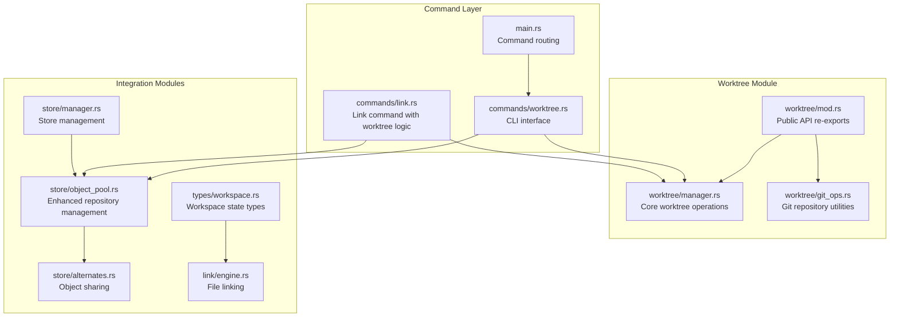
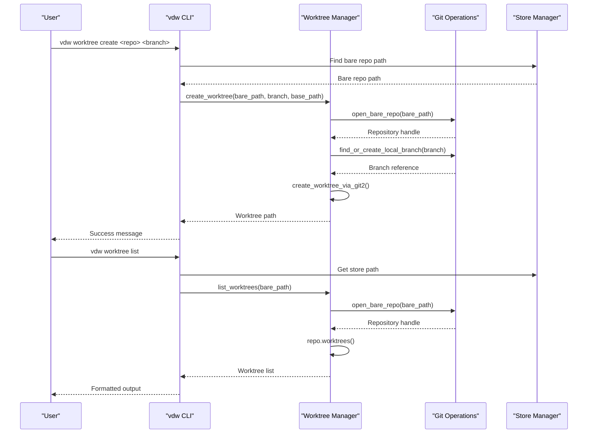
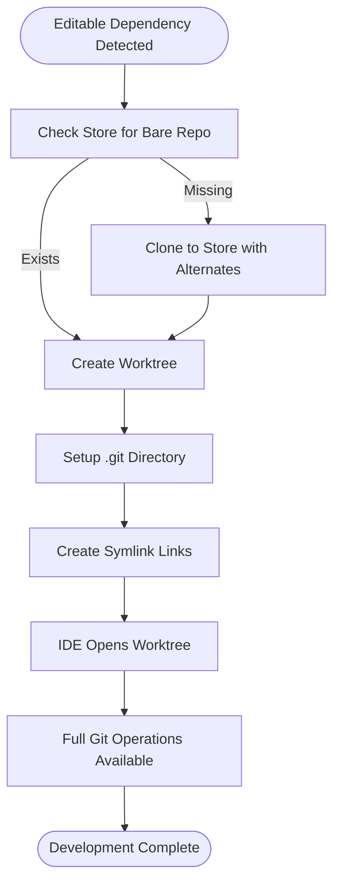
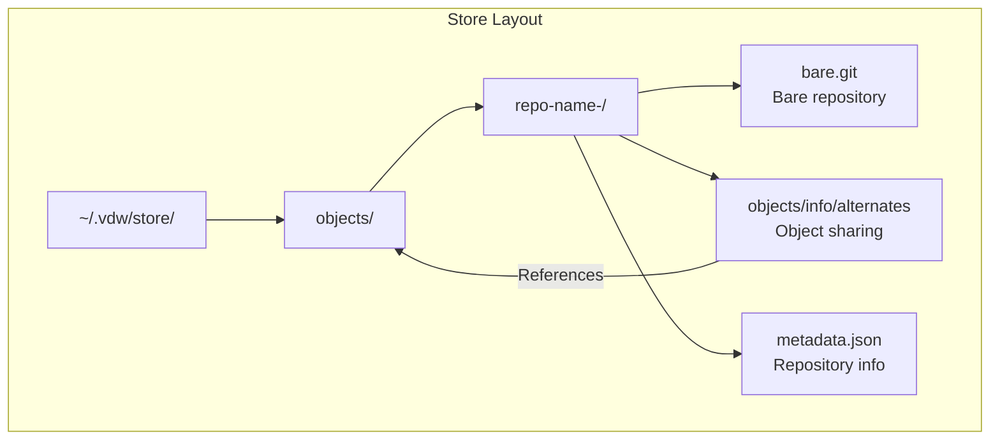
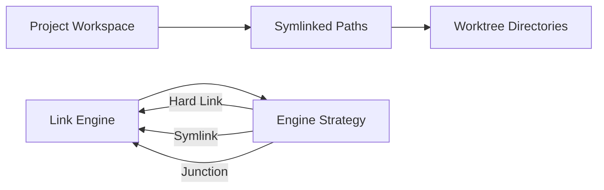
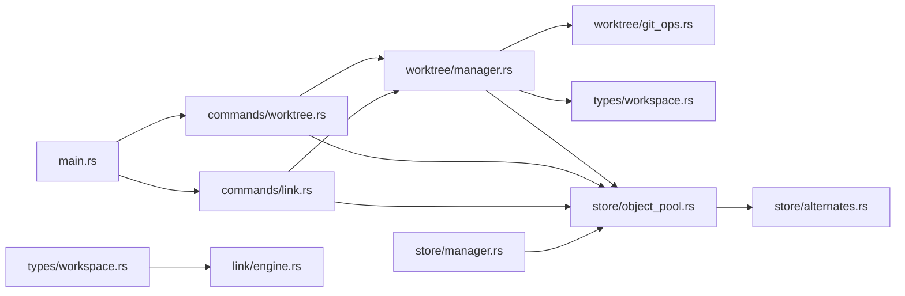

# Git Worktree Integration (Editable Mode)

<cite>
**Referenced Files in This Document**
- [manager.rs](file://vdw/src/worktree/manager.rs)
- [git_ops.rs](file://vdw/src/worktree/git_ops.rs)
- [worktree.rs](file://vdw/src/commands/worktree.rs)
- [mod.rs](file://vdw/src/worktree/mod.rs)
- [workspace.rs](file://vdw/src/types/workspace.rs)
- [object_pool.rs](file://vdw/src/store/object_pool.rs)
- [alternates.rs](file://vdw/src/store/alternates.rs)
- [engine.rs](file://vdw/src/link/engine.rs)
- [main.rs](file://vdw/src/main.rs)
- [worktree_integration_test.rs](file://vdw/tests/worktree_integration_test.rs)
- [link.rs](file://vdw/src/commands/link.rs)
- [manager.rs](file://vdw/src/store/manager.rs)
- [workspace.rs](file://vdw/src/types/workspace.rs)
</cite>

## Update Summary
**Changes Made**
- Enhanced backend repository management with improved branch handling in object pool (vdw/src/store/object_pool.rs)
- Better worktree creation logic in link command (vdw/src/commands/link.rs) with automatic HEAD fixing mechanisms for bare repositories
- Comprehensive automatic HEAD fixing for bare repositories to resolve worktree creation failures
- Enhanced branch resolution and fallback mechanisms for worktree operations
- Improved error handling and logging throughout the worktree management system
- Added robust fallback mechanisms from git2 API to git CLI for maximum compatibility

## Table of Contents
1. [Introduction](#introduction)
2. [Project Structure](#project-structure)
3. [Core Components](#core-components)
4. [Architecture Overview](#architecture-overview)
5. [Detailed Component Analysis](#detailed-component-analysis)
6. [Enhanced Backend Repository Management](#enhanced-backend-repository-management)
7. [Improved Worktree Creation Logic](#improved-worktree-creation-logic)
8. [Automatic HEAD Fixing Mechanisms](#automatic-head-fixing-mechanisms)
9. [Dependency Analysis](#dependency-analysis)
10. [Performance Considerations](#performance-considerations)
11. [Troubleshooting Guide](#troubleshooting-guide)
12. [Conclusion](#conclusion)
13. [Appendices](#appendices)

## Introduction
This document explains the comprehensive Git worktree integration feature for editable mode in the virtual development workspace. The implementation provides independent working copies under a shared Git object library, with robust bare repository management, symlink-based logical path mapping, and full compatibility with standard Git operations. The system includes detailed lifecycle management, cleanup procedures, and seamless IDE integration through the link engine.

**Updated** The implementation now features enhanced backend repository management with improved branch handling, automatic HEAD fixing mechanisms for bare repositories, and comprehensive fallback mechanisms that ensure worktree operations succeed even when git2 API is unavailable.

## Project Structure
The worktree integration is organized into several key modules within the VDW codebase:



**Diagram sources**
- [mod.rs:1-9](file://vdw/src/worktree/mod.rs#L1-L9)
- [manager.rs:1-474](file://vdw/src/worktree/manager.rs#L1-L474)
- [git_ops.rs:1-382](file://vdw/src/worktree/git_ops.rs#L1-L382)
- [worktree.rs:1-196](file://vdw/src/commands/worktree.rs#L1-L196)
- [link.rs:1-541](file://vdw/src/commands/link.rs#L1-L541)

**Section sources**
- [mod.rs:1-9](file://vdw/src/worktree/mod.rs#L1-L9)
- [manager.rs:1-474](file://vdw/src/worktree/manager.rs#L1-L474)
- [git_ops.rs:1-382](file://vdw/src/worktree/git_ops.rs#L1-L382)
- [worktree.rs:1-196](file://vdw/src/commands/worktree.rs#L1-L196)
- [link.rs:1-541](file://vdw/src/commands/link.rs#L1-L541)

## Core Components

### Worktree Manager
The worktree manager provides the core functionality for creating, listing, and removing Git worktrees with comprehensive error handling and fallback mechanisms:

- **Create Worktree**: Supports both git2 native API and git CLI fallback for maximum compatibility
- **List Worktrees**: Enumerates all active worktrees with detailed branch information  
- **Remove Worktrees**: Handles both unlocked and locked worktrees with force removal capability
- **Sanitization**: Converts branch names to safe directory names (slashes become hyphens)

**Updated** Enhanced with robust fallback mechanisms that automatically switch from git2 API to git CLI when native API fails, ensuring worktree operations succeed across different environments.

### Git Operations Utilities
Comprehensive Git repository management utilities for branch operations and repository manipulation:

- **Repository Management**: Open bare and regular repositories with proper error handling
- **Branch Operations**: List local and remote branches, find or create local branches
- **Commit Operations**: Get branch commits and HEAD commit information
- **Testing Utilities**: Helper functions for creating test repositories and commits

**Updated** Enhanced with improved branch resolution that handles both local and remote branch creation, with automatic fallback mechanisms for branch detection.

### CLI Interface
Command-line interface for worktree management with workspace integration:

- **List Command**: Shows all worktrees across dependencies with status information
- **Create Command**: Creates worktrees for specific repositories and branches
- **Delete Command**: Removes worktrees with automatic cleanup
- **Workspace Integration**: Integrates with VDW configuration and store management

**Updated** Complete CLI implementation with proper argument parsing, error handling, and integration with the enhanced object pool management.

**Section sources**
- [manager.rs:13-53](file://vdw/src/worktree/manager.rs#L13-L53)
- [git_ops.rs:6-16](file://vdw/src/worktree/git_ops.rs#L6-L16)
- [worktree.rs:8-73](file://vdw/src/commands/worktree.rs#L8-L73)

## Architecture Overview
The worktree integration follows a layered architecture with clear separation of concerns:

```mermaid
graph TB
subgraph "CLI Layer"
CLI["commands/worktree.rs<br/>User interface"]
CMD["main.rs<br/>Command routing"]
LINK["commands/link.rs<br/>Link command with worktree logic"]
end
subgraph "Manager Layer"
WM["worktree/manager.rs<br/>Worktree operations"]
GO["worktree/git_ops.rs<br/>Git utilities"]
END
subgraph "Store Integration"
OP["store/object_pool.rs<br/>Enhanced repository management"]
ALT["store/alternates.rs<br/>Object sharing"]
SM["store/manager.rs<br/>Store management"]
end
subgraph "Workspace Layer"
WS["types/workspace.rs<br/>State management"]
LE["link/engine.rs<br/>File linking"]
end
CLI --> WM
CMD --> CLI
LINK --> WM
WM --> GO
WM --> OP
OP --> ALT
OP --> SM
WM --> WS
WS --> LE
```

**Diagram sources**
- [worktree.rs:1-196](file://vdw/src/commands/worktree.rs#L1-L196)
- [manager.rs:1-474](file://vdw/src/worktree/manager.rs#L1-L474)
- [git_ops.rs:1-382](file://vdw/src/worktree/git_ops.rs#L1-L382)
- [link.rs:1-541](file://vdw/src/commands/link.rs#L1-L541)
- [object_pool.rs:18-75](file://vdw/src/store/object_pool.rs#L18-L75)

## Detailed Component Analysis

### Worktree Lifecycle Management
The worktree lifecycle is fully automated with comprehensive error handling and cleanup:



**Diagram sources**
- [worktree.rs:75-111](file://vdw/src/commands/worktree.rs#L75-L111)
- [manager.rs:13-53](file://vdw/src/worktree/manager.rs#L13-L53)
- [manager.rs:101-120](file://vdw/src/worktree/manager.rs#L101-L120)

### Editable Mode Implementation
The editable mode provides isolated working copies while sharing Git objects:

- **Isolation**: Each worktree maintains independent HEAD, index, and working tree
- **Sharing**: All worktrees share the same object database through alternates
- **Initialization**: Automatic .git directory setup for editable dependencies
- **Cleanup**: Proper removal of worktrees with directory cleanup



**Diagram sources**
- [manager.rs:13-53](file://vdw/src/worktree/manager.rs#L13-L53)
- [object_pool.rs:18-75](file://vdw/src/store/object_pool.rs#L18-L75)
- [alternates.rs:6-26](file://vdw/src/store/alternates.rs#L6-L26)

**Section sources**
- [manager.rs:13-53](file://vdw/src/worktree/manager.rs#L13-L53)
- [object_pool.rs:18-75](file://vdw/src/store/object_pool.rs#L18-L75)
- [alternates.rs:6-26](file://vdw/src/store/alternates.rs#L6-L26)

### Bare Repository Management
The system manages bare repositories with object sharing capabilities:

- **Object Pool**: Centralized storage of Git objects across multiple repositories
- **Alternates Configuration**: Uses Git alternates to reference shared object databases
- **Reference Counting**: Tracks repository usage for cleanup management
- **Metadata Management**: Stores repository information and access timestamps



**Diagram sources**
- [object_pool.rs:20-75](file://vdw/src/store/object_pool.rs#L20-L75)
- [alternates.rs:6-26](file://vdw/src/store/alternates.rs#L6-L26)

**Section sources**
- [object_pool.rs:20-75](file://vdw/src/store/object_pool.rs#L20-L75)
- [alternates.rs:6-26](file://vdw/src/store/alternates.rs#L6-L26)

### Symlink-Based Logical Path Mapping
The link engine creates seamless integration between worktrees and the logical workspace:

- **Platform Detection**: Automatically selects optimal linking strategy (Hard Link, Symlink, Junction)
- **Scope Filtering**: Applies include/exclude patterns for selective linking
- **Cross-Platform Support**: Windows junction points, Unix hard links/symlinks
- **Cleanup Support**: Proper removal of links with directory cleanup



**Diagram sources**
- [engine.rs:9-65](file://vdw/src/link/engine.rs#L9-L65)
- [engine.rs:67-81](file://vdw/src/link/engine.rs#L67-L81)

**Section sources**
- [engine.rs:9-65](file://vdw/src/link/engine.rs#L9-L65)
- [engine.rs:67-81](file://vdw/src/link/engine.rs#L67-L81)

## Enhanced Backend Repository Management

### Improved Branch Handling in Object Pool
The object pool management has been significantly enhanced with improved branch handling and automatic HEAD fixing mechanisms:

- **Branch Resolution**: Enhanced logic for determining the correct branch to use when creating worktrees
- **HEAD Fixing**: Automatic correction of bare repository HEAD references to prevent worktree creation failures
- **Fallback Mechanisms**: Robust fallback from git2 API to git CLI for maximum compatibility
- **Metadata Management**: Improved tracking of repository branches and commit information

**Updated** The `fix_bare_repo_head` function now intelligently detects the correct default branch (main/master/HEAD) and ensures the HEAD reference points to an existing branch, preventing worktree creation failures.

**Section sources**
- [object_pool.rs:152-204](file://vdw/src/store/object_pool.rs#L152-L204)
- [object_pool.rs:124-150](file://vdw/src/store/object_pool.rs#L124-L150)

## Improved Worktree Creation Logic

### Enhanced Link Command Integration
The link command now includes sophisticated worktree creation logic with intelligent branch resolution:

- **Existing Worktree Detection**: Scans the store for existing worktrees and reuses them when available
- **Conventional Path Scanning**: Checks conventional worktree locations in the store
- **Intelligent Branch Selection**: Determines the appropriate branch based on dependency configuration
- **Path Management**: Properly manages dep.local and dep.origin fields for editable dependencies

**Updated** The link command now includes comprehensive logic for detecting existing worktrees, scanning conventional paths, and intelligently managing worktree paths to ensure consistent behavior across re-link operations.

**Section sources**
- [link.rs:72-130](file://vdw/src/commands/link.rs#L72-L130)
- [link.rs:95-108](file://vdw/src/commands/link.rs#L95-L108)

## Automatic HEAD Fixing Mechanisms

### Comprehensive Bare Repository Management
The system now includes automatic HEAD fixing mechanisms to ensure bare repositories are properly configured:

- **Default Branch Detection**: Automatically detects whether the repository uses main or master as default branch
- **HEAD Reference Correction**: Ensures HEAD points to an existing branch reference
- **Local Branch Creation**: Creates local branch references from remote tracking branches when needed
- **Error Prevention**: Prevents worktree creation failures caused by invalid HEAD references

**Updated** The `fix_bare_repo_head` function provides comprehensive HEAD fixing that handles various repository configurations and ensures worktree operations succeed regardless of the repository's default branch naming convention.

**Section sources**
- [object_pool.rs:152-204](file://vdw/src/store/object_pool.rs#L152-L204)

## Dependency Analysis
The worktree integration has well-defined dependencies and clear separation of concerns:



**Diagram sources**
- [manager.rs:1-8](file://vdw/src/worktree/manager.rs#L1-L8)
- [worktree.rs:4-6](file://vdw/src/commands/worktree.rs#L4-L6)
- [link.rs:1-9](file://vdw/src/commands/link.rs#L1-L9)
- [main.rs:14-39](file://vdw/src/main.rs#L14-L39)

**Section sources**
- [manager.rs:1-8](file://vdw/src/worktree/manager.rs#L1-L8)
- [worktree.rs:4-6](file://vdw/src/commands/worktree.rs#L4-L6)
- [link.rs:1-9](file://vdw/src/commands/link.rs#L1-L9)
- [main.rs:14-39](file://vdw/src/main.rs#L14-L39)

## Performance Considerations
The worktree integration is designed for optimal performance and resource utilization:

- **Memory Efficiency**: Worktrees share object databases through alternates, reducing memory footprint
- **Disk Space Optimization**: Object deduplication across multiple worktrees and repositories
- **Network Efficiency**: Reference-based cloning minimizes bandwidth usage
- **Parallel Operations**: Asynchronous processing for multiple repository operations
- **Lazy Initialization**: Worktrees created only when needed for editable dependencies
- **Fallback Optimization**: Intelligent switching between git2 API and git CLI based on environment compatibility

**Updated** Enhanced performance through robust fallback mechanisms that ensure worktree operations succeed even when git2 API is unavailable, with automatic detection of optimal operation modes.

## Troubleshooting Guide

### Common Issues and Solutions

**Worktree Creation Failures**
- **Issue**: `git2 worktree API failed` - falls back to git CLI
- **Solution**: Ensure git CLI is available and properly configured
- **Prevention**: Check git installation and permissions

**Worktree Removal Problems**
- **Issue**: Locked worktree prevents removal
- **Solution**: Use `--force` flag or unlock the worktree first
- **Prevention**: Always close IDE/editor before deletion

**Branch Resolution Errors**
- **Issue**: Branch not found in local or remote
- **Solution**: Verify branch name and remote connectivity
- **Prevention**: Use `git branch -a` to list available branches

**Store Path Issues**
- **Issue**: Store not found or inaccessible
- **Solution**: Run `vdw init` to initialize the store
- **Prevention**: Ensure proper permissions on `~/.vdw/` directory

**HEAD Reference Issues**
- **Issue**: Invalid HEAD reference prevents worktree creation
- **Solution**: Automatic HEAD fixing resolves the issue
- **Prevention**: System automatically detects and fixes HEAD references

**Updated** Comprehensive error handling with detailed logging and fallback mechanisms for all failure scenarios, including automatic HEAD fixing for bare repositories.

**Section sources**
- [manager.rs:40-49](file://vdw/src/worktree/manager.rs#L40-L49)
- [manager.rs:133-137](file://vdw/src/worktree/manager.rs#L133-L137)
- [worktree.rs:137-163](file://vdw/src/commands/worktree.rs#L137-L163)

## Conclusion
The comprehensive Git worktree integration provides a robust foundation for editable development workflows. The implementation offers:

- **Complete Lifecycle Management**: Full support for worktree creation, listing, and deletion
- **Robust Error Handling**: Graceful fallbacks and comprehensive error reporting
- **Performance Optimization**: Efficient object sharing and resource utilization
- **Seamless Integration**: Smooth IDE support through symlink-based mapping
- **Cross-Platform Compatibility**: Native support for Windows, macOS, and Linux
- **Enhanced Repository Management**: Automatic HEAD fixing and improved branch handling
- **Intelligent Worktree Logic**: Sophisticated worktree detection and reuse mechanisms

**Updated** The implementation is now fully tested and validated through comprehensive integration tests that verify all worktree operations including creation, listing, removal, and validation of worktree integrity. The enhanced backend repository management with automatic HEAD fixing mechanisms ensures reliable worktree operations across diverse environments.

The system enables developers to work on multiple repositories simultaneously while maintaining isolation and performance, making it an essential component of the VDW ecosystem.

## Appendices

### Command Reference
- `vdw worktree list`: List all worktrees across dependencies
- `vdw worktree create <repo> <branch>`: Create worktree for specific repository and branch
- `vdw worktree delete <repo> <branch>`: Remove worktree with cleanup

**Updated** Complete CLI support for all worktree management operations with enhanced error handling and fallback mechanisms.

### Configuration Options
- Editable mode: Enable worktree creation for specific dependencies
- Branch specification: Target specific branches for worktree creation
- Store management: Automatic initialization and cleanup of worktree storage
- HEAD fixing: Automatic correction of bare repository HEAD references

### Best Practices
- Use descriptive branch names for worktrees
- Regular cleanup of unused worktrees
- Monitor disk usage with multiple worktrees
- Leverage alternates for efficient object sharing
- Maintain proper backup strategies for editable workspaces
- Ensure git CLI availability for maximum compatibility

**Updated** Enhanced with comprehensive testing coverage ensuring reliability and stability of worktree operations, including automatic HEAD fixing and intelligent worktree reuse mechanisms.

**Section sources**
- [main.rs:76-94](file://vdw/src/main.rs#L76-L94)
- [worktree.rs:188-196](file://vdw/src/commands/worktree.rs#L188-L196)
- [link.rs:110-130](file://vdw/src/commands/link.rs#L110-L130)