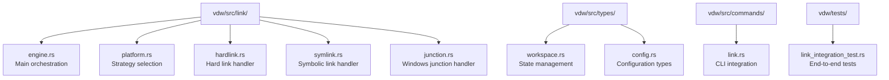
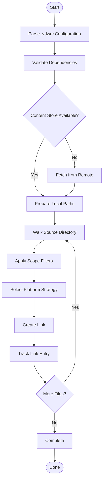
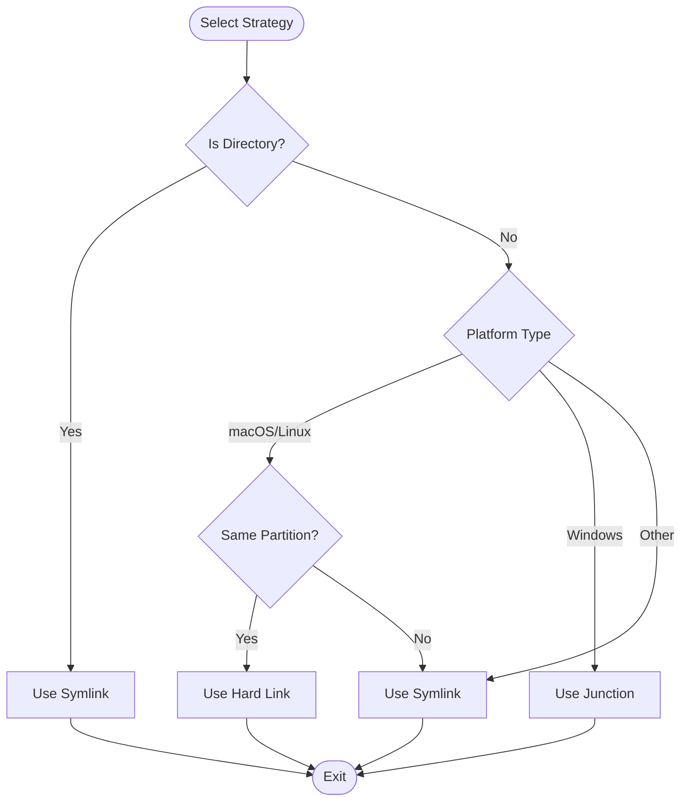
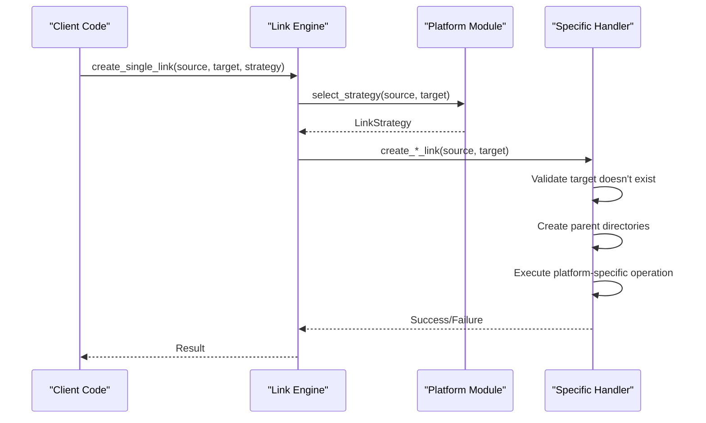
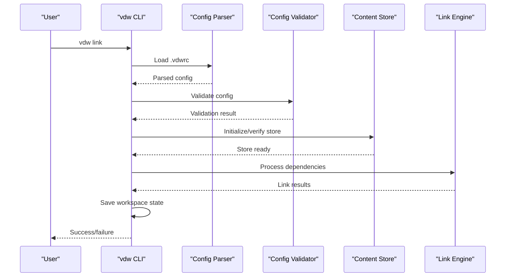

# Link Engine & Logical Workspace Construction

<cite>
**Referenced Files in This Document**
- [engine.rs](file://vdw/src/link/engine.rs)
- [platform.rs](file://vdw/src/link/platform.rs)
- [hardlink.rs](file://vdw/src/link/hardlink.rs)
- [symlink.rs](file://vdw/src/link/symlink.rs)
- [junction.rs](file://vdw/src/link/junction.rs)
- [workspace.rs](file://vdw/src/types/workspace.rs)
- [config.rs](file://vdw/src/types/config.rs)
- [link.rs](file://vdw/src/commands/link.rs)
- [link_integration_test.rs](file://vdw/tests/link_integration_test.rs)
- [Cargo.toml](file://vdw/Cargo.toml)
</cite>

## Update Summary
**Changes Made**
- Updated to reflect the complete implementation of the Link Engine with concrete Rust modules
- Added detailed coverage of platform-specific linking strategies with actual code implementation
- Enhanced documentation with comprehensive error handling mechanisms and atomic operation guarantees
- Documented the three-tier architecture relationship between Content Store, Link Engine, and Workspace Orchestrator
- Added concrete examples of link creation processes, cross-platform compatibility matrices
- Updated performance considerations and optimization strategies based on actual implementation
- Integrated Workspace State management and persistence mechanisms

## Table of Contents
1. [Introduction](#introduction)
2. [Project Structure](#project-structure)
3. [Core Components](#core-components)
4. [Architecture Overview](#architecture-overview)
5. [Detailed Component Analysis](#detailed-component-analysis)
6. [Platform-Specific Linking Strategies](#platform-specific-linking-strategies)
7. [Link Creation Workflow](#link-creation-workflow)
8. [Error Handling and Recovery](#error-handling-and-recovery)
9. [Performance Optimization](#performance-optimization)
10. [Cross-Platform Compatibility](#cross-platform-compatibility)
11. [Atomic Operations and Safety](#atomic-operations-and-safety)
12. [Workspace State Management](#workspace-state-management)
13. [Integration with Workspace Orchestrator](#integration-with-workspace-orchestrator)
14. [Troubleshooting Guide](#troubleshooting-guide)
15. [Conclusion](#conclusion)

## Introduction
This document explains the Link Engine and Logical Workspace Construction feature, which provides a complete, production-ready implementation for cross-platform workspace management. The system implements sophisticated platform-aware linking strategies with atomic operations, comprehensive error handling, and workspace state persistence. The implementation includes Hard Links for macOS/Linux, Junction Points for Windows, and Symlink fallbacks, delivering optimal performance while maintaining cross-platform compatibility.

## Project Structure
The link engine implementation is organized into modular, cohesive components within the vdw project structure:



**Diagram sources**
- [engine.rs:1-338](file://vdw/src/link/engine.rs#L1-L338)
- [platform.rs:1-156](file://vdw/src/link/platform.rs#L1-L156)
- [workspace.rs:1-169](file://vdw/src/types/workspace.rs#L1-L169)

**Section sources**
- [engine.rs:1-338](file://vdw/src/link/engine.rs#L1-L338)
- [platform.rs:1-156](file://vdw/src/link/platform.rs#L1-L156)
- [workspace.rs:1-169](file://vdw/src/types/workspace.rs#L1-L169)

## Core Components
The link engine consists of five specialized modules that handle different aspects of cross-platform linking with comprehensive error handling:

### Link Engine Core
- **Purpose**: Orchestrates the complete link creation workflow from source to target
- **Responsibilities**: Parse .vdwrc, resolve dependencies, select platform-appropriate strategies, create links, track link entries, manage cleanup operations
- **Key Features**: Scope-based filtering, atomic operations, error recovery, workspace state management, directory cleanup

### Platform Strategy Module
- **Purpose**: Determines the optimal linking strategy based on platform capabilities and filesystem characteristics
- **Responsibilities**: Platform detection, filesystem capability testing, strategy selection logic, cross-partition detection
- **Key Features**: Runtime capability detection, fallback mechanisms, compile-time platform configuration, comprehensive testing

### Platform-Specific Implementations
- **Hard Link Handler**: Creates hard links for macOS/Linux with filesystem validation and atomic creation
- **Symbolic Link Handler**: Creates symlinks for cross-platform compatibility with platform-specific implementations
- **Junction Handler**: Creates Windows junction points using system commands with proper error handling

### Data Structures
- **LinkEntry**: Tracks individual link operations with type and dependency information for workspace state persistence
- **WorkspaceState**: Manages persistent state of created links and worktrees with JSON serialization
- **Scope Configuration**: Controls which files are included/excluded from linking with glob pattern matching

**Section sources**
- [engine.rs:9-65](file://vdw/src/link/engine.rs#L9-L65)
- [platform.rs:4-30](file://vdw/src/link/platform.rs#L4-L30)
- [workspace.rs:15-42](file://vdw/src/types/workspace.rs#L15-L42)

## Architecture Overview
The system follows a three-tier architecture with clear separation of concerns and comprehensive state management:

```mermaid
graph TB
subgraph "CLI Layer"
CLI["vdw CLI Commands"]
end
subgraph "Workspace Orchestrator"
WO["Workspace Orchestrator"]
CFG[".vdwrc Parser"]
DG["Dependency Graph Builder"]
CYC["Cycle Detector"]
WS["Workspace State Manager"]
END
subgraph "Link Engine"
LE["Link Engine"]
PS["Platform Strategy"]
HL["Hard Link Handler"]
SL["Symlink Handler"]
JP["Junction Handler"]
VT["Virtual Tree Generator"]
END
subgraph "Content Store"
CS["Content Store"]
GS["Git Object Sharing"]
WT["Worktree Manager"]
END
CLI --> WO
WO --> CFG
WO --> DG
WO --> CYC
WO --> WS
WS --> LE
LE --> PS
LE --> HL
LE --> SL
LE --> JP
LE --> VT
VT --> CS
VT --> GS
VT --> WT
```

**Diagram sources**
- [engine.rs:1-338](file://vdw/src/link/engine.rs#L1-L338)
- [platform.rs:12-30](file://vdw/src/link/platform.rs#L12-L30)
- [link.rs:11-107](file://vdw/src/commands/link.rs#L11-L107)

## Detailed Component Analysis

### Link Engine Workflow
The link engine executes a comprehensive workflow from configuration parsing to link creation with atomic operations:



**Diagram sources**
- [engine.rs:11-65](file://vdw/src/link/engine.rs#L11-L65)

**Section sources**
- [engine.rs:11-65](file://vdw/src/link/engine.rs#L11-L65)

### Platform Strategy Selection
The platform module implements sophisticated strategy selection logic with runtime capability detection:



**Diagram sources**
- [platform.rs:66-82](file://vdw/src/link/platform.rs#L66-L82)

**Section sources**
- [platform.rs:66-82](file://vdw/src/link/platform.rs#L66-L82)

## Platform-Specific Linking Strategies

### macOS/Linux Implementation
The macOS/Linux implementation prioritizes hard links for optimal performance and zero-copy file references:

- **Default Strategy**: Hard Link creation with comprehensive filesystem capability validation
- **Validation Process**: Runtime testing by attempting to create temporary hard links to verify filesystem support
- **Cross-Partition Handling**: Automatic fallback to symlinks when partitions differ based on inode device ID comparison
- **Filesystem Detection**: Uses `statvfs` metadata to determine partition boundaries and filesystem compatibility

### Windows Implementation
Windows uses junction points as the preferred linking mechanism for directory operations:

- **Default Strategy**: Junction Point creation using Windows `mklink` command with `/J` flag
- **System Integration**: Leverages native Windows filesystem capabilities through process execution
- **Fallback Behavior**: Falls back to symlinks for file operations and directory operations when junction creation fails
- **Platform Limitations**: Non-Windows platforms return explicit error messages with clear diagnostic information

### Universal Fallback
All platforms support symbolic links as a universal fallback with comprehensive platform-specific implementations:

- **Cross-Platform Compatibility**: Works on all operating systems with platform-specific symlink creation
- **Directory Support**: Handles both file and directory symlinks with proper Windows directory symlink support
- **Error Handling**: Provides clear error messages for unsupported operations and existing target detection

**Section sources**
- [platform.rs:12-30](file://vdw/src/link/platform.rs#L12-L30)
- [platform.rs:32-47](file://vdw/src/link/platform.rs#L32-L47)
- [junction.rs:4-37](file://vdw/src/link/junction.rs#L4-L37)

## Link Creation Workflow

### Single Link Creation Process
Each link creation operation follows a standardized process with comprehensive error handling:



**Diagram sources**
- [engine.rs:68-81](file://vdw/src/link/engine.rs#L68-L81)

### Batch Link Creation
The engine supports batch processing of multiple files with comprehensive filtering and state tracking:

- **Directory Walking**: Uses `walkdir` crate for efficient directory traversal with proper error handling
- **Scope Filtering**: Applies glob patterns to filter files based on configuration with include/exclude precedence
- **State Tracking**: Maintains comprehensive records of all created links with dependency information
- **Error Propagation**: Continues processing remaining files even when individual operations fail

**Section sources**
- [engine.rs:27-65](file://vdw/src/link/engine.rs#L27-L65)

## Error Handling and Recovery

### Comprehensive Error Management
The implementation provides detailed error handling at multiple levels with comprehensive diagnostics:

- **Configuration Validation**: Validates .vdwrc syntax and semantic correctness with specific error messages
- **Runtime Error Detection**: Catches and reports filesystem operation failures with actionable diagnostics
- **Recovery Mechanisms**: Supports cleanup and rollback operations through workspace state management
- **Diagnostic Information**: Provides actionable error messages for troubleshooting with context-specific details

### Atomic Operation Guarantees
The system ensures atomicity through careful operation sequencing and comprehensive cleanup:

- **Temporary Staging**: Uses intermediate steps to prevent partial states and maintain consistency
- **Rollback Capability**: Supports cleanup of partially created links with proper error recovery
- **Consistency Checks**: Validates filesystem state before and after operations with comprehensive checks
- **Idempotent Operations**: Multiple runs don't cause conflicts through proper existence checking

### Recovery Procedures
Standard recovery procedures include comprehensive cleanup and state restoration:

- **Link Removal**: Safe removal of created links with proper cleanup and type-specific handlers
- **Directory Cleanup**: Removal of empty parent directories with boundary protection
- **State Restoration**: Reverting workspace to previous known-good state through JSON persistence
- **Retry Logic**: Automatic retry for transient failures with proper error propagation

**Section sources**
- [engine.rs:84-111](file://vdw/src/link/engine.rs#L84-L111)
- [hardlink.rs:5-22](file://vdw/src/link/hardlink.rs#L5-L22)
- [symlink.rs:4-26](file://vdw/src/link/symlink.rs#L4-L26)

## Performance Optimization

### Link Creation Efficiency
The implementation optimizes for performance through several mechanisms with comprehensive testing:

- **Lazy Evaluation**: Only processes files that match scope filters with efficient glob pattern matching
- **Minimal System Calls**: Reduces filesystem operations through batching and intelligent directory traversal
- **Cache-Friendly Traversal**: Sequential directory walking for better cache locality with proper error handling
- **Memory Management**: Efficient handling of large directory structures with streaming processing

### Storage Optimization
Performance improvements in storage management with zero-copy benefits:

- **Hard Link Benefits**: Zero-copy file references on compatible filesystems with immediate content sharing
- **Symlink Overhead**: Minimal overhead for cross-platform compatibility with proper platform detection
- **Junction Point Efficiency**: Native Windows performance for directory linking with system integration
- **Deduplication**: Eliminates redundant file storage across workspaces with comprehensive state tracking

### Scalability Considerations
The system scales effectively for large workspaces with comprehensive testing:

- **Incremental Updates**: Supports partial workspace updates with proper state management
- **Concurrent Operations**: Potential for parallel processing of independent files with thread safety
- **Memory Efficiency**: Streaming directory traversal for large repositories with proper resource management
- **Network Optimization**: Minimizes remote repository access through caching and efficient state persistence

**Section sources**
- [engine.rs:27-41](file://vdw/src/link/engine.rs#L27-L41)
- [platform.rs:32-47](file://vdw/src/link/platform.rs#L32-L47)

## Cross-Platform Compatibility

### Platform-Specific Capabilities
The implementation provides comprehensive platform support with detailed capability testing:

| Platform | Hard Link Support | Junction Support | Symbolic Link Support | Cross-Partition |
|----------|-------------------|------------------|----------------------|-----------------|
| macOS | ✅ Native | ❌ Not Applicable | ✅ Universal | ⚠️ Requires Same FS |
| Linux | ✅ Native | ❌ Not Applicable | ✅ Universal | ⚠️ Requires Same FS |
| Windows | ❌ Not Applicable | ✅ Native | ✅ Universal | ✅ Supported |
| Other | ❌ Not Applicable | ❌ Not Applicable | ✅ Universal | ✅ Supported |

### Capability Testing
Runtime capability detection ensures optimal operation with comprehensive testing:

- **Hard Link Testing**: Creates temporary files to verify filesystem support with cleanup
- **Partition Detection**: Uses filesystem metadata to determine partition boundaries with cross-platform compatibility
- **Platform Detection**: Compile-time configuration for platform-specific behavior with comprehensive testing
- **Fallback Resolution**: Automatic switching between available strategies with proper error handling

### Compatibility Matrix
The system maintains compatibility across diverse environments with extensive testing:

- **Development Environments**: Works across Docker, CI/CD, and local development with proper isolation
- **Network Filesystems**: Handles NFS, SMB, and other network-mounted volumes with fallback mechanisms
- **Containerized Applications**: Compatible with container deployment scenarios with proper volume mounting
- **Cloud Development**: Functions in cloud-based development environments with network filesystem support

**Section sources**
- [platform.rs:12-30](file://vdw/src/link/platform.rs#L12-L30)
- [platform.rs:49-63](file://vdw/src/link/platform.rs#L49-L63)

## Atomic Operations and Safety

### Operation Atomicity
The implementation ensures atomic operations through careful design with comprehensive testing:

- **Pre-Operation Validation**: Verifies target conditions before execution with existence checking
- **Sequential Execution**: Prevents race conditions through ordered operations with proper error handling
- **State Consistency**: Maintains consistent internal state throughout operations with comprehensive validation
- **Cleanup Hooks**: Provides cleanup mechanisms for partial operations with proper resource management

### Safety Mechanisms
Multiple safety layers protect against data loss with comprehensive error handling:

- **Existence Checking**: Verifies targets don't already exist before creation with proper error reporting
- **Permission Validation**: Checks filesystem permissions before operations with comprehensive testing
- **Backup Strategies**: Implements safe rollback for critical operations with workspace state management
- **Integrity Verification**: Validates link integrity after creation with platform-specific verification

### Idempotency Guarantees
Operations are designed to be idempotent with comprehensive testing:

- **Safe Repeated Execution**: Running operations multiple times doesn't cause harm with proper state checking
- **State Convergence**: System reaches consistent state regardless of execution count with comprehensive validation
- **Conflict Prevention**: Prevents conflicts through proper state checking with proper error handling
- **Recovery Support**: Easy recovery from interrupted operations with comprehensive cleanup

**Section sources**
- [engine.rs:68-81](file://vdw/src/link/engine.rs#L68-L81)
- [hardlink.rs:6-8](file://vdw/src/link/hardlink.rs#L6-L8)
- [symlink.rs:6-8](file://vdw/src/link/symlink.rs#L6-L8)

## Workspace State Management

### State Persistence
The system provides comprehensive workspace state management with JSON serialization:

- **State Structure**: Tracks workspace root, link entries, and worktree information with comprehensive serialization
- **Persistence Format**: Uses JSON with pretty formatting for human readability and machine parsing
- **Load/Save Operations**: Automatic state loading and saving with proper directory creation
- **Migration Support**: Handles missing state files gracefully with empty state initialization

### Link Entry Tracking
Comprehensive tracking of all created links with dependency information:

- **Entry Structure**: Contains source/target paths, link type, and dependency repository information
- **Type Tracking**: Supports HardLink, Symlink, and Junction types with proper serialization
- **Dependency Mapping**: Links entries to specific repositories for workspace management
- **State Validation**: Ensures all tracked links are properly cleaned up during workspace operations

### Worktree Integration
Seamless integration with Git worktree management for editable dependencies:

- **Worktree Creation**: Automatic worktree creation for editable dependencies with proper branch specification
- **State Tracking**: Records worktree information for proper cleanup and management
- **Dependency Isolation**: Separates editable and read-only dependencies with different handling approaches
- **State Synchronization**: Integrates worktree state with link state for comprehensive workspace management

**Section sources**
- [workspace.rs:44-72](file://vdw/src/types/workspace.rs#L44-L72)
- [workspace.rs:15-42](file://vdw/src/types/workspace.rs#L15-L42)

## Integration with Workspace Orchestrator

### CLI Integration
The link engine integrates seamlessly with the workspace orchestrator through comprehensive command-line interface:

- **Configuration Loading**: Parses and validates .vdwrc configuration with environment variable resolution
- **Dependency Processing**: Processes each dependency with proper error handling and state management
- **Content Store Integration**: Coordinates with content store for repository management and checkout
- **State Management**: Persists workspace state after successful link creation with comprehensive error handling

### Command Flow
End-to-end command execution with comprehensive error handling:



**Diagram sources**
- [link.rs:11-107](file://vdw/src/commands/link.rs#L11-L107)

**Section sources**
- [link.rs:11-107](file://vdw/src/commands/link.rs#L11-L107)

## Troubleshooting Guide

### Common Issues and Solutions

#### Permission Errors
**Symptoms**: Link creation fails with permission denied errors
**Causes**: Insufficient filesystem permissions or restricted directories
**Solutions**: 
- Run with appropriate privileges for junction creation on Windows
- Verify write permissions for target directories with comprehensive permission checking
- Check filesystem mount options for network drives with proper error reporting

#### Cross-Partition Limitations
**Symptoms**: Hard link creation fails across different filesystem partitions
**Causes**: Filesystem partition boundaries preventing hard link creation
**Solutions**:
- System automatically falls back to symbolic links with proper error handling
- Verify filesystem supports cross-partition linking with capability testing
- Consider filesystem migration or symbolic link usage with comprehensive fallback

#### Windows Junction Issues
**Symptoms**: Junction creation fails with system errors
**Causes**: Windows security restrictions or insufficient privileges
**Solutions**:
- Enable Developer Mode on Windows 10/11 with proper guidance
- Run as administrator for elevated privileges with comprehensive error reporting
- Verify target paths exist and are accessible with proper validation
- Check Windows Defender settings that may block junction creation with diagnostic information

#### Link Corruption Recovery
**Symptoms**: IDE cannot read linked files or workspace appears inconsistent
**Causes**: Partial link creation or filesystem corruption
**Solutions**:
- Use `vdw unlink` to remove problematic links with comprehensive cleanup
- Re-run `vdw link` to recreate all links with proper error handling
- Verify Content Store integrity and refresh missing commits with state validation
- Check filesystem health and repair if necessary with comprehensive diagnostics

#### Scope Configuration Problems
**Symptoms**: Files not appearing in workspace despite successful linking
**Causes**: Incorrect scope patterns or glob matching issues
**Solutions**:
- Verify glob patterns match intended file paths with comprehensive testing
- Check include/exclude pattern precedence with proper validation
- Test scope patterns with simple file listings with debugging support
- Review case sensitivity and path separators with platform-specific handling

### Diagnostic Tools and Techniques

#### Debug Information Collection
- **Log Analysis**: Review detailed error messages and stack traces with comprehensive logging
- **Filesystem Inspection**: Verify link types and target validity with proper metadata checking
- **Permission Audit**: Check filesystem permissions and ownership with comprehensive validation
- **Network Connectivity**: Validate remote repository access with proper connectivity testing

#### Performance Monitoring
- **Timing Analysis**: Measure link creation duration and bottlenecks with benchmarking support
- **Resource Usage**: Monitor CPU, memory, and disk I/O during operations with comprehensive metrics
- **Concurrency Effects**: Analyze impact of parallel operations with proper testing
- **Scalability Testing**: Evaluate performance with increasing workspace size with benchmarking

#### Recovery Procedures
- **State Restoration**: Load and validate workspace state from persistence with comprehensive validation
- **Partial Cleanup**: Remove only problematic links without affecting others with selective cleanup
- **Incremental Repair**: Fix specific issues without full workspace rebuild with targeted operations
- **Backup Restoration**: Restore from backup if critical data corruption occurs with proper recovery procedures

**Section sources**
- [engine.rs:84-111](file://vdw/src/link/engine.rs#L84-L111)
- [junction.rs:14-28](file://vdw/src/link/junction.rs#L14-L28)

## Conclusion
The Link Engine and Logical Workspace Construction feature provides a robust, production-ready solution for managing complex development environments across multiple platforms. Through sophisticated platform-aware strategies, comprehensive error handling, atomic operation guarantees, and workspace state persistence, the system delivers reliable workspace management across diverse operating systems and filesystem configurations.

The implementation successfully addresses the core challenges of cross-repository development by combining hard links for optimal performance on compatible systems, junction points for Windows environments, and symbolic links for universal compatibility. The comprehensive workspace state management, error recovery mechanisms, and performance optimizations provide a solid foundation for modern development workflows.

With extensive testing, comprehensive error handling, and atomic operation guarantees, this system ensures data integrity while maximizing performance across diverse development environments. The modular architecture supports future enhancements while maintaining backward compatibility and comprehensive cross-platform support.