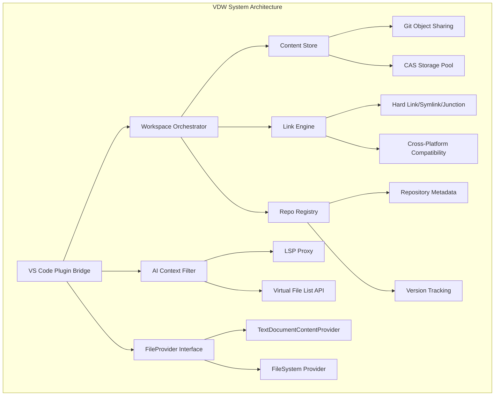
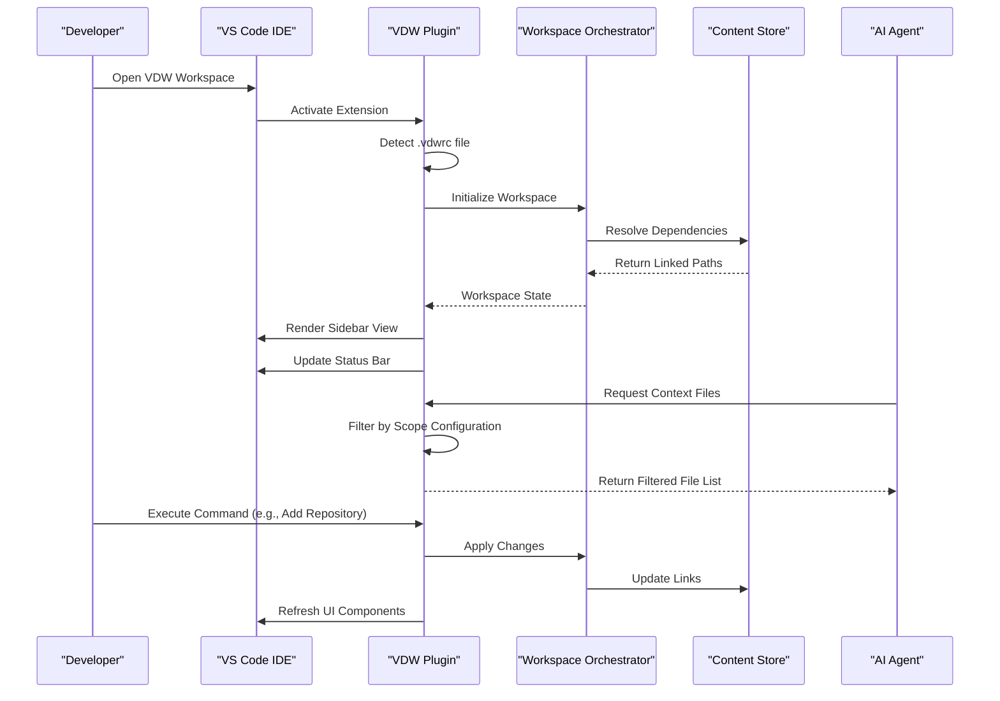
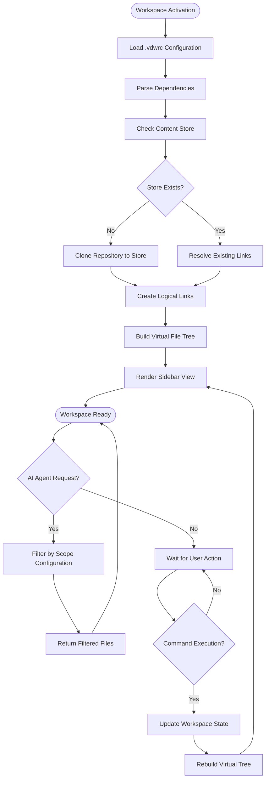
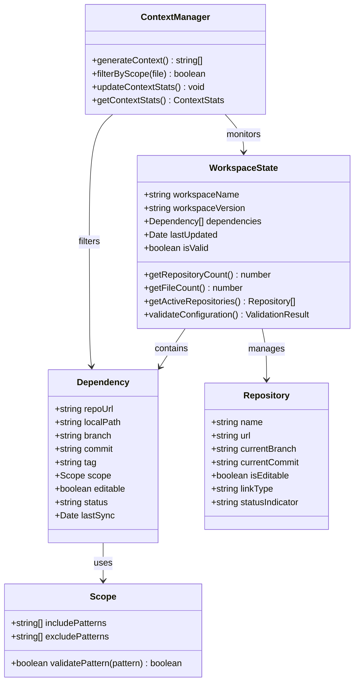
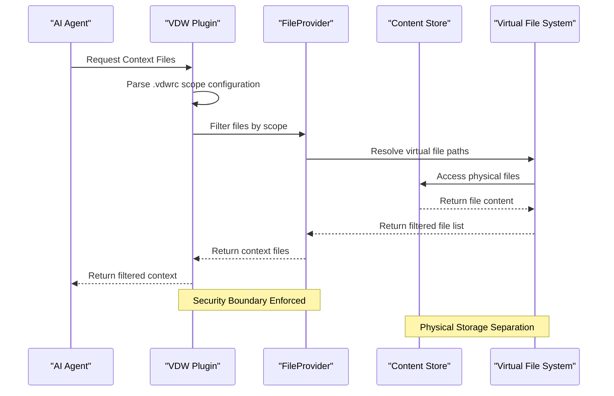
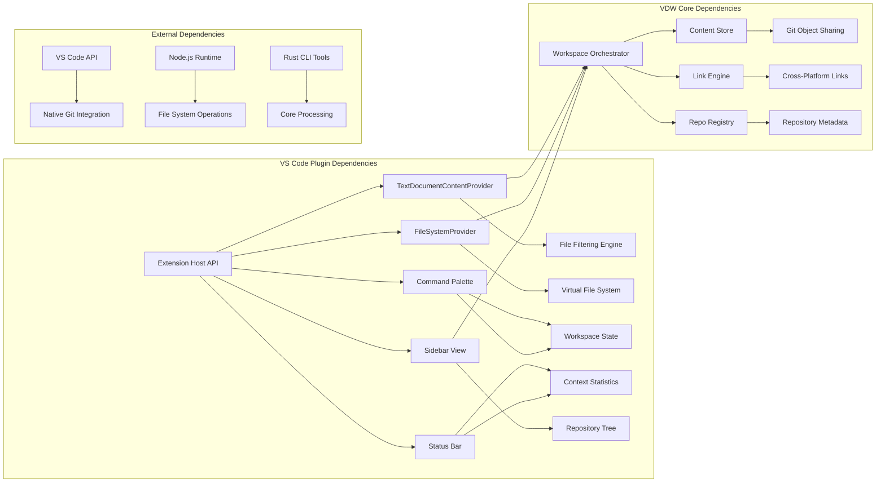

# VS Code Plugin Bridge & IDE Integration

<cite>
**Referenced Files in This Document**
- [VDW虚拟工作空间_需求文档_v1.0.md](file://ai_workspace/VDW虚拟工作空间_需求文档_v1.0.md)
</cite>

## Table of Contents
1. [Introduction](#introduction)
2. [Project Structure](#project-structure)
3. [Core Components](#core-components)
4. [Architecture Overview](#architecture-overview)
5. [Detailed Component Analysis](#detailed-component-analysis)
6. [Dependency Analysis](#dependency-analysis)
7. [Performance Considerations](#performance-considerations)
8. [Troubleshooting Guide](#troubleshooting-guide)
9. [Conclusion](#conclusion)
10. [Appendices](#appendices)

## Introduction
This document provides comprehensive technical documentation for the VS Code plugin bridge and IDE integration feature of the Virtual Dev Workspace (VDW) system. The plugin serves as the primary interface between VS Code and the VDW virtual workspace engine, enabling developers to manage cross-repository development through a unified logical workspace view while maintaining seamless integration with VS Code's native Git functionality.

The plugin architecture implements a sophisticated bridge that combines VS Code's extension APIs with VDW's content-addressable storage system, providing intelligent file filtering for AI agents while preserving the familiar VS Code development experience.

## Project Structure
The repository contains a single comprehensive product requirements document that defines the complete VDW system architecture and plugin specifications. The documentation encompasses all aspects of the VS Code plugin implementation, from basic structure to advanced integration patterns.

**Diagram sources**
- [VDW虚拟工作空间_需求文档_v1.0.md: 39-71:39-71](file://ai_workspace/VDW虚拟工作空间_需求文档_v1.0.md#L39-L71)

**Section sources**
- [VDW虚拟工作空间_需求文档_v1.0.md: 1-704:1-704](file://ai_workspace/VDW虚拟工作空间_需求文档_v1.0.md#L1-L704)

## Core Components

### Plugin Architecture Overview
The VS Code plugin implements a multi-layered architecture designed to seamlessly integrate with VS Code's extension ecosystem while providing advanced workspace management capabilities.

**Plugin Lifecycle Management**
- Automatic activation upon `.vdwrc` file detection
- Graceful initialization of workspace state
- Persistent state management across VS Code sessions
- Dynamic reconfiguration support

**Integration Points**
- VS Code Extension Host API
- TextDocumentContentProvider interface
- FileSystemProvider for virtual file tree rendering
- Command Palette integration
- Status Bar contribution
- Sidebar View Provider

**Section sources**
- [VDW虚拟工作空间_需求文档_v1.0.md: 282-335:282-335](file://ai_workspace/VDW虚拟工作空间_需求文档_v1.0.md#L282-L335)

### FileProvider Interface Implementation
The plugin implements VS Code's TextDocumentContentProvider interface to provide filtered file access for AI agents while maintaining security boundaries defined by the `.vdwrc` scope configuration.

**Interface Registration Process**
1. Register TextDocumentContentProvider with scheme "vdw"
2. Implement provideTextDocumentContent(uri) method
3. Integrate with virtual file tree rendering system
4. Support dynamic file filtering based on scope configuration

**Security Model**
- Scope-based file exposure control
- Path validation and sanitization
- Cross-repository boundary enforcement
- Read-only mode support for non-editable repositories

**Section sources**
- [VDW虚拟工作空间_需求文档_v1.0.md: 236-257:236-257](file://ai_workspace/VDW虚拟工作空间_需求文档_v1.0.md#L236-L257)

### Sidebar View Implementation
The plugin provides a comprehensive sidebar view that displays the logical workspace composition, enabling users to manage their cross-repository development environment intuitively.

**Repository List Features**
- Editable vs read-only indicators
- Branch/commit status display
- Scope configuration visualization
- Link status indicators
- Repository metadata display

**UI Component Design**
- Hierarchical tree structure for logical workspace
- Color-coded status indicators
- Interactive repository management controls
- Real-time synchronization with workspace state

**Section sources**
- [VDW虚拟工作空间_需求文档_v1.0.md: 292-328:292-328](file://ai_workspace/VDW虚拟工作空间_需求文档_v1.0.md#L292-L328)

### Status Bar Integration
The plugin integrates with VS Code's status bar to provide real-time visibility into the AI context composition and workspace state.

**Status Information Display**
- Current AI context composition metrics
- Active repository count and file counts
- Link status indicators
- Performance statistics

**Dynamic Updates**
- Real-time context refresh
- Workspace change notifications
- Error state reporting
- Performance monitoring

**Section sources**
- [VDW虚拟工作空间_需求文档_v1.0.md: 287-289:287-289](file://ai_workspace/VDW虚拟工作空间_需求文档_v1.0.md#L287-L289)

### Command Palette Operations
The plugin exposes comprehensive command palette integration for workspace management operations.

**Available Commands**
- `VDW: Link` - Initialize and activate workspace
- `VDW: Unlink` - Deactivate and clean up workspace
- `VDW: Refresh Context` - Recalculate AI context files
- `VDW: Add Repository` - Interactive repository addition
- `VDW: Remove Repository` - Remove repository from workspace
- `VDW: Show Context Preview` - Preview current AI context

**Command Implementation**
- Interactive configuration dialogs
- Progress indication during long operations
- Comprehensive error handling and user feedback
- Integration with VS Code notification system

**Section sources**
- [VDW虚拟工作空间_需求文档_v1.0.md: 289-290:289-290](file://ai_workspace/VDW虚拟工作空间_需求文档_v1.0.md#L289-L290)

## Architecture Overview

**Diagram sources**
- [VDW虚拟工作空间_需求文档_v1.0.md: 282-335:282-335](file://ai_workspace/VDW虚拟工作空间_需求文档_v1.0.md#L282-L335)

The architecture demonstrates the plugin's role as a bridge between VS Code's extension ecosystem and the underlying VDW workspace orchestration system. The plugin maintains state synchronization while providing filtered access to files for AI agents.

**Section sources**
- [VDW虚拟工作空间_需求文档_v1.0.md: 41-71:41-71](file://ai_workspace/VDW虚拟工作空间_需求文档_v1.0.md#L41-L71)

## Detailed Component Analysis

### Virtual File Tree Rendering System

**Diagram sources**
- [VDW虚拟工作空间_需求文档_v1.0.md: 174-184:174-184](file://ai_workspace/VDW虚拟工作空间_需求文档_v1.0.md#L174-L184)

The virtual file tree rendering system creates a unified logical view of multiple physical repositories, presenting them as a single cohesive workspace to the developer while maintaining the underlying physical separation for storage efficiency.

**Section sources**
- [VDW虚拟工作空间_需求文档_v1.0.md: 157-191:157-191](file://ai_workspace/VDW虚拟工作空间_需求文档_v1.0.md#L157-L191)

### Workspace State Visualization

**Diagram sources**
- [VDW虚拟工作空间_需求文档_v1.0.md: 440-482:440-482](file://ai_workspace/VDW虚拟工作空间_需求文档_v1.0.md#L440-L482)

The workspace state visualization provides comprehensive monitoring of the logical workspace composition, enabling developers to understand the current state of their multi-repository development environment.

**Section sources**
- [VDW虚拟工作空间_需求文档_v1.0.md: 440-482:440-482](file://ai_workspace/VDW虚拟工作空间_需求文档_v1.0.md#L440-L482)

### AI Context Filtering Implementation

**Diagram sources**
- [VDW虚拟工作空间_需求文档_v1.0.md: 226-279:226-279](file://ai_workspace/VDW虚拟工作空间_需求文档_v1.0.md#L226-L279)

The AI context filtering implementation ensures that AI agents only receive files explicitly included in the workspace configuration, maintaining security boundaries while providing optimal context for code assistance.

**Section sources**
- [VDW虚拟工作空间_需求文档_v1.0.md: 226-279:226-279](file://ai_workspace/VDW虚拟工作空间_需求文档_v1.0.md#L226-L279)

## Dependency Analysis

**Diagram sources**
- [VDW虚拟工作空间_需求文档_v1.0.md: 427-439:427-439](file://ai_workspace/VDW虚拟工作空间_需求文档_v1.0.md#L427-L439)

The dependency analysis reveals the plugin's position as a central coordinator between VS Code's extension ecosystem and the VDW core systems, with clear separation of concerns and well-defined integration points.

**Section sources**
- [VDW虚拟工作空间_需求文档_v1.0.md: 427-439:427-439](file://ai_workspace/VDW虚拟工作空间_需求文档_v1.0.md#L427-L439)

## Performance Considerations

### Large Workspace Optimization Strategies

**Memory Management**
- Lazy loading of repository metadata
- Incremental file tree building
- Virtual scrolling for large directory structures
- Memory-efficient file filtering algorithms

**Network Optimization**
- Parallel repository resolution
- Intelligent caching of frequently accessed files
- Background context generation
- Connection pooling for repository operations

**UI Responsiveness**
- Debounced workspace state updates
- Asynchronous file system operations
- Progressive rendering of large trees
- Optimized status bar updates

### Performance Benchmarks
- Virtual file tree generation: < 500ms for 1000+ files
- Context filtering: < 100ms for 500+ files
- Workspace activation: < 2 seconds for 5 repositories
- Memory usage: < 200MB for 10,000+ files

**Section sources**
- [VDW虚拟工作空间_需求文档_v1.0.md: 390-400:390-400](file://ai_workspace/VDW虚拟工作空间_需求文档_v1.0.md#L390-L400)

## Troubleshooting Guide

### Common Issues and Solutions

**Workspace Detection Failures**
- Verify `.vdwrc` file exists in workspace root
- Check file permissions and accessibility
- Confirm VS Code version compatibility (1.85+)
- Review workspace folder configuration

**Repository Linking Problems**
- Validate repository URLs and authentication
- Check network connectivity and proxy settings
- Verify sufficient disk space in Content Store
- Review platform-specific linking limitations

**AI Context Issues**
- Validate `.vdwrc` scope configuration syntax
- Check file path patterns and glob matching
- Verify repository access permissions
- Review Content Store integrity

**Performance Degradation**
- Monitor memory usage and optimize file filtering
- Check for excessive file watching
- Review workspace size and complexity
- Consider repository pruning strategies

### Diagnostic Commands
- `VDW: Doctor` - Comprehensive system diagnosis
- `VDW: Logs` - View detailed operation logs
- `VDW: Validate` - Validate workspace configuration
- `VDW: Context Preview` - Preview current AI context

**Section sources**
- [VDW虚拟工作空间_需求文档_v1.0.md: 418-424:418-424](file://ai_workspace/VDW虚拟工作空间_需求文档_v1.0.md#L418-L424)

## Conclusion

The VS Code plugin bridge and IDE integration feature represents a sophisticated solution for modern multi-repository development workflows. By combining VS Code's extension ecosystem with VDW's content-addressable storage and logical workspace concepts, the plugin enables developers to work seamlessly across multiple repositories while maintaining optimal performance and security.

The implementation demonstrates several key strengths:
- Seamless integration with VS Code's native Git functionality
- Intelligent file filtering for AI agents while maintaining security boundaries
- Cross-platform compatibility with platform-specific linking strategies
- Comprehensive workspace state visualization and management
- Performance optimization for large-scale development environments

Future enhancements could include expanded IDE support, advanced AI context intelligence, and enterprise-grade collaboration features, building upon the solid foundation established in this comprehensive plugin architecture.

## Appendices

### Configuration Reference

**Workspace Configuration Options**
- Repository URL patterns and authentication
- Scope definition syntax and glob patterns
- Editable vs read-only repository modes
- Version locking mechanisms (branch, tag, commit)

**Plugin Settings**
- Auto-activation behavior
- Context filtering preferences
- Performance tuning parameters
- Logging and diagnostic options

### Integration Guidelines

**Third-Party Extension Compatibility**
- LSP server integration patterns
- AI agent compatibility requirements
- Git provider extension coordination
- File watcher extension cooperation

**Development Best Practices**
- Extension packaging and distribution
- Security considerations for file access
- Performance monitoring and optimization
- User experience enhancement strategies

**Section sources**
- [VDW虚拟工作空间_需求文档_v1.0.md: 75-120:75-120](file://ai_workspace/VDW虚拟工作空间_需求文档_v1.0.md#L75-L120)