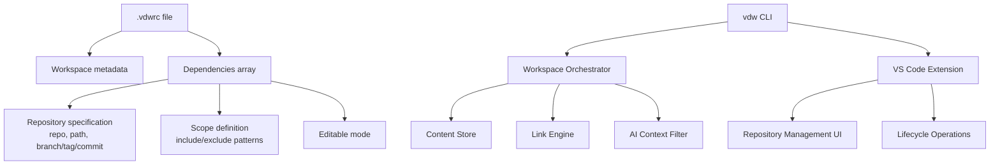
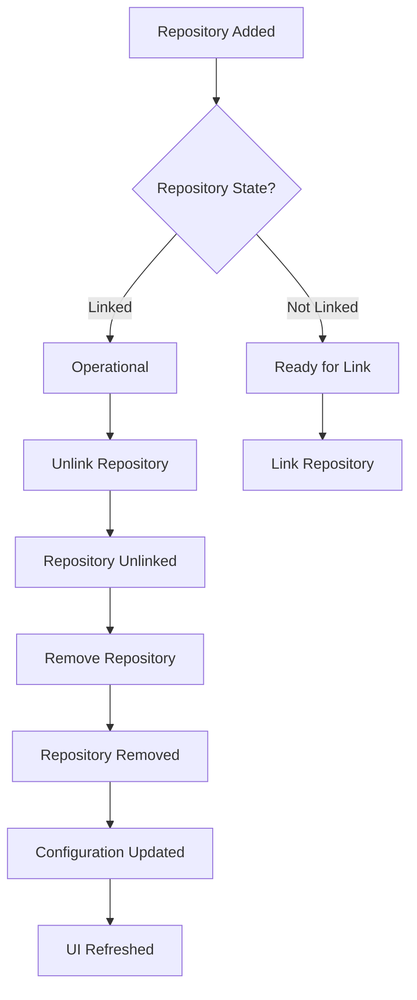
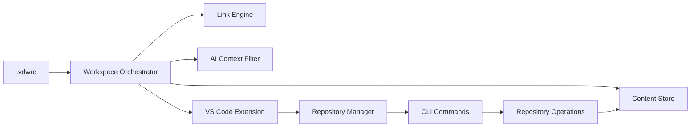

# Workspace Configuration Management (.vdwrc)

<cite>
**Referenced Files in This Document**
- [main.rs](file://vdw/src/main.rs)
- [init.rs](file://vdw/src/commands/init.rs)
- [parser.rs](file://vdw/src/config/parser.rs)
- [validator.rs](file://vdw/src/config/validator.rs)
- [config.rs](file://vdw/src/types/config.rs)
- [doctor.rs](file://vdw/src/commands/doctor.rs)
- [env_resolver.rs](file://vdw/src/config/env_resolver.rs)
- [sample.vdwrc](file://vdw/tests/fixtures/sample.vdwrc)
- [VDW虚拟工作空间_需求文档_v1.0.md](file://ai_workspace/VDW虚拟工作空间_需求文档_v1.0.md)
- [repo.rs](file://vdw/src/commands/repo.rs)
- [link.rs](file://vdw/src/commands/link.rs)
- [worktree.rs](file://vdw/src/commands/worktree.rs)
- [index.ts](file://vdw-vscode/src/commands/index.ts)
- [addRepo.ts](file://vdw-vscode/src/commands/addRepo.ts)
- [workspaceTreeView.ts](file://vdw-vscode/src/providers/workspaceTreeView.ts)
- [vdwCliService.ts](file://vdw-vscode/src/services/vdwCliService.ts)
- [extension.ts](file://vdw-vscode/src/extension.ts)
- [package.json](file://vdw-vscode/package.json)
- [glob_matcher.rs](file://vdw/src/context/glob_matcher.rs)
- [filter.rs](file://vdw/src/context/filter.rs)
</cite>

## Update Summary
**Changes Made**
- Enhanced repository lifecycle management with complete removal workflow from addition to removal
- Expanded VS Code context menu integration with dedicated "Remove Repository" action
- Improved scope pattern specification with comprehensive glob matching support
- Added repository removal command in CLI with proper cleanup procedures
- Updated workspace orchestration to support repository lifecycle operations

## Table of Contents
1. [Introduction](#introduction)
2. [Project Structure](#project-structure)
3. [Core Components](#core-components)
4. [Architecture Overview](#architecture-overview)
5. [Detailed Component Analysis](#detailed-component-analysis)
6. [Repository Lifecycle Management](#repository-lifecycle-management)
7. [VS Code Integration](#vs-code-integration)
8. [Dependency Analysis](#dependency-analysis)
9. [Performance Considerations](#performance-considerations)
10. [Troubleshooting Guide](#troubleshooting-guide)
11. [Conclusion](#conclusion)
12. [Appendices](#appendices)

## Introduction
This document explains the enhanced workspace configuration management feature centered around the .vdwrc configuration file. It covers the complete repository lifecycle from addition to removal, including the .vdwrc configuration file format, YAML/JSON parsing capabilities, workspace dependency declaration syntax, and the integration with the workspace orchestrator. The documentation now includes comprehensive coverage of repository removal workflows, improved scope pattern specification, and expanded VS Code context menu integration for seamless repository management.

## Project Structure
The repository contains a unified product requirements document and implementation that defines the complete .vdwrc configuration model, CLI commands, VS Code extension integration, and orchestration behavior. The .vdwrc file serves as the central declarative artifact that describes:
- Workspace metadata (name, version)
- Dependencies array with repository specification and version locking
- Scope definition with include/exclude patterns using glob syntax
- Editable mode settings for Git Worktree-based development
- Complete repository lifecycle management from addition to removal



**Diagram sources**
- [VDW虚拟工作空间_需求文档_v1.0.md:84-113](file://ai_workspace/VDW虚拟工作空间_需求文档_v1.0.md#L84-L113)
- [VDW虚拟工作空间_需求文档_v1.0.md:444-471](file://ai_workspace/VDW虚拟工作空间_需求文档_v1.0.md#L444-L471)
- [extension.ts:18-104](file://vdw-vscode/src/extension.ts#L18-L104)

**Section sources**
- [VDW虚拟工作空间_需求文档_v1.0.md:75-120](file://ai_workspace/VDW虚拟工作空间_需求文档_v1.0.md#L75-L120)
- [VDW虚拟工作空间_需求文档_v1.0.md:444-471](file://ai_workspace/VDW虚拟工作空间_需求文档_v1.0.md#L444-L471)

## Core Components
- .vdwrc configuration file: Declarative format (YAML/JSON) that defines workspace metadata and dependencies with complete lifecycle support
- Workspace metadata: name and version fields for the logical workspace
- Dependencies: Array of dependency entries with repository URL, local logical path, and version locking (branch, tag, commit)
- Scope: include/exclude patterns using glob syntax to control AI context exposure with comprehensive pattern matching
- Editable mode: Boolean flag enabling Git Worktree-based editable workspaces
- Environment variable substitution: Support for ${VAR} placeholders in configuration values
- vdw init command: Interactive workflow to generate .vdwrc with optional templates (default and fullstack)
- vdw validate command: Validates configuration syntax and detects dependency cycles
- Repository lifecycle: Complete management from addition to removal with proper cleanup procedures

**Section sources**
- [VDW虚拟工作空间_需求文档_v1.0.md:84-113](file://ai_workspace/VDW虚拟工作空间_需求文档_v1.0.md#L84-L113)
- [VDW虚拟工作空间_需求文档_v1.0.md:115-119](file://ai_workspace/VDW虚拟工作空间_需求文档_v1.0.md#L115-L119)
- [VDW虚拟工作空间_需求文档_v1.0.md:487-524](file://ai_workspace/VDW虚拟工作空间_需求文档_v1.0.md#L487-L524)

## Architecture Overview
The enhanced .vdwrc system drives the Workspace Orchestrator, which coordinates the complete repository lifecycle:
- Parsing and validating .vdwrc with comprehensive error reporting
- Resolving dependencies and version locks with proper cleanup
- Managing the Content Store and linking engine with lifecycle awareness
- Providing a virtual file list to the AI Context Filter with scope validation
- Supporting VS Code extension integration for UI-driven repository management

```mermaid
sequenceDiagram
participant U as "User"
participant VS as "VS Code Extension"
participant CLI as "vdw CLI"
participant ORCH as "Workspace Orchestrator"
participant STORE as "Content Store"
participant LINK as "Link Engine"
participant AI as "AI Context Filter"
U->>VS : Right-click dependency
VS->>VS : Show context menu with "Remove Repository"
U->>VS : Select "Remove Repository"
VS->>CLI : unlinkRepo(repoUrl)
CLI->>ORCH : Execute unlink operation
ORCH->>LINK : Remove physical links
LINK->>ORCH : Links removed
ORCH->>VS : Update UI state
VS->>VS : Remove from .vdwrc directly
VS->>VS : Refresh tree view and status
VS->>AI : Update context filtering
AI->>U : Updated AI context
```

**Diagram sources**
- [index.ts:299-381](file://vdw-vscode/src/commands/index.ts#L299-L381)
- [vdwCliService.ts:166-169](file://vdw-vscode/src/services/vdwCliService.ts#L166-L169)
- [link.rs:218-269](file://vdw/src/commands/link.rs#L218-L269)

## Detailed Component Analysis

### .vdwrc Configuration File Format
- Supported formats: YAML and JSON with dual extension support (.vdwrc and .vdwrc.yml)
- Root-level keys:
  - workspace: Contains name and version
  - dependencies: Array of dependency entries with complete lifecycle support

Key-value semantics:
- workspace.name: Human-readable workspace identifier
- workspace.version: Semantic version for the workspace
- dependencies[].repo: Remote Git repository URL or local file path
- dependencies[].path: Local logical path under the workspace root
- dependencies[].branch: Target branch for checkout
- dependencies[].tag: Tag to pin to
- dependencies[].commit: Specific commit to pin to
- dependencies[].scope.include: Glob patterns to include in AI context
- dependencies[].scope.exclude: Glob patterns to exclude from AI context
- dependencies[].editable: Boolean enabling editable workspaces via Git Worktree

Environment variable substitution:
- Values may reference environment variables using ${VAR} syntax
- Resolution occurs during configuration validation
- Sensitive tokens should be provided via environment variables rather than embedded in .vdwrc

**Updated** Enhanced with comprehensive environment variable resolution and improved template support

Validation rules:
- repo URL format must be valid (supports git@, https://, http://, or file paths)
- path uniqueness across dependencies must be enforced
- scope include/exclude patterns must be syntactically valid globs
- Version locking: branch, tag, and commit are mutually exclusive; only one should be present
- scope.include must contain at least one pattern

**Section sources**
- [VDW虚拟工作空间_需求文档_v1.0.md:84-113](file://ai_workspace/VDW虚拟工作空间_需求文档_v1.0.md#L84-L113)
- [VDW虚拟工作空间_需求文档_v1.0.md:115-119](file://ai_workspace/VDW虚拟工作空间_需求文档_v1.0.md#L115-L119)
- [VDW虚拟工作空间_需求文档_v1.0.md:487-524](file://ai_workspace/VDW虚拟工作空间_需求文档_v1.0.md#L487-L524)
- [VDW虚拟工作空间_需求文档_v1.0.md:444-471](file://ai_workspace/VDW虚拟工作空间_需求文档_v1.0.md#L444-L471)

### Configuration Structure Details
- Workspace metadata:
  - name: String
  - version: String
- Dependencies array:
  - Each entry includes:
    - repo: String (remote URL, file path, must start with 'git@', 'https://', 'http://', '/', './', or '../')
    - path: String (logical path)
    - branch: Optional<String>
    - tag: Optional<String>
    - commit: Optional<String>
    - scope: Object with include and exclude arrays (include must be non-empty)
    - editable: Boolean (defaults to false)
- Scope definition:
  - include: Array of glob patterns (at least one required)
  - exclude: Array of glob patterns
- Editable mode:
  - When true, enables Git Worktree-based editable workspace for the dependency

Best practices for scope definition:
- Prefer explicit include patterns to minimize context blast radius
- Use exclude patterns to suppress noise (e.g., node_modules, dist, test files)
- Keep include patterns precise to reduce AI indexing overhead

**Updated** Enhanced validation rules now require non-empty scope.include arrays

**Section sources**
- [VDW虚拟工作空间_需求文档_v1.0.md:444-471](file://ai_workspace/VDW虚拟工作空间_需求文档_v1.0.md#L444-L471)
- [VDW虚拟工作空间_需求文档_v1.0.md:94-96](file://ai_workspace/VDW虚拟工作空间_需求文档_v1.0.md#L94-L96)
- [VDW虚拟工作空间_需求文档_v1.0.md:103-105](file://ai_workspace/VDW虚拟工作空间_需求文档_v1.0.md#L103-L105)
- [VDW虚拟工作空间_需求文档_v1.0.md:110-112](file://ai_workspace/VDW虚拟工作空间_需求文档_v1.0.md#L110-L112)

### Concrete Configuration Scenarios
- Example 1: Branch-based dependency with include/exclude scope and editable enabled
- Example 2: Commit-based dependency with include scope and editable disabled
- Example 3: Tag-based dependency with include scope and editable enabled

These examples demonstrate repository specification with branch/tag/commit locking, scope definition with include/exclude patterns, and editable mode settings.

**Updated** All examples now include proper validation with non-empty scope.include arrays

**Section sources**
- [VDW虚拟工作空间_需求文档_v1.0.md:84-113](file://ai_workspace/VDW虚拟工作空间_需求文档_v1.0.md#L84-L113)
- [sample.vdwrc:1-25](file://vdw/tests/fixtures/sample.vdwrc#L1-L25)

### vdw Init Command Workflow
- Purpose: Interactive generation of .vdwrc with template support
- Options:
  - Default interactive mode with minimal template
  - Template selection: `--template fullstack` for comprehensive example
- Post-init steps:
  - Run vdw link to materialize dependencies
  - Verify with vdw validate and vdw context preview

**Updated** Enhanced with template support for faster workspace initialization

**Section sources**
- [VDW虚拟工作空间_需求文档_v1.0.md:487-524](file://ai_workspace/VDW虚拟工作空间_需求文档_v1.0.md#L487-L524)
- [VDW虚拟工作空间_需求文档_v1.0.md:564](file://ai_workspace/VDW虚拟工作空间_需求文档_v1.0.md#L564)
- [VDW虚拟工作空间_需求文档_v1.0.md:621](file://ai_workspace/VDW虚拟工作空间_需求文档_v1.0.md#L621)

### Configuration Validation Rules
- Syntax validation: YAML/JSON parsing success
- Structural validation: Presence of required fields and correct types
- Semantic validation:
  - repo URL validity (supports git@, https://, http://, or file paths)
  - path uniqueness across dependencies
  - scope include/exclude glob syntax correctness
  - Mutually exclusive version locking: branch vs. tag vs. commit
  - Non-empty scope.include requirement
- Dependency graph validation:
  - Detect cycles during resolution
  - Report dependency paths for cycle detection

**Updated** Enhanced validation with comprehensive error reporting and new requirements

**Section sources**
- [VDW虚拟工作空间_需求文档_v1.0.md:115-119](file://ai_workspace/VDW虚拟工作空间_需求文档_v1.0.md#L115-L119)
- [VDW虚拟工作空间_需求文档_v1.0.md:347-350](file://ai_workspace/VDW虚拟工作空间_需求文档_v1.0.md#L347-L350)
- [VDW虚拟工作空间_需求文档_v1.0.md:516-518](file://ai_workspace/VDW虚拟工作空间_需求文档_v1.0.md#L516-L518)

### Environment Variable Substitution
- Placeholders: ${VAR} syntax supported in configuration values
- Resolution process: Environment variables are resolved during validation
- Security: Use environment variables for sensitive values (e.g., tokens) instead of embedding in .vdwrc
- Error handling: Missing environment variables cause validation failures with specific error messages

**New** Added comprehensive environment variable substitution support

**Section sources**
- [VDW虚拟工作空间_需求文档_v1.0.md:118](file://ai_workspace/VDW虚拟工作空间_需求文档_v1.0.md#L118)
- [VDW虚拟工作空间_需求文档_v1.0.md:413](file://ai_workspace/VDW虚拟工作空间_需求文档_v1.0.md#L413)
- [env_resolver.rs:1-137](file://vdw/src/config/env_resolver.rs#L1-L137)

### Integration with the Workspace Orchestrator
- The orchestrator parses .vdwrc, validates it, and builds a dependency graph
- It ensures dependencies are fetched into the Content Store and linked into the logical workspace
- It provides a virtual file list to the AI Context Filter based on scope definitions
- Supports lifecycle operations including repository addition, linking, unlinking, and removal

**Updated** Enhanced integration with environment variable resolution and improved validation

**Section sources**
- [VDW虚拟工作空间_需求文档_v1.0.md:53-55](file://ai_workspace/VDW虚拟工作空间_需求文档_v1.0.md#L53-L55)
- [VDW虚拟工作空间_需求文档_v1.0.md:230-234](file://ai_workspace/VDW虚拟工作空间_需求文档_v1.0.md#L230-L234)

## Repository Lifecycle Management

### Complete Repository Lifecycle
The enhanced system now supports the complete repository lifecycle from creation to removal:

1. **Add Repository**: Initial repository addition with automatic configuration updates
2. **Link Repository**: Materialization of dependencies into the workspace
3. **Operational State**: Active repository with either read-only or editable mode
4. **Unlink Repository**: Removal of physical links while keeping configuration
5. **Remove Repository**: Complete removal including configuration cleanup

### Repository Addition Workflow
- VS Code wizard guides users through repository type selection (remote/local)
- Automatic scope pattern configuration with comma-separated glob patterns
- CLI integration for seamless repository addition
- Configuration updates with proper validation

### Repository Removal Workflow
- VS Code context menu provides dedicated "Remove Repository" action
- Dual-step process: unlink then remove from configuration
- Direct .vdwrc modification for immediate configuration cleanup
- UI refresh and state synchronization



**Diagram sources**
- [index.ts:299-381](file://vdw-vscode/src/commands/index.ts#L299-L381)
- [addRepo.ts:13-278](file://vdw-vscode/src/commands/addRepo.ts#L13-L278)
- [link.rs:218-269](file://vdw/src/commands/link.rs#L218-L269)

**Section sources**
- [index.ts:299-381](file://vdw-vscode/src/commands/index.ts#L299-L381)
- [addRepo.ts:13-278](file://vdw-vscode/src/commands/addRepo.ts#L13-L278)
- [link.rs:218-269](file://vdw/src/commands/link.rs#L218-L269)

## VS Code Integration

### Enhanced Context Menu Integration
The VS Code extension now provides comprehensive repository management through context menus:

- **Right-click Dependencies**: Dedicated "Remove Repository" action available for both linked and unlinked repositories
- **Conditional Menu Items**: Context-aware commands based on repository state (linked/unlinked)
- **Visual Feedback**: Clear icons and status indicators for repository state
- **Immediate Action**: Direct removal without requiring CLI commands

### Repository Management Commands
- `vdw.addRepo`: Interactive repository addition wizard
- `vdw.removeRepo`: Complete repository removal with unlink and configuration cleanup
- `vdw.linkRepo`: Link specific repository to workspace
- `vdw.unlinkRepo`: Unlink specific repository from workspace

### Tree View Enhancements
- **Status Indicators**: Visual distinction between linked and unlinked repositories
- **Editable Mode**: Clear indication of editable vs. read-only repositories
- **Scope Information**: Display of include/exclude patterns in tree view
- **Real-time Updates**: Automatic refresh on configuration changes

**Section sources**
- [package.json:36-101](file://vdw-vscode/package.json#L36-L101)
- [workspaceTreeView.ts:66-196](file://vdw-vscode/src/providers/workspaceTreeView.ts#L66-L196)
- [extension.ts:58-98](file://vdw-vscode/src/extension.ts#L58-L98)

## Dependency Analysis
The enhanced .vdwrc system drives the Workspace Orchestrator, which depends on:
- Content Store for deduplicated storage and Git object sharing
- Link Engine for creating logical links with lifecycle awareness
- AI Context Filter for exposing scoped files with glob pattern matching
- VS Code Extension for UI-driven repository management
- CLI Commands for programmatic repository operations



**Diagram sources**
- [VDW虚拟工作空间_需求文档_v1.0.md:53-55](file://ai_workspace/VDW虚拟工作空间_需求文档_v1.0.md#L53-L55)
- [VDW虚拟工作空间_需求文档_v1.0.md:444-471](file://ai_workspace/VDW虚拟工作空间_需求文档_v1.0.md#L444-L471)
- [extension.ts:18-104](file://vdw-vscode/src/extension.ts#L18-L104)

**Section sources**
- [VDW虚拟工作空间_需求文档_v1.0.md:53-55](file://ai_workspace/VDW虚拟工作空间_需求文档_v1.0.md#L53-L55)
- [VDW虚拟工作空间_需求文档_v1.0.md:444-471](file://ai_workspace/VDW虚拟工作空间_需求文档_v1.0.md#L444-L471)

## Performance Considerations
- Keep scope definitions minimal to reduce AI indexing time
- Prefer tag or commit locking to avoid frequent updates and re-indexing
- Use environment variables for credentials to avoid repeated prompting
- For large workspaces, consider splitting into smaller logical workspaces to reduce context size
- Monitor store usage and clean unused objects periodically
- Template-based initialization reduces manual configuration overhead
- VS Code extension provides real-time feedback for better user experience

**Updated** Added template-based initialization performance benefits and VS Code integration optimizations

## Troubleshooting Guide
Common configuration errors:
- Invalid repo URL format: Ensure the repo field uses a valid Git remote URL (supports git@, https://, http://, or file paths)
- Duplicate path values: Each dependency must have a unique logical path
- Invalid scope patterns: Ensure include/exclude patterns are valid globs with proper syntax
- Mutually exclusive version locks: Only one of branch, tag, or commit should be set
- Empty scope.include: At least one include pattern is required
- Missing environment variables: Ensure all ${VAR} placeholders are defined in the environment
- Cycle dependencies: Use vdw validate to detect and resolve dependency cycles
- Repository removal failures: Ensure proper unlink before removal and check .vdwrc integrity

Diagnostic commands:
- vdw validate: Validate .vdwrc and report issues
- vdw doctor: Diagnose common problems and suggest fixes
- vdw logs: Review logs for detailed error traces
- vdw repo list: List repositories in the Content Store
- vdw context preview: Preview AI context files

**Updated** Enhanced with repository lifecycle error handling and VS Code-specific troubleshooting

**Section sources**
- [VDW虚拟工作空间_需求文档_v1.0.md:115-119](file://ai_workspace/VDW虚拟工作空间_需求文档_v1.0.md#L115-L119)
- [VDW虚拟工作空间_需求文档_v1.0.md:347-350](file://ai_workspace/VDW虚拟工作空间_需求文档_v1.0.md#L347-L350)
- [VDW虚拟工作空间_需求文档_v1.0.md:516-519](file://ai_workspace/VDW虚拟工作空间_需求文档_v1.0.md#L516-L519)

## Conclusion
The enhanced .vdwrc configuration file system provides comprehensive workspace configuration management with complete repository lifecycle support. It enables declarative dependency management, precise scope control for AI contexts, and flexible version locking. The integration with VS Code provides intuitive UI-driven repository management, while the CLI offers programmatic control. With the enhanced vdw init command supporting templates, improved validation rules, environment variable substitution, and comprehensive repository lifecycle management, it provides a robust workflow for setting up and maintaining logical workspaces across multiple repositories while seamlessly integrating with the workspace orchestrator.

**Updated** Enhanced with complete repository lifecycle management and VS Code integration

## Appendices

### Appendix A: Configuration Schema Reference
- workspace
  - name: String
  - version: String
- dependencies[]
  - repo: String (supports git@, https://, http://, or file paths)
  - path: String
  - branch: Optional<String>
  - tag: Optional<String>
  - commit: Optional<String>
  - scope
    - include: Array<String> (glob patterns, at least one required)
    - exclude: Array<String> (glob patterns)
  - editable: Boolean (defaults to false)

**Updated** Enhanced with validation requirements and defaults

**Section sources**
- [VDW虚拟工作空间_需求文档_v1.0.md:444-471](file://ai_workspace/VDW虚拟工作空间_需求文档_v1.0.md#L444-L471)
- [config.rs:1-283](file://vdw/src/types/config.rs#L1-L283)

### Appendix B: CLI Command Reference
- vdw init [--template fullstack]: Initialize workspace with template support
- vdw validate: Validate .vdwrc configuration
- vdw doctor: Diagnose workspace issues
- vdw link: Create workspace links
- vdw unlink: Remove workspace links
- vdw repo add: Add repository to workspace
- vdw repo remove: Remove repository from Content Store
- vdw repo list: List repositories in Content Store

**Updated** Enhanced with repository lifecycle commands

**Section sources**
- [main.rs:18-49](file://vdw/src/main.rs#L18-L49)
- [init.rs:5-29](file://vdw/src/commands/init.rs#L5-L29)
- [doctor.rs:29-52](file://vdw/src/commands/doctor.rs#L29-L52)
- [repo.rs:8-32](file://vdw/src/commands/repo.rs#L8-L32)

### Appendix C: VS Code Command Reference
- vdw.addRepo: Interactive repository addition wizard
- vdw.removeRepo: Complete repository removal with unlink and configuration cleanup
- vdw.linkRepo: Link specific repository to workspace
- vdw.unlinkRepo: Unlink specific repository from workspace
- vdw.relink: Refresh workspace links with updated configuration
- vdw.validate: Validate workspace configuration
- vdw.refreshContext: Refresh AI context based on current scope

**Section sources**
- [package.json:16-39](file://vdw-vscode/package.json#L16-L39)
- [vdwCliService.ts:93-169](file://vdw-vscode/src/services/vdwCliService.ts#L93-L169)

### Appendix D: Scope Pattern Specification
- Glob patterns support: `**` for recursive matching, `*` for single-level matching
- Pattern normalization: Backslash conversion to forward slashes
- Matching priority: Exclude patterns take precedence over include patterns
- Multiple pattern support: Arrays of patterns with logical OR semantics
- Path normalization: Consistent path handling across different operating systems

**Section sources**
- [glob_matcher.rs:54-88](file://vdw/src/context/glob_matcher.rs#L54-L88)
- [filter.rs:9-39](file://vdw/src/context/filter.rs#L9-L39)
- [config.rs:109-132](file://vdw/src/types/config.rs#L109-L132)