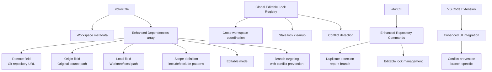
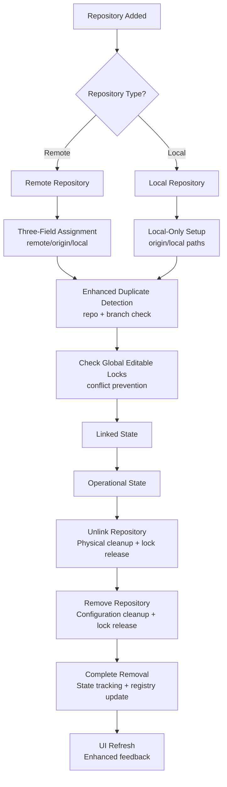
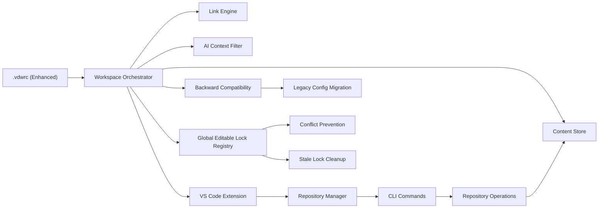

# Workspace Configuration Management (.vdwrc)

<cite>
**Referenced Files in This Document**
- [main.rs](file://vdw/src/main.rs)
- [init.rs](file://vdw/src/commands/init.rs)
- [parser.rs](file://vdw/src/config/parser.rs)
- [validator.rs](file://vdw/src/config/validator.rs)
- [config.rs](file://vdw/src/types/config.rs)
- [doctor.rs](file://vdw/src/commands/doctor.rs)
- [env_resolver.rs](file://vdw/src/config/env_resolver.rs)
- [sample.vdwrc](file://vdw/tests/fixtures/sample.vdwrc)
- [VDW虚拟工作空间_需求文档_v1.0.md](file://ai_workspace/VDW虚拟工作空间_需求文档_v1.0.md)
- [VDW配置重构_需求文档_v1.0.md](file://ai_workspace/VDW配置重构_需求文档_v1.0.md)
- [repo.rs](file://vdw/src/commands/repo.rs)
- [link.rs](file://vdw/src/commands/link.rs)
- [worktree.rs](file://vdw/src/commands/worktree.rs)
- [index.ts](file://vdw-vscode/src/commands/index.ts)
- [addRepo.ts](file://vdw-vscode/src/commands/addRepo.ts)
- [workspaceTreeView.ts](file://vdw-vscode/src/providers/workspaceTreeView.ts)
- [vdwCliService.ts](file://vdw-vscode/src/services/vdwCliService.ts)
- [extension.ts](file://vdw-vscode/src/extension.ts)
- [package.json](file://vdw-vscode/package.json)
- [glob_matcher.rs](file://vdw/src/context/glob_matcher.rs)
- [filter.rs](file://vdw/src/context/filter.rs)
- [README.md](file://vdw/README.md)
- [editable_locks.rs](file://vdw/src/store/editable_locks.rs)
- [editableLockService.ts](file://vdw-vscode/src/services/editableLockService.ts)
</cite>

## Update Summary
**Changes Made**
- Enhanced repository lifecycle management with improved duplicate detection logic
- Added branch-specific conflict prevention for editable workspaces in multi-workspace environments
- Integrated global editable lock registry for cross-workspace coordination
- Updated duplicate detection to consider both repository identity and branch targeting
- Added stale lock cleanup mechanism for robust multi-workspace management

## Table of Contents
1. [Introduction](#introduction)
2. [Project Structure](#project-structure)
3. [Core Components](#core-components)
4. [Architecture Overview](#architecture-overview)
5. [Detailed Component Analysis](#detailed-component-analysis)
6. [Enhanced Repository Lifecycle Management](#enhanced-repository-lifecycle-management)
7. [VS Code Integration](#vs-code-integration)
8. [Dependency Analysis](#dependency-analysis)
9. [Performance Considerations](#performance-considerations)
10. [Troubleshooting Guide](#troubleshooting-guide)
11. [Conclusion](#conclusion)
12. [Appendices](#appendices)

## Introduction
This document explains the enhanced workspace configuration management feature centered around the .vdwrc configuration file with the new three-field dependency system and advanced repository lifecycle management. The major restructuring introduces sophisticated dependency management using remote/origin/local fields, comprehensive duplicate detection logic, branch-specific conflict prevention, and improved multi-workspace coordination. The enhanced system now provides robust duplicate detection that considers both repository identity and branch targeting, along with a global editable lock registry that prevents conflicts across multiple workspaces working on the same repository branch.

## Project Structure
The repository contains unified product requirements and implementation that defines the complete .vdwrc configuration model with enhanced lifecycle management, CLI commands, VS Code extension integration, and advanced orchestration behavior. The .vdwrc file serves as the central declarative artifact that now supports:
- Workspace metadata (name, version)
- Enhanced dependencies array with three-field repository specification (remote/origin/local)
- Comprehensive scope definition with include/exclude patterns using glob syntax
- Editable mode settings with branch-specific conflict prevention
- Global editable lock registry for multi-workspace coordination
- Advanced duplicate detection logic considering repository and branch identity
- Complete repository lifecycle management from addition to removal
- Backward compatibility migration from legacy 'repo' field configurations



**Diagram sources**
- [VDW配置重构_需求文档_v1.0.md:1-150](file://ai_workspace/VDW配置重构_需求文档_v1.0.md#L1-L150)
- [VDW虚拟工作空间_需求文档_v1.0.md:444-471](file://ai_workspace/VDW虚拟工作空间_需求文档_v1.0.md#L444-L471)
- [repo.rs:79-121](file://vdw/src/commands/repo.rs#L79-L121)
- [editable_locks.rs:67-106](file://vdw/src/store/editable_locks.rs#L67-L106)

**Section sources**
- [VDW配置重构_需求文档_v1.0.md:1-150](file://ai_workspace/VDW配置重构_需求文档_v1.0.md#L1-L150)
- [VDW虚拟工作空间_需求文档_v1.0.md:75-120](file://ai_workspace/VDW虚拟工作空间_需求文档_v1.0.md#L75-L120)
- [VDW虚拟工作空间_需求文档_v1.0.md:444-471](file://ai_workspace/VDW虚拟工作空间_需求文档_v1.0.md#L444-L471)

## Core Components
- .vdwrc configuration file: Declarative format (YAML/JSON) that defines workspace metadata and enhanced dependencies with complete lifecycle support
- Workspace metadata: name and version fields for the logical workspace
- Enhanced Dependencies: Three-field dependency entries with remote/origin/local separation for comprehensive repository management
- Scope: include/exclude patterns using glob syntax to control AI context exposure with comprehensive pattern matching
- Editable mode: Boolean flag enabling Git Worktree-based editable workspaces with branch-specific conflict prevention
- Global Editable Lock Registry: Centralized coordination system preventing conflicts across multiple workspaces
- Enhanced Duplicate Detection: Logic that identifies duplicates based on both repository identity and branch targeting
- Environment variable substitution: Support for ${VAR} placeholders in configuration values
- vdw init command: Interactive workflow to generate .vdwrc with optional templates (default and fullstack)
- vdw validate command: Validates configuration syntax and detects dependency cycles
- Repository lifecycle: Complete management from addition to removal with proper cleanup procedures
- Backward compatibility: Automatic migration from legacy 'repo' field to new three-field system

**Section sources**
- [VDW配置重构_需求文档_v1.0.md:1-150](file://ai_workspace/VDW配置重构_需求文档_v1.0.md#L1-L150)
- [VDW虚拟工作空间_需求文档_v1.0.md:84-113](file://ai_workspace/VDW虚拟工作空间_需求文档_v1.0.md#L84-L113)
- [VDW虚拟工作空间_需求文档_v1.0.md:115-119](file://ai_workspace/VDW虚拟工作空间_需求文档_v1.0.md#L115-L119)
- [VDW虚拟工作空间_需求文档_v1.0.md:487-524](file://ai_workspace/VDW虚拟工作空间_需求文档_v1.0.md#L487-L524)

## Architecture Overview
The enhanced .vdwrc system with three-field dependency management and global editable lock coordination drives the Workspace Orchestrator, which now coordinates the complete repository lifecycle with advanced conflict prevention:
- Parsing and validating .vdwrc with comprehensive error reporting and backward compatibility migration
- Enhanced duplicate detection considering both repository identity and branch targeting
- Global editable lock registry for cross-workspace coordination and conflict prevention
- Resolving dependencies with enhanced identifier system (remote > origin > local priority)
- Managing the Content Store and linking engine with lifecycle awareness
- Providing a virtual file list to the AI Context Filter with scope validation
- Supporting VS Code extension integration for UI-driven repository management
- Handling worktree management with integrated dependency tracking and conflict detection

```mermaid
sequenceDiagram
participant U as "User"
participant VS as "VS Code Extension"
participant CLI as "vdw CLI"
participant REG as "Editable Lock Registry"
participant ORCH as "Workspace Orchestrator"
participant STORE as "Content Store"
participant LINK as "Link Engine"
U->>VS : Right-click dependency
VS->>VS : Check for branch conflicts
VS->>REG : Query editable locks for repo+branch
REG-->>VS : Return conflict info (if any)
VS->>VS : Show enhanced context menu with "Remove Repository"
U->>VS : Select "Remove Repository"
VS->>CLI : unlinkRepo(repoUrl)
CLI->>ORCH : Execute unlink operation with dependency tracking
ORCH->>REG : Release editable lock for repo+branch
REG-->>ORCH : Lock released successfully
ORCH->>LINK : Remove physical links and update dependency state
LINK->>ORCH : Links removed with worktree cleanup
ORCH->>VS : Update UI state with enhanced feedback
VS->>VS : Remove from .vdwrc with proper migration
VS->>VS : Refresh tree view with improved indicators
VS->>VS : Update lock registry state
```

**Diagram sources**
- [index.ts:299-381](file://vdw-vscode/src/commands/index.ts#L299-L381)
- [vdwCliService.ts:166-169](file://vdw-vscode/src/services/vdwCliService.ts#L166-L169)
- [link.rs:218-269](file://vdw/src/commands/link.rs#L218-L269)
- [config.rs:156-170](file://vdw/src/types/config.rs#L156-L170)
- [editable_locks.rs:67-106](file://vdw/src/store/editable_locks.rs#L67-L106)

## Detailed Component Analysis

### .vdwrc Configuration File Format
- Supported formats: YAML and JSON with dual extension support (.vdwrc and .vdwrc.yml)
- Root-level keys:
  - workspace: Contains name and version
  - dependencies: Array of enhanced dependency entries with three-field system

Enhanced key-value semantics:
- workspace.name: Human-readable workspace identifier
- workspace.version: Semantic version for the workspace
- dependencies[].remote: Remote Git repository URL (git@, https://, http://) or empty for local-only repos
- dependencies[].origin: Original source path for local-only repos, preserved during migration
- dependencies[].local: Local repository path on disk (worktree or local git repo)
- dependencies[].path: Local logical path under the workspace root
- dependencies[].branch: Target branch for checkout
- dependencies[].tag: Tag to pin to
- dependencies[].commit: Specific commit to pin to
- dependencies[].scope.include: Glob patterns to include in AI context
- dependencies[].scope.exclude: Glob patterns to exclude from AI context
- dependencies[].editable: Boolean enabling editable workspaces via Git Worktree

Enhanced with three-field dependency system, branch-specific conflict prevention, and global lock coordination

Environment variable substitution:
- Values may reference environment variables using ${VAR} syntax
- Resolution occurs during configuration validation
- Sensitive tokens should be provided via environment variables rather than embedded in .vdwrc

Enhanced with comprehensive environment variable resolution and improved template support

Validation rules:
- At least one of remote, origin, or local must be set for each dependency
- remote URL format must be valid (supports git@, https://, http:// prefixes)
- path uniqueness across dependencies must be enforced
- scope include/exclude patterns must be syntactically valid globs
- Version locking: branch, tag, and commit are mutually exclusive; only one should be present
- scope.include must contain at least one pattern
- Enhanced duplicate detection: Repository + branch combination must be unique across dependencies

**Section sources**
- [VDW配置重构_需求文档_v1.0.md:1-150](file://ai_workspace/VDW配置重构_需求文档_v1.0.md#L1-L150)
- [VDW虚拟工作空间_需求文档_v1.0.md:84-113](file://ai_workspace/VDW虚拟工作空间_需求文档_v1.0.md#L84-L113)
- [VDW虚拟工作空间_需求文档_v1.0.md:115-119](file://ai_workspace/VDW虚拟工作空间_需求文档_v1.0.md#L115-L119)
- [VDW虚拟工作空间_需求文档_v1.0.md:487-524](file://ai_workspace/VDW虚拟工作空间_需求文档_v1.0.md#L487-L524)
- [VDW虚拟工作空间_需求文档_v1.0.md:444-471](file://ai_workspace/VDW虚拟工作空间_需求文档_v1.0.md#L444-L471)

### Enhanced Configuration Structure Details
- Workspace metadata:
  - name: String
  - version: String
- Enhanced Dependencies array:
  - Each entry includes:
    - remote: String (remote URL or empty for local-only)
    - origin: String (preserved original source path)
    - local: String (worktree or local git repo path)
    - path: String (logical path)
    - branch: Optional<String>
    - tag: Optional<String>
    - commit: Optional<String>
    - scope: Object with include and exclude arrays (include must be non-empty)
    - editable: Boolean (defaults to false)
- Scope definition:
  - include: Array of glob patterns (at least one required)
  - exclude: Array of glob patterns
- Editable mode:
  - When true, enables Git Worktree-based editable workspace for the dependency
  - Subject to global editable lock registry for conflict prevention
- Global Editable Lock Registry:
  - Tracks editable locks across all workspaces
  - Prevents simultaneous editable access to same repo+branch combinations
  - Automatically cleans up stale locks where worktree paths no longer exist

Enhanced with three-field dependency system, branch-specific conflict prevention, and comprehensive validation rules

Best practices for scope definition:
- Prefer explicit include patterns to minimize context blast radius
- Use exclude patterns to suppress noise (e.g., node_modules, dist, test files)
- Keep include patterns precise to reduce AI indexing overhead

**Section sources**
- [VDW配置重构_需求文档_v1.0.md:1-150](file://ai_workspace/VDW配置重构_需求文档_v1.0.md#L1-L150)
- [VDW虚拟工作空间_需求文档_v1.0.md:444-471](file://ai_workspace/VDW虚拟工作空间_需求文档_v1.0.md#L444-L471)
- [VDW虚拟工作空间_需求文档_v1.0.md:94-96](file://ai_workspace/VDW虚拟工作空间_需求文档_v1.0.md#L94-L96)
- [VDW虚拟工作空间_需求文档_v1.0.md:103-105](file://ai_workspace/VDW虚拟工作空间_需求文档_v1.0.md#L103-L105)
- [VDW虚拟工作空间_需求文档_v1.0.md:110-112](file://ai_workspace/VDW虚拟工作空间_需求文档_v1.0.md#L110-L112)

### Concrete Configuration Scenarios
- Example 1: Remote repository with branch-based dependency, include/exclude scope, and editable enabled
- Example 2: Local-only repository with commit-based dependency, include scope, and editable disabled
- Example 3: Mixed configuration with both remote and local dependencies, demonstrating three-field system
- Example 4: Multi-workspace scenario showing branch-specific conflict prevention with global lock registry

These examples demonstrate the new three-field dependency system with remote/origin/local separation, repository specification with branch/tag/commit locking, scope definition with include/exclude patterns, editable mode settings, and advanced conflict prevention mechanisms.

Enhanced with detailed YAML examples from requirement documents and multi-workspace conflict prevention scenarios

**Section sources**
- [VDW配置重构_需求文档_v1.0.md:54-84](file://ai_workspace/VDW配置重构_需求文档_v1.0.md#L54-L84)
- [VDW虚拟工作空间_需求文档_v1.0.md:84-113](file://ai_workspace/VDW虚拟工作空间_需求文档_v1.0.md#L84-L113)
- [sample.vdwrc:1-25](file://vdw/tests/fixtures/sample.vdwrc#L1-L25)

### vdw Init Command Workflow
- Purpose: Interactive generation of .vdwrc with template support
- Options:
  - Default interactive mode with minimal template
  - Template selection: `--template fullstack` for comprehensive example
- Post-init steps:
  - Run vdw link to materialize dependencies
  - Verify with vdw validate and vdw context preview

Enhanced with template support for faster workspace initialization

**Section sources**
- [VDW虚拟工作空间_需求文档_v1.0.md:487-524](file://ai_workspace/VDW虚拟工作空间_需求文档_v1.0.md#L487-L524)
- [VDW虚拟工作空间_需求文档_v1.0.md:564](file://ai_workspace/VDW虚拟工作空间_需求文档_v1.0.md#L564)
- [VDW虚拟工作空间_需求文档_v1.0.md:621](file://ai_workspace/VDW虚拟工作空间_需求文档_v1.0.md#L621)

### Enhanced Configuration Validation Rules
- Syntax validation: YAML/JSON parsing success
- Structural validation: Presence of required fields and correct types
- Enhanced semantic validation:
  - At least one of remote, origin, or local must be set per dependency
  - remote URL validity (supports git@, https://, http:// prefixes)
  - path uniqueness across dependencies
  - scope include/exclude glob syntax correctness
  - Mutually exclusive version locking: branch vs. tag vs. commit
  - Non-empty scope.include requirement
  - Enhanced duplicate detection: Repository + branch combination must be unique
  - Backward compatibility: Automatic migration from legacy 'repo' field
- Dependency graph validation:
  - Detect cycles during resolution
  - Report dependency paths for cycle detection

Enhanced validation with three-field dependency requirements, branch-specific duplicate detection, and backward compatibility

**Section sources**
- [VDW配置重构_需求文档_v1.0.md:85-92](file://ai_workspace/VDW配置重构_需求文档_v1.0.md#L85-L92)
- [VDW虚拟工作空间_需求文档_v1.0.md:115-119](file://ai_workspace/VDW虚拟工作空间_需求文档_v1.0.md#L115-L119)
- [VDW虚拟工作空间_需求文档_v1.0.md:347-350](file://ai_workspace/VDW虚拟工作空间_需求文档_v1.0.md#L347-L350)
- [VDW虚拟工作空间_需求文档_v1.0.md:516-518](file://ai_workspace/VDW虚拟工作空间_需求文档_v1.0.md#L516-L518)

### Environment Variable Substitution
- Placeholders: ${VAR} syntax supported in configuration values
- Resolution process: Environment variables are resolved during validation
- Security: Use environment variables for sensitive values (e.g., tokens) instead of embedding in .vdwrc
- Error handling: Missing environment variables cause validation failures with specific error messages

Added comprehensive environment variable substitution support

**Section sources**
- [VDW虚拟工作空间_需求文档_v1.0.md:118](file://ai_workspace/VDW虚拟工作空间_需求文档_v1.0.md#L118)
- [VDW虚拟工作空间_需求文档_v1.0.md:413](file://ai_workspace/VDW虚拟工作空间_需求文档_v1.0.md#L413)
- [env_resolver.rs:1-137](file://vdw/src/config/env_resolver.rs#L1-L137)

### Enhanced Integration with the Workspace Orchestrator
- The orchestrator parses .vdwrc, validates it, and builds a dependency graph with enhanced identifier resolution
- It ensures dependencies are fetched into the Content Store and linked into the logical workspace
- It provides a virtual file list to the AI Context Filter based on scope definitions
- Supports lifecycle operations including repository addition, linking, unlinking, and removal
- Handles backward compatibility migration from legacy configurations
- Integrates with global editable lock registry for conflict prevention across workspaces
- Implements enhanced duplicate detection considering both repository identity and branch targeting

Enhanced integration with three-field dependency system, branch-specific conflict prevention, and improved validation

**Section sources**
- [VDW配置重构_需求文档_v1.0.md:1-150](file://ai_workspace/VDW配置重构_需求文档_v1.0.md#L1-L150)
- [VDW虚拟工作空间_需求文档_v1.0.md:53-55](file://ai_workspace/VDW虚拟工作空间_需求文档_v1.0.md#L53-L55)
- [VDW虚拟工作空间_需求文档_v1.0.md:230-234](file://ai_workspace/VDW虚拟工作空间_需求文档_v1.0.md#L230-L234)

## Enhanced Repository Lifecycle Management

### Complete Repository Lifecycle with Three-Field System and Conflict Prevention
The enhanced system now supports the complete repository lifecycle with the new three-field dependency system and advanced conflict prevention mechanisms:

1. **Add Repository**: Initial repository addition with automatic configuration updates, three-field assignment, and duplicate detection
2. **Duplicate Detection**: Enhanced logic that checks for existing dependencies with the same repository AND branch combination
3. **Conflict Prevention**: Global editable lock registry prevents simultaneous editable access to same repo+branch across workspaces
4. **Link Repository**: Materialization of dependencies into the workspace with worktree management and lock acquisition
5. **Operational State**: Active repository with either read-only or editable mode based on conflict detection
6. **Unlink Repository**: Removal of physical links while preserving configuration state and releasing locks
7. **Remove Repository**: Complete removal including configuration cleanup, dependency tracking, and lock release

### Enhanced Repository Addition Workflow
- VS Code wizard guides users through repository type selection (remote/local) with three-field assignment
- Automatic scope pattern configuration with comma-separated glob patterns
- CLI integration for seamless repository addition with enhanced validation and duplicate detection
- Configuration updates with proper validation, backward compatibility migration, and lock registry updates
- Worktree management integration for editable repositories with conflict prevention
- Global lock registry consulted to prevent branch-specific conflicts across workspaces

### Enhanced Repository Removal Workflow
- VS Code context menu provides dedicated "Remove Repository" action with enhanced feedback
- Dual-step process: unlink then remove from configuration with proper cleanup and lock release
- Direct .vdwrc modification for immediate configuration cleanup
- UI refresh and state synchronization with improved indicators
- Dependency state tracking and cleanup procedures with lock registry updates



**Diagram sources**
- [index.ts:299-381](file://vdw-vscode/src/commands/index.ts#L299-L381)
- [addRepo.ts:13-278](file://vdw-vscode/src/commands/addRepo.ts#L13-L278)
- [link.rs:218-269](file://vdw/src/commands/link.rs#L218-L269)
- [config.rs:56-73](file://vdw/src/config/parser.rs#L56-L73)
- [repo.rs:79-121](file://vdw/src/commands/repo.rs#L79-L121)
- [editable_locks.rs:67-106](file://vdw/src/store/editable_locks.rs#L67-L106)

**Section sources**
- [index.ts:299-381](file://vdw-vscode/src/commands/index.ts#L299-L381)
- [addRepo.ts:13-278](file://vdw-vscode/src/commands/addRepo.ts#L13-L278)
- [link.rs:218-269](file://vdw/src/commands/link.rs#L218-L269)
- [parser.rs:56-73](file://vdw/src/config/parser.rs#L56-L73)
- [repo.rs:79-121](file://vdw/src/commands/repo.rs#L79-L121)

### Global Editable Lock Registry
The system now maintains a centralized editable lock registry that coordinates editable workspace access across multiple workspaces:

- **Lock Storage**: Global JSON registry stored in user home directory under `.vdw/editable_locks.json`
- **Lock Structure**: Each lock records repo_id, branch, workspace_path, worktree_path, and timestamp
- **Conflict Detection**: Checks for existing editable locks on the same repo+branch combination
- **Same Workspace Allowance**: Allows relinking within the same workspace without conflict
- **Stale Lock Cleanup**: Automatically removes locks where the associated worktree path no longer exists
- **Concurrency Safety**: Uses file locking for thread-safe registry updates across processes
- **Cross-Platform Support**: Works consistently across different operating systems

**Section sources**
- [editable_locks.rs:12-186](file://vdw/src/store/editable_locks.rs#L12-L186)
- [editableLockService.ts:19-60](file://vdw-vscode/src/services/editableLockService.ts#L19-L60)

## VS Code Integration

### Enhanced Context Menu Integration
The VS Code extension now provides comprehensive repository management through enhanced context menus with conflict prevention:

- **Right-click Dependencies**: Dedicated "Remove Repository" action available for both linked and unlinked repositories
- **Conditional Menu Items**: Context-aware commands based on repository state (linked/unlinked)
- **Visual Feedback**: Clear icons and status indicators for repository state with enhanced clarity
- **Conflict Prevention**: Automatic conflict detection for editable repositories with branch-specific guidance
- **Immediate Action**: Direct removal without requiring CLI commands
- **Enhanced State Indicators**: Improved visual distinction between remote, local, and mixed repositories
- **Multi-workspace Awareness**: Shows conflicts with other workspaces working on the same repo+branch

### Enhanced Repository Management Commands
- `vdw.addRepo`: Interactive repository addition wizard with three-field configuration and duplicate detection
- `vdw.removeRepo`: Complete repository removal with unlink, configuration cleanup, and lock release
- `vdw.linkRepo`: Link specific repository to workspace with enhanced validation and conflict prevention
- `vdw.unlinkRepo`: Unlink specific repository from workspace with proper cleanup and lock release
- `vdw.migrateConfig`: Automatic migration from legacy configurations to new three-field system

### Enhanced Tree View Features
- **Status Indicators**: Visual distinction between linked and unlinked repositories with enhanced clarity
- **Editable Mode**: Clear indication of editable vs. read-only repositories with conflict warnings
- **Scope Information**: Display of include/exclude patterns in tree view
- **Repository Type**: Visual indication of remote vs. local repository types
- **Migration Status**: Clear indicators for legacy configuration migration
- **Conflict Indicators**: Visual warnings for repositories with active editable locks in other workspaces
- **Real-time Updates**: Automatic refresh on configuration changes with enhanced feedback

**Section sources**
- [package.json:36-101](file://vdw-vscode/package.json#L36-L101)
- [workspaceTreeView.ts:66-196](file://vdw-vscode/src/providers/workspaceTreeView.ts#L66-L196)
- [extension.ts:58-98](file://vdw-vscode/src/extension.ts#L58-L98)

## Dependency Analysis
The enhanced .vdwrc system with three-field dependency management and global lock coordination drives the Workspace Orchestrator, which depends on:
- Content Store for deduplicated storage and Git object sharing
- Link Engine for creating logical links with enhanced lifecycle awareness
- AI Context Filter for exposing scoped files with glob pattern matching
- VS Code Extension for UI-driven repository management with enhanced features
- CLI Commands for programmatic repository operations with backward compatibility
- Backward Compatibility Layer for legacy configuration migration
- Global Editable Lock Registry for cross-workspace conflict prevention
- Enhanced Duplicate Detection Logic for repository+branch uniqueness enforcement



**Diagram sources**
- [VDW配置重构_需求文档_v1.0.md:1-150](file://ai_workspace/VDW配置重构_需求文档_v1.0.md#L1-L150)
- [VDW虚拟工作空间_需求文档_v1.0.md:53-55](file://ai_workspace/VDW虚拟工作空间_需求文档_v1.0.md#L53-L55)
- [VDW虚拟工作空间_需求文档_v1.0.md:444-471](file://ai_workspace/VDW虚拟工作空间_需求文档_v1.0.md#L444-L471)
- [extension.ts:18-104](file://vdw-vscode/src/extension.ts#L18-L104)
- [editable_locks.rs:67-106](file://vdw/src/store/editable_locks.rs#L67-L106)

**Section sources**
- [VDW配置重构_需求文档_v1.0.md:1-150](file://ai_workspace/VDW配置重构_需求文档_v1.0.md#L1-L150)
- [VDW虚拟工作空间_需求文档_v1.0.md:53-55](file://ai_workspace/VDW虚拟工作空间_需求文档_v1.0.md#L53-L55)
- [VDW虚拟工作空间_需求文档_v1.0.md:444-471](file://ai_workspace/VDW虚拟工作空间_需求文档_v1.0.md#L444-L471)

## Performance Considerations
- Keep scope definitions minimal to reduce AI indexing time
- Prefer tag or commit locking to avoid frequent updates and re-indexing
- Use environment variables for credentials to avoid repeated prompting
- For large workspaces, consider splitting into smaller logical workspaces to reduce context size
- Monitor store usage and clean unused objects periodically
- Template-based initialization reduces manual configuration overhead
- VS Code extension provides real-time feedback for better user experience
- Enhanced three-field dependency system reduces ambiguity and improves lookup performance
- Backward compatibility migration eliminates redundant configuration processing
- Global lock registry operations are optimized with efficient JSON serialization and file locking
- Stale lock cleanup prevents registry bloat and maintains optimal performance

Enhanced with three-field dependency performance benefits, migration optimizations, and lock registry efficiency improvements

## Troubleshooting Guide
Common configuration errors:
- Invalid three-field combinations: Ensure at least one of remote, origin, or local is set per dependency
- Invalid remote URL format: Ensure the remote field uses a valid Git remote URL (supports git@, https://, http:// prefixes)
- Duplicate path values: Each dependency must have a unique logical path
- Duplicate repository+branch combinations: Enhanced duplicate detection prevents adding the same repo on the same branch multiple times
- Invalid scope patterns: Ensure include/exclude patterns are valid globs with proper syntax
- Mutually exclusive version locks: Only one of branch, tag, or commit should be set
- Empty scope.include: At least one include pattern is required
- Missing environment variables: Ensure all ${VAR} placeholders are defined in the environment
- Cycle dependencies: Use vdw validate to detect and resolve dependency cycles
- Repository removal failures: Ensure proper unlink before removal and check .vdwrc integrity
- Legacy configuration issues: Run vdw migrate-config to convert from old 'repo' field format
- Editable lock conflicts: When multiple workspaces try to edit the same repo+branch, conflicts are automatically detected and resolved
- Stale lock issues: The system automatically cleans up stale locks where worktree paths no longer exist

Diagnostic commands:
- vdw validate: Validate .vdwrc configuration with enhanced error reporting including duplicate detection
- vdw doctor: Diagnose common problems and suggest fixes
- vdw logs: Review logs for detailed error traces
- vdw repo list: List repositories in the Content Store
- vdw context preview: Preview AI context files
- vdw migrate-config: Migrate legacy configurations to new three-field system
- vdw repo remove: Remove repository with proper lock release and cleanup

Enhanced with three-field dependency troubleshooting, migration guidance, and comprehensive conflict resolution

**Section sources**
- [VDW配置重构_需求文档_v1.0.md:85-92](file://ai_workspace/VDW配置重构_需求文档_v1.0.md#L85-L92)
- [VDW虚拟工作空间_需求文档_v1.0.md:115-119](file://ai_workspace/VDW虚拟工作空间_需求文档_v1.0.md#L115-L119)
- [VDW虚拟工作空间_需求文档_v1.0.md:347-350](file://ai_workspace/VDW虚拟工作空间_需求文档_v1.0.md#L347-L350)
- [VDW虚拟工作空间_需求文档_v1.0.md:516-519](file://ai_workspace/VDW虚拟工作空间_需求文档_v1.0.md#L516-L519)

## Conclusion
The enhanced .vdwrc configuration file system with the new three-field dependency system and advanced conflict prevention provides comprehensive workspace configuration management with complete repository lifecycle support. The major restructuring introduces sophisticated dependency management using remote/origin/local fields, backward compatibility migration from legacy configurations, enhanced worktree management, improved VS Code integration, and robust multi-workspace coordination through global editable lock registry. The enhanced duplicate detection logic prevents adding the same repository on the same branch multiple times, while the global lock registry prevents conflicts across multiple workspaces working on the same repository branch. It enables declarative dependency management, precise scope control for AI contexts, flexible version locking, and intelligent conflict prevention. The integration with VS Code provides intuitive UI-driven repository management with enhanced feedback and conflict warnings, while the CLI offers programmatic control with comprehensive validation and error reporting. With the enhanced vdw init command supporting templates, improved validation rules, environment variable substitution, comprehensive repository lifecycle management, backward compatibility migration, and advanced conflict prevention, it provides a robust workflow for setting up and maintaining logical workspaces across multiple repositories while seamlessly integrating with the workspace orchestrator and coordinating access across multiple workspaces.

Enhanced with three-field dependency system, backward compatibility, improved integration, and comprehensive conflict prevention

## Appendices

### Appendix A: Enhanced Configuration Schema Reference
- workspace
  - name: String
  - version: String
- dependencies[]
  - remote: String (remote URL or empty for local-only)
  - origin: String (preserved original source path)
  - local: String (worktree or local git repo path)
  - path: String
  - branch: Optional<String>
  - tag: Optional<String>
  - commit: Optional<String>
  - scope
    - include: Array<String> (glob patterns, at least one required)
    - exclude: Array<String> (glob patterns)
  - editable: Boolean (defaults to false)

Enhanced with three-field dependency system, validation requirements, and branch-specific conflict prevention

**Section sources**
- [VDW配置重构_需求文档_v1.0.md:71-84](file://ai_workspace/VDW配置重构_需求文档_v1.0.md#L71-L84)
- [VDW虚拟工作空间_需求文档_v1.0.md:444-471](file://ai_workspace/VDW虚拟工作空间_需求文档_v1.0.md#L444-L471)
- [config.rs:1-283](file://vdw/src/types/config.rs#L1-L283)

### Appendix B: Enhanced CLI Command Reference
- vdw init [--template fullstack]: Initialize workspace with template support
- vdw validate: Validate .vdwrc configuration with enhanced error reporting including duplicate detection
- vdw doctor: Diagnose workspace issues
- vdw link: Create workspace links with enhanced validation
- vdw unlink: Remove workspace links with proper cleanup
- vdw repo add: Add repository to workspace with three-field configuration and duplicate detection
- vdw repo remove: Remove repository from Content Store with proper lock release and cleanup
- vdw repo list: List repositories in Content Store
- vdw migrate-config: Migrate legacy configurations to new three-field system

Enhanced with repository lifecycle commands, migration support, and conflict prevention

**Section sources**
- [main.rs:18-49](file://vdw/src/main.rs#L18-L49)
- [init.rs:5-29](file://vdw/src/commands/init.rs#L5-L29)
- [doctor.rs:29-52](file://vdw/src/commands/doctor.rs#L29-L52)
- [repo.rs:19-47](file://vdw/src/commands/repo.rs#L19-L47)

### Appendix C: Enhanced VS Code Command Reference
- vdw.addRepo: Interactive repository addition wizard with three-field configuration and duplicate detection
- vdw.removeRepo: Complete repository removal with unlink, configuration cleanup, and lock release
- vdw.linkRepo: Link specific repository to workspace with enhanced validation and conflict prevention
- vdw.unlinkRepo: Unlink specific repository from workspace with proper cleanup and lock release
- vdw.relink: Refresh workspace links with updated configuration
- vdw.validate: Validate workspace configuration with enhanced error reporting
- vdw.refreshContext: Refresh AI context based on current scope
- vdw.migrateConfig: Migrate legacy configurations to new three-field system

Enhanced with migration, improved validation, conflict prevention, and lock registry integration

**Section sources**
- [package.json:16-39](file://vdw-vscode/package.json#L16-L39)
- [vdwCliService.ts:93-169](file://vdw-vscode/src/services/vdwCliService.ts#L93-L169)

### Appendix D: Enhanced Scope Pattern Specification
- Glob patterns support: `**` for recursive matching, `*` for single-level matching
- Pattern normalization: Backslash conversion to forward slashes
- Matching priority: Exclude patterns take precedence over include patterns
- Multiple pattern support: Arrays of patterns with logical OR semantics
- Path normalization: Consistent path handling across different operating systems

**Section sources**
- [glob_matcher.rs:54-88](file://vdw/src/context/glob_matcher.rs#L54-L88)
- [filter.rs:9-39](file://vdw/src/context/filter.rs#L9-L39)
- [config.rs:109-132](file://vdw/src/types/config.rs#L109-L132)

### Appendix E: Backward Compatibility Migration Guide
- Legacy 'repo' field: Automatically migrated to remote/local fields during parsing
- Migration process: Detection of legacy configurations triggers automatic conversion
- Validation warnings: Users receive clear migration warnings with remediation guidance
- State preservation: Original repository state is maintained during migration
- Command support: vdw migrate-config command for manual migration control

Added comprehensive backward compatibility migration support

**Section sources**
- [parser.rs:56-73](file://vdw/src/config/parser.rs#L56-L73)
- [config.rs:37-39](file://vdw/src/types/config.rs#L37-L39)

### Appendix F: Detailed Configuration Examples
The following examples demonstrate the new three-field dependency system with concrete YAML configurations and multi-workspace conflict prevention scenarios:

**Remote Repository Example:**
```yaml
dependencies:
  - remote: git@github.com:org/repo.git
    local: /Users/user/.vdw/store/objects/repo-abc123/worktrees/main
    path: ./packages/repo
    branch: main
    scope:
      include:
        - "src/**/*.ts"
        - "package.json"
      exclude:
        - "node_modules"
        - "*.test.ts"
    editable: true
```

**Local Repository Example:**
```yaml
dependencies:
  - remote: ""
    origin: "/old/path/to/repo"
    local: /path/to/local/repo
    path: ./packages/local-repo
    branch: main
    scope:
      include:
        - "src/**/*.rs"
    editable: false
```

**Multi-workspace Conflict Prevention Example:**
```yaml
workspace:
  name: "multi-workspace-project"
  version: "1.0"
dependencies:
  # Primary workspace editing this branch
  - remote: https://github.com/example/frontend.git
    local: ~/.vdw/store/objects/frontend-1a2b3c/worktrees/feature-ui
    path: ./apps/web
    branch: feature/ui-enhancements
    scope:
      include:
        - "src/**/*.{ts,tsx}"
        - "public/**/*"
      exclude:
        - "**/*.test.{ts,tsx}"
    editable: true

  # Another workspace attempting to edit the same branch
  - remote: https://github.com/example/frontend.git
    local: ~/.vdw/store/objects/frontend-1a2b3c/worktrees/feature-ui
    path: ./apps/web-alt
    branch: feature/ui-enhancements  # Same branch - will trigger conflict detection
    scope:
      include:
        - "src/**/*.{ts,tsx}"
    editable: true  # Will be downgraded to read-only due to conflict
```

**Section sources**
- [VDW配置重构_需求文档_v1.0.md:54-84](file://ai_workspace/VDW配置重构_需求文档_v1.0.md#L54-L84)
- [README.md:217-252](file://vdw/README.md#L217-L252)
- [sample.vdwrc:1-25](file://vdw/tests/fixtures/sample.vdwrc#L1-L25)

### Appendix G: Global Editable Lock Registry Structure
The global editable lock registry provides centralized coordination for multi-workspace scenarios:

- **Registry File**: `~/.vdw/editable_locks.json`
- **Structure**: JSON array of lock entries with version tracking
- **Lock Entry Fields**:
  - `repo_id`: Unique identifier for the repository
  - `branch`: Target branch name
  - `workspace_path`: Path to the workspace using this lock
  - `worktree_path`: Path to the actual worktree directory
  - `created_at`: Timestamp of lock creation
- **Conflict Resolution**: When multiple workspaces request the same repo+branch, the system prevents conflicts and downgrades to read-only mode
- **Stale Lock Cleanup**: Automatically removes locks where the worktree path no longer exists

**Section sources**
- [editable_locks.rs:12-186](file://vdw/src/store/editable_locks.rs#L12-L186)
- [editableLockService.ts:19-60](file://vdw-vscode/src/services/editableLockService.ts#L19-L60)