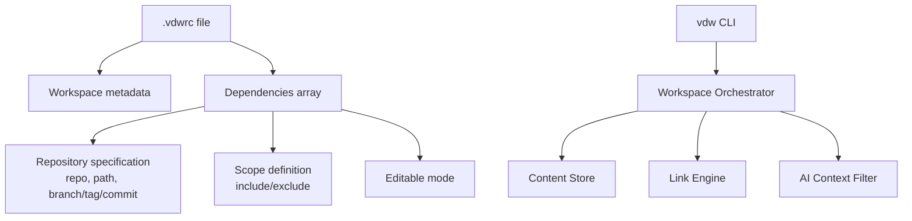
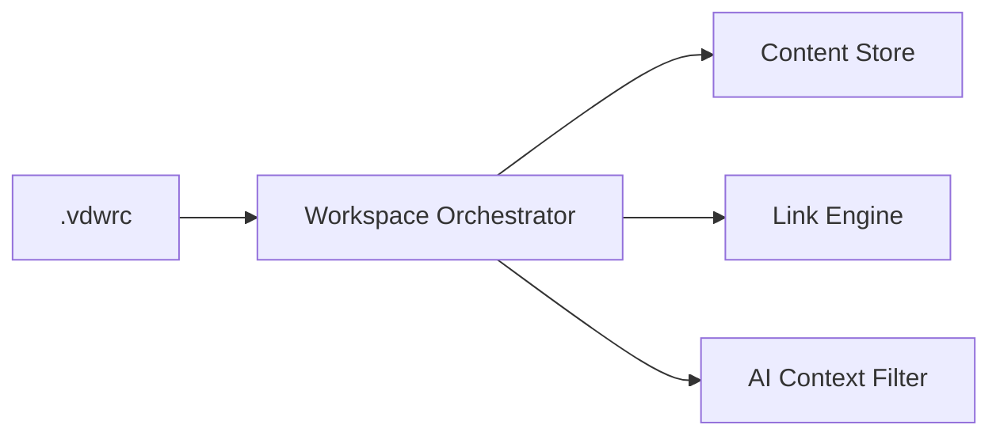

# Workspace Configuration Management (.vdwrc)

<cite>
**Referenced Files in This Document**
- [main.rs](file://vdw/src/main.rs)
- [init.rs](file://vdw/src/commands/init.rs)
- [parser.rs](file://vdw/src/config/parser.rs)
- [validator.rs](file://vdw/src/config/validator.rs)
- [config.rs](file://vdw/src/types/config.rs)
- [doctor.rs](file://vdw/src/commands/doctor.rs)
- [env_resolver.rs](file://vdw/src/config/env_resolver.rs)
- [sample.vdwrc](file://vdw/tests/fixtures/sample.vdwrc)
- [VDW虚拟工作空间_需求文档_v1.0.md](file://ai_workspace/VDW虚拟工作空间_需求文档_v1.0.md)
</cite>

## Update Summary
**Changes Made**
- Updated CLI-based workspace initialization workflow with template support
- Enhanced configuration validation with comprehensive error reporting
- Improved .vdwrc file management with dual extension support
- Added environment variable substitution capabilities
- Updated command references and workflow descriptions

## Table of Contents
1. [Introduction](#introduction)
2. [Project Structure](#project-structure)
3. [Core Components](#core-components)
4. [Architecture Overview](#architecture-overview)
5. [Detailed Component Analysis](#detailed-component-analysis)
6. [Dependency Analysis](#dependency-analysis)
7. [Performance Considerations](#performance-considerations)
8. [Troubleshooting Guide](#troubleshooting-guide)
9. [Conclusion](#conclusion)
10. [Appendices](#appendices)

## Introduction
This document explains the workspace configuration management feature centered around the .vdwrc configuration file. It covers the configuration file format, YAML/JSON parsing capabilities, workspace dependency declaration syntax, and the integration with the workspace orchestrator. It also documents configuration validation rules, environment variable substitution, the enhanced vdw init command workflow with template support, common configuration errors, best practices for scope definition, and performance optimization tips for large workspace configurations.

## Project Structure
The repository contains a single product requirements document that defines the .vdwrc configuration model, CLI commands, and orchestration behavior. The .vdwrc file is the central declarative artifact that describes:
- Workspace metadata (name, version)
- Dependencies array with repository specification and version locking
- Scope definition with include/exclude patterns
- Editable mode settings



**Diagram sources**
- [VDW虚拟工作空间_需求文档_v1.0.md:84-113](file://ai_workspace/VDW虚拟工作空间_需求文档_v1.0.md#L84-L113)
- [VDW虚拟工作空间_需求文档_v1.0.md:444-471](file://ai_workspace/VDW虚拟工作空间_需求文档_v1.0.md#L444-L471)

**Section sources**
- [VDW虚拟工作空间_需求文档_v1.0.md:75-120](file://ai_workspace/VDW虚拟工作空间_需求文档_v1.0.md#L75-L120)
- [VDW虚拟工作空间_需求文档_v1.0.md:444-471](file://ai_workspace/VDW虚拟工作空间_需求文档_v1.0.md#L444-L471)

## Core Components
- .vdwrc configuration file: Declarative format (YAML/JSON) that defines workspace metadata and dependencies.
- Workspace metadata: name and version fields for the logical workspace.
- Dependencies: Array of dependency entries with repository URL, local logical path, and version locking (branch, tag, commit).
- Scope: include/exclude patterns using glob syntax to control AI context exposure.
- Editable mode: Boolean flag enabling Git Worktree-based editable workspaces.
- Environment variable substitution: Support for ${VAR} placeholders in configuration values.
- vdw init command: Interactive workflow to generate .vdwrc with optional templates (default and fullstack).
- vdw validate command: Validates configuration syntax and detects dependency cycles.

**Section sources**
- [VDW虚拟工作空间_需求文档_v1.0.md:84-113](file://ai_workspace/VDW虚拟工作空间_需求文档_v1.0.md#L84-L113)
- [VDW虚拟工作空间_需求文档_v1.0.md:115-119](file://ai_workspace/VDW虚拟工作空间_需求文档_v1.0.md#L115-L119)
- [VDW虚拟工作空间_需求文档_v1.0.md:487-524](file://ai_workspace/VDW虚拟工作空间_需求文档_v1.0.md#L487-L524)

## Architecture Overview
The .vdwrc drives the Workspace Orchestrator, which coordinates:
- Parsing and validating .vdwrc
- Resolving dependencies and version locks
- Managing the Content Store and linking engine
- Providing a virtual file list to the AI Context Filter

```mermaid
sequenceDiagram
participant U as "User"
participant CLI as "vdw CLI"
participant INIT as "Init Command"
participant ORCH as "Workspace Orchestrator"
participant STORE as "Content Store"
participant LINK as "Link Engine"
participant AI as "AI Context Filter"
U->>CLI : Run "vdw init --template [fullstack]"
CLI->>INIT : Generate .vdwrc with template
INIT->>INIT : Initialize store and create .vdwrc
INIT-->>U : .vdwrc created successfully
U->>CLI : Run "vdw validate"
CLI->>ORCH : Load and parse .vdwrc
ORCH->>ORCH : Validate config and detect cycles
ORCH->>STORE : Fetch/ensure commits for dependencies
ORCH->>LINK : Create logical links for dependencies
LINK-->>ORCH : Logical directory structure ready
ORCH->>AI : Provide virtual file list based on scope
AI-->>U : Serve filtered context to AI Agent
```

**Diagram sources**
- [VDW虚拟工作空间_需求文档_v1.0.md:487-524](file://ai_workspace/VDW虚拟工作空间_需求文档_v1.0.md#L487-L524)
- [VDW虚拟工作空间_需求文档_v1.0.md:444-471](file://ai_workspace/VDW虚拟工作空间_需求文档_v1.0.md#L444-L471)

## Detailed Component Analysis

### .vdwrc Configuration File Format
- Supported formats: YAML and JSON.
- Root-level keys:
  - workspace: Contains name and version.
  - dependencies: Array of dependency entries.

Key-value semantics:
- workspace.name: Human-readable workspace identifier.
- workspace.version: Semantic version for the workspace.
- dependencies[].repo: Remote Git repository URL.
- dependencies[].path: Local logical path under the workspace root.
- dependencies[].branch: Target branch for checkout.
- dependencies[].tag: Tag to pin to.
- dependencies[].commit: Specific commit to pin to.
- dependencies[].scope.include: Glob patterns to include in AI context.
- dependencies[].scope.exclude: Glob patterns to exclude from AI context.
- dependencies[].editable: Boolean enabling editable workspaces via Git Worktree.

Environment variable substitution:
- Values may reference environment variables using ${VAR} syntax. Sensitive tokens should be provided via environment variables rather than embedded in .vdwrc.

**Updated** Enhanced with environment variable resolution capabilities and improved template support.

Validation rules:
- repo URL format must be valid (must start with 'git@' or 'https://').
- path uniqueness across dependencies must be enforced.
- scope include/exclude patterns must be syntactically valid globs.
- Version locking: branch, tag, and commit are mutually exclusive; only one should be present.
- scope.include must contain at least one pattern.

vdw init workflow:
- Interactive generation of .vdwrc with template support.
- Template selection: default (minimal) or fullstack (comprehensive example).
- Post-init, run vdw link to materialize dependencies.

**Updated** Enhanced with template support for faster workspace initialization.

Integration with the workspace orchestrator:
- The orchestrator reads .vdwrc, validates it, resolves dependencies, and constructs the logical workspace.

**Section sources**
- [VDW虚拟工作空间_需求文档_v1.0.md:84-113](file://ai_workspace/VDW虚拟工作空间_需求文档_v1.0.md#L84-L113)
- [VDW虚拟工作空间_需求文档_v1.0.md:115-119](file://ai_workspace/VDW虚拟工作空间_需求文档_v1.0.md#L115-L119)
- [VDW虚拟工作空间_需求文档_v1.0.md:487-524](file://ai_workspace/VDW虚拟工作空间_需求文档_v1.0.md#L487-L524)
- [VDW虚拟工作空间_需求文档_v1.0.md:444-471](file://ai_workspace/VDW虚拟工作空间_需求文档_v1.0.md#L444-L471)

### Configuration Structure Details
- Workspace metadata:
  - name: String
  - version: String
- Dependencies array:
  - Each entry includes:
    - repo: String (remote URL, must start with 'git@' or 'https://')
    - path: String (logical path)
    - branch: Optional<String>
    - tag: Optional<String>
    - commit: Optional<String>
    - scope: Object with include and exclude arrays (include must be non-empty)
    - editable: Boolean (defaults to false)
- Scope definition:
  - include: Array of glob patterns (at least one required)
  - exclude: Array of glob patterns
- Editable mode:
  - When true, enables Git Worktree-based editable workspace for the dependency.

Best practices for scope definition:
- Prefer explicit include patterns to minimize context blast radius.
- Use exclude patterns to suppress noise (e.g., node_modules, dist, test files).
- Keep include patterns precise to reduce AI indexing overhead.

**Updated** Enhanced validation rules now require non-empty scope.include arrays.

**Section sources**
- [VDW虚拟工作空间_需求文档_v1.0.md:444-471](file://ai_workspace/VDW虚拟工作空间_需求文档_v1.0.md#L444-L471)
- [VDW虚拟工作空间_需求文档_v1.0.md:94-96](file://ai_workspace/VDW虚拟工作空间_需求文档_v1.0.md#L94-L96)
- [VDW虚拟工作空间_需求文档_v1.0.md:103-105](file://ai_workspace/VDW虚拟工作空间_需求文档_v1.0.md#L103-L105)
- [VDW虚拟工作空间_需求文档_v1.0.md:110-112](file://ai_workspace/VDW虚拟工作空间_需求文档_v1.0.md#L110-L112)

### Concrete Configuration Scenarios
- Example 1: Branch-based dependency with include/exclude scope and editable enabled.
- Example 2: Commit-based dependency with include scope and editable disabled.
- Example 3: Tag-based dependency with include scope and editable enabled.

These examples demonstrate repository specification with branch/tag/commit locking, scope definition with include/exclude patterns, and editable mode settings.

**Updated** All examples now include proper validation with non-empty scope.include arrays.

**Section sources**
- [VDW虚拟工作空间_需求文档_v1.0.md:84-113](file://ai_workspace/VDW虚拟工作空间_需求文档_v1.0.md#L84-L113)
- [sample.vdwrc:1-25](file://vdw/tests/fixtures/sample.vdwrc#L1-L25)

### vdw Init Command Workflow
- Purpose: Interactive generation of .vdwrc with template support.
- Options:
  - Default interactive mode with minimal template.
  - Template selection: `--template fullstack` for comprehensive example.
- Post-init steps:
  - Run vdw link to materialize dependencies.
  - Verify with vdw validate and vdw context preview.

**Updated** Enhanced with template support for faster workspace initialization.

**Section sources**
- [VDW虚拟工作空间_需求文档_v1.0.md:487-524](file://ai_workspace/VDW虚拟工作空间_需求文档_v1.0.md#L487-L524)
- [VDW虚拟工作空间_需求文档_v1.0.md:564](file://ai_workspace/VDW虚拟工作空间_需求文档_v1.0.md#L564)
- [VDW虚拟工作空间_需求文档_v1.0.md:621](file://ai_workspace/VDW虚拟工作空间_需求文档_v1.0.md#L621)

### Configuration Validation Rules
- Syntax validation: YAML/JSON parsing success.
- Structural validation: Presence of required fields and correct types.
- Semantic validation:
  - repo URL validity (must start with 'git@' or 'https://').
  - path uniqueness across dependencies.
  - scope include/exclude glob syntax correctness.
  - Mutually exclusive version locking: branch vs. tag vs. commit.
  - Non-empty scope.include requirement.
- Dependency graph validation:
  - Detect cycles during resolution.
  - Report dependency paths for cycle detection.

**Updated** Enhanced validation with comprehensive error reporting and new requirements.

**Section sources**
- [VDW虚拟工作空间_需求文档_v1.0.md:115-119](file://ai_workspace/VDW虚拟工作空间_需求文档_v1.0.md#L115-L119)
- [VDW虚拟工作空间_需求文档_v1.0.md:347-350](file://ai_workspace/VDW虚拟工作空间_需求文档_v1.0.md#L347-L350)
- [VDW虚拟工作空间_需求文档_v1.0.md:516-518](file://ai_workspace/VDW虚拟工作空间_需求文档_v1.0.md#L516-L518)

### Environment Variable Substitution
- Placeholders: ${VAR} syntax supported in configuration values.
- Resolution process: Environment variables are resolved during validation.
- Security: Use environment variables for sensitive values (e.g., tokens) instead of embedding in .vdwrc.
- Error handling: Missing environment variables cause validation failures with specific error messages.

**New** Added comprehensive environment variable substitution support.

**Section sources**
- [VDW虚拟工作空间_需求文档_v1.0.md:118](file://ai_workspace/VDW虚拟工作空间_需求文档_v1.0.md#L118)
- [VDW虚拟工作空间_需求文档_v1.0.md:413](file://ai_workspace/VDW虚拟工作空间_需求文档_v1.0.md#L413)
- [env_resolver.rs:1-137](file://vdw/src/config/env_resolver.rs#L1-L137)

### Integration with the Workspace Orchestrator
- The orchestrator parses .vdwrc, validates it, and builds a dependency graph.
- It ensures dependencies are fetched into the Content Store and linked into the logical workspace.
- It provides a virtual file list to the AI Context Filter based on scope definitions.

**Updated** Enhanced integration with environment variable resolution and improved validation.

**Section sources**
- [VDW虚拟工作空间_需求文档_v1.0.md:53-55](file://ai_workspace/VDW虚拟工作空间_需求文档_v1.0.md#L53-L55)
- [VDW虚拟工作空间_需求文档_v1.0.md:230-234](file://ai_workspace/VDW虚拟工作空间_需求文档_v1.0.md#L230-L234)

## Dependency Analysis
The .vdwrc drives the Workspace Orchestrator, which depends on:
- Content Store for deduplicated storage and Git object sharing
- Link Engine for creating logical links
- AI Context Filter for exposing scoped files



**Diagram sources**
- [VDW虚拟工作空间_需求文档_v1.0.md:53-55](file://ai_workspace/VDW虚拟工作空间_需求文档_v1.0.md#L53-L55)
- [VDW虚拟工作空间_需求文档_v1.0.md:444-471](file://ai_workspace/VDW虚拟工作空间_需求文档_v1.0.md#L444-L471)

**Section sources**
- [VDW虚拟工作空间_需求文档_v1.0.md:53-55](file://ai_workspace/VDW虚拟工作空间_需求文档_v1.0.md#L53-L55)
- [VDW虚拟工作空间_需求文档_v1.0.md:444-471](file://ai_workspace/VDW虚拟工作空间_需求文档_v1.0.md#L444-L471)

## Performance Considerations
- Keep scope definitions minimal to reduce AI indexing time.
- Prefer tag or commit locking to avoid frequent updates and re-indexing.
- Use environment variables for credentials to avoid repeated prompting.
- For large workspaces, consider splitting into smaller logical workspaces to reduce context size.
- Monitor store usage and clean unused objects periodically.
- Template-based initialization reduces manual configuration overhead.

**Updated** Added template-based initialization performance benefits.

## Troubleshooting Guide
Common configuration errors:
- Invalid repo URL format: Ensure the repo field uses a valid Git remote URL (must start with 'git@' or 'https://').
- Duplicate path values: Each dependency must have a unique logical path.
- Invalid scope patterns: Ensure include/exclude patterns are valid globs.
- Mutually exclusive version locks: Only one of branch, tag, or commit should be set.
- Empty scope.include: At least one include pattern is required.
- Missing environment variables: Ensure all ${VAR} placeholders are defined in the environment.
- Cycle dependencies: Use vdw validate to detect and resolve dependency cycles.

Diagnostic commands:
- vdw validate: Validate .vdwrc and report issues.
- vdw doctor: Diagnose common problems and suggest fixes.
- vdw logs: Review logs for detailed error traces.

**Updated** Enhanced with environment variable and scope validation error handling.

**Section sources**
- [VDW虚拟工作空间_需求文档_v1.0.md:115-119](file://ai_workspace/VDW虚拟工作空间_需求文档_v1.0.md#L115-L119)
- [VDW虚拟工作空间_需求文档_v1.0.md:347-350](file://ai_workspace/VDW虚拟工作空间_需求文档_v1.0.md#L347-L350)
- [VDW虚拟工作空间_需求文档_v1.0.md:516-519](file://ai_workspace/VDW虚拟工作空间_需求文档_v1.0.md#L516-L519)

## Conclusion
The .vdwrc configuration file is the cornerstone of the workspace configuration management feature. It enables declarative dependency management, precise scope control for AI contexts, and flexible version locking. With the enhanced vdw init command supporting templates, improved validation rules, and environment variable substitution, it provides a robust workflow for setting up and maintaining logical workspaces across multiple repositories while integrating seamlessly with the workspace orchestrator.

**Updated** Enhanced with template support and improved validation capabilities.

## Appendices

### Appendix A: Configuration Schema Reference
- workspace
  - name: String
  - version: String
- dependencies[]
  - repo: String (must start with 'git@' or 'https://')
  - path: String
  - branch: Optional<String>
  - tag: Optional<String>
  - commit: Optional<String>
  - scope
    - include: Array<String> (glob patterns, at least one required)
    - exclude: Array<String> (glob patterns)
  - editable: Boolean (defaults to false)

**Updated** Enhanced with validation requirements and defaults.

**Section sources**
- [VDW虚拟工作空间_需求文档_v1.0.md:444-471](file://ai_workspace/VDW虚拟工作空间_需求文档_v1.0.md#L444-L471)
- [config.rs:1-283](file://vdw/src/types/config.rs#L1-L283)

### Appendix B: CLI Command Reference
- vdw init [--template fullstack]: Initialize workspace with template support
- vdw validate: Validate .vdwrc configuration
- vdw doctor: Diagnose workspace issues
- vdw link: Create workspace links
- vdw unlink: Remove workspace links

**Updated** Enhanced with template support in init command.

**Section sources**
- [main.rs:18-49](file://vdw/src/main.rs#L18-L49)
- [init.rs:5-29](file://vdw/src/commands/init.rs#L5-L29)
- [doctor.rs:29-52](file://vdw/src/commands/doctor.rs#L29-L52)