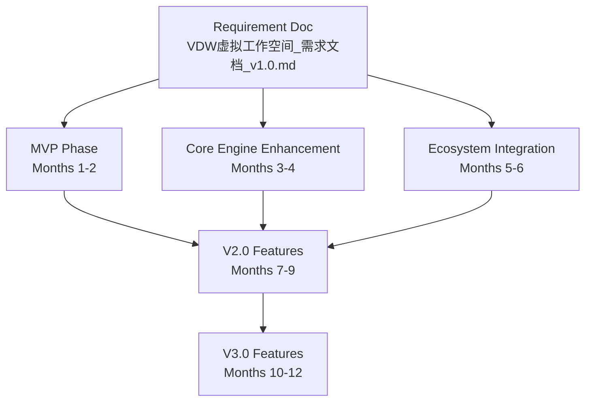
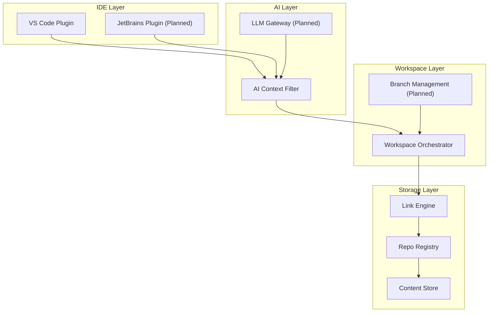
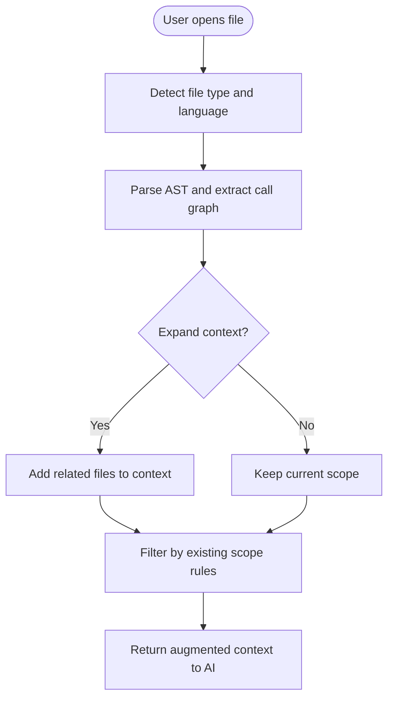
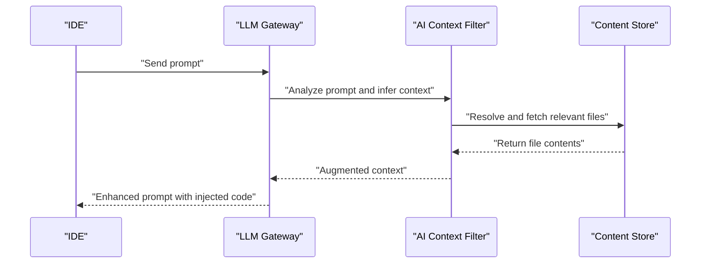
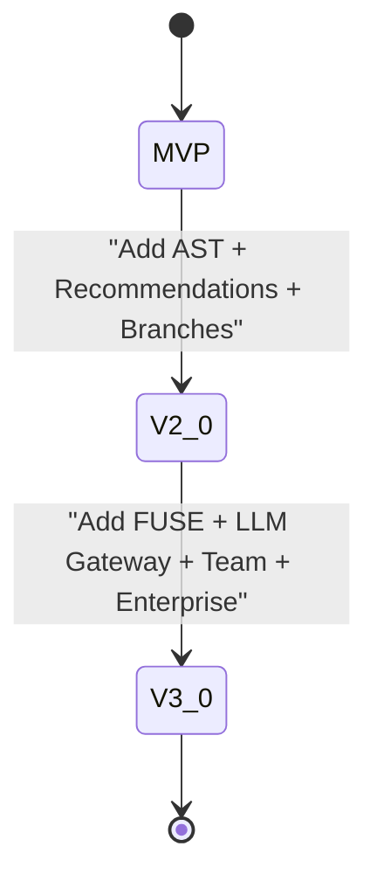
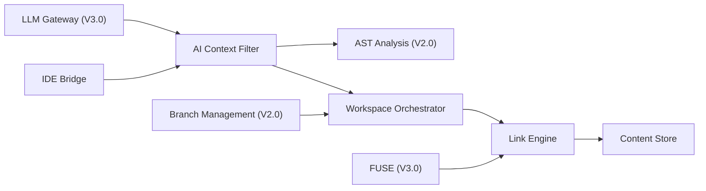

# Future Roadmap and Advanced Features

<cite>
**Referenced Files in This Document**
- [VDW虚拟工作空间_需求文档_v1.0.md](file://ai_workspace/VDW虚拟工作空间_需求文档_v1.0.md)
</cite>

## Table of Contents
1. [Introduction](#introduction)
2. [Project Structure](#project-structure)
3. [Core Components](#core-components)
4. [Architecture Overview](#architecture-overview)
5. [Detailed Component Analysis](#detailed-component-analysis)
6. [Dependency Analysis](#dependency-analysis)
7. [Performance Considerations](#performance-considerations)
8. [Troubleshooting Guide](#troubleshooting-guide)
9. [Conclusion](#conclusion)
10. [Appendices](#appendices)

## Introduction
This document outlines the future roadmap and advanced feature plans for VDW (Virtual Dev Workspace) through V2.0 and V3.0. It synthesizes the product’s strategic direction, the incremental evolution from MVP to advanced capabilities, and the technical feasibility of planned enhancements. The focus areas include AST-driven dynamic context expansion, intelligent recommendations, branch management, FUSE virtual file system for complete transparency, LLM Gateway integration for dynamic context injection, team collaboration features, and enterprise capabilities. Performance targets, compatibility expansion plans, and competitive advantages are explained alongside the roadmap.

## Project Structure
The repository currently contains a single product requirement document that defines the MVP and subsequent phases. The document organizes the vision, functional architecture, acceptance criteria, and iteration plan across three phases: MVP, core engine enhancement, and ecosystem integration.

**Diagram sources**
- [VDW虚拟工作空间_需求文档_v1.0.md:558-614](file://ai_workspace/VDW虚拟工作空间_需求文档_v1.0.md#L558-L614)

**Section sources**
- [VDW虚拟工作空间_需求文档_v1.0.md:10-704](file://ai_workspace/VDW虚拟工作空间_需求文档_v1.0.md#L10-L704)

## Core Components
The requirement document defines the core components that underpin VDW’s architecture and functionality. These components form the foundation for V2.0 and V3.0 enhancements.

- IDE Bridge (VS Code plugin): Provides logical workspace view, context file lists, and one-click dependency addition.
- AI Context Filter: Intercepts AI requests and filters content based on configured scopes; supports AST-based dynamic expansion in later phases.
- Workspace Orchestrator: Parses .vdwrc, constructs dependency graphs, detects cycles, and dynamically mounts repositories.
- Link Engine: Maps repositories from the Content Store to local logical paths using platform-appropriate linking mechanisms.
- Repo Registry: Manages metadata, version dependency graphs, and branch/commit tracking.
- Content Store: Implements global deduplication using CAS and Git object sharing.

These components collectively enable the MVP and serve as the base for advanced features in V2.0 and V3.0.

**Section sources**
- [VDW虚拟工作空间_需求文档_v1.0.md:39-71](file://ai_workspace/VDW虚拟工作空间_需求文档_v1.0.md#L39-L71)
- [VDW虚拟工作空间_需求文档_v1.0.md:226-279](file://ai_workspace/VDW虚拟工作空间_需求文档_v1.0.md#L226-L279)
- [VDW虚拟工作空间_需求文档_v1.0.md:338-351](file://ai_workspace/VDW虚拟工作空间_需求文档_v1.0.md#L338-L351)
- [VDW虚拟工作空间_需求文档_v1.0.md:157-191](file://ai_workspace/VDW虚拟工作空间_需求文档_v1.0.md#L157-L191)
- [VDW虚拟工作空间_需求文档_v1.0.md:123-154](file://ai_workspace/VDW虚拟工作空间_需求文档_v1.0.md#L123-L154)

## Architecture Overview
The system architecture integrates IDE plugins, AI context filtering, workspace orchestration, linking, registry, and storage. The architecture supports both static scoping and dynamic expansion via AST analysis in later phases.

**Diagram sources**
- [VDW虚拟工作空间_需求文档_v1.0.md:39-71](file://ai_workspace/VDW虚拟工作空间_需求文档_v1.0.md#L39-L71)
- [VDW虚拟工作空间_需求文档_v1.0.md:651-663](file://ai_workspace/VDW虚拟工作空间_需求文档_v1.0.md#L651-L663)

**Section sources**
- [VDW虚拟工作空间_需求文档_v1.0.md:39-71](file://ai_workspace/VDW虚拟工作空间_需求文档_v1.0.md#L39-L71)

## Detailed Component Analysis

### V2.0 Feature Plan (Months 7-9)
V2.0 focuses on enhancing intelligence and developer productivity while maintaining backward compatibility and performance.

- AST Analysis for Dynamic Context Expansion
  - Goal: Move beyond static scope filtering to dynamically expand the AI context based on code call graphs and dependencies.
  - Implementation approach: Integrate language-specific parsers to build ASTs and derive call relationships; augment the AI Context Filter to include related files automatically.
  - Benefits: Reduces manual scope tuning, improves AI suggestion quality, and accelerates cross-repository debugging.

- Intelligent Recommendations
  - Goal: Suggest additional repositories or files to include in the AI context based on the current editing session.
  - Implementation approach: Track file edits and inferred dependencies; surface recommendations to the IDE bridge and AI context filter.
  - Benefits: Streamlines context assembly and reduces cognitive load during complex refactorings.

- Branch Management
  - Goal: Provide a visual, unified view of branches across linked repositories with one-click switching and merging.
  - Implementation approach: Extend the Workspace Orchestrator and IDE bridge to expose branch states and actions.
  - Benefits: Simplifies multi-repo branching workflows and reduces operational overhead.

- Performance Optimizations
  - Goal: Improve throughput and responsiveness for large-scale multi-repo environments.
  - Implementation approach: Leverage asynchronous I/O and parallelization in the Link Engine and indexing pipeline.
  - Benefits: Faster link/unlink operations, reduced latency in context generation, and smoother IDE interactions.

**Diagram sources**
- [VDW虚拟工作空间_需求文档_v1.0.md:651-657](file://ai_workspace/VDW虚拟工作空间_需求文档_v1.0.md#L651-L657)

**Section sources**
- [VDW虚拟工作空间_需求文档_v1.0.md:651-657](file://ai_workspace/VDW虚拟工作空间_需求文档_v1.0.md#L651-L657)

### V3.0 Feature Plan (Months 10-12)
V3.0 aims to achieve complete transparency and enterprise readiness, enabling seamless integration across IDEs and teams.

- FUSE Virtual File System
  - Goal: Present a fully transparent virtual file system so IDEs operate as if working with local files, without VDW awareness.
  - Implementation approach: Develop a FUSE module that overlays the logical workspace onto the filesystem, intercepting reads/writes and delegating to the Link Engine.
  - Benefits: Eliminates IDE-specific integrations, simplifies adoption, and reduces maintenance overhead.

- LLM Gateway Integration
  - Goal: Intercept prompts before sending to LLM providers and inject relevant cross-repository code snippets dynamically.
  - Implementation approach: Build a gateway that inspects prompts, augments with context from the AI Context Filter, and forwards to selected LLMs.
  - Benefits: Improves accuracy and speed of AI assistance by providing precise, on-demand context.

- Team Collaboration
  - Goal: Enable teams to share .vdwrc configurations and maintain synchronized development environments.
  - Implementation approach: Add workspace sharing primitives, conflict resolution, and change propagation across collaborators.
  - Benefits: Standardizes environments, reduces “works on my machine” issues, and accelerates onboarding.

- Enterprise Capabilities
  - Goal: Provide enterprise-grade controls for large organizations.
  - Implementation approach: Introduce SSO, permission management, audit logging, and private deployments.
  - Benefits: Enables secure, scalable adoption in corporate settings.

**Diagram sources**
- [VDW虚拟工作空间_需求文档_v1.0.md:658-663](file://ai_workspace/VDW虚拟工作空间_需求文档_v1.0.md#L658-L663)

**Section sources**
- [VDW虚拟工作空间_需求文档_v1.0.md:658-663](file://ai_workspace/VDW虚拟工作空间_需求文档_v1.0.md#L658-L663)

### Conceptual Overview
The evolution from MVP to V2.0 and V3.0 follows an incremental approach:
- MVP validates the core value: physical deduplication, logical workspace, and AI context filtering.
- V2.0 adds intelligence and developer ergonomics: AST-driven expansion, recommendations, branch management, and performance improvements.
- V3.0 achieves transparency and enterprise readiness: FUSE, LLM Gateway, team collaboration, and enterprise controls.

[No sources needed since this diagram shows conceptual workflow, not actual code structure]

[No sources needed since this section doesn't analyze specific source files]

## Dependency Analysis
The roadmap documents define clear dependencies among features and phases. The IDE Bridge depends on the AI Context Filter, which in turn relies on Workspace Orchestrator, Link Engine, and Content Store. V2.0 builds on these foundations by adding AST analysis and recommendations, while V3.0 introduces FUSE and LLM Gateway integrations.

**Diagram sources**
- [VDW虚拟工作空间_需求文档_v1.0.md:39-71](file://ai_workspace/VDW虚拟工作空间_需求文档_v1.0.md#L39-L71)
- [VDW虚拟工作空间_需求文档_v1.0.md:651-663](file://ai_workspace/VDW虚拟工作空间_需求文档_v1.0.md#L651-L663)

**Section sources**
- [VDW虚拟工作空间_需求文档_v1.0.md:39-71](file://ai_workspace/VDW虚拟工作空间_需求文档_v1.0.md#L39-L71)
- [VDW虚拟工作空间_需求文档_v1.0.md:651-663](file://ai_workspace/VDW虚拟工作空间_需求文档_v1.0.md#L651-L663)

## Performance Considerations
Performance targets are established for MVP and expanded for V2.0/V3.0:
- Link creation time: < 10 seconds for up to five repositories.
- Context file list generation: < 500 ms for 1000 files.
- Incremental index updates: < 1 second for single-file changes.
- Disk space savings: > 60% in multi-branch scenarios.
- Memory footprint: < 200 MB for 10,000 files.
- IDE startup impact: < 2 seconds compared to no VDW.
- FUSE performance loss: < 5% (targeted for V3.0).

These targets guide engineering decisions and validation criteria across phases.

**Section sources**
- [VDW虚拟工作空间_需求文档_v1.0.md:390-400](file://ai_workspace/VDW虚拟工作空间_需求文档_v1.0.md#L390-L400)
- [VDW虚拟工作空间_需求文档_v1.0.md:609-612](file://ai_workspace/VDW虚拟工作空间_需求文档_v1.0.md#L609-L612)

## Troubleshooting Guide
Operational reliability is ensured through diagnostics, validation, and recovery mechanisms:
- Validation: Use vdw validate to detect dependency cycles and report dependency paths.
- Diagnostics: vdw doctor helps diagnose common issues; vdw logs provides structured logs.
- Recovery: vdw rollback enables reverting operations; vdw store repair fixes corrupted stores.
- IDE integration: VS Code plugin registers a FileProvider and exposes commands for linking, un-linking, and refreshing context.

These tools support iterative development and reduce downtime during transitions.

**Section sources**
- [VDW虚拟工作空间_需求文档_v1.0.md:517-524](file://ai_workspace/VDW虚拟工作空间_需求文档_v1.0.md#L517-L524)
- [VDW虚拟工作空间_需求文档_v1.0.md:528-555](file://ai_workspace/VDW虚拟工作空间_需求文档_v1.0.md#L528-L555)

## Conclusion
VDW’s roadmap progresses from a validated MVP to intelligent, transparent, and enterprise-ready capabilities. V2.0 enhances context intelligence and developer workflows, while V3.0 delivers FUSE transparency, LLM Gateway integration, team collaboration, and enterprise controls. The phased approach ensures technical feasibility, strong performance targets, and a clear competitive advantage: a unified, efficient, and AI-aware development environment across multiple repositories.

[No sources needed since this section summarizes without analyzing specific files]

## Appendices

### Compatibility Expansion Plans
- Platforms: macOS 12+, Linux distributions, Windows 10/11 with developer mode.
- IDEs: VS Code (MVP), JetBrains suite (planned).
- Runtimes: Node.js 18+ for CLI, VS Code 1.85+ for plugin.

**Section sources**
- [VDW虚拟工作空间_需求文档_v1.0.md:401-410](file://ai_workspace/VDW虚拟工作空间_需求文档_v1.0.md#L401-L410)

### Strategic Direction and Competitive Advantages
- Unified Multi-Repository Experience: Physical deduplication plus logical workspace eliminates redundancy and fragmentation.
- AI-Centric Context Management: Static scoping evolves to dynamic AST-driven expansion for higher-quality suggestions.
- Developer Transparency: FUSE and LLM Gateway minimize friction and IDE-specific complexity.
- Enterprise Readiness: Team collaboration and enterprise controls enable secure, scalable adoption.

**Section sources**
- [VDW虚拟工作空间_需求文档_v1.0.md:6-27](file://ai_workspace/VDW虚拟工作空间_需求文档_v1.0.md#L6-L27)
- [VDW虚拟工作空间_需求文档_v1.0.md:651-663](file://ai_workspace/VDW虚拟工作空间_需求文档_v1.0.md#L651-L663)