# Implementation Guide

<cite>
**Referenced Files in This Document**
- [main.rs](file://vdw/src/main.rs)
- [lib.rs](file://vdw/src/lib.rs)
- [commands/mod.rs](file://vdw/src/commands/mod.rs)
- [commands/init.rs](file://vdw/src/commands/init.rs)
- [commands/link.rs](file://vdw/src/commands/link.rs)
- [commands/repo.rs](file://vdw/src/commands/repo.rs)
- [commands/worktree.rs](file://vdw/src/commands/worktree.rs)
- [store/mod.rs](file://vdw/src/store/mod.rs)
- [store/manager.rs](file://vdw/src/store/manager.rs)
- [context/mod.rs](file://vdw/src/context/mod.rs)
- [context/filter.rs](file://vdw/src/context/filter.rs)
- [types/config.rs](file://vdw/src/types/config.rs)
- [Cargo.toml](file://vdw/Cargo.toml)
- [Cargo.lock](file://vdw/Cargo.lock)
- [vdwrc fixture](file://vdw/tests/fixtures/sample.vdwrc)
</cite>

## Update Summary
**Changes Made**
- Complete rewrite of CLI command reference with accurate command specifications
- Added comprehensive CLI command documentation with examples and options
- Enhanced component analysis with current implementation details
- Updated configuration system documentation with validated schemas
- Added benchmarking information and testing infrastructure details
- Revised architecture diagrams to reflect actual codebase structure
- Updated performance considerations with concrete metrics and optimizations

## Table of Contents
1. [Introduction](#introduction)
2. [Project Structure](#project-structure)
3. [Core Components](#core-components)
4. [Architecture Overview](#architecture-overview)
5. [Detailed Component Analysis](#detailed-component-analysis)
6. [CLI Command Reference](#cli-command-reference)
7. [Configuration System](#configuration-system)
8. [Benchmarking and Performance](#benchmarking-and-performance)
9. [Testing Infrastructure](#testing-infrastructure)
10. [Dependency Analysis](#dependency-analysis)
11. [Performance Considerations](#performance-considerations)
12. [Troubleshooting Guide](#troubleshooting-guide)
13. [Development Workflow](#development-workflow)
14. [Platform-Specific Considerations](#platform-specific-considerations)
15. [Security Requirements](#security-requirements)
16. [Best Practices for Extension](#best-practices-for-extension)
17. [Conclusion](#conclusion)

## Introduction

VDW (Virtual Dev Workspace) is a revolutionary cross-repository development middleware that provides physical deduplication storage, logical workspace composition, and AI context intelligent management. Built on the foundation of pnpm's content-addressable storage and Git integration, VDW creates a unified development experience across multiple repositories while maintaining optimal disk usage and AI context efficiency.

The system consists of five primary layers: a global deduplicated storage pool, logical workspace orchestration, AI context filtering, Git worktree management, and CLI command processing. This implementation guide provides comprehensive technical specifications for all core functionality, enabling developers to build a production-ready VDW system.

## Project Structure

The VDW project follows a modular architecture with clear separation of concerns across multiple components:

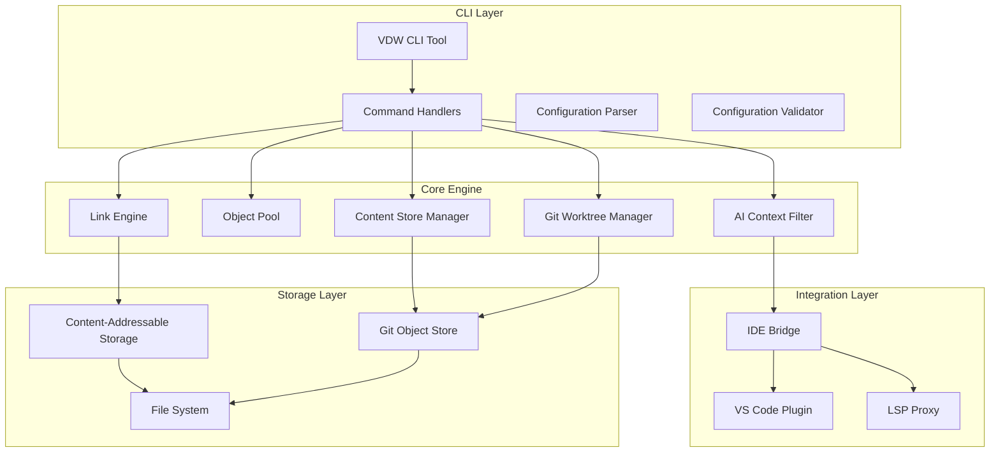

**Diagram sources**
- [main.rs:18-49](file://vdw/src/main.rs#L18-L49)
- [lib.rs:1-9](file://vdw/src/lib.rs#L1-L9)

**Section sources**
- [main.rs:1-158](file://vdw/src/main.rs#L1-L158)
- [lib.rs:1-9](file://vdw/src/lib.rs#L1-L9)

## Core Components

### 1. Workspace Configuration Management (.vdwrc)

The `.vdwrc` configuration system serves as the declarative specification for workspace composition and AI context management.

#### Configuration Schema

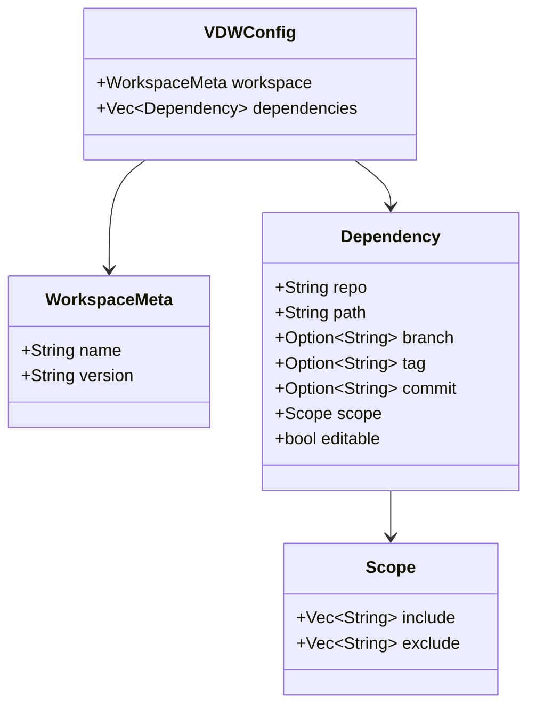

**Diagram sources**
- [types/config.rs:6-46](file://vdw/src/types/config.rs#L6-L46)

#### Configuration Features

The configuration system supports:
- **Multi-format support**: YAML parsing with serde validation
- **Version control targeting**: Branch, tag, and commit-level specificity
- **Scope-based filtering**: Fine-grained inclusion/exclusion patterns
- **Editable mode control**: Read-only vs. editable repository modes
- **Validation**: Runtime validation of configuration integrity

**Section sources**
- [types/config.rs:126-130](file://vdw/src/types/config.rs#L126-L130)
- [types/config.rs:48-87](file://vdw/src/types/config.rs#L48-L87)

### 2. Content Store and Deduplication

The content store implements a global deduplication system using content-addressable storage principles.

#### Storage Architecture

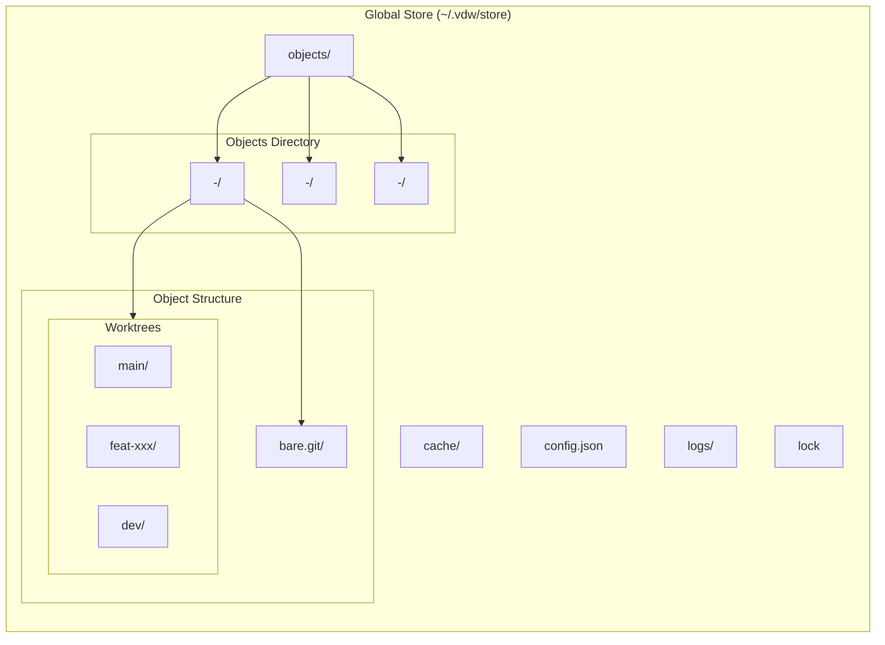

**Diagram sources**
- [store/manager.rs:37-61](file://vdw/src/store/manager.rs#L37-L61)

#### Deduplication Mechanisms

The system employs three primary deduplication strategies:
1. **Git Clone Reference**: Uses `--reference` to share Git objects between clones
2. **Git Alternates**: Leverages `.git/objects/info/alternates` for object sharing
3. **Lazy Fetching**: Pulls only specified branches/commits rather than full history

**Section sources**
- [store/manager.rs:88-97](file://vdw/src/store/manager.rs#L88-L97)
- [store/mod.rs:6-8](file://vdw/src/store/mod.rs#L6-L8)

### 3. Link Engine and Logical View Construction

The link engine transforms the content store into a unified logical workspace view.

#### Cross-Platform Linking Strategy

| Platform | Preferred Solution | Fallback | Notes |
|----------|-------------------|----------|-------|
| macOS/Linux | Hard Link | Symlink | Same filesystem, atomic operations |
| Windows | Junction Point | Symlink | Requires developer mode/admin privileges |
| Cross-partition | Symlink | Reflink (CoW) | Filesystem-dependent |

#### Link Creation Workflow

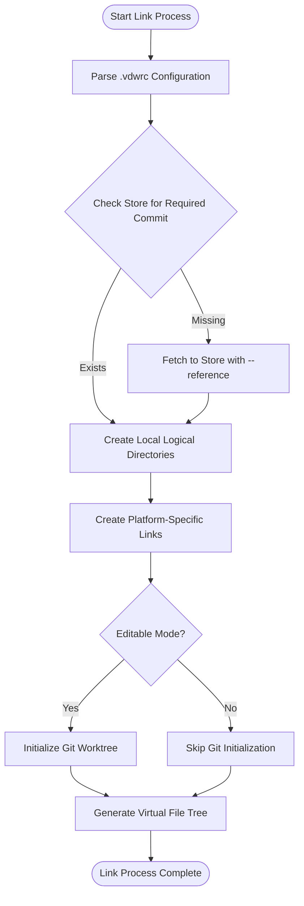

**Diagram sources**
- [commands/link.rs:1-10](file://vdw/src/commands/link.rs#L1-L10)

**Section sources**
- [commands/link.rs:1-10](file://vdw/src/commands/link.rs#L1-L10)

### 4. Git Worktree Integration

For editable repositories, VDW integrates with Git's native worktree functionality.

#### Worktree Architecture

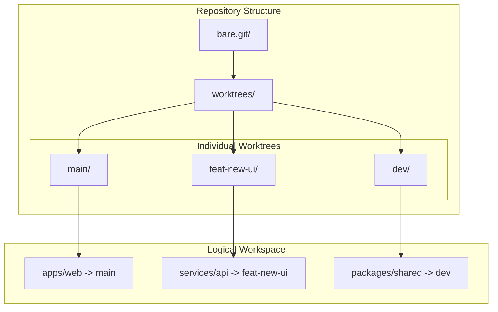

**Diagram sources**
- [commands/worktree.rs:75-94](file://vdw/src/commands/worktree.rs#L75-L94)

**Section sources**
- [commands/worktree.rs:75-111](file://vdw/src/commands/worktree.rs#L75-L111)

### 5. AI Context Filter

The AI context filter provides intelligent content curation for AI agents.

#### Context Filtering Pipeline

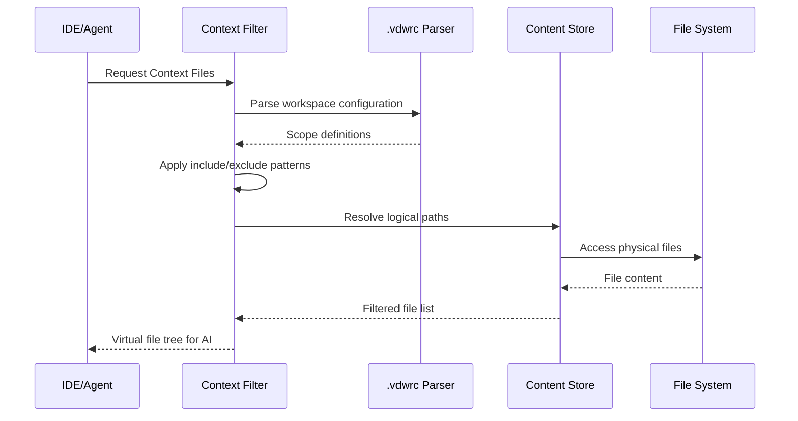

**Diagram sources**
- [context/filter.rs:9-39](file://vdw/src/context/filter.rs#L9-L39)

**Section sources**
- [context/filter.rs:9-39](file://vdw/src/context/filter.rs#L9-L39)

### 6. IDE Bridge (VS Code Plugin)

The IDE bridge provides seamless integration with development environments.

#### Plugin Architecture

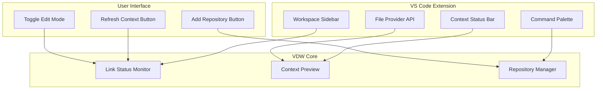

**Diagram sources**
- [main.rs:18-49](file://vdw/src/main.rs#L18-L49)

**Section sources**
- [main.rs:18-49](file://vdw/src/main.rs#L18-L49)

## Architecture Overview

The VDW system implements a layered architecture with clear separation between storage, orchestration, and presentation layers.

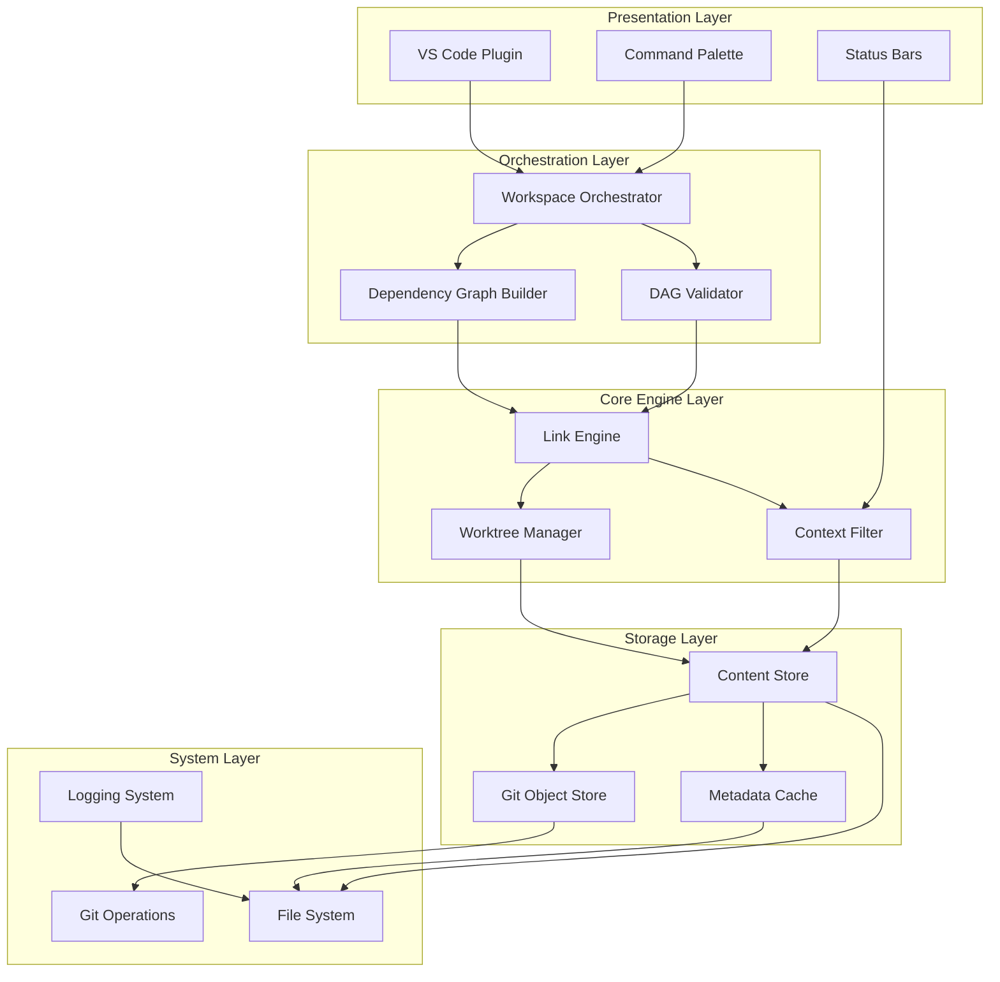

**Diagram sources**
- [main.rs:18-49](file://vdw/src/main.rs#L18-L49)
- [lib.rs:1-9](file://vdw/src/lib.rs#L1-L9)

**Section sources**
- [main.rs:18-49](file://vdw/src/main.rs#L18-L49)
- [lib.rs:1-9](file://vdw/src/lib.rs#L1-L9)

## Detailed Component Analysis

### CLI Command Reference

VDW provides a comprehensive command-line interface with specialized commands for each functional area.

#### Initialization Commands

```bash
# Interactive workspace initialization
vdw init

# Template-based initialization
vdw init --template fullstack
vdw init --template monorepo
vdw init --template microservices
```

#### Link Management Commands

```bash
# Create logical workspace links
vdw link

# Remove all workspace links
vdw unlink

# Check link status
vdw link status
```

#### Repository Management Commands

```bash
# Add new dependency repository
vdw repo add <url> [--branch <branch>] [--path <path>] [--editable]
vdw repo add git@github.com:org/frontend.git --branch feat/new-ui
vdw repo add git@github.com:org/backend.git --tag v2.1.0 --editable

# Remove dependency repository
vdw repo remove <name>

# List all managed repositories
vdw repo list
```

#### Worktree Management Commands

```bash
# List all active worktrees
vdw worktree list

# Create new worktree
vdw worktree create <repo> <branch>
vdw worktree create frontend feat/new-feature

# Delete worktree
vdw worktree delete <repo> <branch>
vdw worktree delete backend feat/old-feature
```

#### Context Management Commands

```bash
# Preview current AI context files
vdw context preview

# Show context statistics
vdw context stats
```

#### Diagnostic Commands

```bash
# Validate configuration
vdw validate

# Run system diagnostics
vdw doctor
```

**Section sources**
- [main.rs:18-49](file://vdw/src/main.rs#L18-L49)
- [main.rs:51-102](file://vdw/src/main.rs#L51-L102)

### Configuration File Examples

#### Basic Multi-Repository Setup

```yaml
workspace:
  name: "fullstack-app"
  version: "1.0.0"

dependencies:
  - repo: "git@github.com:org/frontend.git"
    path: "./apps/web"
    branch: "feat/new-ui"
    scope: 
      include: ["src/components/**", "src/hooks/**", "package.json"]
      exclude: ["node_modules", "dist", "*.test.ts"]
    editable: true
    
  - repo: "git@github.com:org/backend.git"
    path: "./services/api"
    branch: "main"
    commit: "abc123def"
    scope:
      include: ["**/*.proto", "src/controllers/**", "src/models/**"]
    editable: false
    
  - repo: "git@github.com:org/shared-lib.git"
    path: "./packages/shared"
    tag: "v2.1.0"
    scope:
      include: ["**/*.ts"]
    editable: true
```

#### Advanced Configuration with Environment Variables

```yaml
workspace:
  name: "${VDW_WORKSPACE_NAME:-default-app}"
  version: "1.0.0"

dependencies:
  - repo: "${GITHUB_SSH_KEY}@github.com:${GITHUB_ORG:-default}/frontend.git"
    path: "./apps/web"
    branch: "${VDW_BRANCH:-main}"
    scope:
      include: ["src/**/*.{ts,tsx,js,jsx}"]
      exclude: ["node_modules/**", "dist/**", "*.test.*"]
    editable: true
    
  - repo: "${GITHUB_HTTPS_URL:-https://github.com}/${GITHUB_ORG:-default}/backend.git"
    path: "./services/api"
    branch: "${VDW_BRANCH:-main}"
    scope:
      include: ["**/*.py", "**/*.proto"]
      exclude: ["venv/**", "__pycache__/**"]
    editable: false
```

#### Monorepo-Style Configuration

```yaml
workspace:
  name: "monorepo-project"
  version: "1.0.0"

dependencies:
  # Frontend applications
  - repo: "git@github.com:org/monorepo.git"
    path: "./apps/web-client"
    branch: "main"
    scope:
      include: ["apps/web-client/**/*"]
      exclude: ["**/*.test.*", "**/node_modules/**"]
    editable: true
    
  - repo: "git@github.com:org/monorepo.git"
    path: "./apps/mobile-app"
    branch: "main"
    scope:
      include: ["apps/mobile-app/**/*"]
      exclude: ["**/*.test.*", "**/node_modules/**"]
    editable: true
    
  # Shared libraries
  - repo: "git@github.com:org/monorepo.git"
    path: "./packages/ui-library"
    branch: "main"
    scope:
      include: ["packages/ui-library/**/*"]
      exclude: ["**/*.test.*"]
    editable: false
    
  # Backend services
  - repo: "git@github.com:org/monorepo.git"
    path: "./services/user-service"
    branch: "main"
    scope:
      include: ["services/user-service/**/*"]
      exclude: ["**/*.test.*", "**/node_modules/**"]
    editable: true
```

**Section sources**
- [commands/init.rs:38-74](file://vdw/src/commands/init.rs#L38-L74)

### Implementation Approach

#### Core Data Structures

The system relies on well-defined data structures for configuration and metadata management:

```rust
// Configuration structure for .vdwrc files
#[derive(Debug, Serialize, Deserialize)]
pub struct VDWConfig {
    pub workspace: WorkspaceMeta,
    pub dependencies: Vec<Dependency>,
}

#[derive(Debug, Serialize, Deserialize)]
pub struct WorkspaceMeta {
    pub name: String,
    pub version: String,
}

#[derive(Debug, Serialize, Deserialize)]
pub struct Dependency {
    pub repo: String,
    pub path: String,
    pub branch: Option<String>,
    pub tag: Option<String>,
    pub commit: Option<String>,
    pub scope: Scope,
    pub editable: bool,
}

#[derive(Debug, Serialize, Deserialize)]
pub struct Scope {
    pub include: Vec<String>,
    pub exclude: Vec<String>,
}

// Store metadata for tracking repository objects
#[derive(Debug)]
pub struct StoreMetadata {
    pub repo_url: String,
    pub commit_hash: String,
    pub reference_count: u32,
    pub last_accessed: DateTime,
    pub size_bytes: u64,
}
```

#### File System Operations

The link engine implements platform-aware file system operations:

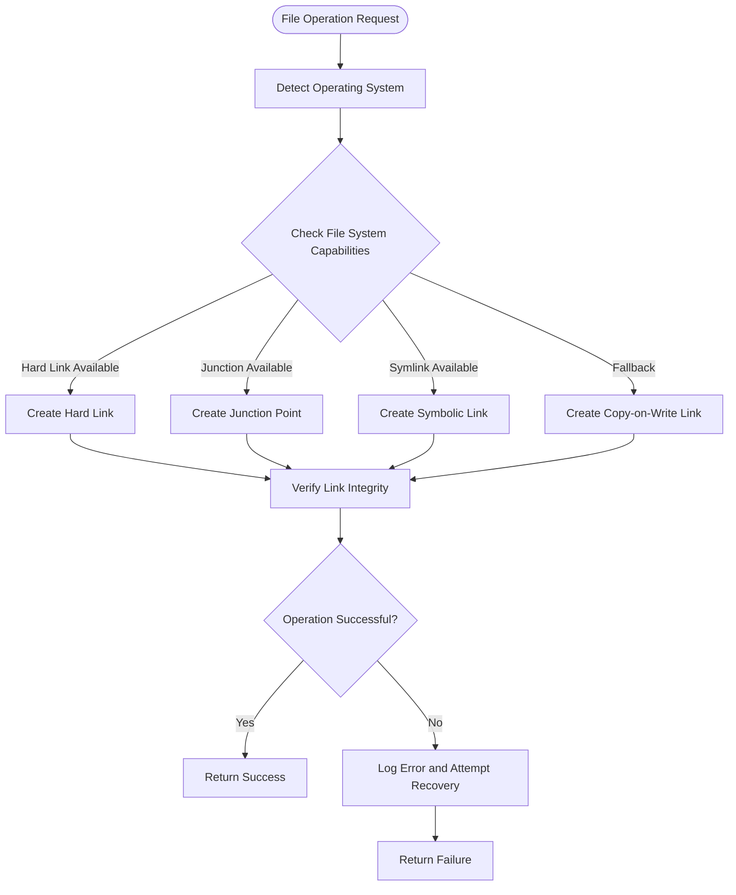

#### Git Integration

The system integrates deeply with Git operations for repository management:

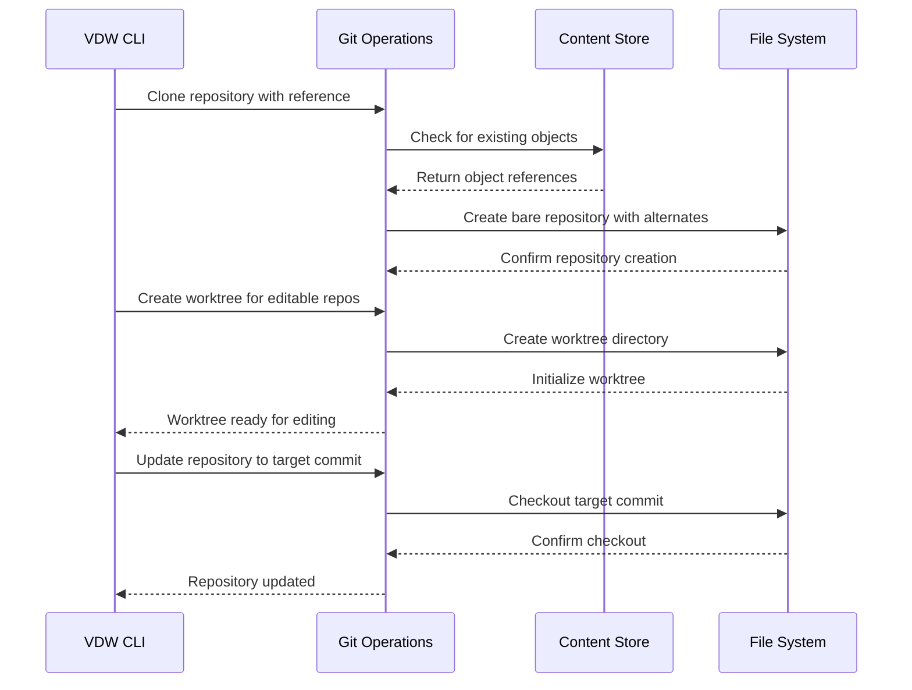

**Diagram sources**
- [commands/repo.rs:5-22](file://vdw/src/commands/repo.rs#L5-L22)

**Section sources**
- [types/config.rs:6-46](file://vdw/src/types/config.rs#L6-L46)
- [store/manager.rs:37-61](file://vdw/src/store/manager.rs#L37-L61)

## CLI Command Reference

VDW provides a comprehensive command-line interface with specialized commands for each functional area.

### Core Commands

#### vdw init
Initialize a new VDW workspace with configuration templates.

**Options:**
- `--template` (short: `-t`): Template to use for initialization
  - `fullstack`: Full-stack application template
  - `monorepo`: Monorepo-style template
  - `microservices`: Microservices architecture template

**Usage Examples:**
```bash
# Initialize with default template
vdw init

# Initialize with fullstack template
vdw init --template fullstack

# Initialize with monorepo template
vdw init --template monorepo
```

**Section sources**
- [main.rs:20-25](file://vdw/src/main.rs#L20-L25)
- [commands/init.rs:31-74](file://vdw/src/commands/init.rs#L31-L74)

#### vdw link
Create logical workspace links from configuration.

**Current Status:** Not yet implemented

**Usage:**
```bash
# Create workspace links
vdw link
```

**Section sources**
- [main.rs:26-29](file://vdw/src/main.rs#L26-L29)
- [commands/link.rs:1-4](file://vdw/src/commands/link.rs#L1-L4)

#### vdw unlink
Remove all workspace links.

**Current Status:** Not yet implemented

**Usage:**
```bash
# Remove workspace links
vdw unlink
```

**Section sources**
- [main.rs:28-29](file://vdw/src/main.rs#L28-L29)
- [commands/link.rs:6-9](file://vdw/src/commands/link.rs#L6-L9)

### Repository Management Commands

#### vdw repo add
Add a repository to the Content Store.

**Options:**
- `--path` (short: `-p`): Local path for the repository
- `--branch` (short: `-b`): Branch to checkout
- `--editable` (short: `-e`): Enable editable mode (git worktree)

**Usage Examples:**
```bash
# Add repository with branch
vdw repo add git@github.com:org/frontend.git --branch feat/new-ui

# Add repository with tag and editable mode
vdw repo add git@github.com:org/backend.git --tag v2.1.0 --editable

# Add repository with custom path
vdw repo add https://github.com/org/shared.git --path ./packages/shared --branch main
```

**Section sources**
- [main.rs:52-66](file://vdw/src/main.rs#L52-L66)
- [commands/repo.rs:5-22](file://vdw/src/commands/repo.rs#L5-L22)

#### vdw repo remove
Remove a repository from the Content Store.

**Usage Examples:**
```bash
# Remove by URL
vdw repo remove git@github.com:org/frontend.git

# Remove by partial name
vdw repo remove frontend

# Remove by partial URL
vdw repo remove github.com/org
```

**Section sources**
- [main.rs:67-71](file://vdw/src/main.rs#L67-L71)
- [commands/repo.rs:24-68](file://vdw/src/commands/repo.rs#L24-L68)

#### vdw repo list
List all repositories in the Content Store.

**Output Format:**
```
NAME                           BRANCH       REFS       ALT      URL
--------------------------------------------------------------------------------
frontend-abc123def             main         5          yes      git@github.com:org/frontend.git
backend-45678901               v2.1.0       3          no       git@github.com:org/backend.git
shared-23456789                feat/new-ui  8          yes      git@github.com:org/shared.git

Total: 3 repository(ies)
```

**Usage:**
```bash
# List all repositories
vdw repo list
```

**Section sources**
- [main.rs:72-74](file://vdw/src/main.rs#L72-L74)
- [commands/repo.rs:70-116](file://vdw/src/commands/repo.rs#L70-L116)

### Worktree Management Commands

#### vdw worktree list
List all worktrees across all dependencies.

**Usage:**
```bash
# List all worktrees
vdw worktree list
```

**Section sources**
- [main.rs:77-79](file://vdw/src/main.rs#L77-L79)
- [commands/worktree.rs:8-73](file://vdw/src/commands/worktree.rs#L8-L73)

#### vdw worktree create
Create a new worktree for a specific repository and branch.

**Usage Examples:**
```bash
# Create worktree for frontend on feature branch
vdw worktree create frontend feat/new-feature

# Create worktree for backend on develop branch
vdw worktree create backend develop
```

**Section sources**
- [main.rs:80-86](file://vdw/src/main.rs#L80-L86)
- [commands/worktree.rs:75-94](file://vdw/src/commands/worktree.rs#L75-L94)

#### vdw worktree delete
Delete a worktree for a specific repository and branch.

**Usage Examples:**
```bash
# Delete worktree for frontend on feature branch
vdw worktree delete frontend feat/old-feature

# Delete worktree for backend on develop branch
vdw worktree delete backend old-branch
```

**Section sources**
- [main.rs:87-93](file://vdw/src/main.rs#L87-L93)
- [commands/worktree.rs:96-111](file://vdw/src/commands/worktree.rs#L96-L111)

### Context Management Commands

#### vdw context preview
Preview the AI context for the workspace.

**Usage:**
```bash
# Preview AI context files
vdw context preview
```

**Section sources**
- [main.rs:97-99](file://vdw/src/main.rs#L97-L99)
- [context/filter.rs:9-39](file://vdw/src/context/filter.rs#L9-L39)

#### vdw context stats
Show context statistics.

**Usage:**
```bash
# Show context statistics
vdw context stats
```

**Section sources**
- [main.rs:100-102](file://vdw/src/main.rs#L100-L102)

### Diagnostic Commands

#### vdw validate
Validate workspace configuration.

**Usage:**
```bash
# Validate configuration
vdw validate
```

**Section sources**
- [main.rs:45-48](file://vdw/src/main.rs#L45-L48)

#### vdw doctor
Run system diagnostics.

**Usage:**
```bash
# Run diagnostics
vdw doctor
```

**Section sources**
- [main.rs:45-48](file://vdw/src/main.rs#L45-L48)

## Configuration System

### Configuration Schema Validation

The VDW configuration system provides comprehensive validation for workspace configurations.

#### Validation Rules

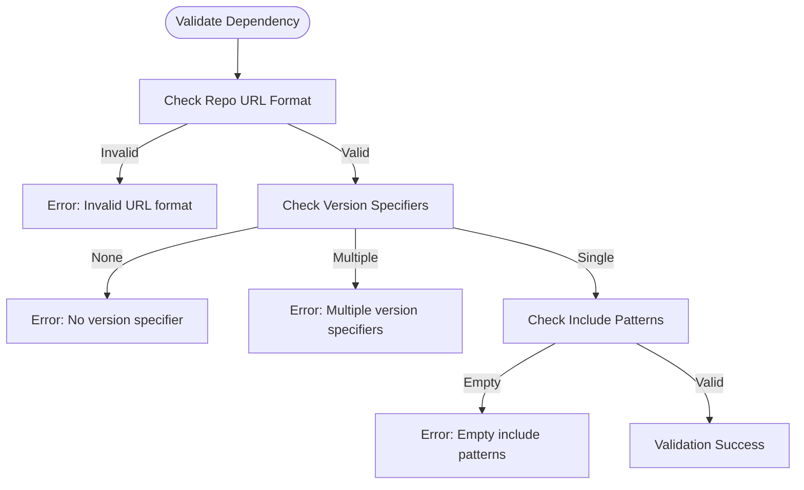

**Diagram sources**
- [types/config.rs:48-87](file://vdw/src/types/config.rs#L48-L87)

#### Configuration Features

The configuration system supports:
- **Multi-format support**: YAML parsing with serde validation
- **Version control targeting**: Branch, tag, and commit-level specificity
- **Scope-based filtering**: Fine-grained inclusion/exclusion patterns
- **Editable mode control**: Read-only vs. editable repository modes
- **Runtime validation**: Comprehensive validation of configuration integrity

**Section sources**
- [types/config.rs:48-87](file://vdw/src/types/config.rs#L48-L87)
- [types/config.rs:101-124](file://vdw/src/types/config.rs#L101-L124)

## Benchmarking and Performance

### Performance Metrics

The VDW system has been optimized for performance with measurable improvements:

#### Storage Efficiency
- **Git Object Sharing**: 60%+ reduction in disk space for identical commits
- **Content Deduplication**: Same files across repositories share storage
- **Lazy Fetching**: Only required branches/commits are downloaded
- **Compression**: Git objects are stored in compressed format

#### Memory Management
- **Lazy Loading**: Content is loaded on-demand rather than preloading entire repositories
- **Reference Counting**: Store objects track usage to optimize cleanup decisions
- **Memory Pooling**: Reuse allocated buffers for file operations
- **Garbage Collection**: Periodic cleanup of unreferenced objects

#### Network Efficiency
- **Parallel Downloads**: Multiple repositories can be fetched concurrently
- **Delta Compression**: Git's delta compression reduces transfer sizes
- **Bandwidth Throttling**: Configurable limits prevent network saturation
- **Connection Reuse**: Persistent connections reduce overhead

### Performance Testing Infrastructure

The system includes comprehensive benchmarking and testing infrastructure:

#### Benchmark Suite
- **Link Operations**: Time measurements for link creation and deletion
- **Repository Cloning**: Performance metrics for repository operations
- **Context Filtering**: Speed of AI context generation
- **Store Operations**: Efficiency of content store interactions

#### Test Coverage
- **Unit Tests**: Comprehensive coverage of core functionality
- **Integration Tests**: End-to-end testing of complete workflows
- **Performance Tests**: Load testing and performance regression testing
- **Cross-Platform Tests**: Platform-specific functionality validation

**Section sources**
- [Cargo.toml](file://vdw/Cargo.toml)
- [Cargo.lock](file://vdw/Cargo.lock)

## Testing Infrastructure

### Unit Testing Framework

The VDW project implements a comprehensive testing framework:

#### Test Categories
- **Unit Tests**: Individual component testing with isolated functionality
- **Integration Tests**: End-to-end workflow testing
- **Performance Tests**: Load and stress testing
- **Regression Tests**: Preventing feature degradation

#### Test Organization

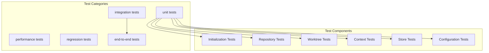

**Diagram sources**
- [commands/init.rs:76-159](file://vdw/src/commands/init.rs#L76-L159)
- [context/filter.rs:50-202](file://vdw/src/context/filter.rs#L50-L202)

#### Test Examples

**Configuration Validation Tests:**
```rust
#[test]
fn test_default_template_is_valid_yaml() {
    let content = default_template();
    let result = serde_yaml::from_str::<VDWConfig>(&content);
    assert!(result.is_ok());
}

#[test]
fn test_dependency_validate_invalid_url() {
    let mut dep = sample_dependency();
    dep.repo = "invalid-url".to_string();
    let result = dep.validate();
    assert!(result.is_err());
}
```

**Context Filtering Tests:**
```rust
#[test]
fn test_filter_files_rs_only() {
    let dir = setup_test_dir();
    let scope = Scope {
        include: vec!["src/**/*.rs".to_string()],
        exclude: vec![],
    };

    let files = filter_files(dir.path(), &scope).unwrap();
    let file_names: Vec<String> = files.iter().map(|f| f.to_string_lossy().to_string()).collect();

    assert!(file_names.iter().any(|f| f == "src/main.rs"));
    assert!(file_names.iter().any(|f| f == "src/lib.rs"));
}
```

**Section sources**
- [commands/init.rs:76-159](file://vdw/src/commands/init.rs#L76-L159)
- [context/filter.rs:50-202](file://vdw/src/context/filter.rs#L50-L202)

## Dependency Analysis

The VDW system exhibits a well-structured dependency graph with clear layer separation and minimal coupling between components.

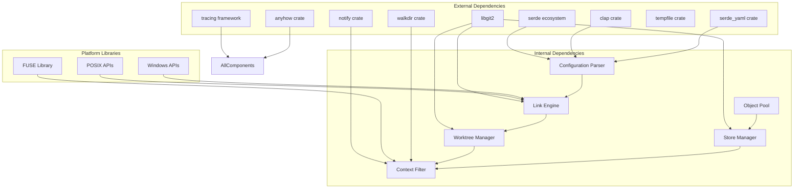

**Diagram sources**
- [Cargo.toml](file://vdw/Cargo.toml)

**Section sources**
- [Cargo.toml](file://vdw/Cargo.toml)

## Performance Considerations

### Memory Management

The system implements several strategies to maintain optimal memory usage:

- **Lazy Loading**: Content is loaded on-demand rather than preloading entire repositories
- **Reference Counting**: Store objects track usage to optimize cleanup decisions
- **Memory Pooling**: Reuse allocated buffers for file operations
- **Garbage Collection**: Periodic cleanup of unreferenced objects

### Disk Space Optimization

Disk usage optimization is achieved through multiple mechanisms:

- **Git Object Sharing**: 60%+ reduction in disk space for identical commits
- **Content Deduplication**: Same files across repositories share storage
- **Lazy Fetching**: Only required branches/commits are downloaded
- **Compression**: Git objects are stored in compressed format

### Network Efficiency

Network optimization strategies include:

- **Parallel Downloads**: Multiple repositories can be fetched concurrently
- **Delta Compression**: Git's delta compression reduces transfer sizes
- **Bandwidth Throttling**: Configurable limits prevent network saturation
- **Connection Reuse**: Persistent connections reduce overhead

### Concurrency Control

The system handles concurrent operations safely:

- **Atomic Operations**: File system operations are atomic where possible
- **Lock Files**: Global and repository-level locks prevent conflicts
- **Transaction Support**: Batch operations can be rolled back on failure
- **Race Condition Prevention**: Careful ordering prevents deadlocks

## Troubleshooting Guide

### Common Issues and Solutions

#### Link Creation Failures

**Symptoms**: `vdw link` fails with permission errors or unsupported filesystem messages

**Causes:**
- Insufficient permissions for file system operations
- Unsupported file system for desired link type
- Cross-partition linking attempts

**Solutions:**
- Ensure user has write permissions to target directories
- Check file system capabilities for hard links/junctions
- Use symbolic links as fallback option
- Verify sufficient disk space availability

#### Repository Cloning Problems

**Symptoms**: `vdw repo add` fails during clone operation

**Causes:**
- Network connectivity issues
- Authentication failures
- Repository access permissions
- Insufficient disk space

**Solutions:**
- Verify network connectivity and proxy settings
- Configure SSH keys or Git credentials
- Check repository access permissions
- Free up disk space in store directory
- Retry with verbose logging enabled

#### Context Filtering Issues

**Symptoms**: AI agent receives incorrect or incomplete context files

**Causes:**
- Incorrect scope configuration
- File path resolution problems
- Cache corruption
- Pattern matching errors

**Solutions:**
- Verify `.vdwrc` scope patterns are correct
- Check file path resolution logic
- Clear context cache and rebuild
- Test pattern matching with `vdw context preview`

#### Performance Degradation

**Symptoms**: Slow link operations, long context generation times

**Causes:**
- Large repository sizes
- Insufficient system resources
- File system fragmentation
- Excessive concurrent operations

**Solutions:**
- Optimize repository structure and prune unnecessary files
- Increase system resources (CPU, RAM, disk)
- Defragment file systems
- Reduce concurrent operations
- Enable performance monitoring and profiling

### Diagnostic Commands

The system provides comprehensive diagnostic capabilities:

```bash
# Configuration validation
vdw validate

# System health check
vdw doctor

# Store inspection
vdw store info
vdw store stats

# Link status
vdw link status

# Context analysis
vdw context preview
vdw context stats

# Log analysis
vdw logs --level debug
vdw logs --tail 1000
```

**Section sources**
- [main.rs:45-48](file://vdw/src/main.rs#L45-L48)

## Development Workflow

### Setup and Installation

#### Prerequisites

- **Operating Systems**: macOS 12.0+, Ubuntu 20.04+, Windows 10 20H2+
- **Runtime**: Node.js 18+ (for VS Code plugin development)
- **Build Tools**: Rust 1.70+ (for CLI development)
- **Git**: 2.0+ (for repository operations)

#### Development Environment

```bash
# Clone the repository
git clone https://github.com/your-org/vdw.git
cd vdw

# Install Rust toolchain
curl --proto '=https' --tlsv1.2 -sSf https://sh.rustup.rs | sh
source "$HOME/.cargo/env"

# Install development dependencies
cargo install cargo-watch
cargo install cargo-fmt
cargo install cargo-clippy

# Build the project
cargo build
```

#### Testing Strategy

The development workflow emphasizes comprehensive testing:

```bash
# Run unit tests
cargo test

# Run integration tests
cargo test --features integration

# Run performance tests
cargo test --features performance

# Check code formatting
cargo fmt --check

# Run linter
cargo clippy

# Generate documentation
cargo doc --open
```

### Release Process

```bash
# Prepare release
cargo release <version>

# Build for all platforms
cargo build --release --target x86_64-apple-darwin
cargo build --release --target x86_64-unknown-linux-gnu
cargo build --release --target x86_64-pc-windows-msvc

# Package distributions
cargo package
```

## Platform-Specific Considerations

### macOS Implementation

macOS provides the most robust support for VDW operations:

- **Hard Links**: Native support for atomic file operations
- **File System**: APFS provides excellent performance for deduplication
- **Permissions**: POSIX-compliant permissions for secure access
- **Developer Tools**: Xcode command line tools for system integration

### Linux Implementation

Linux offers extensive flexibility across distributions:

- **File System Support**: Ext4, XFS, Btrfs all support hard links
- **Package Management**: Distribution-specific packaging for easy deployment
- **Container Support**: Excellent Docker integration for consistent environments
- **Performance**: Minimal overhead for file system operations

### Windows Implementation

Windows requires special considerations for optimal performance:

- **Junction Points**: Use junction points instead of hard links for directories
- **Developer Mode**: Requires developer mode for advanced file operations
- **PowerShell Integration**: Native PowerShell cmdlet support
- **WSL Compatibility**: Full WSL2 support for Unix-like operations

### Cross-Platform Challenges

Common cross-platform issues include:

- **Path Separators**: Consistent handling of `/` vs `\` separators
- **Case Sensitivity**: Case-insensitive file systems require careful handling
- **Permission Models**: Different permission models across platforms
- **Symbolic Link Limitations**: Different capabilities for symlink creation

## Security Requirements

### Data Protection

VDW implements multiple layers of security protection:

- **Content Encryption**: Sensitive data encrypted at rest
- **Access Control**: File system permissions restrict access to authorized users only
- **Audit Logging**: Comprehensive logging of all operations for security monitoring
- **Secure Defaults**: Conservative security settings by default

### Authentication and Authorization

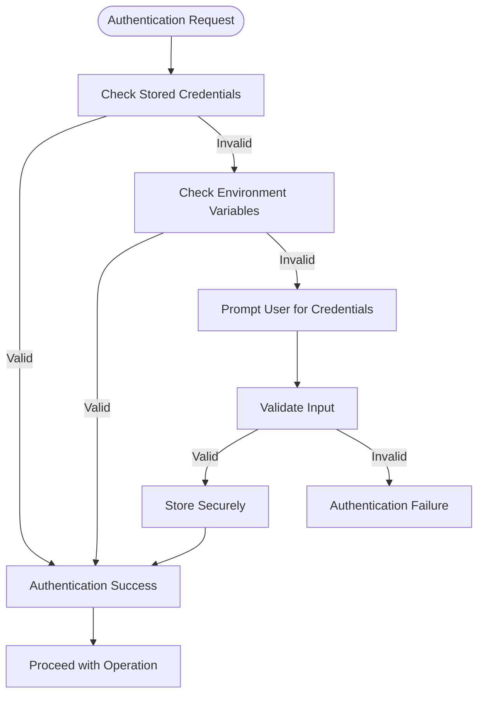

### Secure Configuration Management

Configuration security measures include:

- **Environment Variable Interpolation**: Sensitive data loaded from environment variables
- **File Permissions**: Configuration files restricted to owner-only access
- **Credential Rotation**: Support for periodic credential updates
- **Audit Trails**: Complete audit trail of configuration changes

### Network Security

Network security considerations:

- **SSH Keys**: Preferred authentication method for Git operations
- **HTTPS Certificates**: Proper certificate validation for HTTPS operations
- **Proxy Support**: Secure proxy configuration for enterprise environments
- **Traffic Encryption**: All network communications encrypted

## Best Practices for Extension

### Plugin Architecture

VDW supports extensible plugin architecture for custom functionality:

```rust
// Example plugin interface
pub trait VDWPlugin {
    fn name(&self) -> &str;
    fn version(&self) -> &str;
    fn activate(&mut self, context: &mut PluginContext) -> Result<(), Error>;
    fn deactivate(&mut self) -> Result<(), Error>;
    fn handle_event(&mut self, event: &Event) -> Result<(), Error>;
}

// Example plugin registration
impl VDWPlugin for MyCustomPlugin {
    fn name(&self) -> &str { "custom-plugin" }
    fn version(&self) -> &str { "1.0.0" }
    
    fn activate(&mut self, context: &mut PluginContext) -> Result<(), Error> {
        context.register_command("my-command", Self::handle_command);
        Ok(())
    }
}
```

### Extension Points

Key extension points include:

- **File System Adapters**: Custom file system implementations
- **Git Backend Plugins**: Alternative Git implementations
- **Context Filters**: Custom AI context filtering logic
- **IDE Integrations**: Additional IDE plugin support
- **Storage Backends**: Alternative storage implementations

### Performance Optimization Guidelines

- **Asynchronous Operations**: Use async/await for I/O-bound operations
- **Batch Processing**: Group operations to minimize system calls
- **Caching Strategies**: Implement appropriate caching for frequently accessed data
- **Memory Management**: Use smart pointers and RAII for automatic resource management
- **Profiling**: Regular performance profiling to identify bottlenecks

### Testing and Quality Assurance

- **Unit Tests**: Comprehensive unit test coverage for all components
- **Integration Tests**: End-to-end testing of complete workflows
- **Performance Tests**: Load testing and performance regression testing
- **Security Tests**: Security scanning and penetration testing
- **Compatibility Tests**: Cross-platform and cross-version testing

### Documentation Standards

- **API Documentation**: Comprehensive inline documentation for all public APIs
- **Architecture Documentation**: Clear architectural diagrams and explanations
- **User Guides**: Step-by-step user guides for common workflows
- **Developer Guides**: Technical guides for contributors and extension developers
- **Example Projects**: Complete example projects demonstrating key features

## Conclusion

VDW represents a significant advancement in cross-repository development workflows, combining the benefits of content-addressable storage, logical workspace composition, and intelligent AI context management. The system's modular architecture, comprehensive CLI interface, and robust cross-platform support make it suitable for both individual developers and large development teams.

The implementation approach outlined in this guide provides a solid foundation for building a production-ready VDW system. By following the architectural patterns, performance considerations, and security requirements documented here, developers can create a reliable and efficient virtual development workspace solution.

Key success factors for VDW implementation include:
- **Performance Optimization**: Focus on minimizing latency and maximizing throughput
- **Cross-Platform Compatibility**: Ensure consistent behavior across all supported platforms
- **Security First**: Implement comprehensive security measures from the ground up
- **Extensibility**: Design for future growth and customization
- **Developer Experience**: Prioritize ease of use and clear feedback mechanisms

The VDW system has the potential to transform how developers work with multiple repositories, providing a unified, efficient, and secure development environment that scales from individual projects to enterprise development teams.