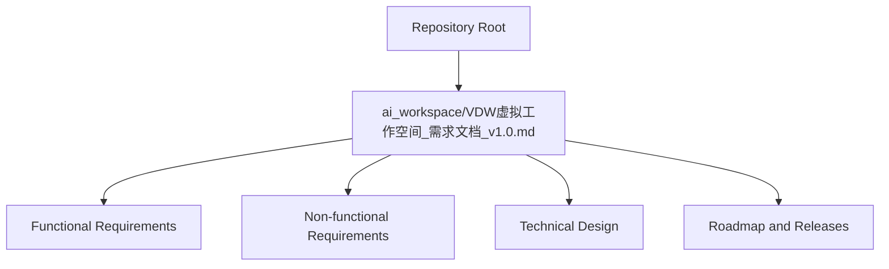
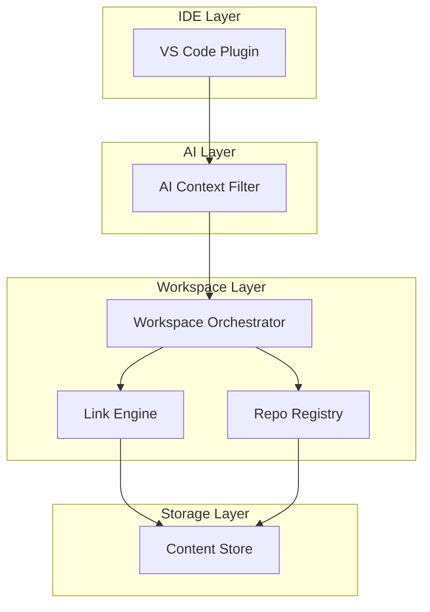
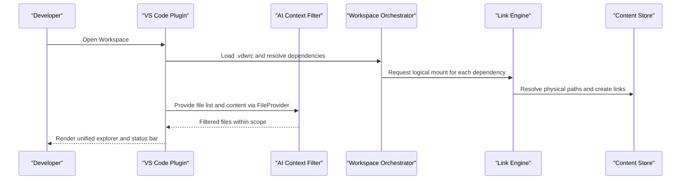
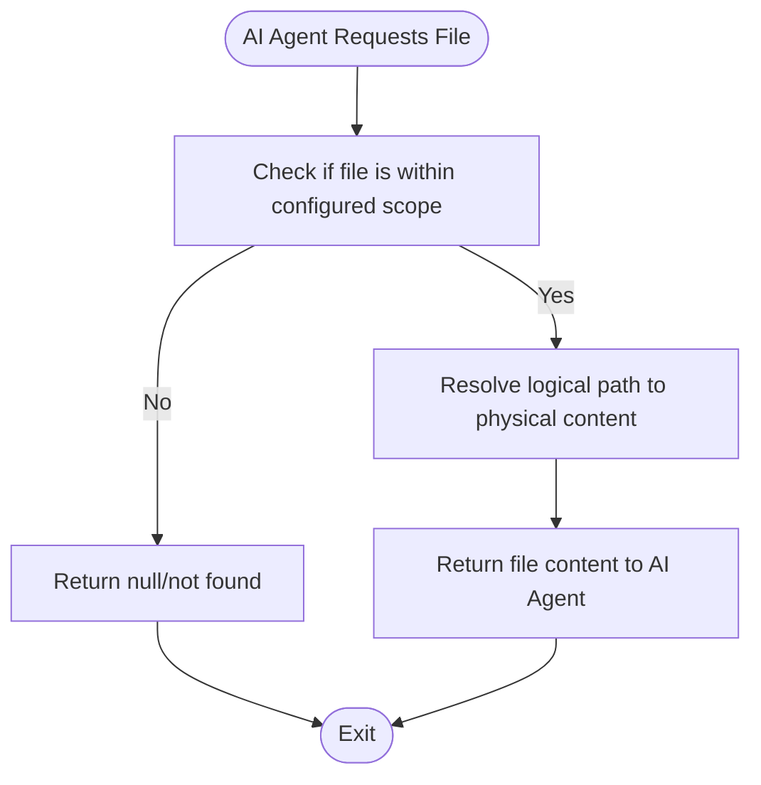
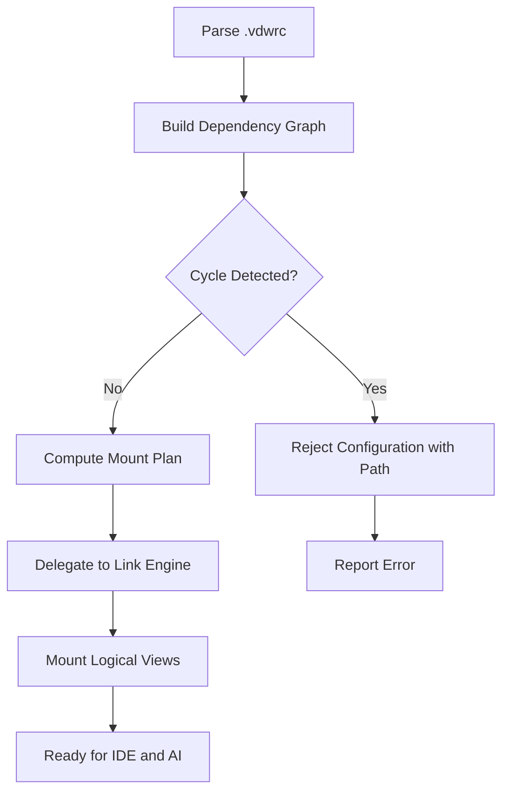
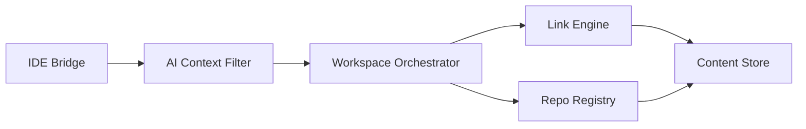

# Project Overview

<cite>
**Referenced Files in This Document**
- [VDW虚拟工作空间_需求文档_v1.0.md](file://ai_workspace/VDW虚拟工作空间_需求文档_v1.0.md)
</cite>

## Table of Contents
1. [Introduction](#introduction)
2. [Project Structure](#project-structure)
3. [Core Components](#core-components)
4. [Architecture Overview](#architecture-overview)
5. [Detailed Component Analysis](#detailed-component-analysis)
6. [Dependency Analysis](#dependency-analysis)
7. [Performance Considerations](#performance-considerations)
8. [Troubleshooting Guide](#troubleshooting-guide)
9. [Conclusion](#conclusion)
10. [Appendices](#appendices)

## Introduction
VDW (Virtual Dev Workspace) is a cross-repository full-stack development middleware designed to address four major pain points in modern development:
- Code redundancy across multiple local copies of the same repositories
- AI context explosion caused by indexing entire monorepos or multi-repo setups
- Chaotic dependency management when linking external repositories into a single workspace
- Fragmented developer experience due to physically isolated repositories

VDW’s value proposition centers on three layers:
- Physical deduplication storage: a global, content-addressable store that ensures identical content is stored only once
- Logical workspace assembly: a unified, overlayed view of multiple repositories mapped under a single logical directory tree
- AI context intelligent management: precise scoping and filtering of files exposed to AI agents, preventing context overflow while keeping relevant code accessible

These layers enable both individual developers and research teams to operate efficiently across heterogeneous repositories with minimal duplication, predictable dependency management, and focused AI assistance.

## Project Structure
At present, the repository contains a single product requirement document that defines VDW’s architecture, features, and implementation roadmap. The document outlines the functional and non-functional requirements, command surface, and acceptance criteria for the system.

**Diagram sources**
- [VDW虚拟工作空间_需求文档_v1.0.md:1-704](file://ai_workspace/VDW虚拟工作空间_需求文档_v1.0.md#L1-L704)

**Section sources**
- [VDW虚拟工作空间_需求文档_v1.0.md:10-704](file://ai_workspace/VDW虚拟工作空间_需求文档_v1.0.md#L10-L704)

## Core Components
VDW’s core functionality is organized around a layered architecture with clear responsibilities and integration points. The primary components are:

- IDE Bridge (VS Code plugin)
  - Provides a logical workspace view, exposes a file provider to AI agents, and offers commands to manage links and refresh contexts.
  - Integrates with VS Code’s extension APIs to present a unified explorer and status bar indicators.

- AI Context Filter (context manager)
  - Interprets scope definitions from the workspace configuration to produce a filtered, virtual file list for AI agents.
  - Implements a file provider interface to intercept and serve only scoped content.

- Workspace Orchestrator (workspace orchestrator)
  - Parses the workspace configuration, builds dependency graphs, validates for cycles, and dynamically mounts logical views.
  - Coordinates with lower layers to ensure consistent state across linked repositories.

- Link Engine
  - Translates logical paths into physical links using platform-aware strategies (hard links, symlinks, junctions).
  - Creates a unified file tree that appears as a single monorepo-like structure to the IDE and AI.

- Repo Registry
  - Manages metadata for repositories, including version dependencies, branches, commits, and tracking mechanisms.

- Content Store
  - A global, content-addressable store leveraging Git object sharing to deduplicate content across repositories and branches.
  - Supports lazy fetching and safe concurrent access.

- Git Worktree Integration (editable mode)
  - For editable dependencies, maintains separate worktrees that share the underlying object store, enabling normal Git operations without duplicating objects.

Practical examples of common use cases:
- Adding a frontend app and a backend service to a single workspace and immediately getting AI suggestions that include only the relevant files.
- Switching between feature branches across multiple repositories while maintaining a consistent logical view and AI context.
- Collaborating on a shared library across teams by pinning specific commits and scoping AI exposure to only public APIs.

**Section sources**
- [VDW虚拟工作空间_需求文档_v1.0.md:39-71](file://ai_workspace/VDW虚拟工作空间_需求文档_v1.0.md#L39-L71)
- [VDW虚拟工作空间_需求文档_v1.0.md:282-335](file://ai_workspace/VDW虚拟工作空间_需求文档_v1.0.md#L282-L335)
- [VDW虚拟工作空间_需求文档_v1.0.md:226-279](file://ai_workspace/VDW虚拟工作空间_需求文档_v1.0.md#L226-L279)
- [VDW虚拟工作空间_需求文档_v1.0.md:527-548](file://ai_workspace/VDW虚拟工作空间_需求文档_v1.0.md#L527-L548)
- [VDW虚拟工作空间_需求文档_v1.0.md:157-191](file://ai_workspace/VDW虚拟工作空间_需求文档_v1.0.md#L157-L191)
- [VDW虚拟工作空间_需求文档_v1.0.md:123-154](file://ai_workspace/VDW虚拟工作空间_需求文档_v1.0.md#L123-L154)
- [VDW虚拟工作空间_需求文档_v1.0.md:194-223](file://ai_workspace/VDW虚拟工作空间_需求文档_v1.0.md#L194-L223)

## Architecture Overview
The system architecture is a layered pipeline that transforms multiple physical repositories into a single logical workspace with intelligent AI context management.

**Diagram sources**
- [VDW虚拟工作空间_需求文档_v1.0.md:39-71](file://ai_workspace/VDW虚拟工作空间_需求文档_v1.0.md#L39-L71)
- [VDW虚拟工作空间_需求文档_v1.0.md:123-154](file://ai_workspace/VDW虚拟工作空间_需求文档_v1.0.md#L123-L154)
- [VDW虚拟工作空间_需求文档_v1.0.md:157-191](file://ai_workspace/VDW虚拟工作空间_需求文档_v1.0.md#L157-L191)
- [VDW虚拟工作空间_需求文档_v1.0.md:226-279](file://ai_workspace/VDW虚拟工作空间_需求文档_v1.0.md#L226-L279)
- [VDW虚拟工作空间_需求文档_v1.0.md:282-335](file://ai_workspace/VDW虚拟工作空间_需求文档_v1.0.md#L282-L335)

## Detailed Component Analysis

### IDE Bridge (VS Code Plugin)
Responsibilities:
- Present a logical workspace view in the sidebar
- Expose a file provider to AI plugins, limiting content to the configured scope
- Provide commands to link/unlink repositories, refresh context, and add new dependencies

User-facing benefits:
- Unified explorer across multiple repositories
- Real-time status bar indicators for AI context size
- One-click actions to keep the workspace up to date

Operational flow:

**Diagram sources**
- [VDW虚拟工作空间_需求文档_v1.0.md:282-335](file://ai_workspace/VDW虚拟工作空间_需求文档_v1.0.md#L282-L335)
- [VDW虚拟工作空间_需求文档_v1.0.md:226-279](file://ai_workspace/VDW虚拟工作空间_需求文档_v1.0.md#L226-L279)
- [VDW虚拟工作空间_需求文档_v1.0.md:157-191](file://ai_workspace/VDW虚拟工作空间_需求文档_v1.0.md#L157-L191)
- [VDW虚拟工作空间_需求文档_v1.0.md:123-154](file://ai_workspace/VDW虚拟工作空间_需求文档_v1.0.md#L123-L154)

**Section sources**
- [VDW虚拟工作空间_需求文档_v1.0.md:282-335](file://ai_workspace/VDW虚拟工作空间_需求文档_v1.0.md#L282-L335)

### AI Context Filter
Responsibilities:
- Parse scope definitions from the workspace configuration
- Generate a virtual file list for AI agents
- Intercept file requests and return only scoped content

Behavior:
- Enforces include/exclude patterns to prevent AI context explosion
- Supports incremental updates and event-driven re-indexing (future enhancement)

**Diagram sources**
- [VDW虚拟工作空间_需求文档_v1.0.md:226-279](file://ai_workspace/VDW虚拟工作空间_需求文档_v1.0.md#L226-L279)

**Section sources**
- [VDW虚拟工作空间_需求文档_v1.0.md:226-279](file://ai_workspace/VDW虚拟工作空间_需求文档_v1.0.md#L226-L279)

### Workspace Orchestrator
Responsibilities:
- Parse and validate the workspace configuration
- Build dependency graphs and detect cycles
- Coordinate dynamic mounting of logical views

**Diagram sources**
- [VDW虚拟工作空间_需求文档_v1.0.md:527-548](file://ai_workspace/VDW虚拟工作空间_需求文档_v1.0.md#L527-L548)
- [VDW虚拟工作空间_需求文档_v1.0.md:338-351](file://ai_workspace/VDW虚拟工作空间_需求文档_v1.0.md#L338-L351)

**Section sources**
- [VDW虚拟工作空间_需求文档_v1.0.md:338-351](file://ai_workspace/VDW虚拟工作空间_需求文档_v1.0.md#L338-L351)

### Link Engine
Responsibilities:
- Map logical paths to physical locations using platform-aware linking strategies
- Maintain a unified file tree for IDE and AI consumption

Strategy:
- Prefer hard links on the same filesystem, fall back to symlinks or junctions on Windows
- Support cross-partition scenarios with reflink (copy-on-write) when available

**Section sources**
- [VDW虚拟工作空间_需求文档_v1.0.md:157-191](file://ai_workspace/VDW虚拟工作空间_需求文档_v1.0.md#L157-L191)

### Content Store
Responsibilities:
- Provide a global, content-addressable store for deduplicated content
- Share Git objects across repositories and branches to reduce disk usage

Mechanisms:
- Git clone with reference to reuse existing objects
- Git alternates to point to shared object pools
- Lazy fetching of only declared branches/commits

**Section sources**
- [VDW虚拟工作空间_需求文档_v1.0.md:123-154](file://ai_workspace/VDW虚拟工作空间_需求文档_v1.0.md#L123-L154)

### Git Worktree Integration (Editable Mode)
Responsibilities:
- For editable dependencies, provide separate worktrees that share the underlying object store
- Enable normal Git operations without duplicating objects

**Section sources**
- [VDW虚拟工作空间_需求文档_v1.0.md:194-223](file://ai_workspace/VDW虚拟工作空间_需求文档_v1.0.md#L194-L223)

## Dependency Analysis
VDW’s internal dependencies reflect a layered design with clear separation of concerns. The IDE Bridge depends on the AI Context Filter, which in turn depends on the Workspace Orchestrator. The Orchestrator coordinates the Link Engine and Repo Registry, which both depend on the Content Store.

**Diagram sources**
- [VDW虚拟工作空间_需求文档_v1.0.md:39-71](file://ai_workspace/VDW虚拟工作空间_需求文档_v1.0.md#L39-L71)

**Section sources**
- [VDW虚拟工作空间_需求文档_v1.0.md:39-71](file://ai_workspace/VDW虚拟工作空间_需求文档_v1.0.md#L39-L71)

## Performance Considerations
Key performance targets and strategies:
- Link creation time under 10 seconds for typical multi-repo setups
- Context file list generation under 500 ms for moderate-scale projects
- Incremental indexing updates under 1 second for single-file changes
- Disk space savings greater than 60% in multi-branch scenarios
- Memory footprint below 200 MB for large file sets

These targets guide the selection of technologies and algorithms, emphasizing efficient file system operations, Git object sharing, and event-driven updates.

**Section sources**
- [VDW虚拟工作空间_需求文档_v1.0.md:390-400](file://ai_workspace/VDW虚拟工作空间_需求文档_v1.0.md#L390-L400)

## Troubleshooting Guide
Common issues and mitigation strategies:
- Git state conflicts: Use Git Worktree to isolate working directories and avoid direct edits in the shared store
- Cross-platform compatibility: Abstract file system operations and provide fallback strategies (symlinks/junctions/reflinks)
- AI context inconsistency: Implement event-driven indexing to refresh context within 1 second of file changes
- Circular dependencies: Detect and reject cyclic dependencies during configuration parsing
- IDE plugin overhead: Limit VDW intervention to initialization and branch switching; operate transparently during normal editing

Diagnostic tools and commands:
- Validation and diagnostics commands to verify configuration correctness and environment health
- Logging and verbose modes for troubleshooting
- Doctor command to diagnose common problems and suggest fixes

**Section sources**
- [VDW虚拟工作空间_需求文档_v1.0.md:527-548](file://ai_workspace/VDW虚拟工作空间_需求文档_v1.0.md#L527-L548)
- [VDW虚拟工作空间_需求文档_v1.0.md:418-424](file://ai_workspace/VDW虚拟工作空间_需求文档_v1.0.md#L418-L424)

## Conclusion
VDW addresses the fragmentation and inefficiencies of multi-repository development by unifying physical storage, logical workspace assembly, and AI context management. Its layered architecture enables scalable collaboration, reduces duplication, and keeps AI assistance focused and responsive. The documented roadmap and acceptance criteria provide a clear path toward a production-ready system that integrates seamlessly with existing developer workflows.

## Appendices

### Product Vision and Target Users
Vision:
- Enable seamless, efficient development across heterogeneous repositories with minimal duplication and maximum focus on relevant code.

Target users:
- Individual full-stack developers managing multiple repositories
- Research teams collaborating across services and libraries

Value propositions:
- Reduced disk usage via physical deduplication
- Unified workspace view for improved productivity
- Intelligent AI context to avoid overload and improve suggestions

**Section sources**
- [VDW虚拟工作空间_需求文档_v1.0.md:21-34](file://ai_workspace/VDW虚拟工作空间_需求文档_v1.0.md#L21-L34)

### Implementation Roadmap
- Phase 1 (MVP): Core features including CLI, Content Store, Git Worktree integration, .vdwrc parsing, and VS Code plugin
- Phase 2: Enhanced features such as dependency graph validation, incremental indexing, and expanded CLI tooling
- Phase 3: IDE integrations (JetBrains), LLM Gateway, and enterprise capabilities

**Section sources**
- [VDW虚拟工作空间_需求文档_v1.0.md:558-614](file://ai_workspace/VDW虚拟工作空间_需求文档_v1.0.md#L558-L614)