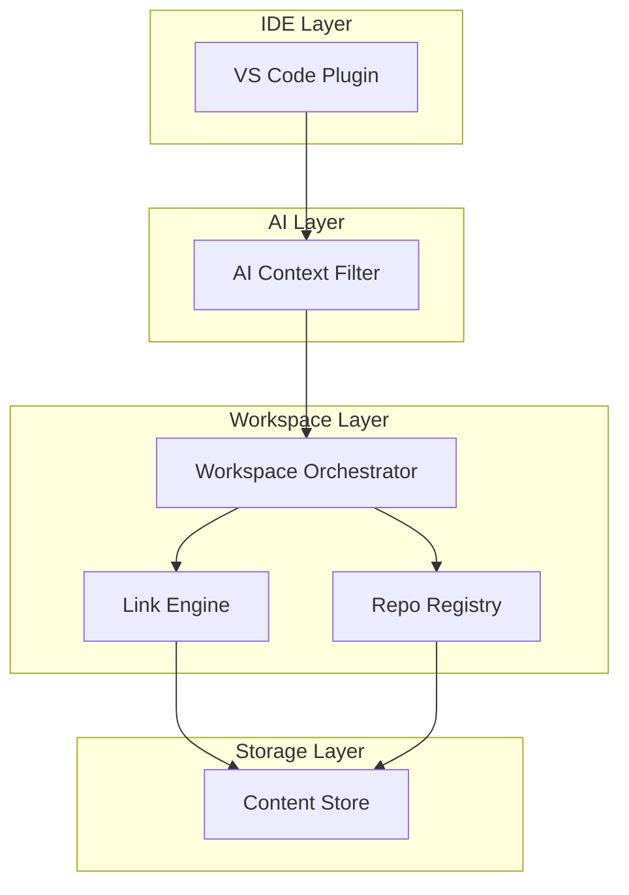
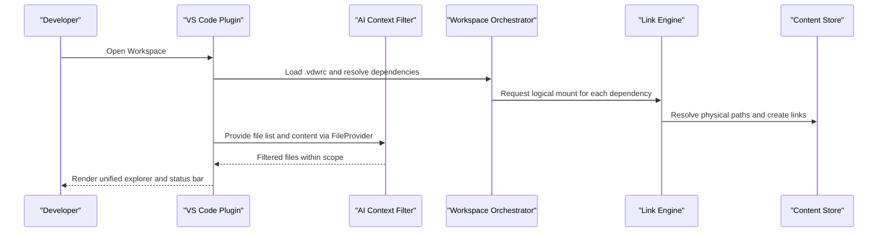
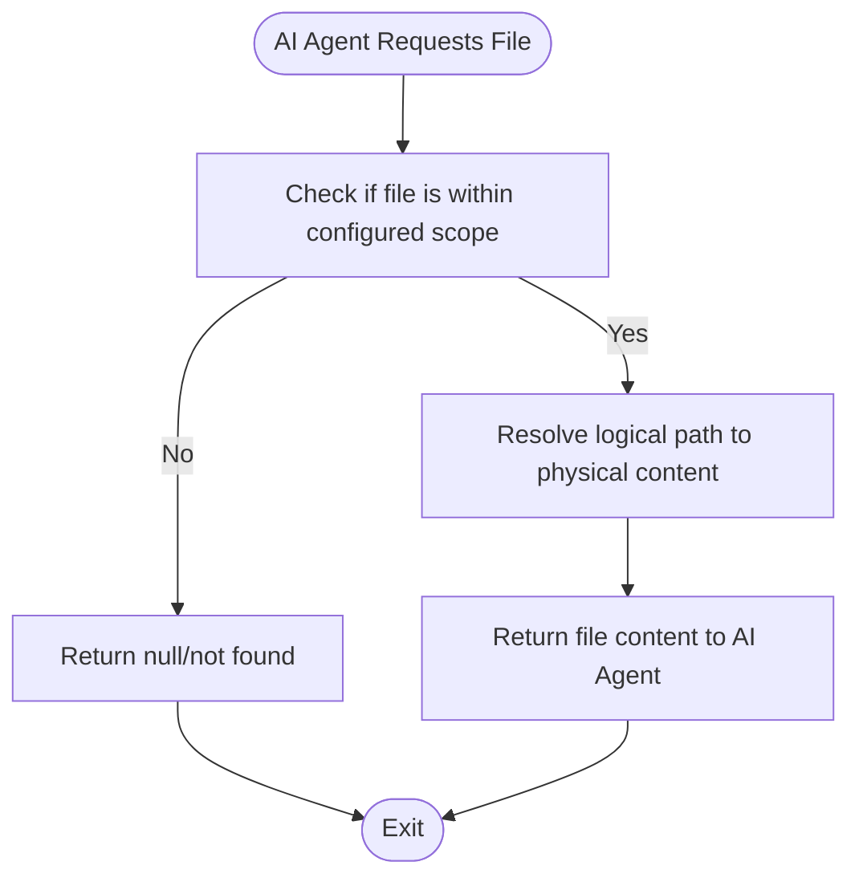
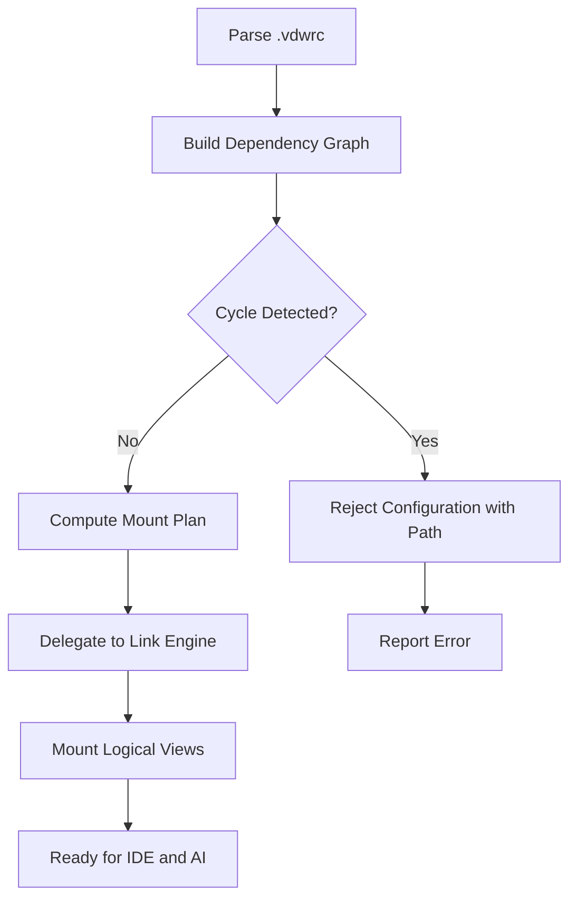

# Project Overview

<cite>
**Referenced Files in This Document**
- [README.md](file://README.md)
- [vdw/README.md](file://vdw/README.md)
- [vdw-vscode/README.md](file://vdw-vscode/README.md)
- [ai_workspace/VDW虚拟工作空间_需求文档_v1.0.md](file://ai_workspace/VDW虚拟工作空间_需求文档_v1.0.md)
- [ai_workspace/VDW虚拟工作空间_技术设计文档_v1.0.md](file://ai_workspace/VDW虚拟工作空间_技术设计文档_v1.0.md)
- [ai_workspace/VDW配置重构_需求文档_v1.0.md](file://ai_workspace/VDW配置重构_需求文档_v1.0.md)
- [ai_workspace/VDW插건功能增强_需求文档_v1.0.md](file://ai_workspace/VDW插件功能增强_需求文档_v1.0.md)
- [ai_workspace/VDW分支选择优化_需求文档_v1.0.md](file://ai_workspace/VDW分支选择优化_需求文档_v1.0.md)
- [DEBUGGING_GUIDE.md](file://DEBUGGING_GUIDE.md)
</cite>

## Update Summary
**Changes Made**
- Updated to reflect the new centralized documentation structure with main README.md serving as the central hub
- Added comprehensive coverage of all sub-project documentation including CLI, VS Code extension, and design documents
- Enhanced project structure documentation to show the new unified documentation approach
- Updated architecture overview to reflect the integrated documentation ecosystem
- Added detailed coverage of the new design document series

## Table of Contents
1. [Introduction](#introduction)
2. [Centralized Documentation Hub](#centralized-documentation-hub)
3. [Project Structure](#project-structure)
4. [Core Components](#core-components)
5. [Architecture Overview](#architecture-overview)
6. [Design Documentation Series](#design-documentation-series)
7. [Detailed Component Analysis](#detailed-component-analysis)
8. [Development Workflow](#development-workflow)
9. [Platform Support](#platform-support)
10. [Getting Started](#getting-started)
11. [Conclusion](#conclusion)

## Introduction
VDW (Virtual Dev Workspace) is a cross-repository full-stack development middleware designed to address four major pain points in modern development:
- Code redundancy across multiple local copies of the same repositories
- AI context explosion caused by indexing entire monorepos or multi-repo setups
- Chaotic dependency management when linking external repositories into a single workspace
- Fragmented developer experience due to physically isolated repositories

VDW's value proposition centers on three layers:
- **Physical deduplication storage**: a global, content-addressable store that ensures identical content is stored only once
- **Logical workspace assembly**: a unified, overlayed view of multiple repositories mapped under a single logical directory tree
- **AI context intelligent management**: precise scoping and filtering of files exposed to AI agents, preventing context overflow while keeping relevant code accessible

These layers enable both individual developers and research teams to operate efficiently across heterogeneous repositories with minimal duplication, predictable dependency management, and focused AI assistance.

**Updated** The project now features a centralized documentation hub through the main README.md file, which serves as the primary entry point for all project information, replacing the previous fragmented documentation approach.

## Centralized Documentation Hub
The VDW project now operates under a unified documentation structure centered around the main README.md file, which serves as the central hub for all project information and provides comprehensive coverage of:

### Primary Documentation Sources
- **Main README.md**: Complete project overview, quick start guide, and comprehensive documentation
- **vdw/README.md**: Detailed CLI documentation with features, usage, and configuration
- **vdw-vscode/README.md**: VS Code extension documentation covering features, installation, and usage
- **Design Documents**: Comprehensive technical specifications and architectural designs

### Documentation Structure Benefits
- **Single Source of Truth**: All essential information consolidated in one accessible location
- **Reduced Cognitive Load**: Developers can find everything they need without navigating multiple scattered documents
- **Improved Onboarding**: New contributors can quickly understand the entire project ecosystem
- **Maintained Consistency**: All documentation stays synchronized with the latest implementation

**Section sources**
- [README.md:1-225](file://README.md#L1-L225)
- [vdw/README.md:1-389](file://vdw/README.md#L1-L389)
- [vdw-vscode/README.md:1-261](file://vdw-vscode/README.md#L1-L261)

## Project Structure
The VDW project follows a modular architecture with clear separation of concerns across multiple sub-projects:

```
agent-vdm/
├── vdw/                    # 🦀 Rust CLI — core engine
├── vdw-vscode/             # 🧩 VS Code Extension — GUI frontend
├── vdw-test/               # 🧪 Test workspace with sample .vdwrc
├── ai_workspace/           # 📋 PRD & technical design documents
├── .github/workflows/      # ⚙️ CI/CD pipeline
└── DEBUGGING_GUIDE.md      # 🐛 Debugging guide
```

### Sub-projects Overview
| Project | Description | Documentation |
|---------|-------------|---------------|
| 🦀 **[vdw](vdw/)** | Rust CLI — clone, link, worktree, context filtering | [vdw/README.md](vdw/README.md) |
| 🧩 **[vdw-vscode](vdw-vscode/)** | VS Code extension — tree view, add repo wizard, status bar | [vdw-vscode/README.md](vdw-vscode/README.md) |

### Design Documents
The ai_workspace directory contains comprehensive technical documentation:
| Document | Description |
|----------|-------------|
| [VDW 需求文档 v1.0](ai_workspace/VDW虚拟工作空间_需求文档_v1.0.md) | Original requirements specification |
| [VDW 技术设计文档 v1.0](ai_workspace/VDW虚拟工作空间_技术设计文档_v1.0.md) | Technical architecture & design |
| [VDW 配置重构需求文档 v1.0](ai_workspace/VDW配置重构_需求文档_v1.0.md) | Config schema refactoring (remote/local separation) |
| [VDW 插件功能增强 v1.0](ai_workspace/VDW插件功能增强_需求文档_v1.0.md) | VS Code plugin feature enhancements |
| [VDW 分支选择优化 v1.0](ai_workspace/VDW分支选择优化_需求文档_v1.0.md) | Branch selection UX optimization |

**Section sources**
- [README.md:25-53](file://README.md#L25-L53)
- [vdw/README.md:365-382](file://vdw/README.md#L365-L382)
- [vdw-vscode/README.md:239-254](file://vdw-vscode/README.md#L239-L254)

## Core Components
VDW's core functionality is organized around a layered architecture with clear responsibilities and integration points. The primary components are:

### IDE Bridge (VS Code plugin)
- Provides a logical workspace view, exposes a file provider to AI agents, and offers commands to manage links and refresh contexts
- Integrates with VS Code's extension APIs to present a unified explorer and status bar indicators

### AI Context Filter (context manager)
- Interprets scope definitions from the workspace configuration to produce a filtered, virtual file list for AI agents
- Implements a file provider interface to intercept and serve only scoped content

### Workspace Orchestrator (workspace orchestrator)
- Parses the workspace configuration, builds dependency graphs, validates for cycles, and dynamically mounts logical views
- Coordinates with lower layers to ensure consistent state across linked repositories

### Link Engine
- Translates logical paths into physical links using platform-aware strategies (hard links, symlinks, junctions)
- Creates a unified file tree that appears as a single monorepo-like structure to the IDE and AI

### Repo Registry
- Manages metadata for repositories, including version dependencies, branches, commits, and tracking mechanisms

### Content Store
- A global, content-addressable store leveraging Git object sharing to deduplicate content across repositories and branches
- Supports lazy fetching and safe concurrent access

### Git Worktree Integration (editable mode)
- For editable dependencies, maintains separate worktrees that share the underlying object store, enabling normal Git operations without duplicating objects

**Section sources**
- [ai_workspace/VDW虚拟工作空间_需求文档_v1.0.md:39-71](file://ai_workspace/VDW虚拟工作空间_需求文档_v1.0.md#L39-L71)
- [ai_workspace/VDW虚拟工作空间_需求文档_v1.0.md:282-335](file://ai_workspace/VDW虚拟工作空间_需求文档_v1.0.md#L282-L335)
- [ai_workspace/VDW虚拟工作空间_需求文档_v1.0.md:226-279](file://ai_workspace/VDW虚拟工作空间_需求文档_v1.0.md#L226-L279)
- [ai_workspace/VDW虚拟工作空间_需求文档_v1.0.md:527-548](file://ai_workspace/VDW虚拟工作空间_需求文档_v1.0.md#L527-L548)
- [ai_workspace/VDW虚拟工作空间_需求文档_v1.0.md:157-191](file://ai_workspace/VDW虚拟工作空间_需求文档_v1.0.md#L157-L191)
- [ai_workspace/VDW虚拟工作空间_需求文档_v1.0.md:123-154](file://ai_workspace/VDW虚拟工作空间_需求文档_v1.0.md#L123-L154)
- [ai_workspace/VDW虚拟工作空间_需求文档_v1.0.md:194-223](file://ai_workspace/VDW虚拟工作空间_需求文档_v1.0.md#L194-L223)

## Architecture Overview
The system architecture is a layered pipeline that transforms multiple physical repositories into a single logical workspace with intelligent AI context management.



**Diagram sources**
- [ai_workspace/VDW虚拟工作空间_需求文档_v1.0.md:39-71](file://ai_workspace/VDW虚拟工作空间_需求文档_v1.0.md#L39-L71)
- [ai_workspace/VDW虚拟工作空间_需求文档_v1.0.md:123-154](file://ai_workspace/VDW虚拟工作空间_需求文档_v1.0.md#L123-L154)
- [ai_workspace/VDW虚拟工作空间_需求文档_v1.0.md:157-191](file://ai_workspace/VDW虚拟工作空间_需求文档_v1.0.md#L157-L191)
- [ai_workspace/VDW虚拟工作空间_需求文档_v1.0.md:226-279](file://ai_workspace/VDW虚拟工作空间_需求文档_v1.0.md#L226-L279)
- [ai_workspace/VDW虚拟工作空间_需求文档_v1.0.md:282-335](file://ai_workspace/VDW虚拟工作空间_需求文档_v1.0.md#L282-L335)

## Design Documentation Series
The VDW project maintains a comprehensive design documentation series that covers all aspects of the system architecture and implementation:

### Core Design Documents
- **PRD (Product Requirements Document)**: Defines the product vision, user stories, and acceptance criteria
- **Technical Design Document**: Details the system architecture, component interactions, and implementation strategies
- **Configuration Refactoring Document**: Outlines the evolution of the dependency configuration schema
- **Plugin Enhancement Document**: Specifies improvements to the VS Code extension functionality
- **Branch Selection Optimization**: Focuses on improving the user experience for branch selection workflows

### Documentation Evolution
The design documents demonstrate the iterative development process:
1. **Initial Requirements**: Establishes the foundational product vision and core features
2. **Technical Architecture**: Defines the system design and component responsibilities
3. **Feature Enhancements**: Continuously improves user experience and functionality
4. **Configuration Optimization**: Evolves the configuration schema for better usability

**Section sources**
- [ai_workspace/VDW虚拟工作空间_技术设计文档_v1.0.md:1-200](file://ai_workspace/VDW虚拟工作空间_技术设计文档_v1.0.md#L1-L200)
- [ai_workspace/VDW配置重构_需求文档_v1.0.md:1-200](file://ai_workspace/VDW配置重构_需求文档_v1.0.md#L1-L200)
- [ai_workspace/VDW插件功能增强_需求文档_v1.0.md:1-200](file://ai_workspace/VDW插件功能增强_需求文档_v1.0.md#L1-L200)
- [ai_workspace/VDW分支选择优化_需求文档_v1.0.md:1-200](file://ai_workspace/VDW分支选择优化_需求文档_v1.0.md#L1-L200)

## Detailed Component Analysis

### IDE Bridge (VS Code Plugin)
Responsibilities:
- Present a logical workspace view in the sidebar
- Expose a file provider to AI plugins, limiting content to the configured scope
- Provide commands to link/unlink repositories, refresh context, and add new dependencies

User-facing benefits:
- Unified explorer across multiple repositories
- Real-time status bar indicators for AI context size
- One-click actions to keep the workspace up to date

Operational flow:


**Section sources**
- [ai_workspace/VDW虚拟工作空间_需求文档_v1.0.md:282-335](file://ai_workspace/VDW虚拟工作空间_需求文档_v1.0.md#L282-L335)
- [ai_workspace/VDW虚拟工作空间_需求文档_v1.0.md:226-279](file://ai_workspace/VDW虚拟工作空间_需求文档_v1.0.md#L226-L279)
- [ai_workspace/VDW虚拟工作空间_需求文档_v1.0.md:157-191](file://ai_workspace/VDW虚拟工作空间_需求文档_v1.0.md#L157-L191)
- [ai_workspace/VDW虚拟工作空间_需求文档_v1.0.md:123-154](file://ai_workspace/VDW虚拟工作空间_需求文档_v1.0.md#L123-L154)

### AI Context Filter
Responsibilities:
- Parse scope definitions from the workspace configuration
- Generate a virtual file list for AI agents
- Intercept file requests and return only scoped content

Behavior:
- Enforces include/exclude patterns to prevent AI context explosion
- Supports incremental updates and event-driven re-indexing (future enhancement)



**Section sources**
- [ai_workspace/VDW虚拟工作空间_需求文档_v1.0.md:226-279](file://ai_workspace/VDW虚拟工作空间_需求文档_v1.0.md#L226-L279)

### Workspace Orchestrator
Responsibilities:
- Parse and validate the workspace configuration
- Build dependency graphs and detect cycles
- Coordinate dynamic mounting of logical views



**Section sources**
- [ai_workspace/VDW虚拟工作空间_需求文档_v1.0.md:527-548](file://ai_workspace/VDW虚拟工作空间_需求文档_v1.0.md#L527-L548)
- [ai_workspace/VDW虚拟工作空间_需求文档_v1.0.md:338-351](file://ai_workspace/VDW虚拟工作空间_需求文档_v1.0.md#L338-L351)

### Link Engine
Responsibilities:
- Map logical paths to physical locations using platform-aware linking strategies
- Maintain a unified file tree for IDE and AI consumption

Strategy:
- Prefer hard links on the same filesystem, fall back to symlinks or junctions on Windows
- Support cross-partition scenarios with reflink (copy-on-write) when available

**Section sources**
- [ai_workspace/VDW虚拟工作空间_需求文档_v1.0.md:157-191](file://ai_workspace/VDW虚拟工作空间_需求文档_v1.0.md#L157-L191)

### Content Store
Responsibilities:
- Provide a global, content-addressable store for deduplicated content
- Share Git objects across repositories and branches to reduce disk usage

Mechanisms:
- Git clone with reference to reuse existing objects
- Git alternates to point to shared object pools
- Lazy fetching of only declared branches/commits

**Section sources**
- [ai_workspace/VDW虚拟工作空间_需求文档_v1.0.md:123-154](file://ai_workspace/VDW虚拟工作空间_需求文档_v1.0.md#L123-L154)

### Git Worktree Integration (Editable Mode)
Responsibilities:
- For editable dependencies, provide separate worktrees that share the underlying object store
- Enable normal Git operations without duplicating objects

**Section sources**
- [ai_workspace/VDW虚拟工作空间_需求文档_v1.0.md:194-223](file://ai_workspace/VDW虚拟工作空间_需求文档_v1.0.md#L194-L223)

## Development Workflow
The VDW project follows a comprehensive development workflow that integrates CLI development, VS Code extension development, and thorough testing:

### Development Environment Setup
```bash
# Build CLI
cd vdw && cargo build --release

# Run CLI tests
cargo test

# Build VS Code extension
cd vdw-vscode && npm install && npm run compile

# Package VSIX
npm run package
```

### Debugging Workflow
The project includes comprehensive debugging support through the DEBUGGING_GUIDE.md:

- **Joint Debugging**: Simultaneous debugging of both TypeScript and Rust components
- **Environment Detection**: Automatic detection of CLI paths for development vs production
- **Conditional Breakpoints**: Advanced debugging techniques for complex workflows
- **Multi-workspace Testing**: Isolated testing environments for different scenarios

**Section sources**
- [DEBUGGING_GUIDE.md:161-194](file://DEBUGGING_GUIDE.md#L161-L194)
- [DEBUGGING_GUIDE.md:253-304](file://DEBUGGING_GUIDE.md#L253-L304)

## Platform Support
VDW provides comprehensive cross-platform support with platform-specific optimizations:

| OS | Architectures | Link Strategy | Status |
|----|--------------|---------------|--------|
| 🍎 macOS | arm64 (M1/M2/M3), x86_64 | HardLink → Symlink | ✅ |
| 🐧 Linux | x86_64, aarch64 | HardLink → Symlink | ✅ |
| 🪟 Windows | x86_64 (Git Bash / WSL) | Junction → Symlink | ✅ |

### Platform-Specific Features
- **macOS**: Special handling for EDR quarantine clearing during installation
- **Windows**: Support for junction points and symbolic links
- **Linux**: Optimized hard link usage for maximum performance

**Section sources**
- [README.md:194-201](file://README.md#L194-L201)
- [vdw/README.md:333-346](file://vdw/README.md#L333-L346)

## Getting Started
The main README.md provides a comprehensive getting started guide that covers all essential setup steps:

### Quick Start Installation
```bash
# Install CLI
cd vdw && make install-quick

# Install VS Code Extension
cd vdw-vscode && npm install && npm run compile && npm run package
code --install-extension vdw-vscode-*.vsix --force

# Initialize Workspace
cd your-project
vdw init

# Add Repositories
vdw repo add git@github.com:org/api-service.git --path services/api --branch main
vdw repo add /path/to/local/repo --path packages/shared --branch feature/dev --editable

# Link Files
vdw link
```

### Configuration Management
VDW uses a `.vdwrc` YAML configuration file to define workspace dependencies:

```yaml
workspace:
  name: my-monorepo
  version: "1.0"

dependencies:
  # Remote repository (Git URL)
  - remote: "git@github.com:org/ui-lib.git"
    path: libs/ui-lib
    branch: main
    scope:
      include:
        - "src/components/**"
        - "src/hooks/**"
      exclude:
        - "**/*.test.ts"
        - "**/node_modules/**"

  # Local repository (path on disk)
  - remote: ''
    local: /path/to/local/api-service
    path: services/api
    branch: develop
    editable: true
    scope:
      include:
        - "src/**/*.rs"
```

**Section sources**
- [README.md:56-98](file://README.md#L56-L98)
- [README.md:100-144](file://README.md#L100-L144)
- [vdw/README.md:94-210](file://vdw/README.md#L94-L210)

## Conclusion
VDW represents a comprehensive solution to modern multi-repository development challenges. The centralized documentation approach through the main README.md file, combined with the three-layer architecture (Physical Deduplication Storage, Logical Workspace Assembly, AI Context Intelligent Management), provides a robust foundation for both individual developers and research teams.

The project's evolution through comprehensive design documentation demonstrates a commitment to quality engineering practices, with continuous improvement through feature enhancements, configuration optimizations, and user experience improvements. The unified documentation structure ensures that all project information is easily accessible and consistently maintained.

The modular architecture, cross-platform support, and comprehensive development workflow make VDW an ideal choice for modern full-stack development environments where efficiency, collaboration, and AI-assisted coding are priorities.

**Section sources**
- [README.md:1-225](file://README.md#L1-L225)
- [ai_workspace/VDW虚拟工作空间_需求文档_v1.0.md:21-34](file://ai_workspace/VDW虚拟工作空间_需求文档_v1.0.md#L21-L34)
- [ai_workspace/VDW虚拟工作空间_需求文档_v1.0.md:558-614](file://ai_workspace/VDW虚拟工作空间_需求文档_v1.0.md#L558-L614)