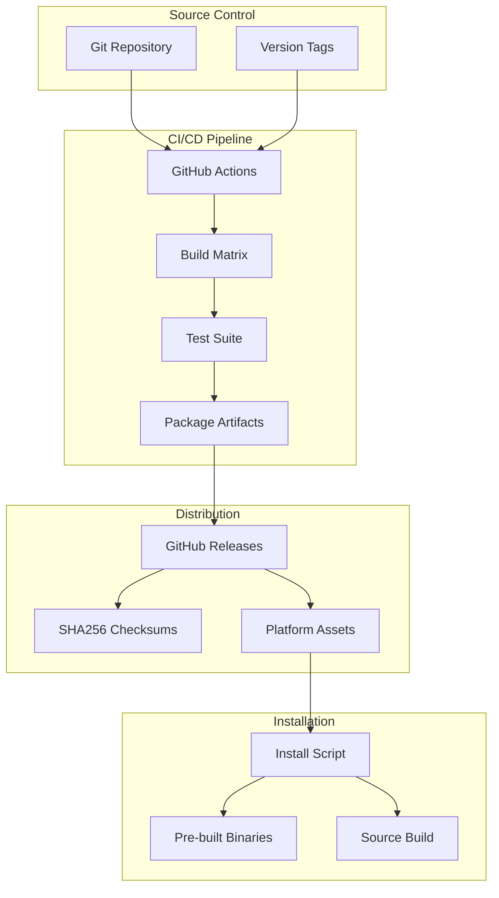
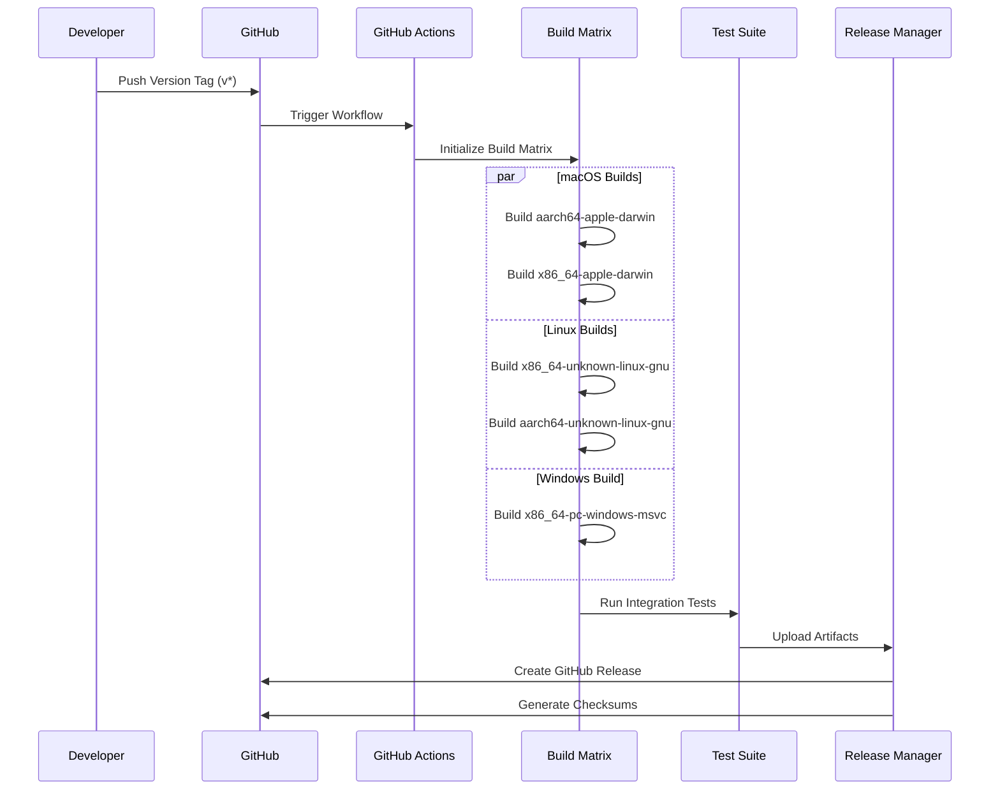
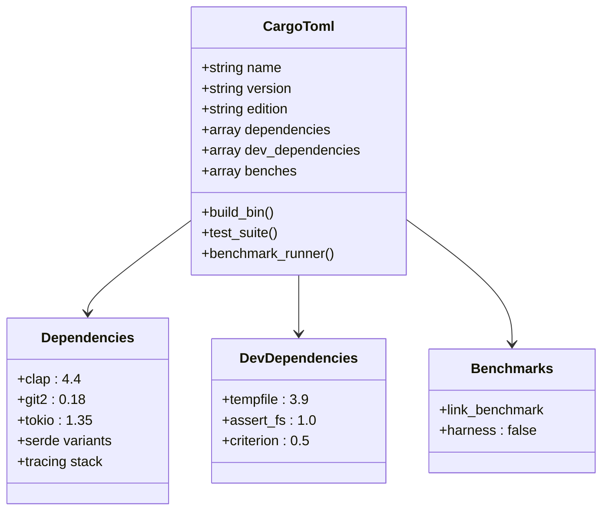
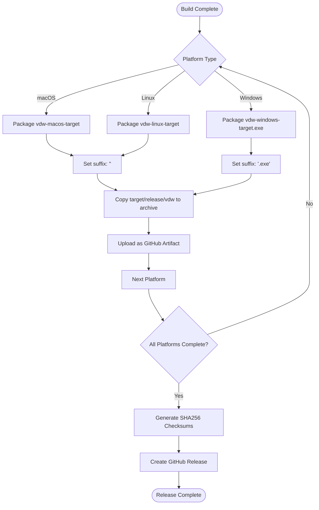
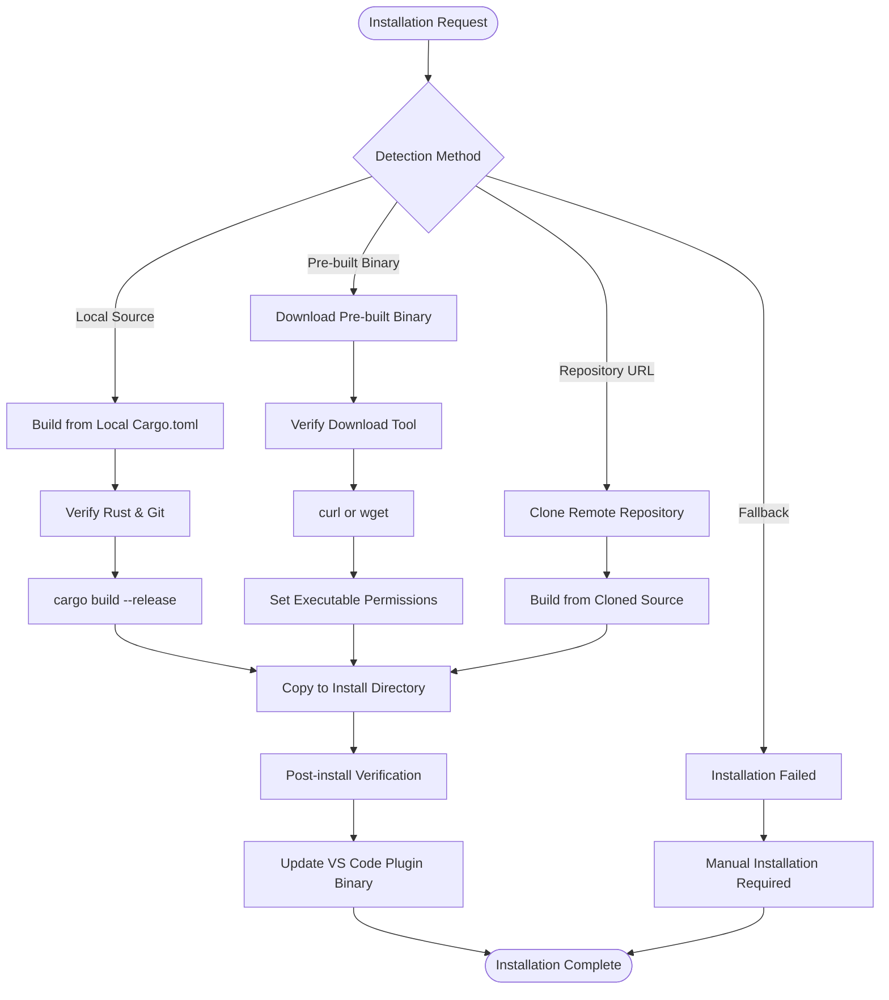
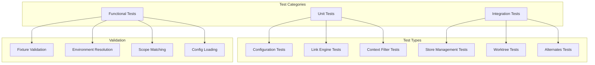
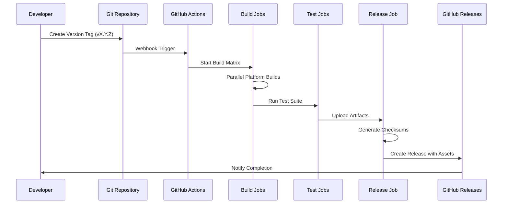
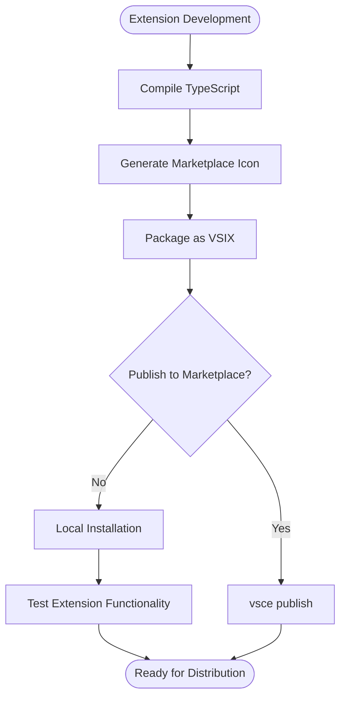

# Release Infrastructure & CI/CD

<cite>
**Referenced Files in This Document**
- [release.yml](file://.github/workflows/release.yml)
- [install.sh](file://vdw/install.sh)
- [Makefile](file://vdw/Makefile)
- [Cargo.toml](file://vdw/Cargo.toml)
- [README.md](file://vdw/README.md)
- [package.json](file://vdw-vscode/package.json)
- [README.md](file://vdw-vscode/README.md)
- [config_integration_test.rs](file://vdw/tests/config_integration_test.rs)
- [sample.vdwrc](file://vdw/tests/fixtures/sample.vdwrc)
</cite>

## Table of Contents
1. [Introduction](#introduction)
2. [Release Infrastructure Overview](#release-infrastructure-overview)
3. [CI/CD Pipeline Architecture](#cicd-pipeline-architecture)
4. [Build System Components](#build-system-components)
5. [Cross-Platform Distribution](#cross-platform-distribution)
6. [Installation Infrastructure](#installation-infrastructure)
7. [Testing and Quality Assurance](#testing-and-quality-assurance)
8. [Release Process Automation](#release-process-automation)
9. [VS Code Extension Packaging](#vs-code-extension-packaging)
10. [Troubleshooting and Maintenance](#troubleshooting-and-maintenance)

## Introduction

The VDW (Virtual Dev Workspace) project implements a comprehensive release infrastructure and CI/CD system designed to deliver cross-platform binaries and extensions efficiently. This infrastructure supports multiple operating systems (macOS, Linux, Windows) and architectures (x86_64, ARM64), ensuring seamless distribution of both the Rust CLI and the VS Code extension.

The release system is built around GitHub Actions for automated building and packaging, with supporting scripts for local development and installation. The infrastructure emphasizes reliability, cross-platform compatibility, and developer experience through automated testing and quality assurance processes.

## Release Infrastructure Overview

The VDW release infrastructure consists of several interconnected components working together to provide automated, reliable distribution of the application across multiple platforms and formats.

**Diagram sources**
- [release.yml:1-92](file://.github/workflows/release.yml#L1-L92)
- [install.sh:185-237](file://vdw/install.sh#L185-L237)

The infrastructure supports three primary installation methods:
- **Pre-built binaries**: Direct downloads from GitHub Releases
- **Source compilation**: Building from source code with Rust toolchain
- **Package manager**: Cargo install for development workflows

**Section sources**
- [release.yml:1-92](file://.github/workflows/release.yml#L1-L92)
- [install.sh:185-237](file://vdw/install.sh#L185-L237)

## CI/CD Pipeline Architecture

The CI/CD pipeline is implemented using GitHub Actions with a sophisticated build matrix supporting multiple platforms and architectures. The pipeline ensures consistent builds across environments while maintaining build efficiency through parallel execution.

**Diagram sources**
- [release.yml:11-91](file://.github/workflows/release.yml#L11-L91)

The build matrix configuration supports four distinct platforms with specific requirements:

| Platform | Architecture | Operating System | Target Suffix | Special Requirements |
|----------|--------------|------------------|---------------|---------------------|
| macOS | ARM64 | macOS Latest | Empty | Native build |
| macOS | x86_64 | macOS Latest | Empty | Native build |
| Linux | x86_64 | Ubuntu Latest | Empty | Standard build |
| Linux | ARM64 | Ubuntu Latest | Empty | GCC cross-compiler |
| Windows | x86_64 | Windows Latest | .exe | MSVC toolchain |

**Section sources**
- [release.yml:18-33](file://.github/workflows/release.yml#L18-L33)

## Build System Components

The build system leverages Cargo for Rust project management while incorporating custom automation through Makefiles and shell scripts. This hybrid approach provides flexibility for both automated CI builds and local development workflows.

### Cargo Configuration

The Cargo.toml file defines the core Rust project configuration, dependency management, and benchmark specifications essential for the build process.

**Diagram sources**
- [Cargo.toml:1-40](file://vdw/Cargo.toml#L1-L40)

### Makefile Automation

The Makefile provides convenient shortcuts for common development tasks, encapsulating complex build and installation procedures into simple commands.

| Target | Purpose | Description |
|--------|---------|-------------|
| `build` | Primary build | Executes `cargo build --release` |
| `install` | Full installation | Uses install.sh with platform detection |
| `install-quick` | Developer build | Direct binary copy to install directory |
| `test` | Unit testing | Runs all tests with cargo test |
| `test-all` | Integration testing | Includes ignored integration tests |
| `clean` | Cleanup | Removes build artifacts |
| `uninstall` | Removal | Deletes installed binary |

**Section sources**
- [Makefile:8-44](file://vdw/Makefile#L8-L44)
- [Cargo.toml:32-40](file://vdw/Cargo.toml#L32-L40)

## Cross-Platform Distribution

The distribution system ensures consistent delivery of VDW across all supported platforms through automated packaging and asset management. Each platform receives platform-specific treatment to address unique requirements and constraints.

**Diagram sources**
- [release.yml:52-65](file://.github/workflows/release.yml#L52-L65)

### Platform-Specific Considerations

**Linux ARM64 Support**: The pipeline includes specialized handling for ARM64 Linux builds through the installation of cross-compilation toolchains, ensuring compatibility with ARM-based servers and embedded systems.

**Windows Integration**: Windows builds automatically append the `.exe` suffix and handle executable permissions, providing seamless integration with Windows environments.

**macOS Quarantine Handling**: The installation script includes specific handling for macOS security attributes, addressing known issues with enterprise security software that can cause binary rejection.

**Section sources**
- [release.yml:43-47](file://.github/workflows/release.yml#L43-L47)
- [install.sh:165-170](file://vdw/install.sh#L165-L170)

## Installation Infrastructure

The installation infrastructure provides multiple pathways for users to obtain and deploy VDW, balancing ease of use with flexibility for different deployment scenarios.

**Diagram sources**
- [install.sh:107-179](file://vdw/install.sh#L107-L179)
- [install.sh:185-237](file://vdw/install.sh#L185-L237)

### Installation Methods Comparison

| Method | Advantages | Disadvantages | Best For |
|--------|------------|---------------|----------|
| **Source Build** | Latest code, custom compilation | Requires Rust toolchain | Developers, contributors |
| **Pre-built Binary** | Fastest installation | Limited to supported platforms | End users, CI/CD |
| **Package Manager** | System integration | May lag behind latest version | System administrators |

**Section sources**
- [install.sh:107-179](file://vdw/install.sh#L107-L179)
- [install.sh:185-237](file://vdw/install.sh#L185-L237)

## Testing and Quality Assurance

The testing infrastructure encompasses unit tests, integration tests, and end-to-end validation to ensure release quality across all supported platforms and configurations.

### Test Suite Architecture

**Diagram sources**
- [config_integration_test.rs:8-114](file://vdw/tests/config_integration_test.rs#L8-L114)

### Configuration Testing Framework

The configuration testing framework validates YAML parsing, environment variable resolution, and scope pattern matching through comprehensive test suites.

**Section sources**
- [config_integration_test.rs:1-194](file://vdw/tests/config_integration_test.rs#L1-L194)
- [sample.vdwrc:1-25](file://vdw/tests/fixtures/sample.vdwrc#L1-L25)

## Release Process Automation

The release process automation streamlines version tagging, artifact generation, and distribution through GitHub Actions workflows, minimizing manual intervention while ensuring consistency and reliability.

### Release Workflow Sequence

**Diagram sources**
- [release.yml:3-91](file://.github/workflows/release.yml#L3-L91)

### Asset Generation Process

The release process generates platform-specific assets with consistent naming conventions and includes automated checksum generation for integrity verification.

**Section sources**
- [release.yml:77-81](file://.github/workflows/release.yml#L77-L81)

## VS Code Extension Packaging

The VS Code extension packaging system integrates seamlessly with the main VDW release infrastructure, providing automated packaging and distribution capabilities for the IDE extension.

### Extension Packaging Workflow

**Diagram sources**
- [package.json:171-180](file://vdw-vscode/package.json#L171-L180)

**Section sources**
- [package.json:171-180](file://vdw-vscode/package.json#L171-L180)
- [README.md:206-224](file://vdw-vscode/README.md#L206-L224)

## Troubleshooting and Maintenance

The release infrastructure includes comprehensive troubleshooting mechanisms and maintenance procedures to address common issues and ensure smooth operation across all supported platforms.

### Common Issues and Solutions

**macOS EDR Quarantine Issues**: The installation script automatically handles security attribute clearing for known enterprise security software, preventing binary rejection and system warnings.

**Cross-Compilation Dependencies**: Linux ARM64 builds require specific toolchain packages; the CI pipeline automatically installs these dependencies during the build process.

**Path Resolution Problems**: The installation script includes comprehensive path detection and verification, ensuring proper binary placement and PATH configuration.

**Section sources**
- [install.sh:165-170](file://vdw/install.sh#L165-L170)
- [install.sh:261-270](file://vdw/install.sh#L261-L270)

### Maintenance Procedures

Regular maintenance tasks include dependency updates, security patches, and platform support verification. The CI pipeline serves as the primary mechanism for identifying and resolving compatibility issues across supported platforms.

**Section sources**
- [README.md:81-90](file://vdw/README.md#L81-L90)
- [release.yml:43-47](file://.github/workflows/release.yml#L43-L47)