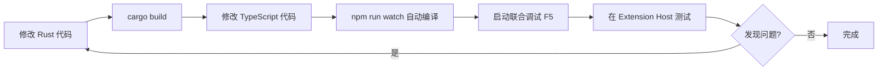

# VDW 联合调试配置指南

## 🎯 概述

本配置支持 **VS Code 插件** 和 **Rust CLI** 的联合调试，让你能够同时调试两个组件。

---

## 📋 前提条件

### 已安装

- ✅ **Rust 工具链** (rustc 1.96.0)
- ✅ **Node.js** (v18+)
- ✅ **CodeLLDB 扩展** (vadimcn.vscode-lldb) - 用于 Rust 调试

### 项目结构

```
agent-vdm/
├── vdw/              # Rust CLI 源码
│   ├── Cargo.toml
│   └── src/
├── vdw-vscode/       # VS Code 插件源码
│   ├── .vscode/
│   │   ├── launch.json   ← 调试配置
│   │   └── tasks.json    ← 构建任务
│   ├── src/
│   └── package.json
── .vdwrc            # 测试配置文件
```

---

## 🔧 配置说明

### launch.json 配置了 4 种调试模式

| 配置名称 | 类型 | 用途 |
|---------|------|------|
| **1️⃣ VDW Plugin (Extension Host)** | VS Code Extension | 仅调试插件代码 |
| **2️⃣ VDW CLI (Rust Debugger)** | LLDB (Rust) | 仅调试 CLI 的 `init` 命令 |
| **3️⃣ VDW CLI - Link Command** | LLDB (Rust) | 仅调试 CLI 的 `link` 命令 |
| **4️⃣ VDW CLI - Validate Command** | LLDB (Rust) | 仅调试 CLI 的 `validate` 命令 |

### 联合调试配置

** Joint Debug: Plugin + CLI** - 同时启动插件和 CLI 调试器

---

## 🚀 使用方法

### 方式 1: 单独调试插件

```bash
# 1. 在 vdw-vscode 目录打开 VS Code
cd /Users/tbsg/Desktop/codes/agent-vdm/vdw-vscode
code .

# 2. 按 F5 或点击运行和调试
# 3. 选择 "1️ VDW Plugin (Extension Host)"
# 4. 新窗口打开，开始调试插件
```

**调试目标**: TypeScript 代码
- `src/extension.ts`
- `src/providers/*.ts`
- `src/services/*.ts`

---

### 方式 2: 单独调试 Rust CLI

```bash
# 1. 在 vdw-vscode 目录打开 VS Code
cd /Users/tbsg/Desktop/codes/agent-vdm/vdw-vscode
code .

# 2. 按 F5
# 3. 选择 "2️⃣ VDW CLI (Rust Debugger)" 或其他 CLI 命令
# 4. LLDB 调试器启动，可在 Rust 代码中设置断点
```

**调试目标**: Rust 代码
- `../vdw/src/main.rs`
- `../vdw/src/commands/*.rs`
- `../vdw/src/store/*.rs`

---

### 方式 3: 联合调试 (推荐) 

```bash
# 1. 在 vdw-vscode 目录打开 VS Code
cd /Users/tbsg/Desktop/codes/agent-vdm/vdw-vscode
code .

# 2. 点击运行和调试面板
# 3. 在顶部下拉菜单选择 " Joint Debug: Plugin + CLI"
# 4. 点击绿色播放按钮
```

**效果**:
- 同时启动 **Extension Host** 和 **LLDB** 两个调试器
- 可以在 **TypeScript** 和 **Rust** 代码中都设置断点
- 插件调用 CLI 时，会自动命中 Rust 断点

---

##  断点设置示例

### 场景: 调试 `vdw link` 完整流程

**步骤**:

1. **在 Rust CLI 中设置断点**:
   - 打开 `/Users/tbsg/Desktop/codes/agent-vdm/vdw/src/commands/link.rs`
   - 在 `execute()` 函数第一行设置断点

2. **在 VS Code 插件中设置断点**:
   - 打开 `src/services/vdwCliService.ts`
   - 在 `link()` 方法设置断点

3. **启动联合调试**:
   - 选择 "🔥 Joint Debug: Plugin + CLI"
   - 按 F5

4. **在 Extension Development Host 中操作**:
   - 按 `Cmd+Shift+P`
   - 输入 `VDW: Link Dependencies`
   - 按回车

5. **调试流程**:
   - 首先命中 **TypeScript 断点** (vdwCliService.ts)
   - 继续执行
   - 然后命中 **Rust 断点** (link.rs)
   - 可以逐步调试完整的调用链

---

## ️ 自动 CLI 路径检测

配置了智能 CLI 路径检测逻辑:

```typescript
// src/services/vdwCliService.ts
private getCliPath(): string {
    // 1. 优先使用用户配置的路径
    // 2. 开发模式下自动使用 ../vdw/target/debug/vdw
    // 3. 生产模式使用系统 PATH 中的 vdw
}
```

**工作原理**:
- 当环境变量 `VDW_DEBUG=true` 时，自动使用 **Debug 构建的 CLI**
- 这样你修改 Rust 代码后，无需重新安装 CLI，直接重新编译即可

---

## 🔄 开发工作流

### 典型开发循环



### 快速命令

```bash
# 编译 Rust CLI (Debug 模式)
cd vdw && cargo build

# 编译 Rust CLI (Release 模式)
cd vdw && cargo build --release

# 编译 TypeScript (自动监听)
cd vdw-vscode && npm run watch

# 运行插件测试
cd vdw-vscode && npm test

# 打包插件
cd vdw-vscode && npm run package
```

---

##  调试面板说明

### VS Code 调试视图

启动联合调试后，会看到两个调试会话:

```
DEBUG CONSOLE
├─ VDW Plugin (Extension Host)
│  └─ 显示 TypeScript console.log
└─ VDW CLI (Rust Debugger)
   └─ 显示 Rust tracing 日志
```

### 变量检查

| 调试器 | 可查看的变量 |
|--------|-------------|
| **Extension Host** | TypeScript 对象、VS Code API 返回值 |
| **LLDB (Rust)** | Rust structs、枚举、Git 对象 |

---

## 🎨 自定义调试配置

### 添加新的 CLI 命令调试

在 `.vscode/launch.json` 中添加:

```json
{
  "name": "5️⃣ VDW CLI - Custom Command",
  "type": "lldb",
  "request": "launch",
  "program": "${workspaceFolder}/../vdw/target/debug/vdw",
  "args": ["--verbose", "your-command", "--arg1", "value1"],
  "cwd": "${workspaceFolder}",
  "preLaunchTask": "cargo: build debug",
  "sourceLanguages": ["rust"],
  "console": "integratedTerminal"
}
```

### 修改工作目录

默认工作目录是 `vdw-vscode` 的根目录。如果要调试其他目录:

```json
{
  "cwd": "/path/to/test/workspace"
}
```

---

## 🐛 常见问题

### Q1: LLDB 调试器无法启动

**症状**: 提示 "lldb" 类型不支持

**解决**:
```bash
# 安装 CodeLLDB 扩展
code --install-extension vadimcn.vscode-lldb

# 或者在 VS Code 扩展市场搜索 "CodeLLDB" 并安装
```

---

### Q2: CLI 编译失败

**症状**: `cargo build` 报错

**解决**:
```bash
cd vdw
# 清理构建缓存
cargo clean
# 重新构建
cargo build
```

---

### Q3: 插件找不到 CLI

**症状**: 插件报错 "vdw command not found"

**解决**:
1. 检查 `VDW_DEBUG` 环境变量是否设置
2. 手动配置 CLI 路径:
   - 打开 VS Code 设置
   - 搜索 `vdw.cliPath`
   - 设置为绝对路径: `/Users/tbsg/Desktop/codes/agent-vdm/vdw/target/debug/vdw`

---

### Q4: 断点不命中

**症状**: 设置了断点但调试器不停

**解决**:
- **TypeScript**: 确保 `npm run watch` 正在运行，且 `out/` 目录有编译后的 `.js` 文件
- **Rust**: 确保使用 **Debug 构建** (`cargo build`)，而不是 Release 构建

---

##  进阶技巧

### 1. 使用条件断点

**Rust (LLDB)**:
- 右键断点 → "Edit Breakpoint"
- 输入条件: `dep.editable == true`

**TypeScript**:
- 右键断点 → "Edit Breakpoint"
- 输入条件: `config.dependencies.length > 0`

### 2. 日志断点 (不暂停执行)

- 右键断点 → "Add Logpoint"
- 输入: `Dependency: {dep.repo}`
- 每次执行到此处会打印日志但不暂停

### 3. 多工作区调试

创建不同的 `.vdwrc` 文件用于测试:

```bash
# 测试场景 1
cp .vdwrc .vdwrc.backup
cat > .vdwrc << 'EOF'
workspace:
  name: "test-single"
dependencies:
  - repo: "git@test.git"
    path: "./test"
    branch: "main"
    scope:
      include: ["**"]
    editable: true
EOF

# 测试场景 2 (恢复)
mv .vdwrc.backup .vdwrc
```

---

## ✅ 验证清单

开始联合调试前，确认:

- [ ] Rust CLI 编译成功 (`cargo build`)
- [ ] TypeScript 编译成功 (`npm run compile`)
- [ ] `.vdwrc` 文件存在于工作区
- [ ] CodeLLDB 扩展已安装
- [ ] 当前目录是 `vdw-vscode`
- [ ] `VDW_DEBUG=true` 环境变量在 launch.json 中设置

---

## 🎯 下一步

完成联合调试配置后，你可以:

1. **调试插件功能**: 测试 `vdw.link`, `vdw.unlink` 等命令
2. **调试 CLI 逻辑**: 深入调试 Git Worktree、Content Store 实现
3. **端到端测试**: 验证插件 → CLI → Git 的完整调用链
4. **性能分析**: 使用 LLDB 的性能分析工具

---

**祝你调试愉快!** 🚀

如有问题，查看:
- Rust CLI 日志: Extension Host 的 Debug Console
- TypeScript 日志: 使用 `console.log()` 或 `log()` 工具函数
