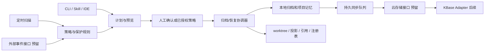

# VDW 工作空间生命周期管理方案初稿 v0.1

日期：2026-10-21
状态：待用户确认；本文是设计提案，命令、字段和目录结构均未实现。
适用基线：当前仓库 VDW 0.9.1 的 CLI、VS Code 插件和 vdw-cli Skill。

## 1. 目标与范围

围绕“活跃工作空间 → 归档 → 恢复”建立完整生命周期：

1. 根据长期未使用规则自动归档；为外部消息触发预留统一入口。
2. 在本地保存工作空间配置、版本定位和项目改进记忆；为云端保存、检索和下载预留通用接口，首个适配方向为 KBase。
3. 移除本工作空间拥有的 editable worktree 和只读投影，保留 Git 分支、提交和共享 Store。
4. 手动操作统一遵循“预览 → 调整/确认 → 执行 → 状态反馈”。
5. 支持全局默认闲置时长、单工作空间覆盖、归档位置配置，以及不清理白名单。

一期交付完整本地归档/恢复、自动归档、配置/白名单、项目记忆与 CLI/Skill 操作闭环。插件提供状态、操作入口和活动上报。外部消息连接器、真实 KBase 上传/下载属于后续对接范围；一期提供协议、能力声明和测试替身，不对未实现的能力返回成功。

## 2. 需求解释与待确认假设

### 2.1 “忽略未提交改动”的建议解释

本初稿暂按以下语义设计，需在实施前确认：

> 仓库内未提交的改动不纳入归档，也不阻断归档；移除 worktree 时会丢弃这些内容。恢复只恢复配置、已提交代码及选定的工作空间资料。

覆盖暂存区修改、未暂存修改、未跟踪文件，以及 worktree 内 ignored 文件。不会自动 commit、stash 或生成 WIP patch。预览必须列明该行为及受影响仓库、文件数量；自动归档需要事先确认包含此行为的策略版本。

如果用户的“忽略”实际是“遇到有改动的仓库就跳过”，改为 `dirty_policy=skip_workspace`：跳过整个工作空间，避免只归档其中部分仓库。本方案保留这两种策略，建议值暂为 `discard`，尚未生效。

### 2.2 归档后的目录形态

建议保留原工作空间的轻量目录：`.vdwrc`、`.vdw.lock`、身份文件、归档指针，以及工作空间自有资料；删除其中的受管 worktree 和只读投影。完整归档记录另存于归档位置。

这样原路径仍能显示“已归档”，现有 IDE/项目入口可引导恢复，也不会把工作空间自己的文档和普通文件当作仓库残留删除。整目录搬迁/删除不属于一期默认动作。

### 2.3 归档不是永久删除

归档保留期默认无限；本需求中的“预留时长”解释为自动归档前的闲置时长，不等于归档文件过期时间。删除历史归档和删除 Git 分支均不纳入本次范围。

## 3. 当前实现与设计约束

| 已核查能力 | 当前行为 | 本次设计需要补齐 |
| --- | --- | --- |
| `store/registry.rs` | `workspaces.json` v1 只有路径和 `last_seen`；部分配置/链接操作会刷新 | 稳定 workspace_id、生命周期状态、活动时间及其来源 |
| `store/manager.rs` | 全局设置包含 workspace_root、store_path、容量与 Store GC 时长 | 独立 lifecycle 配置，避免复用 Store GC 参数 |
| `commands/link.rs` | unlink 保留配置；普通 unlink 遇到 dirty editable worktree 会拒绝 | 归档专属执行计划、显式 dirty 策略和持久操作日志 |
| `worktree/manager.rs` | 支持按确切路径移除 worktree | 复用底层能力，执行前确认 Store 和路径归属 |
| `.vdw.lock` | 记录依赖解析提交；editable HEAD 可在锁定提交之上继续提交 | 同时保存 lock 提交与实际 HEAD，恢复不能只读取 lock |
| `commands/store.rs` | 引用来自注册工作空间配置、lock 与 Git worktree；注册路径丢失会使引用盘点不完整 | 增加归档引用来源，识别正常 archived 状态 |
| Store GC | 目前仅 dry-run | 保持现有边界，本次不扩大为 Store 实体删除 |
| 插件 | 已通过 CLI 和 JSON 获取工作空间状态 | 增加归档状态、预览/恢复入口、活动与租约上报 |

现有 `unlink` 在部分删除后可能返回错误，不能直接包装成“归档事务”。新的协调器需要独立记录每个仓库的进度，再复用受管目标识别、worktree 操作和链接清理等底层能力。

## 4. 总体结构



CLI 是唯一执行引擎；Skill 和插件负责交互，调度器负责触发。所有入口调用同一套资格检查、计划、执行和状态查询，避免不同入口产生不同清理规则。

## 5. 身份、状态与索引

### 5.1 稳定身份

为每个工作空间增加不可变 `workspace_id`，名称与目录路径仍维持原有语义。身份保存于注册表及 `.vdw/identity.json`；重命名不改变 ID，复制目录后发现身份冲突须显式注册为新工作空间。

注册表升级为 v2，建议字段：

| 字段 | 说明 |
| --- | --- |
| workspace_id / name / path | 稳定 ID、显示名称和当前路径 |
| lifecycle_state | active / archiving / archived / restoring |
| created_at / observation_started_at | 创建时间、活动观测起点 |
| last_active_at / activity_source | 最近使用时间及依据 |
| activity_revision | 活动版本，用于作废旧计划 |
| latest_archive_id | 最近一次归档版本 |
| current_operation_id | 未结束操作，支持中断恢复 |

`candidate` 作为策略评估结果，不改变工作空间主状态。失败记录在操作上：保留最后稳定状态和未完成阶段；已部分移除仓库的工作空间保持 `archiving` 并显示 `needs_attention`，不能伪装为完整 active 或 archived。

### 5.2 分开记录三类结果

- 工作空间结果：是否确已归档或恢复。
- 项目记忆结果：基础记忆是否生成，增强总结是否待补充。
- 云端结果：disabled / unsupported / pending / syncing / synced / failed。

本地归档成功而云端失败时，返回“本地已归档，云端待重试”，不得合并成无条件成功。

## 6. 如何判断长期未使用

### 6.1 活动来源

`last_seen` 是现有注册记录的更新时间，不能直接作为最近使用时间。新增活动采集：

| 信号 | 处理方式 |
| --- | --- |
| 创建、恢复、成功 link/sync、修改仓库配置 | 更新活动时间 |
| 插件中打开工作空间、聚焦并编辑/保存源码 | 更新活动时间，并维护活动租约 |
| 源码变更、Git HEAD/index 或 dirty 清单发生变化 | 作为补充活动信号；排除扫描自身和生成目录 |
| `vdw workspace touch` | 显式续期，支持终端和未接入 IDE 的工具 |
| `status/list/preview`、定时扫描、心跳轮询、云同步重试 | 不自动续期 |

插件建议每 60 秒维护一次租约，TTL 180 秒。心跳只说明客户端仍持有工作空间；自动归档在有效租约存在时跳过。插件关闭后心跳失效，无用户活动时不会凭后台轮询永久续期。

不采用文件 atime；不把 node_modules、target、构建缓存或 VDW 日志的变化计入活动。候选扫描先读取注册信息，接近阈值时再检查源码/Git 变化，避免每次完整遍历全部仓库。

对未接入活动协议的外部编辑器，无法保证识别其内存中未保存的编辑。自动管理需显式启用；此类使用方式可以通过 touch、活动租约接口或白名单表达占用。预览展示活动来源和观测覆盖，不能宣称完整识别所有外部进程。

### 6.2 建议自动规则

默认配置建议：闲置 30 天进入候选，每 24 小时扫描一次，候选宽限期 72 小时；从进入候选算起，通常在闲置约 33 天后执行，具体受扫描时间影响。

自动执行同时满足：

1. 已启用并确认当前自动策略；当前工作空间在授权范围内。
2. 超过有效闲置阈值，并经过完整宽限期。
3. 不在白名单，无有效客户端/任务租约，无其他生命周期操作。
4. 配置、归属和本地归档位置可校验，所需 Git 对象可读取。
5. 计划生成后无新的活动、保护规则或关键仓库状态变化。

宽限期内有活动即撤销候选，重新计时；改变候选规则会使原策略授权与候选计划失效。调度器每次实际删除前重新检查，不能直接消费几天前的候选列表。

### 6.3 旧工作空间迁移

v1 迁移时保留原 `last_seen` 作为历史证据，将迁移时间设为 `observation_started_at`。对不具备可靠历史活动数据的工作空间，至少从迁移时起重新观测一个闲置周期，再进入宽限期；不能升级后立刻删除历史目录。

扫描只自动处理已注册工作空间。新 root 配置不会让旧注册路径失效；未注册目录只列为可导入项，不能凭目录名自动纳管或清理。

## 7. 归档内容与本地目录

建议默认位置 `~/.vdw/archives`，支持绝对路径或 `~/...`。归档位置不能位于将清理的工作空间、任一受管仓库或 Store 对象目录内。

```text
~/.vdw/
  config.json
  workspaces.json
  lifecycle/
    policies.json
    protection.json
    archives.json
    plans/<plan_id>.json
    operations/<operation_id>.json
    outbox/<task_id>.json
  archives/
    <workspace_id>/<archive_id>/
      manifest.json
      config/.vdwrc
      config/.vdw.lock
      config/identity.json
      workspace-files/...
      memory/summary.md
      memory/improvements.json
      evidence/repositories.json
      checksums.json
      git/...
```

归档目录变更仅影响新归档；固定保存在 `~/.vdw/lifecycle/archives.json` 的索引记录每份归档的绝对位置，历史归档继续检索。搬迁旧归档另走预览、校验、执行流程，不随设置变更隐式移动。

### 7.1 内容范围

| 内容 | 策略 |
| --- | --- |
| `.vdwrc`、存在时的 `.vdw.lock` | 原文和校验和；保存配置格式及相对布局 |
| 依赖 remote/local 声明、scope、editable | 保持声明语义，不写入临时 worktree 路径 |
| 每个仓库的实际分支、HEAD、lock 提交、来源和 Store 身份 | 写入 manifest/evidence，不能用 metadata.json 代替现场读数 |
| 已提交但未推送的提交 | 保留本地分支，并增加归档引用保护 |
| 工作空间自有文档、设计、任务说明、IDE 配置 | 位于依赖根目录外的普通文件默认纳入；排除敏感/缓存规则，预览列明包含与排除项 |
| 未识别的独立 Git 根目录、符号链接或特殊文件 | 不递归清理；保留原位并提示，不沿链接读取外部文件 |
| 仓库内 dirty/未跟踪/ignored 文件 | 按确认后的 dirty 策略处理，不纳入代码归档 |
| `.vdw/state.json`、可编辑锁、绝对路径缓存 | 仅作必要诊断，恢复时重新生成，不原样激活 |
| 迁移/冲突备份等历史数据 | 不随本次 worktree 清理删除；需要纳入归档时单独列入资料清单 |

原工作空间中的自有资料默认仍保留；未被归档的文件应明确展示为“原位保留，异地恢复不包含”。因此异地恢复的覆盖范围以归档清单为准，不宣称恢复所有磁盘内容。

对只读投影，仅删除经过 ownership 校验且仍匹配受管来源的链接。投影已被替换、出现独立修改、子模块或嵌套非受管仓库时，不使用整体 rm -rf；一期停止该工作空间执行并反馈明确原因。

### 7.2 Git 保存策略

默认 `git_backup=store_refs`：

- 原分支留在实际拥有该 worktree 的 Git 仓库中，不执行 branch delete、reset 或 push。
- 在该仓库建立 `refs/vdw/archives/<archive_id>/...`，保护实际 HEAD 和 lock 所需提交；同时记录 Store 级归档引用。
- 删除目标 worktree 后释放该工作空间的 editable 占用锁，其他工作空间和同仓库其他分支均不改变。
- 自动归档不清理共享 Store，也不删除本地源仓库。

该模式节省重复代码存储，但恢复依赖原 Store/本地源仓库仍可用；这不是可脱离本机的完整代码备份。

提供可选 `portable_bundle`：将归档实际 HEAD、lock 提交及其所需普通 Git 历史导出为不依赖外部前置 bundle 的校验包，可在 Store 丢失后重建。预览单独展示占用和可恢复等级。浅克隆、缺失对象、Git LFS 对象和子模块不能自动获得完整覆盖；一期不把存在这些缺口的包标为完整可移植备份。

云端仅保存配置与记忆时，恢复能力也仅限这些内容；不能承诺恢复本机未上传的提交。是否上传代码备份由 provider 能力与独立配置控制，默认关闭。

## 8. 项目改进记忆

每份归档必须包含基础记忆；AI 增强总结作为可选步骤，不成为自动删除必须依赖的外部服务。

基础记忆以归档清单、已有项目文档、已提交历史和操作验证结果为证据，至少记录：

- 项目目的、涉及仓库和分支、归档原因。
- 已完成事项、明确未完成事项；区分代码、测试、发布与业务验证。
- 关键决策、约束、问题及已有解决方式。
- 改进建议、适用范围、待办、证据位置和生成时间。
- 恢复步骤、环境依赖、当前恢复覆盖范围和已知缺口。
- dirty 内容被跳过/丢弃的数量，不保存被丢弃文件的正文。

`summary.md` 便于阅读；`improvements.json` 供检索和合并，建议字段包括 `project_key`、`category`、`observation`、`recommendation`、`evidence_refs`、`verification_state`、`content_hash`、`archive_id`。

没有证据的栏目写“未提供/未验证”；算法不能把提交信息直接认定为测试通过或需求已完成。增强总结记录模型/生成器版本、来源和生成状态；失败仍保留基础记忆并允许后续补充。

记忆按归档版本不可变保存；项目索引用内容哈希去重，并保留来源，不覆盖冲突结论。归档读取工作空间内可访问的项目材料；聊天记录需通过后续显式数据接口导入，不扫描全部 Codex/Qoder 历史。不会自动写入工具自身的全局用户记忆或修改 Skill。

## 9. 手动操作：预览、调整、确认、执行

### 9.1 操作计划

计划包含操作类型、工作空间和仓库清单、触发原因、配置版本、白名单版本、活动版本、HEAD/lock、dirty 清单指纹、资料清单、目标位置、Git 备份模式、云端策略和有效期。

建议交互计划有效期 30 分钟。预览允许写入非破坏性的计划文件，但不修改仓库、分支、worktree 或工作空间配置，不 fetch。

调整计划会产生新版本并使旧确认失效；“确认”绑定具体计划 ID 和内容摘要。执行不接受无目标范围的泛化 `--force` 来跳过归属、租约或白名单检查。

### 9.2 归档预览内容

每个工作空间展示：最近活动及来源、候选原因、保护状态、有效策略、预计删除的 worktree、保留分支及 HEAD、未提交内容处理方式、归档文件、空间估算、恢复等级、云端能力与同步范围。

空间分别显示预计回收和归档新增占用；硬链接/共享对象按估算说明，不把全部逻辑文件大小当作真实回收量。

允许调整选择范围、排除某个工作空间、临时续期、加入白名单、修改资料范围/归档位置，以及在恢复时修改目标目录和版本方案。归档以完整工作空间为单位，不默认提供“跳过一个仓库后把其余部分标为整个工作空间已归档”。

### 9.3 提议命令

```bash
# 检索
vdw workspace list --state active --json
vdw workspace list --state archived --json
vdw workspace status <workspace_id> --json

# 预览（支持多个明确指定的工作空间）
vdw workspace archive <workspace_id> --preview --json
vdw workspace restore <archive_id> --preview --json
vdw workspace restore <archive_id> --target <absolute_path> --preview --json

# 调整、确认并执行指定版本
vdw lifecycle plan show <plan_id>
vdw lifecycle plan adjust <plan_id> --exclude-workspace <workspace_id>
vdw lifecycle plan execute <plan_id> --confirm

# 活动续期、保护和诊断
vdw workspace touch <workspace_id>
vdw workspace protect add <workspace_id> --reason <text>
vdw workspace protect remove <workspace_id> --preview
vdw workspace protect list --json
vdw lifecycle operation status <operation_id> --json
vdw lifecycle operation resume <operation_id> --preview
```

非交互调用也必须传已审阅的 plan_id 和确认信息；Skill 仅在用户确认当前预览后执行。插件使用同样计划和 JSON，不在 TypeScript 层直接删除目录。

### 9.4 状态反馈

统一返回 `schema_version`、`operation_id`、`workspace_id`、`archive_id`、总体状态、分步骤状态、每仓库结果、归档位置、分支保留校验、记忆状态、云同步状态、实际/估算空间和可执行的恢复/续跑命令。

批量结果允许成功、跳过、失败并存；退出码建议区分全部完成、部分失败、计划过期、保护规则阻止和前置条件不满足，具体数字在实现时冻结。

## 10. 归档执行顺序与中断处理

1. 读取当前有效策略、白名单和租约，获取工作空间操作锁；按固定 repo_id 顺序获取需要的共享仓库锁。
2. 重新核对配置/lock、实际 Git common-dir、worktree 注册路径、分支 HEAD、dirty 指纹和活动版本；变化则返回 `PLAN_STALE`，重新预览。
3. 生成配置、资料、基础记忆和版本清单，写入归档盘上的 staging 目录。
4. 建立 Git 归档引用；需要时生成 portable bundle。验证所有文件校验和、所需提交和引用可读。
5. 原子发布归档包，持久化 `ARCHIVE_VERIFIED` 检查点和操作日志。归档包、必要持久写入失败时不得删除 worktree。
6. 再检查租约/新活动，并设置 `archiving`；逐仓库按确切路径移除 worktree、删除可验证的只读投影。每完成一步就持久记录结果，仅释放已完成仓库的 editable 锁。
7. 清理对应的投影状态，保留配置与自有资料，写入归档指针；提交注册表与归档索引为 `archived`。
8. 回读 worktree 清单、保留分支及归档包，生成结果，再按云端配置写入持久 outbox。

删除前的失败：保留原工作空间，不进入删除阶段；临时包/临时引用按操作记录清理。

部分仓库已删除后的失败：保留完整归档及进度，显示 `needs_attention`，后续 resume 在重新校验后继续，或通过新的恢复计划重建已删除仓库。被确认丢弃的 dirty 内容不可回滚，不能声称跨仓库文件系统操作完全原子。

批量工作空间之间独立记录与执行，一个失败不使其他成功结果丢失。进程崩溃后按 operation 日志与真实 Git/文件状态对账，不能只相信最后一个状态字段。

所有配套 VDW 改动命令也需遵守生命周期锁。外部直接运行的 Git/编辑器不会天然遵守该锁；执行前仍需检查原生 Git 状态与客户端租约，发现变化即停止。

## 11. 恢复策略

### 11.1 默认恢复目标

默认恢复到原路径；允许指定新路径。原路径存在归档骨架时核对 workspace_id；新路径必须为空或为匹配的受管骨架。普通同名非空目录不能覆盖。

保留原工作空间名称和配置中的相对布局。不同目录或不同名称需在预览中显式列出；同一 workspace_id 不能同时激活两份副本。

### 11.2 版本选择

默认恢复归档时的实际 HEAD；只读依赖使用归档 lock 的确切提交。不能通过普通 sync 将分支悄悄更新到远端最新版本。

| 现场情况 | 方案 |
| --- | --- |
| 原分支仍在归档 HEAD 且未被占用 | 重新创建 worktree，挂接原分支 |
| 原分支后来前进或被改写 | 暂停；预览选择“现有分支当前版本”或“以归档 HEAD 创建指定恢复分支” |
| 原分支被另一活跃工作空间占用 | 暂停；不抢占、不静默降为只读，允许明确选择新恢复分支 |
| 原分支已被外部删除 | 提示；确认后从归档引用/备份重建原分支 |
| 归档记录为 detached HEAD | 恢复 detached 状态；若改为分支，需在预览中指定 |
| Store 对象不在本机 | 有 portable bundle 则验证后导入；否则仅在明确允许联网且来源可取回该提交时获取 |
| local-only 源路径失效或提交不可得 | 报告缺失前置条件，不改用其他分支或相似仓库 |

恢复“现有分支当前版本”还需验证与 lock 的关系；若需要改变 lock，必须列出新的解析计划并确认，不能直接覆写归档原件。

### 11.3 执行与验收

先校验整个归档、版本可得性、目标路径和所有分支占用，再创建文件/worktree。重建 `.vdw/state.json`、editable 锁、目标注册信息和相关指针；不复制旧绝对路径和 inode 状态。

失败时只清理本次新建且仍可确认归属的内容；若恢复过程中出现外部写入，则保留现场并显示 needs_attention。全部通过配置、拓扑、分支、HEAD 和链接校验后才标为 active，并从恢复时间重新计时。

恢复后仍保留归档历史。IDE 注册/打开是可选后续步骤，单独报告结果。

## 12. 自动调度与外部事件预留

### 12.1 自动归档授权模型

手动操作每次确认具体计划；自动操作由用户事先确认一份持续生效的策略，避免每次扫描都等待人工回复。

启用流程仍为“策略预览 → 调整/确认 → 启用 → 状态反馈”。策略明确作用范围、闲置阈值、宽限期、dirty 处理、本地位置和云端范围，并保存授权摘要。扩大范围、缩短时长、改为 discard 等变更需要重新确认；白名单新增立即生效，移除白名单按其独立确认流程处理。

初始 `auto.enabled=false`。启用后由调度器执行明确的 `vdw lifecycle run`，每次均生成可审计计划。无人值守上下文不弹交互问题；条件不满足则记录 skip/failed。

```bash
vdw lifecycle scan --preview --json
vdw lifecycle auto enable --preview
vdw lifecycle plan execute <enable_plan_id> --confirm
vdw lifecycle auto disable
vdw lifecycle run --json
```

一期提供跨平台单次扫描/执行内核，以及 macOS launchd 调度安装和卸载；Linux/Windows 可调用同一内核，原生调度器适配后续补充。启用自动管理时明确安装范围和命令路径；不依赖 IDE 一直运行。电脑休眠或关机期间不执行，恢复后重新评估候选，不补跑过期的删除计划。

### 12.2 外部事件协议

预留 `ArchiveTrigger`：`event_id`、`source`、`workspace_id`、`reason`、`occurred_at`、`requested_action`、`policy_version`、可选 `not_before`。

后续对接需求关闭、变更结束、项目完成等消息时，先通过显式映射定位 workspace_id。消息正文只作为数据，不能成为 shell 指令或确认授权。使用 source+event_id 去重，重复事件返回原操作结果；执行仍受白名单、租约和配置保护。

是否跳过闲置阈值由事先批准的 source 策略决定，默认仅产生候选；不因“项目完成”消息直接强制删除。未配置 connector/信任来源时不启动监听，也不暴露匿名归档接口。

## 13. 云端通用接口与 KBase 方向

建议区分归档快照和知识文档两种资源：

| 接口 | 用途 |
| --- | --- |
| capabilities | 是否支持配置、记忆、二进制包、版本检索、下载 |
| put_manifest / get_manifest | 归档元数据与配置快照 |
| put_memory / list_memory | 项目总结、改进项和来源检索 |
| put_blob / get_blob | 可选文件包、Git bundle；由能力声明决定 |
| verify_receipt | 回读 ID/版本/内容哈希，确认同步结果 |

每次写入使用稳定幂等键 `workspace_id + archive_id + resource_kind + content_hash`；返回 provider、remote_id、remote_version、checksum 和持久化状态。哈希不足以防恶意篡改，云端连接使用其认证和访问控制，不把本地校验和当作身份认证。

KBase Adapter 后续将记忆映射为 Markdown 文档，将 manifest/config 映射为版本化文档或附件；大文件能力需实际核实后才能启用，不能假设 KBase 等价于对象存储。文档路径可采用 `vdw/workspaces/<workspace_id>/<archive_id>/...`，repo/知识库标识由配置注入。

一期不直接绑定个人知识库 ID，不调用现有定时 KBase 同步脚本，也不另造其同步流程。正式接入已有 KBase 管理体系时，需要复用其确定性同步、水位和读回校验约定，再实现适配器。

采用本地先完成、outbox 异步同步。认证失败需人工处理，临时错误退避重试；归档历史不因云端超时丢失。`synced` 必须有可验证回执。没有实现的 provider 返回 unsupported，不能留下永久假成功或无消费者的 pending 队列。

默认云端内容仅为脱敏后的记忆和必要元数据；真实配置、凭证、完整绝对路径、dirty 正文与源码备份不默认上传。凭证使用 credential_ref 指向安全凭据存储，不写进归档。

## 14. 配置与白名单

### 14.1 全局配置提案

在现有 `~/.vdw/config.json` 中增加 lifecycle：

```json
{
  "lifecycle": {
    "version": 1,
    "idle_days": 30,
    "dirty_policy": "discard",
    "archive": {
      "root": "~/.vdw/archives",
      "keep_workspace_skeleton": true,
      "git_backup": "store_refs"
    },
    "auto": {
      "enabled": false,
      "scan_interval_hours": 24,
      "grace_hours": 72
    },
    "memory": {
      "basic_required": true,
      "enhancer": "none"
    },
    "cloud": {
      "enabled": false,
      "provider": null,
      "content": ["memory", "redacted_metadata"]
    }
  }
}
```

单工作空间的生命周期覆盖保存在本机 policies.json，以 workspace_id 为键，支持 idle_days、auto.enabled、archive.root 和临时保留到期日。源配置 `.vdwrc` 保持团队共享的声明信息，不在其中混入本机路径、凭证和白名单。

配置优先级：保护规则优先 → 已确认计划内允许的显式选择 → 单工作空间覆盖 → 全局默认。自动执行必须落在已确认的策略边界内；参数不能覆盖白名单或归属检查。

所有有效值可通过 `config show --effective --workspace <id> --json` 展示来源。idle_days 须为正数，明确配置 auto=false 来关闭自动管理，不将 0 解释为立刻清理。

### 14.2 白名单语义

protection.json 按 workspace_id 保存保护项：原因、添加时间、可选有效期；支持按确切路径/名称查找 ID 后添加。默认无有效期。

- 白名单拦截自动扫描、外部事件和手动归档；预览可查看，但 execute 返回 protected。
- 若要归档白名单工作空间，先明确移除保护；移除后不立即触发清理，建议重新进入完整 72 小时宽限期。手动计划仍可在确认后立即执行。
- 名称和路径变化不使保护失效；不会用模糊名称或任意 glob 批量保护/移除。
- 加保护可立即取消候选计划；执行阶段再次读取保护，避免旧计划绕过新保护。
- 批量保护变更提供预览和确认；白名单移除必须展示受影响工作空间。

生命周期参数、归档位置和白名单均通过 CLI 读写并原子保存，插件与 Skill 不直接编辑这些 JSON。

## 15. Store、旧命令和兼容迁移

Store 引用统计增加 `archive_references`，至少覆盖归档依赖对象、实际 HEAD、lock 提交及 Git 备份策略。默认 store_refs 归档继续保护关联 Store 对象，不将“worktree 不存在”等同于“仓库不再被引用”。

archived 骨架路径丢失时可由独立归档索引确认生命周期；已验证归档不会仅因原目录不存在就把引用盘点变成 missing。归档损坏、索引不可读或引用不完整时，维持保守的引用不完整状态，不给出可删除结论。

`status` 增加 lifecycle 与恢复提示，archived 不当作一组待修复的 missing worktree。`init/link/relink/repo add` 识别 archived，提示走 restore，不静默重新激活。普通 active 工作空间的 unlink/删除保护保持现有语义，只有生命周期计划执行器按已确认 dirty 策略处理归档。

配置 schema 使用缺省值兼容旧配置；workspaces.json 升级前备份，迁移失败保留原文件。旧 CLI 不理解 v2 时应明确提示版本不支持；CLI、插件、Skill 在同一发行版本交付并做能力协商。

## 16. 实施拆分与影响文件

| 阶段 | 内容 | 完成依据 |
| --- | --- | --- |
| A：基础与手动闭环 | 身份/注册迁移、策略/白名单、计划、归档/恢复、本地记忆、Store 引用、日志续跑 | 临时多仓库场景完成 preview→confirm→archive→restore，分支和 HEAD 可验证 |
| B：自动闭环 | 活动、租约、候选/宽限期、策略授权、launchd、批量状态 | 虚拟时间验证阈值和取消候选；实际调度可安装/关闭/卸载 |
| C：产品与扩展契约 | Skill 交互、插件入口、云端/事件接口及测试替身、文档 | 各入口使用同一计划；未实现 provider/source 明确反馈 |
| 后续集成 | KBase 真适配、真实消息源、其他 OS 原生调度适配 | 独立确认接入系统、权限、同步与回读依据 |

A/B/C 一起构成本需求一期完整交付，不能只完成 A 就宣称自动归档已支持。

预计影响：

- CLI 路由与类型：`vdw/src/main.rs`、`commands/mod.rs`、`types/workspace.rs`，新增 lifecycle 配置和报告类型。
- 新增 `vdw/src/lifecycle/`：activity、policy、plan、archive、restore、memory、journal、scheduler、providers、triggers。
- Store/Git：`store/manager.rs`、`store/registry.rs`、`store/editable_locks.rs`、`commands/store.rs`、`worktree/manager.rs`。
- 兼容入口：`commands/link.rs`、`commands/status.rs`、`commands/init.rs`、`commands/repo.rs`、`commands/sync.rs`、`commands/config.rs`。
- 插件：CLI service、状态类型、命令注册、工作空间树、活动/租约服务。
- Skill/文档：`vdw-cli/SKILL.md`、`reference.md`、CLI/插件 README、新配置与恢复示例。
- 验证：新增 lifecycle、归档故障注入、恢复和注册迁移集成场景；扩展 Store 引用及插件交互验证。

## 17. 验收场景

1. 多仓库归档后，配置、基础记忆和所有需要的已提交版本可定位；只有目标 worktree/投影被移除，原分支和其他工作空间不变。
2. discard 模式下，预览明确列出暂存/未暂存/未跟踪/ignored 范围；恢复不含这些内容。skip_workspace 模式则整空间跳过。
3. 先预览后新增活动、切换 HEAD、改配置或新增白名单，旧计划执行被拒绝。
4. 并发归档/恢复/link 操作互斥；模拟第二个仓库删除失败和进程崩溃，日志准确反映部分完成并可续跑。
5. 本地归档写失败、校验失败、备份对象缺失，未进入 worktree 删除阶段。
6. 恢复到原目录/新目录均验证配置、路径、branch、HEAD、lock 和链接；分支前进、占用、同名目录、local 源缺失均产生明确选择或错误。
7. old registry 升级不导致立刻自动归档；阈值、宽限期、租约、白名单和重启后重算均符合规则。
8. 只读硬链接、原子保存后独立文件、符号链接边界、嵌套独立仓库和子模块均不会被误删或越界访问。
9. archived 和损坏归档分别正确参与 Store 引用统计；GC 仍保持现有 dry-run 行为。
10. 云端不可用、认证失败、重复投递、KBase 能力不足分别报告真实状态；基础本地恢复不依赖云服务。
11. 记忆每条结论有来源/验证状态，发布与测试不会由模型推断；敏感内容不出现在默认云端载荷。
12. 自动开关、默认时长、单空间覆盖、归档位置、白名单添加/移除和有效值来源都可通过 CLI/插件查看，旧 active 操作行为兼容。

## 18. 提请确认的决策

| 决策 | 本稿建议 |
| --- | --- |
| dirty 含义 | 不归档、不阻断；删除 worktree 时丢弃。若意图是跳过则改为 skip_workspace |
| 默认闲置周期 | 30 天候选 + 72 小时宽限，每 24 小时扫描 |
| 自动启用方式 | 默认关闭，预览并确认策略后启用；不逐次确认 |
| 原目录 | 保留轻量骨架和自有资料，删除受管 worktree/投影 |
| 本地 Git 备份 | 默认 Store 引用保护；可选 portable bundle，明确空间/恢复范围 |
| 白名单 | 所有归档入口均保护；明确移除后才可手动归档 |
| 云端与消息源 | 一期完成通用协议/状态/测试契约；真实 KBase/消息源另行对接 |
| 归档历史 | 默认不自动过期、不自动删除分支 |

确认这些决策后，再据此冻结 schema、命令协议和分阶段实现计划。
