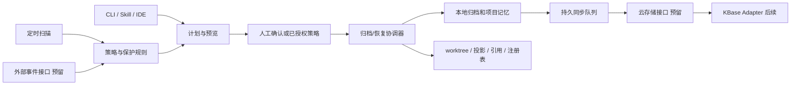

# VDW 工作空间生命周期管理方案修订稿 v0.2

日期：2026-10-21
状态：方案已确认，已据此完成 0.10.0 本地源码实现。本文保留为设计基线；实际命令与使用方式见 [生命周期使用说明](../vdw/LIFECYCLE.md)，本地验证见 [验证记录](evidence/vdw-lifecycle-implementation-validation-20261021.json)。云端与消息源仍按约定预留。
适用基线：当前仓库 VDW 0.9.1 的 CLI、VS Code 插件和 vdw-cli Skill。

本版主要调整：移除丢弃 dirty 的设计；优先保存 packages 外的原始资料；把确定性资料索引与可配置 AI 总结分开；归档位置变更自动迁移历史归档并展示进度；增加真实 Git bundle 测量及容量模型。v0.1 保留用于比较，不再作为实施依据。

## 1. 目标与范围

围绕“活跃工作空间 → 归档 → 恢复”建立完整生命周期：

1. 根据长期未使用规则自动归档；为外部消息触发预留统一入口。
2. 在本地保存工作空间配置、版本定位和项目改进记忆；为云端保存、检索和下载预留通用接口，首个适配方向为 KBase。
3. 移除本工作空间拥有的 editable worktree 和只读投影，保留 Git 分支、提交和共享 Store。
4. 手动操作统一遵循“预览 → 调整/确认 → 执行 → 状态反馈”。
5. 支持全局默认闲置时长、单工作空间覆盖、归档位置配置，以及不清理白名单。

一期交付完整本地归档/恢复、自动归档、配置/白名单、项目记忆与 CLI/Skill 操作闭环。插件提供状态、操作入口和活动上报。外部消息连接器、真实 KBase 上传/下载属于后续对接范围；一期提供协议、能力声明和测试替身，不对未实现的能力返回成功。

## 2. 已确认要求与设计细化

### 2.1 存在未提交改动则跳过整个工作空间（已确认）

统一使用 `dirty_policy=skip_workspace`，手动、自动、后续消息触发均遵循：

> 任一受管仓库存在暂存、未暂存、冲突或未跟踪文件时，跳过整个工作空间；不归档其中其他仓库，也不删除任何 worktree。已提交但尚未推送的提交不属于 dirty，仍保留分支与提交。

跳过结果为 `skipped_dirty`，附仓库、状态分类和数量；人工整理后可重新预览。不会自动 commit、stash、reset 或生成 WIP patch，一期不提供 discard 或用 force 绕过检查的归档选项。

跳过项必须保留在本次操作的结果中，不能被资格过滤后从反馈中消失。操作结束统一反馈“本次已归档、未归档、未归档中的跳过项”，并列明每个工作空间及原因，详见 9.4。

Git ignored 文件需与 dirty 区分：node_modules 等已分类的可重建缓存不视为未提交业务改动；未知 ignored 内容可能包含本地资料或环境文件，默认整空间跳过并返回 `ignored_files_need_review`，不因其被 Git 忽略就认定可删除。可重建目录规则可配置并在预览中列出，不能用一条通配规则静默豁免所有 ignored 文件。工作空间自身若也是 Git 根，dirty 检查也覆盖该根；依赖根目录外、未处于 Git 管理中的项目资料则纳入原始资料快照。

### 2.2 归档后的目录形态

已确认保留原工作空间的轻量目录：`.vdwrc`、`.vdw.lock`、身份文件、归档指针，以及工作空间自有资料；删除其中的受管 worktree 和只读投影。完整归档记录另存于归档位置。

这样原路径仍能显示“已归档”，现有 IDE/项目入口可引导恢复，也不会把工作空间自己的文档和普通文件当作仓库残留删除。整目录搬迁/删除不属于一期默认动作。

### 2.3 归档不是永久删除

归档保留期默认无限；本需求中的“预留时长”解释为自动归档前的闲置时长，不等于归档文件过期时间。删除历史归档和删除 Git 分支均不纳入本次范围。

## 3. 当前实现与设计约束

| 已核查能力 | 当前行为 | 本次设计需要补齐 |
| --- | --- | --- |
| `store/registry.rs` | `workspaces.json` v1 只有路径和 `last_seen`；部分配置/链接操作会刷新 | 稳定 workspace_id、生命周期状态、活动时间及其来源 |
| `store/manager.rs` | 全局设置包含 workspace_root、store_path、容量与 Store GC 时长 | 独立 lifecycle 配置，避免复用 Store GC 参数 |
| `commands/link.rs` | unlink 保留配置；普通 unlink 遇到 dirty editable worktree 会拒绝 | 归档专属执行计划、显式 dirty 策略和持久操作日志 |
| `worktree/manager.rs` | 支持按确切路径移除 worktree | 复用底层能力，执行前确认 Store 和路径归属 |
| `.vdw.lock` | 记录依赖解析提交；editable HEAD 可在锁定提交之上继续提交 | 同时保存 lock 提交与实际 HEAD，恢复不能只读取 lock |
| `commands/store.rs` | 引用来自注册工作空间配置、lock 与 Git worktree；注册路径丢失会使引用盘点不完整 | 增加归档引用来源，识别正常 archived 状态 |
| Store GC | 目前仅 dry-run | 保持现有边界，本次不扩大为 Store 实体删除 |
| 插件 | 已通过 CLI 和 JSON 获取工作空间状态 | 增加归档状态、预览/恢复入口、活动与租约上报 |

现有 `unlink` 在部分删除后可能返回错误，不能直接包装成“归档事务”。新的协调器需要独立记录每个仓库的进度，再复用受管目标识别、worktree 操作和链接清理等底层能力。

## 4. 总体结构



CLI 是唯一执行引擎；Skill 和插件负责交互，调度器负责触发。所有入口调用同一套资格检查、计划、执行和状态查询，避免不同入口产生不同清理规则。

## 5. 身份、状态与索引

### 5.1 稳定身份

为每个工作空间增加不可变 `workspace_id`，名称与目录路径仍维持原有语义。身份保存于注册表及 `.vdw/identity.json`；重命名不改变 ID，复制目录后发现身份冲突须显式注册为新工作空间。

注册表升级为 v2，建议字段：

| 字段 | 说明 |
| --- | --- |
| workspace_id / name / path | 稳定 ID、显示名称和当前路径 |
| lifecycle_state | active / archiving / archived / restoring |
| created_at / observation_started_at | 创建时间、活动观测起点 |
| last_active_at / activity_source | 最近使用时间及依据 |
| activity_revision | 活动版本，用于作废旧计划 |
| latest_archive_id | 最近一次归档版本 |
| current_operation_id | 未结束操作，支持中断恢复 |

`candidate` 作为策略评估结果，不改变工作空间主状态。失败记录在操作上：保留最后稳定状态和未完成阶段；已部分移除仓库的工作空间保持 `archiving` 并显示 `needs_attention`，不能伪装为完整 active 或 archived。

### 5.2 分开记录三类结果

- 工作空间结果：是否确已归档或恢复。
- 项目记忆结果：原始资料与确定性索引是否就绪，AI 总结是否 disabled / pending / completed / failed。
- 云端结果：disabled / unsupported / pending / syncing / synced / failed。

本地归档成功而云端失败时，返回“本地已归档，云端待重试”，不得合并成无条件成功。

## 6. 如何判断长期未使用

### 6.1 活动来源

`last_seen` 是现有注册记录的更新时间，不能直接作为最近使用时间。新增活动采集：

| 信号 | 处理方式 |
| --- | --- |
| 创建、恢复、成功 link/sync、修改仓库配置 | 更新活动时间 |
| 插件中打开工作空间、聚焦并编辑/保存源码 | 更新活动时间，并维护活动租约 |
| 源码变更、Git HEAD/index 或 dirty 清单发生变化 | 作为补充活动信号；排除扫描自身和生成目录 |
| `vdw workspace touch` | 显式续期，支持终端和未接入 IDE 的工具 |
| `status/list/preview`、定时扫描、心跳轮询、云同步重试 | 不自动续期 |

插件建议每 60 秒维护一次租约，TTL 180 秒。心跳只说明客户端仍持有工作空间；自动归档在有效租约存在时跳过。插件关闭后心跳失效，无用户活动时不会凭后台轮询永久续期。

不采用文件 atime；不把 node_modules、target、构建缓存或 VDW 日志的变化计入活动。候选扫描先读取注册信息，接近阈值时再检查源码/Git 变化，避免每次完整遍历全部仓库。

对未接入活动协议的外部编辑器，无法保证识别其内存中未保存的编辑。自动管理需显式启用；此类使用方式可以通过 touch、活动租约接口或白名单表达占用。预览展示活动来源和观测覆盖，不能宣称完整识别所有外部进程。

### 6.2 建议自动规则

已确认默认规则：闲置 30 天进入候选，候选宽限期 72 小时；建议每 24 小时扫描一次。从进入候选算起，通常在闲置约 33 天后执行，具体受扫描时间影响。

自动执行同时满足：

1. 已启用并确认当前自动策略；当前工作空间在授权范围内。
2. 超过有效闲置阈值，并经过完整宽限期。
3. 不在白名单，无有效客户端/任务租约，无其他生命周期操作。
4. 配置、归属和本地归档位置可校验，所需 Git 对象可读取。
5. 计划生成后无新的活动、保护规则或关键仓库状态变化。
6. 全部受管 Git 根通过 dirty 检查，ignored 内容均可分类；任一不满足就整空间跳过。

宽限期内有活动即撤销候选，重新计时；改变候选规则会使原策略授权与候选计划失效。调度器每次实际删除前重新检查，不能直接消费几天前的候选列表。

### 6.3 旧工作空间迁移

v1 迁移时保留原 `last_seen` 作为历史证据，将迁移时间设为 `observation_started_at`。对不具备可靠历史活动数据的工作空间，至少从迁移时起重新观测一个闲置周期，再进入宽限期；不能升级后立刻删除历史目录。

扫描只自动处理已注册工作空间。新 root 配置不会让旧注册路径失效；未注册目录只列为可导入项，不能凭目录名自动纳管或清理。

## 7. 归档内容与本地目录

建议默认位置 `~/.vdw/archives`，支持绝对路径或 `~/...`。归档位置不能位于将清理的工作空间、任一受管仓库或 Store 对象目录内。

```text
~/.vdw/
  config.json
  workspaces.json
  lifecycle/
    policies.json
    protection.json
    archives.json
    plans/<plan_id>.json
    operations/<operation_id>.json
    outbox/<task_id>.json
  archives/
    <workspace_id>/<archive_id>/
      manifest.json
      config/.vdwrc
      config/.vdw.lock
      config/identity.json
      workspace-files/...
      memory/catalog.md
      memory/sources.jsonl
      memory/explicit-notes.json
      derived/ai/<generation_id>/summary.md
      derived/ai/<generation_id>/improvements.json
      derived/ai/<generation_id>/provenance.json
      evidence/repositories.json
      checksums.json
      git/...
```

修改归档位置时，历史归档自动同步到新位置并展示进度，详见 7.3。固定保存在 `~/.vdw/lifecycle/archives.json` 的索引逐条记录当前已验证位置，迁移期间可同时定位旧位置和新位置，不要求用户再手动搬迁。

### 7.1 内容范围

| 内容 | 策略 |
| --- | --- |
| `.vdwrc`、存在时的 `.vdw.lock` | 原文和校验和；保存配置格式及相对布局 |
| 依赖 remote/local 声明、scope、editable | 保持声明语义，不写入临时 worktree 路径 |
| 每个仓库的实际分支、HEAD、lock 提交、来源和 Store 身份 | 写入 manifest/evidence，不能用 metadata.json 代替现场读数 |
| 已提交但未推送的提交 | 保留本地分支，并增加归档引用保护 |
| packages 外的文件和目录 | 原样保存相对目录、文件内容与必要元数据，是项目记忆的原始材料；例外规则见下文 |
| packages 外的受管依赖（如 services/api） | 按实际 dependency.path 识别为代码仓库，不因其位于 packages 外就重复复制代码树 |
| packages 内不属于受管仓库的普通资料 | 默认原位保留；预览明确列出，可配置加入资料快照 |
| 未识别的独立 Git 根目录、符号链接或特殊文件 | 不递归清理；保留原位并提示，不沿链接读取外部文件 |
| 仓库内 dirty/未跟踪文件 | 发现即整空间跳过；不产生该工作空间的成功归档 |
| ignored 文件 | 已分类缓存可重建；未知内容导致整空间跳过，不静默丢弃 |
| `.vdw/state.json`、可编辑锁、绝对路径缓存 | 仅作必要诊断，恢复时重新生成，不原样激活 |
| 迁移/冲突备份等历史数据 | 不随本次 worktree 清理删除；需要纳入归档时单独列入资料清单 |

原工作空间中的自有资料默认仍保留；未被归档的文件应明确展示为“原位保留，异地恢复不包含”。因此异地恢复的覆盖范围以归档清单为准，不宣称恢复所有磁盘内容。

资料范围采用“尽量完整保留”原则，而非少量文件扩展名白名单：默认从工作空间根开始，排除 packages/**、所有实际受管依赖根、`.git` 数据库和可配置的可重建缓存/运行时数据。`.vscode`、工作空间内的 `.agents`/`.codex`、设计文档、notes、报告、脚本及附件均可保留；符号链接只记录链接本身，绝不沿链接采集外部目录。显式的资料 include 可以补充 packages 内的非仓库资料，但不能越过受管 Git 根的保护边界。

本地原始快照可保存敏感配置以支持本机恢复，使用严格权限；它与 AI 输入、云端上传分别配置。`.env`、密钥及凭证类文件不默认进入 AI 或云端，不能因为模型不读取就从本地资料归档中一并排除。

对只读投影，仅删除经过 ownership 校验且仍匹配受管来源的链接。投影已被替换、出现独立修改、子模块或嵌套非受管仓库时，不使用整体 rm -rf；一期停止该工作空间执行并反馈明确原因。

### 7.2 Git 保存策略

默认 `git_backup=store_refs`：

- 原分支留在实际拥有该 worktree 的 Git 仓库中，不执行 branch delete、reset 或 push。
- 在该仓库建立 `refs/vdw/archives/<archive_id>/...`，保护实际 HEAD 和 lock 所需提交；同时记录 Store 级归档引用。
- 删除目标 worktree 后释放该工作空间的 editable 占用锁，其他工作空间和同仓库其他分支均不改变。
- 自动归档不清理共享 Store，也不删除本地源仓库。

该模式节省重复代码存储，但恢复依赖原 Store/本地源仓库仍可用；这不是可脱离本机的完整代码备份。

提供可选 `portable_bundle`：将归档实际 HEAD、lock 提交及其所需普通 Git 历史导出为不依赖外部前置 bundle 的校验包，可在 Store 丢失后重建。预览单独展示占用和可恢复等级。浅克隆、缺失对象、Git LFS 对象和子模块不能自动获得完整覆盖；一期不把存在这些缺口的包标为完整可移植备份。

云端仅保存配置与记忆时，恢复能力也仅限这些内容；不能承诺恢复本机未上传的提交。是否上传代码备份由 provider 能力与独立配置控制，默认关闭。

#### 7.2.1 Git bundle 保存什么，以及成本来自哪里

完整 bundle 包含所选引用可达的普通 Git 对象历史；增量 bundle 需要指定基线。其格式以 pack 数据加引用信息组成，并非工作目录压缩包。工作区、index 和本机设置等不靠 bundle 恢复。[Git bundle 官方文档](https://git-scm.com/docs/git-bundle)

成本主要由可达历史对象、历史大文件、二进制可压缩性、打包时的 delta 选择、引用范围和跨归档重复决定。不能把 `.git` 大小直接当作 bundle 精确大小；Store 使用 alternates 时，完整 bundle 仍需包含所需可达对象，引用共享也不代表导出成本为零。

定义：`M` 为配置/资料/索引/可选 AI 输出，`B(r,v)` 为仓库 r 在归档版本 v 所需的完整 bundle，`D(r,v)` 为相对基线的增量包，`W` 为删除 worktree/投影后真正释放的独占磁盘空间。

| 保存方式 | 新增归档占用 | 能力与代价 |
| --- | --- | --- |
| Store 引用保护（默认） | 约 M + 少量引用/索引 | 复用现有对象，不复制仓库历史；仍需原 Store。引用会持续保护对象，长期占用不能算零 |
| 每版本独立完整 bundle | M + 所有 B(r,v) 之和 | 单份包所选历史可独立恢复；多个工作空间/版本会重复保存公共历史 |
| 同仓库共享基线 + 增量（后续） | M + 基线包 + 所有 D(r,v) 之和 | 降低重复，但增加依赖图、验证及恢复顺序；基线缺失则相关增量不可恢复 |

若同仓库一份完整包为 500 MiB，20 份独立归档即约 9.77 GiB 代码包；这是算术示例，并非当前业务仓库测量。原 Store 仍保留时，完整包是在原对象之外新增的第二份历史数据。

净回收量应估为 `W - 新增归档资料 - 新增 bundle`。如果要求保留原目录全部自有资料，资料快照本身就是新增副本；若 worktree 以硬链接共享内容，应按独占块估算 W，不能使用文件逻辑大小。

#### 7.2.2 本地实测（2026-10-21）

仅使用当前 VDW 仓库的已提交历史作为小样本：Git 2.50.1，HEAD 历史 44 次提交。源仓库引用和工作状态在测量过程中未改变；生成的 bundle 和恢复副本均位于临时目录，测完已删除。

| 项目 | 大小 | 生成耗时 | 空仓库验证 |
| --- | --- | --- | --- |
| 当前 `.git` 磁盘占用 | 11.37 MiB | — | — |
| 当前 HEAD 的完整历史 bundle | 8.54 MiB（8,956,499 bytes） | 0.232 秒 | 通过，且克隆后 HEAD 一致 |
| 全部 refs 的完整 bundle | 8.55 MiB（8,967,537 bytes） | 0.209 秒 | 通过 |
| 相对 HEAD~10 的增量 bundle | 64.57 KiB（66,119 bytes） | 0.125 秒 | 未通过；源仓库具备基线时通过 |

本例增量包大小约为完整 HEAD 包的 0.74%，但它只覆盖最近 10 次提交且依赖已有历史，两者不是相同恢复能力。完整包约为 `.git` 磁盘占用的 75.12%，该比例不适用于预测其他仓库。全部 refs 与 HEAD 包虽提交数相同，覆盖引用和打包结果仍可略有差异。

原始数据见 [测量记录](evidence/vdw-lifecycle-bundle-20261021.json)。这不是业务仓库普查，也未测试 LFS、浅克隆、partial clone 或大二进制历史。

#### 7.2.3 本期建议与预览指标

维持 Store 引用保护为默认；portable_bundle 按需开启，仅选择归档实际 HEAD、lock 提交及必要引用，不默认使用 --all 把其他无关分支全部打包。同一归档的多个所需引用合并到同仓库一个包，避免一分支一包重复。

一期不引入增量链，以免增加恢复依赖。若后续真实仓库测量表明完整包成本明显，再增加“每仓库共享基线 + 增量”并管理完整依赖闭包；复制/云端同步时也必须带齐基线，不能把单个增量标成完整备份。

普通预览使用可达对象磁盘统计作为粗估；其含义与限制见 [Git rev-list 文档](https://git-scm.com/docs/git-rev-list#Documentation/git-rev-list.txt---disk-usage)。精确测量需在临时位置实际打包并校验，再取得真实字节数；这是独立的非破坏性测量步骤，展示 CPU/IO 与临时空间，避免每次候选扫描都打包。

预览分别显示 Store 保留、资料新增、bundle 粗估/实测、临时空间需求、预计净回收和恢复等级；采用可配置容量预算，超预算整空间跳过或要求调整计划，不能静默关闭所选备份。

### 7.3 修改归档位置后自动同步并展示进度

#### 7.3.1 配置提交即启动同步

归档位置变更走已有“预览 → 调整/确认 → 执行 → 状态反馈”：预览同时列出历史归档数、总字节数、源/目标、容量估算、迁移范围、源数据清理方式。确认这次配置变更即授权本次列明的自动同步，不再要求另发搬迁命令。

全局位置变化迁移继承全局存储策略的历史归档；单工作空间的显式位置覆盖仍生效。修改单工作空间位置则只迁移该 workspace_id。未被索引管理的普通目录不纳入同步。

确认后由执行器直接运行同步，默认在当前 CLI 持续显示进度；选择后台执行时启动带操作租约的 VDW worker，而非仅写入无人消费的队列。进程异常退出后保留检查点，下次 VDW 启动/任务执行器恢复运行时重新校验并继续；用户显式暂停的任务保持暂停。

目标预检通过并建立持久迁移任务后，设置新的有效位置；新归档直接写新位置。历史索引逐份切换，尚未完成的归档继续从旧位置恢复。配置、迁移任务和索引通过同一配置操作日志发布并在重启时对账，避免只有新配置而没有迁移任务。

#### 7.3.2 同步阶段和失败处理

逐归档执行 `发现/盘点 → 复制至目标 staging → 校验清单与哈希 → 发布目标 → 切换索引 → 清理已迁移源文件 → 完成`。默认串行迁移一个归档以限制额外占用；采用复制后校验路径，不依赖跨磁盘 rename。

源归档在目标验证且索引切换持久化前完整保留；清理只触达已确认的受管归档目录。正在恢复或生成 AI 派生内容的归档有读写租约，切换/源清理需等待；追加派生文件必须参与归档锁及版本清单，不能复制途中漏掉。

源清理仅删除已迁移的冗余副本，不删除任何逻辑归档版本，仍遵守“归档历史不自动过期”的要求。

失败保留旧副本和已验证目标，按文件检查点续跑；目标不可写/空间不足在预检或复制阶段明确反馈。取消任务停止未完成的后续迁移，已切换归档继续使用新位置，不伪装为整体回滚。原位置暂时不可用则显示待处理归档，恢复按该条目的实际可用位置查询。

额外空间至少需要正在迁移的单份归档及校验/打包临时数据；不会一次性为所有归档再保留永久副本。源清理完成前也明确展示两份数据的临时占用。

#### 7.3.3 可观察进度

CLI 持续输出，插件展示同一 operation_id 的阶段与进度。JSON 字段至少包括 `state`、`phase`、`archives_done/total`、`files_done/total`、`bytes_copied/total`、`bytes_verified/total`、`bytes_released`、`current_archive`、`current_file`、`elapsed`、`error`、`retryable`。

盘点未结束时总量未知，展示阶段和已处理量；总量确定后分别显示复制和校验百分比。速度稳定后才估算剩余时间，不能把复制完成当作迁移完成。支持 status、暂停、继续、取消，重启后通过 operation_id 恢复进度。

未来启用真实云端 provider 后，更换远端目标也复用该框架，按新 provider 的回执/内容版本验证后切换；当前未实现 provider 时必须在预检阶段返回 unsupported，不创建虚假的同步进度。

## 8. 原始资料、记忆索引与可配置 AI 总结

### 8.1 三层关系

归档优先保留整个工作空间 packages 外的资料树（结合 7.1 的实际依赖边界）；记忆是这些原始资料上的索引和可选派生结果，不替代原文件。

| 层次 | 内容 | 是否调用 AI | 失败影响 |
| --- | --- | --- | --- |
| 原始资料层 | config、workspace-files、仓库版本证据 | 否 | 复制/校验失败则不能删除 worktree |
| 确定性索引层 | sources.jsonl、catalog.md、显式笔记条目 | 否 | 基础索引失败则不能完成归档 |
| AI 派生层 | 总结、改进建议、待办归并与来源说明 | 可配置，默认关闭 | 独立 pending/failed，可重试，不影响已完成的原始归档 |

基础归档足以保存项目上下文；未启用 AI 时也能浏览原始目录和索引。不会把“生成了目录”描述成“已智能总结项目”，也不要求 AI 能从任意文件可靠理解全部业务事实。

### 8.2 原始资料如何形成基础记忆

1. 根据资料范围生成清单，记录每个文件的相对路径、类型、大小、内容哈希、来源类别和归档版本；先复制并验证，再据不可变副本建立索引。
2. 对支持的文本格式记录标题/锚点、行号和可选预览。二进制附件先保留文件和元数据，未配置解析器不声称已读懂其正文。
3. 仅对已有结构明确的项目资料解析显式信息，如标准任务清单、文档 frontmatter，以及“决策/问题/改进/待办”章节；保留原文摘录和位置，不自动推断所有文档的完成状态。
4. 生成 catalog.md：归档原因、仓库/分支/HEAD、资料目录、现有显式笔记、恢复说明和覆盖缺口。测试/发布只有已有证据时才显示结果。
5. 在 explicit-notes.json 保存原文条目及 `source_path`、`source_hash`、`anchor/line`、`recorded_state`，方便后续搜索、AI 读取和人工核对。

例如 `notes/decisions.md` 中已有“因接口限流改用批量查询”，基础层只建立该原文的位置与标签；不会自动追加“所有调用场景已验证”。

### 8.3 AI 具体如何接入和生成

用户可配置 `memory.ai`，支持关闭、命令适配器和 HTTP 适配器三类接入。配置包含 provider、模型标识、凭证引用、输入 include/exclude、超时、输入/输出限额和触发方式；不绑定某个模型厂商。命令适配器使用固定 argv 和输入/输出文件，直接启动进程，不把项目文档当作 shell 命令执行。

AI 流程：从已验证的资料快照按范围选文档 → 生成带路径/哈希/行号的输入清单 → 在限额内分块 → 调用配置适配器 → 校验结构与引用 → 保存为新的 generation → 更新派生结果索引。

文档内容仅作待总结的材料，不能更改适配器权限或触发任意工具调用；输入限额同时约束总任务和分块汇总，避免分块后绕过预算。

默认输入仅为可解析项目资料和仓库元数据，不含 packages 源码、凭证或聊天历史。后续若明确允许读取已提交代码，可从保存的 Git 提交中选取；该权限和范围单独展示。超出输入预算的材料必须记录为未覆盖，不能默认为模型已读。

输出建议包含：项目背景、完成/未完成事项、关键决策、问题及解决方式、改进建议、恢复提示。improvements.json 的条目具有 `observation`、`recommendation`、`evidence_refs`、`verification_state`、`project_key` 和 `archive_id`；建议项明确标为 AI 建议，不升级为已验证项目事实。

provenance.json 记录输入清单哈希、provider/model、提示模板版本、时间、覆盖/遗漏文件、实际用量和错误。引用不存在、输出越界或结构无效时标为失败/待复核，不覆盖原始资料。模型引用检查能验证位置与哈希，不能保证语义正确。

### 8.4 触发、版本和恢复关系

- 本地原始归档完成后，可按配置自动异步总结；也支持手动 preview→confirm→summarize，不要求重新归档或恢复 worktree。
- 未配置 provider 时显示 disabled；失败显示 failed，可重试；每次结果写入 derived/ai/<generation_id>，附该 generation 的校验清单和完成标记，基础 manifest 和原始资料不被修改。独立索引引用已完成 generation，恢复/迁移据此验证派生文件。
- 使用“资料快照哈希 + 输入选择 + 模型/提示版本”作为生成幂等键，重复任务复用同一有效结果。
- 项目索引按原始证据关联归档版本和 AI generations，冲突结论并列保留；不覆盖历史事实。
- 恢复时用 workspace-files 还原资料原路径，AI 结果提供浏览/导出，不默认覆盖用户笔记或修改项目代码。
- 云端以后可只同步索引和选定总结；本地原始资料始终与 AI/云端输入范围独立。
- 不扫描全部 Codex/Qoder 历史，不自动写入工具全局用户记忆；已有项目记忆文件作为原始资料保存。

## 9. 手动操作：预览、调整、确认、执行

### 9.1 操作计划

计划包含操作类型、工作空间和仓库清单、触发原因、配置版本、白名单版本、活动版本、HEAD/lock、dirty 清单指纹、资料清单、目标位置、Git 备份模式、云端策略和有效期。

建议交互计划有效期 30 分钟。预览允许写入非破坏性的计划文件，但不修改仓库、分支、worktree 或工作空间配置，不 fetch。

调整计划会产生新版本并使旧确认失效；“确认”绑定具体计划 ID 和内容摘要。执行不接受无目标范围的泛化 `--force` 来跳过归属、租约或白名单检查。

### 9.2 归档预览内容

每个工作空间展示：最近活动及来源、候选原因、保护状态、有效策略、预计删除的 worktree、保留分支及 HEAD、未提交内容处理方式、归档文件、空间估算、恢复等级、云端能力与同步范围。

空间分别显示预计回收和归档新增占用；硬链接/共享对象按估算说明，不把全部逻辑文件大小当作真实回收量。

允许调整选择范围、排除某个工作空间、临时续期、加入白名单、修改资料范围/归档位置，以及在恢复时修改目标目录和版本方案。归档以完整工作空间为单位，不默认提供“跳过一个仓库后把其余部分标为整个工作空间已归档”。

### 9.3 提议命令

```bash
# 检索
vdw workspace list --state active --json
vdw workspace list --state archived --json
vdw workspace status <workspace_id> --json

# 预览（支持多个明确指定的工作空间）
vdw workspace archive <workspace_id> --preview --json
vdw workspace restore <archive_id> --preview --json
vdw workspace restore <archive_id> --target <absolute_path> --preview --json

# 调整、确认并执行指定版本
vdw lifecycle plan show <plan_id>
vdw lifecycle plan adjust <plan_id> --exclude-workspace <workspace_id>
vdw lifecycle plan execute <plan_id> --confirm

# 活动续期、保护和诊断
vdw workspace touch <workspace_id>
vdw workspace protect add <workspace_id> --reason <text>
vdw workspace protect remove <workspace_id> --preview
vdw workspace protect list --json
vdw lifecycle operation status <operation_id> --json
vdw lifecycle operation resume <operation_id> --preview

# 位置变更的计划会自动包含历史归档同步
vdw config set archive-root <absolute_path> --preview
vdw lifecycle plan execute <config_change_plan_id> --confirm
vdw lifecycle operation watch <migration_operation_id> --json
vdw lifecycle operation pause <migration_operation_id>
vdw lifecycle operation continue <migration_operation_id>
vdw lifecycle operation cancel <migration_operation_id>

# 可选 AI 总结：配置适配器后再启用
vdw workspace memory summarize <archive_id> --preview
vdw lifecycle plan execute <summary_plan_id> --confirm

# 精确 bundle 成本测量，临时打包后清理
vdw workspace archive <workspace_id> --measure-bundle --preview --json
```

非交互调用也必须传已审阅的 plan_id 和确认信息；Skill 仅在用户确认当前预览后执行。插件使用同样计划和 JSON，不在 TypeScript 层直接删除目录。

### 9.4 状态反馈

统一返回 `schema_version`、`operation_id`、`workspace_id`、`archive_id`、总体状态、分步骤状态、每仓库结果、归档位置、分支保留校验、记忆状态、云同步状态、实际/估算空间和可执行的恢复/续跑命令。

#### 9.4.1 本次操作的完整范围

手动操作以本次明确指定、去重后的工作空间集合为范围；自动操作以本轮策略扫描范围为准。范围在资格筛选前记录，因此 dirty、白名单、不满足闲置条件等跳过项仍须进入结果，不能只反馈进入执行器的工作空间。

调整预览时明确排除的工作空间保留记录，原因是 `excluded_by_user`；不会将所有其他已注册工作空间默认计入一次手动操作。因权限或路径错误而无法盘点的工作空间同样返回单项错误，不静默漏项。

#### 9.4.2 已归档、未归档及跳过清单

操作结束必须输出以下汇总和逐工作空间明细，单空间、批量、手动和自动执行使用相同契约：

| 分类 | 判定 | 必须展示 |
| --- | --- | --- |
| 本次已归档 | 本次本地归档及工作空间状态切换已完成并回读通过 | 工作空间名称/ID/原路径、archive_id、归档位置、完成时间 |
| 本次未归档：跳过 | 规则或用户选择导致未执行归档 | 工作空间、跳过原因、相关仓库和必要状态数量、下一步建议 |
| 本次未归档：失败 | 已尝试执行但未完成，或前置检查发生错误 | 工作空间、失败阶段、错误、已完成步骤、有无部分修改、重试/恢复入口 |
| 本次未归档：未完成 | 取消、中断或尚未开始的项目 | 工作空间、当前阶段、取消/中断原因、是否需要继续处理 |

“跳过”是“本次未归档”的子集，汇总不重复相加。计数满足：

```text
scope_total = archived_count + not_archived_count
not_archived_count = skipped_count + failed_count + unfinished_count
```

每个工作空间在本次报告中只出现一次主结果，多个阻止原因可保存在 reason_codes 中。已有历史归档但本次未执行者计入跳过，原因 `already_archived`，同时展示真实 lifecycle_state，避免让“本次未归档”被误读为“从未归档”。

跳过原因至少区分 `dirty`、`ignored_files_need_review`、`protected`、`active_lease`、`not_due`、`grace_period`、`excluded_by_user` 和 `already_archived`。dirty 明细给出受影响仓库及暂存/未暂存/冲突/未跟踪数量，不读取或展示改动正文。

已发生部分 worktree 删除的失败/中断不能归为“安全跳过”；必须显示部分进度和 needs_attention。AI 或云同步未完成时，只要本地归档确实完成，仍计入“本次已归档”，AI/云端状态另列，不改变本地归档统计。

示例（仅用于说明反馈格式，不代表执行过归档）：

```text
本次涉及 4 个工作空间
已归档 1 个；未归档 3 个，其中跳过 2 个、失败 1 个、未完成 0 个

已归档：project_a → <archive_id>，位置 <archive_path>
未归档：
  project_b：跳过；api 仓库有 2 个未暂存修改、1 个未跟踪文件
  project_c：跳过；处于不清理白名单
  project_d：失败；归档写入阶段空间不足；worktree 尚未删除
```

#### 9.4.3 持久反馈与总体状态

报告写入 operation 记录，CLI、插件与 Skill 在结束后展示同一份汇总和可展开清单；通过 operation status 可以事后查询。断点续跑按工作空间更新最终结果并保留尝试历史，不累计重复计数。全部跳过和零候选也明确反馈，不能仅输出空列表或笼统“成功”。

总体状态区分全部归档成功、完成但含跳过、存在失败/未完成等情况；批量中单项失败不丢失其他项目的结果。退出码建议区分全部完成、部分失败、计划过期、保护规则阻止和前置条件不满足，具体数字在实现时冻结。

## 10. 归档执行顺序与中断处理

1. 读取当前有效策略、白名单和租约，获取工作空间操作锁；按固定 repo_id 顺序获取需要的共享仓库锁。
2. 对全部受管 Git 根做 dirty/ignored 前置检查；任一不通过即整空间跳过且不进入删除阶段。重新核对配置/lock、实际 Git common-dir、worktree 注册路径、分支 HEAD 和活动版本；其他关键变化则返回 `PLAN_STALE`，重新预览。
3. 复制 packages 外等选定的原始资料，生成确定性索引及版本清单，写入归档盘上的 staging 目录；校验复制前后来源指纹，变化则停止，不能把不一致的资料快照作为成功结果。
4. 建立 Git 归档引用；需要时生成 portable bundle。验证所有文件校验和、所需提交和引用可读。
5. 原子发布归档包，持久化 `ARCHIVE_VERIFIED` 检查点和操作日志。归档包、必要持久写入失败时不得删除 worktree。
6. 再检查全部仓库 clean、租约/新活动及资料指纹，并设置 `archiving`；逐仓库在移除前复查，使用拒绝 dirty 的原生 worktree 删除方式，删除可验证的只读投影。每完成一步就持久记录结果，仅释放已完成仓库的 editable 锁。
7. 清理对应的投影状态，保留配置与自有资料，写入归档指针；提交注册表与归档索引为 `archived`。
8. 回读 worktree 清单、保留分支及归档包，生成结果；按配置分别启动 AI 派生任务和云端 outbox，不让未启用的外部能力影响基础归档。

删除前的失败：保留原工作空间，不进入删除阶段；临时包/临时引用按操作记录清理。

部分仓库已删除后的失败：保留完整归档及进度，显示 `needs_attention`，后续 resume 在重新校验后继续，或通过新的恢复计划重建已删除仓库。如果此时其他仓库新增 dirty，则保留它们且暂停操作，不宣称已完成“整空间跳过”或完整归档。跨仓库文件系统操作无法对不遵守租约的外部写入提供绝对原子性；不会为完成归档而丢弃这些新改动。

批量工作空间之间独立记录与执行，一个失败不使其他成功结果丢失。进程崩溃后按 operation 日志与真实 Git/文件状态对账，不能只相信最后一个状态字段。

所有配套 VDW 改动命令也需遵守生命周期锁。外部直接运行的 Git/编辑器不会天然遵守该锁；执行前仍需检查原生 Git 状态与客户端租约，发现变化即停止。

## 11. 恢复策略

### 11.1 默认恢复目标

默认恢复到原路径；允许指定新路径。原路径存在归档骨架时核对 workspace_id；新路径必须为空或为匹配的受管骨架。普通同名非空目录不能覆盖。

保留原工作空间名称和配置中的相对布局。不同目录或不同名称需在预览中显式列出；同一 workspace_id 不能同时激活两份副本。

原目录骨架中的自有资料可能在归档后继续被修改。恢复预览按路径/哈希比较：相同文件复用，缺失文件补回，内容冲突则要求选择保留当前或另存归档版本，不能因身份匹配就覆盖用户后来写入的笔记。

### 11.2 版本选择

默认恢复归档时的实际 HEAD；只读依赖使用归档 lock 的确切提交。不能通过普通 sync 将分支悄悄更新到远端最新版本。

| 现场情况 | 方案 |
| --- | --- |
| 原分支仍在归档 HEAD 且未被占用 | 重新创建 worktree，挂接原分支 |
| 原分支后来前进或被改写 | 暂停；预览选择“现有分支当前版本”或“以归档 HEAD 创建指定恢复分支” |
| 原分支被另一活跃工作空间占用 | 暂停；不抢占、不静默降为只读，允许明确选择新恢复分支 |
| 原分支已被外部删除 | 提示；确认后从归档引用/备份重建原分支 |
| 归档记录为 detached HEAD | 恢复 detached 状态；若改为分支，需在预览中指定 |
| Store 对象不在本机 | 有 portable bundle 则验证后导入；否则仅在明确允许联网且来源可取回该提交时获取 |
| local-only 源路径失效或提交不可得 | 报告缺失前置条件，不改用其他分支或相似仓库 |

恢复“现有分支当前版本”还需验证与 lock 的关系；若需要改变 lock，必须列出新的解析计划并确认，不能直接覆写归档原件。

### 11.3 执行与验收

先校验整个归档、版本可得性、目标路径和所有分支占用，再创建文件/worktree。重建 `.vdw/state.json`、editable 锁、目标注册信息和相关指针；不复制旧绝对路径和 inode 状态。

失败时只清理本次新建且仍可确认归属的内容；若恢复过程中出现外部写入，则保留现场并显示 needs_attention。全部通过配置、拓扑、分支、HEAD 和链接校验后才标为 active，并从恢复时间重新计时。

恢复后仍保留归档历史。IDE 注册/打开是可选后续步骤，单独报告结果。

## 12. 自动调度与外部事件预留

### 12.1 自动归档授权模型

手动操作每次确认具体计划；自动操作由用户事先确认一份持续生效的策略，避免每次扫描都等待人工回复。

启用流程仍为“策略预览 → 调整/确认 → 启用 → 状态反馈”。策略明确作用范围、闲置阈值、宽限期、整空间 dirty 跳过规则、本地位置和云端范围，并保存授权摘要。扩大范围、缩短时长等变更需要重新确认；dirty 保护不能关闭。归档位置变更的确认同时涵盖列明的自动同步与新归档位置。白名单新增立即生效，移除白名单按其独立确认流程处理。

初始 `auto.enabled=false`。启用后由调度器执行明确的 `vdw lifecycle run`，每次均生成可审计计划。无人值守上下文不弹交互问题；条件不满足则记录 skip/failed。

```bash
vdw lifecycle scan --preview --json
vdw lifecycle auto enable --preview
vdw lifecycle plan execute <enable_plan_id> --confirm
vdw lifecycle auto disable
vdw lifecycle run --json
```

一期提供跨平台单次扫描/执行内核，以及 macOS launchd 调度安装和卸载；Linux/Windows 可调用同一内核，原生调度器适配后续补充。启用自动管理时明确安装范围和命令路径；不依赖 IDE 一直运行。电脑休眠或关机期间不执行，恢复后重新评估候选，不补跑过期的删除计划。

### 12.2 外部事件协议

预留 `ArchiveTrigger`：`event_id`、`source`、`workspace_id`、`reason`、`occurred_at`、`requested_action`、`policy_version`、可选 `not_before`。

后续对接需求关闭、变更结束、项目完成等消息时，先通过显式映射定位 workspace_id。消息正文只作为数据，不能成为 shell 指令或确认授权。使用 source+event_id 去重，重复事件返回原操作结果；执行仍受白名单、租约和配置保护。

是否跳过闲置阈值由事先批准的 source 策略决定，默认仅产生候选；不因“项目完成”消息直接强制删除。未配置 connector/信任来源时不启动监听，也不暴露匿名归档接口。

## 13. 云端通用接口与 KBase 方向

建议区分归档快照和知识文档两种资源：

| 接口 | 用途 |
| --- | --- |
| capabilities | 是否支持配置、记忆、二进制包、版本检索、下载 |
| put_manifest / get_manifest | 归档元数据与配置快照 |
| put_memory / list_memory | 项目总结、改进项和来源检索 |
| put_blob / get_blob | 可选文件包、Git bundle；由能力声明决定 |
| verify_receipt | 回读 ID/版本/内容哈希，确认同步结果 |

每次写入使用稳定幂等键 `workspace_id + archive_id + resource_kind + content_hash`；返回 provider、remote_id、remote_version、checksum 和持久化状态。哈希不足以防恶意篡改，云端连接使用其认证和访问控制，不把本地校验和当作身份认证。

KBase Adapter 后续将记忆映射为 Markdown 文档，将 manifest/config 映射为版本化文档或附件；大文件能力需实际核实后才能启用，不能假设 KBase 等价于对象存储。文档路径可采用 `vdw/workspaces/<workspace_id>/<archive_id>/...`，repo/知识库标识由配置注入。

一期不直接绑定个人知识库 ID，不调用现有定时 KBase 同步脚本，也不另造其同步流程。正式接入已有 KBase 管理体系时，需要复用其确定性同步、水位和读回校验约定，再实现适配器。

采用本地先完成、outbox 异步同步。认证失败需人工处理，临时错误退避重试；归档历史不因云端超时丢失。`synced` 必须有可验证回执。没有实现的 provider 返回 unsupported，不能留下永久假成功或无消费者的 pending 队列。

默认云端内容仅为脱敏后的记忆和必要元数据；真实配置、凭证、完整绝对路径、dirty 正文与源码备份不默认上传。凭证使用 credential_ref 指向安全凭据存储，不写进归档。

## 14. 配置与白名单

### 14.1 全局配置提案

在现有 `~/.vdw/config.json` 中增加 lifecycle：

```json
{
  "lifecycle": {
    "version": 1,
    "idle_days": 30,
    "dirty_policy": "skip_workspace",
    "archive": {
      "root": "~/.vdw/archives",
      "keep_workspace_skeleton": true,
      "git_backup": "store_refs",
      "materials": {
        "include": ["**/*"],
        "exclude": ["packages/**", "**/.git/**", "**/node_modules/**", ".vdw/runtime/**"],
        "exclude_managed_dependencies": true
      },
      "migration": {
        "on_root_change": "auto",
        "concurrency": 1,
        "cleanup_source_after_verify": true
      }
    },
    "auto": {
      "enabled": false,
      "scan_interval_hours": 24,
      "grace_hours": 72
    },
    "memory": {
      "index_required": true,
      "ai": {
        "enabled": false,
        "provider": null,
        "trigger": "after_archive",
        "input_include": ["**/*.md", "**/*.txt"],
        "input_exclude": ["**/.env*", "**/*.pem", "**/*.key"],
        "timeout_seconds": 180,
        "max_input_chars": 120000,
        "max_output_tokens": 4000
      }
    },
    "cloud": {
      "enabled": false,
      "provider": null,
      "content": ["memory", "redacted_metadata"]
    }
  }
}
```

单工作空间的生命周期覆盖保存在本机 policies.json，以 workspace_id 为键，支持 idle_days、auto.enabled、archive.root 和临时保留到期日。源配置 `.vdwrc` 保持团队共享的声明信息，不在其中混入本机路径、凭证和白名单。

`skip_workspace` 为本期唯一 dirty 策略；拒绝设置为丢弃或强制删除。资料 include/exclude 与 AI 输入范围各自生效；关闭 AI 不改变原始资料归档。provider 的具体命令 argv / HTTP endpoint、模型和 credential_ref 在独立连接配置中引用，避免将凭证放入项目归档。

配置优先级：保护规则优先 → 已确认计划内允许的显式选择 → 单工作空间覆盖 → 全局默认。自动执行必须落在已确认的策略边界内；参数不能覆盖白名单或归属检查。

所有有效值可通过 `config show --effective --workspace <id> --json` 展示来源。idle_days 须为正数，明确配置 auto=false 来关闭自动管理，不将 0 解释为立刻清理。

### 14.2 白名单语义

protection.json 按 workspace_id 保存保护项：原因、添加时间、可选有效期；支持按确切路径/名称查找 ID 后添加。默认无有效期。

- 白名单拦截自动扫描、外部事件和手动归档；预览可查看，但 execute 返回 protected。
- 若要归档白名单工作空间，先明确移除保护；移除后不立即触发清理，建议重新进入完整 72 小时宽限期。手动计划仍可在确认后立即执行。
- 名称和路径变化不使保护失效；不会用模糊名称或任意 glob 批量保护/移除。
- 加保护可立即取消候选计划；执行阶段再次读取保护，避免旧计划绕过新保护。
- 批量保护变更提供预览和确认；白名单移除必须展示受影响工作空间。

生命周期参数、归档位置和白名单均通过 CLI 读写并原子保存，插件与 Skill 不直接编辑这些 JSON。

## 15. Store、旧命令和兼容迁移

Store 引用统计增加 `archive_references`，至少覆盖归档依赖对象、实际 HEAD、lock 提交及 Git 备份策略。默认 store_refs 归档继续保护关联 Store 对象，不将“worktree 不存在”等同于“仓库不再被引用”。

archived 骨架路径丢失时可由独立归档索引确认生命周期；已验证归档不会仅因原目录不存在就把引用盘点变成 missing。归档损坏、索引不可读或引用不完整时，维持保守的引用不完整状态，不给出可删除结论。

`status` 增加 lifecycle 与恢复提示，archived 不当作一组待修复的 missing worktree。`init/link/relink/repo add` 识别 archived，提示走 restore，不静默重新激活。普通 active 工作空间的 unlink/删除保护保持现有语义；生命周期归档同样拒绝 dirty，额外提供整空间预检和跳过结果。

配置 schema 使用缺省值兼容旧配置；workspaces.json 升级前备份，迁移失败保留原文件。旧 CLI 不理解 v2 时应明确提示版本不支持；CLI、插件、Skill 在同一发行版本交付并做能力协商。

## 16. 实施拆分与影响文件

| 阶段 | 内容 | 完成依据 |
| --- | --- | --- |
| A：基础与手动闭环 | 身份/注册迁移、策略/白名单、整空间 dirty 预检、计划、原始资料/索引、归档/恢复、Store 引用、位置自动同步和日志续跑 | 多仓库完成 preview→confirm→archive→restore，分支/HEAD 可验证；配置变更自动迁移且进度可恢复 |
| B：自动闭环 | 活动、租约、候选/宽限期、策略授权、launchd、批量状态 | 虚拟时间验证阈值和取消候选；实际调度可安装/关闭/卸载 |
| C：产品与扩展契约 | Skill 交互、插件进度、可配置 AI 适配器及结构校验、云端/事件接口及测试替身、文档 | 各入口使用同一计划；AI 可关闭/异步/重试并可追溯；未实现云端 provider/source 明确反馈 |
| 后续集成 | KBase 真适配、真实消息源、其他 OS 原生调度适配 | 独立确认接入系统、权限、同步与回读依据 |

A/B/C 一起构成本需求一期完整交付，不能只完成 A 就宣称自动归档已支持。

预计影响：

- CLI 路由与类型：`vdw/src/main.rs`、`commands/mod.rs`、`types/workspace.rs`，新增 lifecycle 配置和报告类型。
- 新增 `vdw/src/lifecycle/`：activity、policy、plan、archive、restore、materials、memory/index、memory/ai、migration、journal、scheduler、providers、triggers。
- Store/Git：`store/manager.rs`、`store/registry.rs`、`store/editable_locks.rs`、`commands/store.rs`、`worktree/manager.rs`。
- 兼容入口：`commands/link.rs`、`commands/status.rs`、`commands/init.rs`、`commands/repo.rs`、`commands/sync.rs`、`commands/config.rs`。
- 插件：CLI service、状态类型、命令注册、工作空间树、活动/租约服务、迁移及 AI 任务进度。
- Skill/文档：`vdw-cli/SKILL.md`、`reference.md`、CLI/插件 README、新配置与恢复示例。
- 验证：新增 lifecycle、归档故障注入、恢复和注册迁移集成场景；扩展 Store 引用及插件交互验证。

## 17. 验收场景

1. 多仓库归档后，配置、packages 外资料及所有需要的已提交版本可定位；只有目标 worktree/投影被移除，原分支和其他工作空间不变。
2. 任一仓库出现暂存/未暂存/冲突/未跟踪内容即整空间跳过，其他仓库无变化；未知 ignored 文件也不会被当作缓存静默删除。预览后新增 dirty 同样受到保护。
3. 先预览后新增活动、切换 HEAD、改配置或新增白名单，旧计划执行被拒绝。
4. 并发归档/恢复/link 操作互斥；模拟第二个仓库删除失败和进程崩溃，日志准确反映部分完成并可续跑。
5. 本地归档写失败、校验失败、备份对象缺失，未进入 worktree 删除阶段。
6. 恢复到原目录/新目录均验证配置、路径、branch、HEAD、lock 和链接；分支前进、占用、同名目录、local 源缺失均产生明确选择或错误。
7. old registry 升级不导致立刻自动归档；阈值、宽限期、租约、白名单和重启后重算均符合规则。
8. 只读硬链接、原子保存后独立文件、符号链接边界、嵌套独立仓库和子模块均不会被误删或越界访问。
9. archived 和损坏归档分别正确参与 Store 引用统计；GC 仍保持现有 dry-run 行为。
10. 云端不可用、认证失败、重复投递、KBase 能力不足分别报告真实状态；基础本地恢复不依赖云服务。
11. 未启用 AI 时原始资料、文件哈希、目录索引和显式笔记完整可用；启用后每条派生结论有来源/验证状态，发布与测试不会由模型推断；敏感内容不出现在默认 AI/云端载荷。
12. 自动开关、默认时长、单空间覆盖、归档位置、白名单添加/移除和有效值来源都可通过 CLI/插件查看，旧 active 操作行为兼容。
13. 修改归档位置后自动迁移历史归档，实时显示复制/校验/切换进度；覆盖跨盘、空间不足、中断/继续、取消、并发恢复和派生内容追加，不丢旧副本。
14. 资料配置正确排除 packages 和 packages 外的实际依赖根，保留隐藏项目资料；恢复时不被 AI 总结覆盖原始笔记。
15. bundle 预览显示真实新增/临时占用和净回收估算；完整包在空仓库可验证，增量包缺少基线时明确失败，不能冒充完整恢复能力。
16. AI 超时、无效引用、格式错误或输入超额均单独反馈；可在已归档资料上重试生成新版本，不修改基础归档，也不要求重建 worktree。
17. 本轮涉及的每个工作空间在最终报告中都有唯一主结果；验证已归档、未归档及其中跳过项的清单/原因和计数一致，覆盖全部跳过、零候选、部分失败、取消、中断续跑，以及本地成功但 AI/云端待处理。

## 18. 已确认项与本轮展开项

| 决策 | 修订内容 | 状态 |
| --- | --- | --- |
| dirty 含义 | 任一受管仓库未提交改动，跳过整个工作空间；不提供丢弃模式 | 已确认 |
| 操作结束反馈 | 完整展示本次已归档、未归档及其中跳过的工作空间，附逐项原因和状态 | 按本轮批注补充，见 9.4 |
| 默认闲置周期 | 30 天候选 + 72 小时宽限；扫描建议每 24 小时 | 周期已确认 |
| 原目录 | 保留配置骨架和自有资料，删除受管 worktree/投影 | 已确认 |
| 云端与消息源 | 一期通用协议/状态/测试契约；真实系统后续接入 | 已确认 |
| 归档历史 | 不自动过期，不删除分支 | 已确认 |
| 项目记忆 | packages 外原始资料优先完整保留，确定性索引必需，AI 可配置且可关闭 | 按批注展开，见第 8 节 |
| 归档位置变化 | 配置确认即启动历史归档自动同步，展示并持久保存进度 | 按批注展开，见 7.3 |
| Git bundle 成本 | 补充小样本实测、完整/增量成本与恢复能力；建议默认 Store 引用，完整包按需 | 分析完成，见 7.2 |
| 自动启用与白名单 | 沿用 v0.1 的显式策略启用和各入口保护规则 | 原提案保留 |

本轮不再次要求确认已明确接受的条目；后续评审聚焦本轮新增的资料边界、AI 接入、位置同步和 bundle 取舍。实施与验证依据见本页顶部的使用说明和验证记录。
