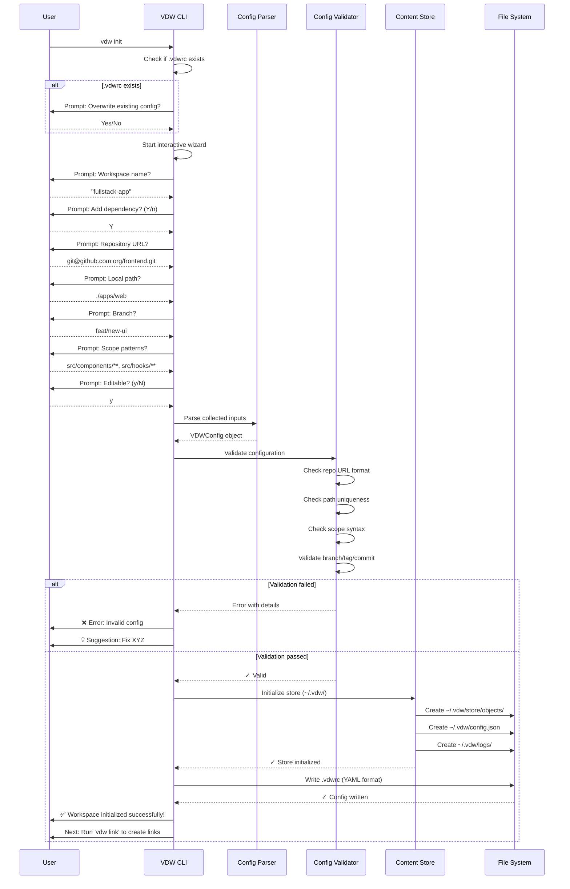
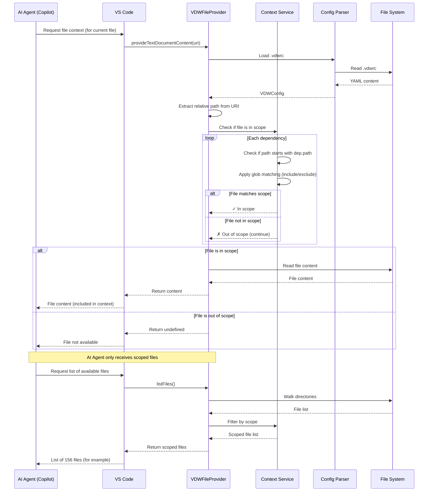

# VDW (Virtual Dev Workspace) - MVP 技术设计文档

**文档版本**: v1.2  
**创建日期**: 2026-06-03  
**最近更新**: 2026-06-03  
**关联 PRD**: [VDW虚拟工作空间_需求文档_v1.0.md](./VDW虚拟工作空间_需求文档_v1.0.md)  
**技术负责人**: TBD  
**开发周期**: Month 1-2 (MVP)

---

## 一、 架构概览

### 1.1 系统边界

```
┌──────────────────────────────────────────────────────────────┐
│                        开发者工作环境                          │
│                                                              │
│  ┌──────────────┐      ┌──────────────┐                     │
│  │  VS Code     │◄────►│  VDW CLI     │                     │
│  │  Plugin      │ IPC  │  (Rust)      │                     │
│  └──────────────┘      └──────┬───────┘                     │
│                               │                               │
│                    ┌──────────▼──────────┐                   │
│                    │   ~/.vdw/           │                   │
│                    │   - store/          │                   │
│                    │   - config.json     │                   │
│                    │   - logs/           │                   │
│                    └──────────┬──────────┘                   │
│                               │                               │
│                    ┌──────────▼──────────┐                   │
│                    │   Git Remote        │                   │
│                    │   (GitHub/GitLab)   │                   │
│                    └─────────────────────┘                   │
└──────────────────────────────────────────────────────────────┘
```

### 1.2 MVP 架构原则

1. **CLI First**: 所有核心功能通过 CLI 暴露，VS Code 插件作为 thin client
2. **Git Native**: 优先使用 Git 原生机制（worktree、alternates），避免重新发明轮子
3. **Fail Fast**: 配置校验前置，链接创建前完成所有预检查
4. **Idempotent**: 所有命令支持重复执行，不会产生副作用

---

## 二、 Rust CLI 架构设计

### 2.1 项目结构

```
vdw/
├── Cargo.toml
├── src/
│   ├── main.rs                    # CLI 入口，命令路由
│   ├── lib.rs                     # 公共模块导出
│   │
│   ├── config/                    # 配置管理模块
│   │   ├── mod.rs
│   │   ├── parser.rs              # .vdwrc YAML/JSON 解析
│   │   ├── validator.rs           # 配置校验逻辑
│   │   └── env_resolver.rs        # 环境变量替换
│   │
│   ├── store/                     # Content Store 模块
│   │   ├── mod.rs
│   │   ├── manager.rs             # Store 生命周期管理
│   │   ├── object_pool.rs         # Git 对象池操作
│   │   ├── alternates.rs          # Git alternates 配置
│   │   └── metadata.rs            # Store 元数据持久化
│   │
│   ├── link/                      # 链接引擎模块
│   │   ├── mod.rs
│   │   ├── engine.rs              # 链接创建/删除主逻辑
│   │   ├── hardlink.rs            # macOS/Linux Hard Link 实现
│   │   ├── symlink.rs             # 跨平台 Symlink 实现
│   │   ├── junction.rs            # Windows Junction Point 实现
│   │   └── platform.rs            # 平台检测与策略选择
│   │
│   ├── worktree/                  # Git Worktree 模块
│   │   ├── mod.rs
│   │   ├── manager.rs             # Worktree 创建/删除/列表
│   │   └── git_ops.rs             # Git 操作封装（基于 git2）
│   │
│   ├── context/                   # AI 上下文模块
│   │   ├── mod.rs
│   │   ├── filter.rs              # Scope 过滤逻辑
│   │   ├── file_list.rs           # 文件列表生成
│   │   └── glob_matcher.rs        # Glob 模式匹配
│   │
│   ├── commands/                  # CLI 命令实现
│   │   ├── mod.rs
│   │   ├── init.rs                # vdw init
│   │   ├── link.rs                # vdw link / unlink
│   │   ├── repo.rs                # vdw repo add/remove/list
│   │   ├── worktree.rs            # vdw worktree create/delete/list
│   │   ├── context.rs             # vdw context preview/stats
│   │   └── doctor.rs              # vdw doctor / validate
│   │
│   ├── utils/                     # 工具函数
│   │   ├── mod.rs
│   │   ├── fs.rs                  # 文件系统操作封装
│   │   ├── git.rs                 # Git 辅助函数
│   │   ├── logging.rs             # 日志配置
│   │   └── errors.rs              # 错误类型定义
│   │
│   └── types/                     # 核心数据结构
│       ├── mod.rs
│       ├── config.rs              # VDWConfig, Dependency, Scope
│       ├── store.rs               # StoreMetadata, RepoRef
│       └── workspace.rs           # WorkspaceState, LinkStatus
│
├── tests/
│   ├── integration/
│   │   ├── link_test.rs
│   │   ├── store_test.rs
│   │   └── context_test.rs
│   └── fixtures/                  # 测试夹具
│       ├── sample.vdwrc
│       └── test-repo/
│
└── benches/                       # 性能基准测试
    └── link_benchmark.rs
```

### 2.2 依赖管理 (Cargo.toml)

```toml
[package]
name = "vdw"
version = "0.1.0"
edition = "2021"
authors = ["VDW Team"]
description = "Virtual Dev Workspace - Cross-repo development middleware"

[[bin]]
name = "vdw"
path = "src/main.rs"

[dependencies]
# CLI 框架
clap = { version = "4.4", features = ["derive", "env"] }
dialoguer = "0.11"  # 交互式 prompts

# 序列化/配置
serde = { version = "1.0", features = ["derive"] }
serde_yaml = "0.9"
serde_json = "1.0"

# Git 操作
git2 = "0.18"  # libgit2 bindings

# 文件系统
tokio = { version = "1.35", features = ["full"] }  # 异步 I/O
walkdir = "2.4"  # 目录遍历
glob = "0.3"  # Glob 模式匹配
fs_extra = "1.3"  # 高级文件操作

# 错误处理
thiserror = "1.0"
anyhow = "1.0"

# 日志
tracing = "0.1"
tracing-subscriber = { version = "0.3", features = ["env-filter"] }

# 平台检测
cfg-if = "1.0"

# 日期时间
chrono = { version = "0.4", features = ["serde"] }

# 哈希计算
sha2 = "0.10"

# 并发控制
parking_lot = "0.12"

[dev-dependencies]
tempfile = "3.9"  # 临时目录
assert_fs = "1.0"  # 文件系统断言
criterion = "0.5"  # 基准测试

[[bench]]
name = "link_benchmark"
harness = false
```

### 2.3 错误处理架构

#### 2.3.1 错误类型层次

```rust
use thiserror::Error;

#[derive(Error, Debug)]
pub enum VDWError {
    #[error("Configuration error: {0}")]
    ConfigError(#[from] ConfigError),
    
    #[error("Store operation failed: {0}")]
    StoreError(#[from] StoreError),
    
    #[error("Link creation failed: {0}")]
    LinkError(#[from] LinkError),
    
    #[error("Git operation failed: {0}")]
    GitError(#[from] GitError),
    
    #[error("Context filter error: {0}")]
    ContextError(#[from] ContextError),
    
    #[error("IO error: {0}")]
    IoError(#[from] std::io::Error),
    
    #[error("Platform not supported: {0}")]
    PlatformError(String),
}

#[derive(Error, Debug)]
pub enum ConfigError {
    #[error("File not found: {path}")]
    FileNotFound { path: String },
    
    #[error("Invalid YAML/JSON: {reason}")]
    ParseError { reason: String },
    
    #[error("Validation failed: {field} - {message}")]
    ValidationError { field: String, message: String },
    
    #[error("Environment variable not set: {var}")]
    EnvVarMissing { var: String },
    
    #[error("Circular dependency detected: {path}")]
    CircularDependency { path: String },
}

#[derive(Error, Debug)]
pub enum StoreError {
    #[error("Store not initialized. Run 'vdw init' first.")]
    NotInitialized,
    
    #[error("Repository not found in store: {repo_url}")]
    RepoNotFound { repo_url: String },
    
    #[error("Failed to clone repository: {reason}")]
    CloneFailed { reason: String },
    
    #[error("Store corruption detected: {path}")]
    Corruption { path: String },
    
    #[error("Concurrent access lock failed")]
    LockFailed,
}

#[derive(Error, Debug)]
pub enum LinkError {
    #[error("Hard link not supported on this filesystem")]
    HardLinkNotSupported,
    
    #[error("Symlink creation failed: {reason}")]
    SymlinkFailed { reason: String },
    
    #[error("Target path already exists: {path}")]
    PathExists { path: String },
    
    #[error("Insufficient permissions for junction point (requires admin)")]
    JunctionPermissionDenied,
}

#[derive(Error, Debug)]
pub enum GitError {
    #[error("Git2 error: {0}")]
    LibGit2(#[from] git2::Error),
    
    #[error("Branch not found: {branch}")]
    BranchNotFound { branch: String },
    
    #[error("Commit not found: {commit}")]
    CommitNotFound { commit: String },
    
    #[error("Worktree already exists: {name}")]
    WorktreeExists { name: String },
}
```

#### 2.3.2 错误处理策略

```rust
// main.rs - 顶层错误处理
use anyhow::Result;

fn main() -> Result<()> {
    // 初始化日志
    logging::init()?;
    
    // 解析 CLI 参数
    let cli = Cli::parse();
    
    // 执行命令，统一错误处理
    if let Err(e) = run_command(cli) {
        tracing::error!("Command failed: {:?}", e);
        
        // 用户友好的错误输出
        eprintln!("❌ Error: {}", e);
        
        // 提供解决建议
        if let Some(suggestion) = get_suggestion(&e) {
            eprintln!("\n💡 Suggestion: {}", suggestion);
        }
        
        // 非零退出码
        std::process::exit(1);
    }
    
    Ok(())
}

fn get_suggestion(error: &anyhow::Error) -> Option<String> {
    // 根据错误类型返回解决建议
    if error.downcast_ref::<StoreError>().is_some() {
        Some("Run 'vdw store repair' to fix store issues".to_string())
    } else if error.downcast_ref::<LinkError>().is_some() {
        Some("Check file permissions and disk space".to_string())
    } else {
        None
    }
}
```

### 2.4 CLI 命令流

#### 2.4.1 命令路由 (main.rs)

```rust
use clap::{Parser, Subcommand};

#[derive(Parser)]
#[command(name = "vdw")]
#[command(about = "Virtual Dev Workspace - Cross-repo development middleware")]
#[command(version = "0.1.0")]
struct Cli {
    #[command(subcommand)]
    command: Commands,
    
    /// Enable verbose output
    #[arg(short, long, global = true)]
    verbose: bool,
}

#[derive(Subcommand)]
enum Commands {
    /// Initialize a new VDW workspace
    Init {
        /// Use a preset template
        #[arg(short, long)]
        template: Option<String>,
    },
    
    /// Create links based on .vdwrc
    Link {
        /// Only link the specified repository URL
        #[arg(long)]
        repo: Option<String>,
    },
    
    /// Remove links (all or by --repo)
    Unlink {
        /// Only unlink the specified repository URL
        #[arg(long)]
        repo: Option<String>,
    },
    
    /// Manage dependencies
    #[command(subcommand)]
    Repo(RepoCommands),
    
    /// Manage worktrees
    #[command(subcommand)]
    Worktree(WorktreeCommands),
    
    /// Preview AI context
    #[command(subcommand)]
    Context(ContextCommands),
    
    /// Diagnose workspace issues
    Doctor,
    
    /// Validate .vdwrc configuration
    Validate,
}

#[derive(Subcommand)]
enum RepoCommands {
    /// Add a dependency repository
    Add {
        /// Repository URL
        url: String,
        
        /// Local path
        #[arg(short, long)]
        path: String,
        
        /// Branch name
        #[arg(short, long)]
        branch: Option<String>,
        
        /// Make editable
        #[arg(short, long)]
        editable: bool,
    },
    
    /// Remove a dependency
    Remove { name: String },
    
    /// List all dependencies
    List,
}

#[derive(Subcommand)]
enum WorktreeCommands {
    /// List worktrees
    List,
    
    /// Create a new worktree
    Create {
        /// Repository name
        repo: String,
        
        /// Branch name
        branch: String,
    },
    
    /// Delete a worktree
    Delete {
        /// Repository name
        repo: String,
        
        /// Branch name
        branch: String,
    },
}

#[derive(Subcommand)]
enum ContextCommands {
    /// Preview files in AI context
    Preview,
    
    /// Show context statistics
    Stats,
}

fn run_command(cli: Cli) -> Result<()> {
    match cli.command {
        Commands::Init { template } => commands::init::execute(template)?,
        Commands::Link { repo } => commands::link::execute(repo.as_deref())?,
        Commands::Unlink { repo } => commands::link::unlink(repo.as_deref())?,
        Commands::Repo(cmd) => commands::repo::execute(cmd)?,
        Commands::Worktree(cmd) => commands::worktree::execute(cmd)?,
        Commands::Context(cmd) => commands::context::execute(cmd)?,
        Commands::Doctor => commands::doctor::execute()?,
        Commands::Validate => commands::doctor::validate()?,
    }
    Ok(())
}
```

---

## 三、 Content Store 实现细节

### 3.1 Store 目录结构

```
~/.vdw/
├── store/
│   ├── objects/                          # Git 对象共享池
│   │   ├── frontend-abc123/              # 格式: <repo-name>-<short-hash>
│   │   │   ├── bare.git/                 # 裸仓库（对象库）
│   │   │   │   ├── HEAD
│   │   │   │   ├── config
│   │   │   │   ├── objects/              # Git 对象
│   │   │   │   │   ├── info/
│   │   │   │   │   │   └── alternates    # 指向全局共享对象（可选）
│   │   │   │   │   └── pack/
│   │   │   │   ├── refs/
│   │   │   │   └── worktrees/            # Worktree 元数据
│   │   │   │       ├── main/
│   │   │   │       │   ├── HEAD
│   │   │   │       │   ├── commondir
│   │   │   │       │   └── gitdir
│   │   │   │       └── feat-new-ui/
│   │   │   └── metadata.json             # 仓库元数据
│   │   │
│   │   └── backend-def456/
│   │       ├── bare.git/
│   │       └── metadata.json
│   │
│   └── cache/
│       ├── index.db                      # SQLite 索引（可选）
│       └── lock                          # 并发锁文件
│
├── config.json                           # 全局配置
│   {
│     "store_path": "~/.vdw/store",
│     "max_store_size_gb": 50,
│     "gc_threshold_days": 30
│   }
│
└── logs/
    └── vdw.log                           # 操作日志
```

### 3.2 Git Alternates 配置策略

#### 3.2.1 核心原理

Git Alternates 机制允许一个 Git 仓库引用另一个仓库的对象库，避免重复存储相同的 Git 对象（blobs、trees、commits）。

**工作机制**：
1. 在 `.git/objects/info/alternates` 文件中写入外部对象库路径
2. Git 在查找对象时，先检查本地对象库，未找到则检查 alternates 路径
3. 多个仓库可以共享同一个裸仓库的对象库

#### 3.2.2 Alternates 实现

```rust
// src/store/alternates.rs

use std::fs;
use std::path::{Path, PathBuf};
use anyhow::Result;

/// 配置 Git alternates，使新仓库引用全局对象池
pub fn setup_alternates(repo_path: &Path, reference_path: &Path) -> Result<()> {
    let alternates_file = repo_path.join("objects/info/alternates");
    let alternates_dir = alternates_file.parent().unwrap();
    
    // 确保目录存在
    fs::create_dir_all(alternates_dir)?;
    
    // 写入 alternates 路径（相对于或绝对路径）
    let reference_objects_path = reference_path.join("objects");
    fs::write(&alternates_file, reference_objects_path.to_string_lossy().as_ref())?;
    
    tracing::info!(
        "Configured alternates: {} -> {}",
        repo_path.display(),
        reference_objects_path.display()
    );
    
    Ok(())
}

/// 移除 Git alternates 配置
pub fn remove_alternates(repo_path: &Path) -> Result<()> {
    let alternates_file = repo_path.join("objects/info/alternates");
    
    if alternates_file.exists() {
        fs::remove_file(&alternates_file)?;
        tracing::info!("Removed alternates: {}", repo_path.display());
    }
    
    Ok(())
}

/// 验证 alternates 路径是否有效
pub fn validate_alternates(repo_path: &Path) -> Result<bool> {
    let alternates_file = repo_path.join("objects/info/alternates");
    
    if !alternates_file.exists() {
        return Ok(true); // 没有 alternates 也是有效的
    }
    
    let alternates_path = fs::read_to_string(&alternates_file)?;
    let alternates_path = alternates_path.trim();
    
    let objects_dir = PathBuf::from(alternates_path);
    Ok(objects_dir.exists() && objects_dir.is_dir())
}
```

### 3.3 对象共享策略

#### 3.3.1 克隆流程（带 --reference）

```rust
// src/store/object_pool.rs

use git2::{Repository, RepositoryInitOptions};
use std::path::{Path, PathBuf};
use anyhow::Result;

/// 克隆仓库到 Content Store，使用 --reference 共享对象
pub fn clone_to_store(
    repo_url: &str,
    store_path: &Path,
    reference_path: Option<&Path>,
) -> Result<PathBuf> {
    // 1. 生成仓库标识（基于 URL hash）
    let repo_hash = compute_repo_hash(repo_url);
    let repo_dir = store_path.join(format!("objects/repo-{}", repo_hash));
    
    if repo_dir.exists() {
        tracing::info!("Repository already exists in store: {}", repo_url);
        return Ok(repo_dir);
    }
    
    // 2. 创建裸仓库（仅对象库，无工作树）
    let mut init_opts = RepositoryInitOptions::new();
    init_opts.bare(true);
    init_opts.external_template(false);
    
    let bare_repo = Repository::init_opts(&repo_dir, &init_opts)?;
    
    // 3. 如果提供了 reference，配置 alternates
    if let Some(ref_path) = reference_path {
        setup_alternates(&repo_dir, ref_path)?;
    }
    
    // 4. 添加 remote
    {
        let mut config = bare_repo.config()?;
        // 使用 git2 API 添加 remote
    }
    
    // 5. 拉取指定分支/commit（惰性拉取）
    // 注意：MVP 阶段拉取完整历史，后续优化为 shallow clone
    
    tracing::info!("Cloned repository to store: {}", repo_url);
    Ok(repo_dir)
}

/// 计算仓库唯一 hash（基于 URL）
fn compute_repo_hash(repo_url: &str) -> String {
    use sha2::{Sha256, Digest};
    let mut hasher = Sha256::new();
    hasher.update(repo_url.as_bytes());
    let result = hasher.finalize();
    format!("{:x}", result)[..8].to_string() // 取前 8 位
}
```

#### 3.3.2 Worktree 创建流程

```rust
// src/worktree/manager.rs

use git2::Repository;
use std::path::{Path, PathBuf};
use anyhow::Result;

/// 为 Store 中的仓库创建 Worktree
pub fn create_worktree(
    bare_repo_path: &Path,
    branch_name: &str,
    worktree_path: &Path,
) -> Result<PathBuf> {
    let bare_repo = Repository::open(bare_repo_path)?;
    
    // 1. 检查 worktree 是否已存在
    if worktree_path.exists() {
        return Err(anyhow::anyhow!(
            "Worktree path already exists: {}",
            worktree_path.display()
        ));
    }
    
    // 2. 查找或创建分支
    let branch = match bare_repo.find_branch(branch_name, git2::BranchType::Local) {
        Ok(branch) => branch,
        Err(_) => {
            // 从 remote 创建本地分支
            let remote_branch = bare_repo
                .find_branch(&format!("origin/{}", branch_name), git2::BranchType::Remote)?;
            let commit = remote_branch.get().peel_to_commit()?;
            bare_repo.branch(branch_name, &commit, false)?
        }
    };
    
    // 3. 创建 worktree
    let commit = branch.get().peel_to_commit()?;
    let mut worktree_opts = git2::WorktreeAddOptions::new();
    // worktree_opts.reference(Some(branch.get()));
    
    let worktree = bare_repo.worktree_add(
        worktree_path,
        branch_name,
        Some(&worktree_opts),
    )?;
    
    tracing::info!(
        "Created worktree: {} at {}",
        branch_name,
        worktree_path.display()
    );
    
    Ok(worktree_path.to_path_buf())
}

/// 列出所有 worktrees
pub fn list_worktrees(bare_repo_path: &Path) -> Result<Vec<String>> {
    let bare_repo = Repository::open(bare_repo_path)?;
    let worktrees = bare_repo.worktrees()?;
    
    Ok(worktrees.iter().filter_map(|name| name.map(String::from)).collect())
}

/// 删除 worktree
pub fn remove_worktree(
    bare_repo_path: &Path,
    worktree_name: &str,
    force: bool,
) -> Result<()> {
    let bare_repo = Repository::open(bare_repo_path)?;
    bare_repo.worktree_prune(worktree_name, force)?;
    
    tracing::info!("Removed worktree: {}", worktree_name);
    Ok(())
}
```

### 3.4 Store 元数据管理

```rust
// src/store/metadata.rs

use serde::{Serialize, Deserialize};
use chrono::{DateTime, Utc};
use std::path::{Path, PathBuf};
use std::fs;
use anyhow::Result;

#[derive(Debug, Serialize, Deserialize)]
pub struct StoreMetadata {
    pub repo_url: String,
    pub commit_hash: String,
    pub branch: Option<String>,
    pub tag: Option<String>,
    pub reference_count: u32,  // 被多少个工作空间引用
    pub last_accessed: DateTime<Utc>,
    pub created_at: DateTime<Utc>,
    pub size_bytes: u64,
    pub alternates_configured: bool,
}

impl StoreMetadata {
    /// 从文件系统加载元数据
    pub fn load(repo_path: &Path) -> Result<Self> {
        let metadata_file = repo_path.join("metadata.json");
        let content = fs::read_to_string(metadata_file)?;
        let metadata: StoreMetadata = serde_json::from_str(&content)?;
        Ok(metadata)
    }
    
    /// 保存元数据到文件系统
    pub fn save(&self, repo_path: &Path) -> Result<()> {
        let metadata_file = repo_path.join("metadata.json");
        let content = serde_json::to_string_pretty(self)?;
        fs::write(metadata_file, content)?;
        Ok(())
    }
    
    /// 更新引用计数
    pub fn increment_reference(&mut self) {
        self.reference_count += 1;
        self.last_accessed = Utc::now();
    }
    
    pub fn decrement_reference(&mut self) {
        if self.reference_count > 0 {
            self.reference_count -= 1;
        }
    }
}

/// Store 索引管理器
pub struct StoreIndex {
    cache_path: PathBuf,
}

impl StoreIndex {
    pub fn new(store_path: &Path) -> Self {
        Self {
            cache_path: store_path.join("cache/index.db"),
        }
    }
    
    /// 初始化索引（MVP 阶段使用 JSON 文件，后续迁移到 SQLite）
    pub fn init(&self) -> Result<()> {
        let index_file = self.cache_path.parent().unwrap().join("index.json");
        if !index_file.exists() {
            fs::write(&index_file, "[]")?;
        }
        Ok(())
    }
    
    /// 添加仓库到索引
    pub fn add_entry(&self, metadata: &StoreMetadata) -> Result<()> {
        // MVP: 简单追加到 JSON 数组
        // V2: 迁移到 SQLite 支持高效查询
        Ok(())
    }
    
    /// 查找仓库
    pub fn find_by_url(&self, repo_url: &str) -> Result<Option<StoreMetadata>> {
        // MVP: 线性扫描
        // V2: SQLite 索引查询
        Ok(None)
    }
}
```

---

## 四、 VS Code 插件架构设计

### 4.1 插件结构

```
vdw-vscode/
├── package.json
├── tsconfig.json
├── .vscodeignore
├── README.md
├── CHANGELOG.md
├── vsc-extension-quickstart.md
│
├── src/
│   ├── extension.ts                 # 插件入口
│   │
│   ├── providers/                   # VS Code 提供者
│   │   ├── workspaceTreeView.ts     # 侧边栏树视图
│   │   ├── fileProvider.ts          # TextDocumentContentProvider
│   │   └── statusBar.ts             # 状态栏管理
│   │
│   ├── commands/                    # 命令处理器
│   │   ├── link.ts
│   │   ├── unlink.ts
│   │   ├── addRepo.ts
│   │   ├── removeRepo.ts
│   │   └── refreshContext.ts
│   ├── services/                    # 业务逻辑
│   │   ├── vdwCliService.ts         # CLI 调用封装（含 linkRepo/unlinkRepo/removeRepo）
│   │   ├── configService.ts         # .vdwrc 解析
│   │   ├── contextService.ts        # 上下文管理
│   │   └── autoOpenService.ts       # 自动打开 Git 仓库
│   │
│   ├── types/                       # TypeScript 类型定义
│   │   └── vdwTypes.ts
│   │
│   └── utils/                       # 工具函数
│       ├── logger.ts
│       └── pathResolver.ts
│
├── resources/                       # 图标资源
│   └── icons/
│
└── tests/
    └── extension.test.ts
```

### 4.2 FileProvider 实现

```typescript
// src/providers/fileProvider.ts

import * as vscode from 'vscode';
import * as fs from 'fs';
import * as path from 'path';
import { VDWConfig, Dependency } from '../types/vdwTypes';
import { isInScope, resolveVDWPath } from '../utils/pathResolver';

export class VDWFileProvider implements vscode.TextDocumentContentProvider {
    private _onDidChangeEmitter = new vscode.EventEmitter<vscode.Uri>();
    readonly onDidChange = this._onDidChangeEmitter.event;
    
    private config: VDWConfig | null = null;
    private workspaceRoot: string | null = null;
    
    constructor() {
        this.loadConfig();
    }
    
    /**
     * 提供文档内容（AI 插件调用此方法获取文件内容）
     */
    async provideTextDocumentContent(uri: vscode.Uri): Promise<string | undefined> {
        try {
            // 1. 检查文件是否在 .vdwrc 的 scope 内
            if (!this.config || !this.workspaceRoot) {
                vscode.window.showWarningMessage('VDW workspace not initialized');
                return undefined;
            }
            
            const relativePath = path.relative(this.workspaceRoot, uri.fsPath);
            
            if (!this.isInAnyScope(relativePath)) {
                // 不在 scope 内，不暴露给 AI
                return undefined;
            }
            
            // 2. 解析 VDW 路径（通过链接访问）
            const resolvedPath = resolveVDWPath(uri.fsPath, this.config);
            
            // 3. 读取实际文件内容
            const content = await fs.promises.readFile(resolvedPath, 'utf-8');
            
            return content;
        } catch (error) {
            console.error(`Failed to read file: ${uri.fsPath}`, error);
            return undefined;
        }
    }
    
    /**
     * 列出所有在 scope 内的文件（供 AI 插件使用）
     */
    async listFiles(): Promise<string[]> {
        if (!this.config || !this.workspaceRoot) {
            return [];
        }
        
        const scopedFiles: string[] = [];
        
        for (const dep of this.config.dependencies) {
            const depPath = path.join(this.workspaceRoot, dep.path);
            const files = await this.walkDirectory(depPath, dep.scope);
            scopedFiles.push(...files);
        }
        
        return scopedFiles;
    }
    
    /**
     * 检查文件是否在任意依赖的 scope 内
     */
    private isInAnyScope(relativePath: string): boolean {
        if (!this.config) return false;
        
        return this.config.dependencies.some(dep => {
            if (!relativePath.startsWith(dep.path)) {
                return false;
            }
            
            const fileInDepPath = path.relative(dep.path, relativePath);
            return isInScope(fileInDepPath, dep.scope);
        });
    }
    
    /**
     * 遍历目录，过滤 scope
     */
    private async walkDirectory(dirPath: string, scope: any): Promise<string[]> {
        const files: string[] = [];
        
        try {
            const entries = await fs.promises.readdir(dirPath, { withFileTypes: true });
            
            for (const entry of entries) {
                const fullPath = path.join(dirPath, entry.name);
                const relativePath = path.relative(this.workspaceRoot!, fullPath);
                
                if (entry.isDirectory()) {
                    // 跳过排除的目录
                    if (this.shouldExclude(relativePath, scope)) {
                        continue;
                    }
                    files.push(...await this.walkDirectory(fullPath, scope));
                } else if (entry.isFile()) {
                    if (isInScope(relativePath, scope)) {
                        files.push(fullPath);
                    }
                }
            }
        } catch (error) {
            console.error(`Failed to walk directory: ${dirPath}`, error);
        }
        
        return files;
    }
    
    /**
     * 重新加载配置
     */
    async reloadConfig() {
        this.loadConfig();
        
        // 通知所有订阅者配置已变更
        this._onDidChangeEmitter.fire(vscode.Uri.parse('vdw://config'));
    }
    
    private loadConfig() {
        // 加载 .vdwrc 配置
        // ...
    }
}
```

### 4.3 WebView Panel - Workspace View

```typescript
// src/providers/workspaceTreeView.ts

import * as vscode from 'vscode';
import { VDWConfig, Dependency } from '../types/vdwTypes';
import { VDWFileProvider } from './fileProvider';

export class WorkspaceTreeProvider implements vscode.TreeDataProvider<WorkspaceTreeItem> {
    private _onDidChangeTreeData: vscode.EventEmitter<WorkspaceTreeItem | undefined | null | void> = new vscode.EventEmitter<WorkspaceTreeItem | undefined | null | void>();
    readonly onDidChangeTreeData: vscode.Event<WorkspaceTreeItem | undefined | null | void> = this._onDidChangeTreeData.event;
    
    private config: VDWConfig | null = null;
    private fileProvider: VDWFileProvider;
    
    constructor(fileProvider: VDWFileProvider) {
        this.fileProvider = fileProvider;
    }
    
    refresh(): void {
        this._onDidChangeTreeData.fire();
    }
    
    getTreeItem(element: WorkspaceTreeItem): vscode.TreeItem {
        return element;
    }
    
    async getChildren(element?: WorkspaceTreeItem): Promise<WorkspaceTreeItem[]> {
        if (!this.config) {
            return [];
        }
        
        if (!element) {
            // 根节点：返回所有依赖仓库
            return this.config.dependencies.map(dep => 
                new WorkspaceTreeItem(
                    `${dep.repo.split('/').pop()}@${dep.branch || 'main'}`,
                    vscode.TreeItemCollapsibleState.Collapsed,
                    'linkedRepo',  // or 'unlinkedRepo' based on link status
                    dep
                )
            );
        }
        
        if (element.contextType === 'repo' || element.contextType === 'linkedRepo' || element.contextType === 'unlinkedRepo') {
            // 仓库节点：显示路径、scope、状态
            const dep = element.dependency!;
            return [
                new WorkspaceTreeItem(
                    `Path: ${dep.path}`,
                    vscode.TreeItemCollapsibleState.None,
                    'path'
                ),
                new WorkspaceTreeItem(
                    `Scope: ${dep.scope.include.join(', ')}`,
                    vscode.TreeItemCollapsibleState.None,
                    'scope'
                ),
                new WorkspaceTreeItem(
                    dep.editable ? '✅ Editable' : '🔒 Read-only',
                    vscode.TreeItemCollapsibleState.None,
                    'status'
                ),
            ];
        }
        
        return [];
    }
}

class WorkspaceTreeItem extends vscode.TreeItem {
    constructor(
        public readonly label: string,
        public readonly collapsibleState: vscode.TreeItemCollapsibleState,
        public readonly contextType: string,
        public readonly dependency?: Dependency
    ) {
        super(label, collapsibleState);
        
        // 设置图标
        this.iconPath = this.getIcon();
        
        // 设置 tooltip
        this.tooltip = this.getTooltip();
    }
    
    private getIcon(): vscode.ThemeIcon {
        switch (this.contextType) {
            case 'repo':
            case 'linkedRepo':
            case 'unlinkedRepo':
                return new vscode.ThemeIcon('repo');
            case 'path':
                return new vscode.ThemeIcon('folder');
            case 'scope':
                return new vscode.ThemeIcon('filter');
            case 'status':
                return new vscode.ThemeIcon('check');
            default:
                return new vscode.ThemeIcon('file');
        }
    }
    
    private getTooltip(): string {
        if (this.dependency) {
            return `${this.dependency.repo}\nBranch: ${this.dependency.branch || 'main'}\nEditable: ${this.dependency.editable}`;
        }
        return this.label;
    }
}
```

### 4.4 插件入口 (extension.ts)

```typescript
// src/extension.ts

import * as vscode from 'vscode';
import { VDWFileProvider } from './providers/fileProvider';
import { WorkspaceTreeProvider } from './providers/workspaceTreeView';
import { StatusBarManager } from './providers/statusBar';
import { registerCommands } from './commands';
import { AutoOpenService } from './services/autoOpenService';

let fileProvider: VDWFileProvider;
let treeProvider: WorkspaceTreeProvider;
let statusBar: StatusBarManager;
let autoOpenService: AutoOpenService;

let fileProvider: VDWFileProvider;
let treeProvider: WorkspaceTreeProvider;
let statusBar: StatusBarManager;

export function activate(context: vscode.ExtensionContext) {
    console.log('VDW extension is now active');
    
    // 1. 初始化 FileProvider
    fileProvider = new VDWFileProvider();
    context.subscriptions.push(
        vscode.workspace.registerTextDocumentContentProvider('vdw', fileProvider)
    );
    
    // 2. 初始化树视图
    treeProvider = new WorkspaceTreeProvider(fileProvider);
    const treeView = vscode.window.createTreeView('vdwWorkspace', {
        treeDataProvider: treeProvider,
        showCollapseAll: true
    });
    context.subscriptions.push(treeView);
    
    // 3. 初始化 AutoOpenService
    autoOpenService = new AutoOpenService();
    context.subscriptions.push(autoOpenService);
    
    // 4. 初始化状态栏
    statusBar = new StatusBarManager();
    statusBar.update(fileProvider);
    
    // 5. 注册命令
    registerCommands(context, fileProvider, treeProvider, statusBar, autoOpenService);
    
    // 6. 监听 .vdwrc 文件变化
    const watcher = vscode.workspace.createFileSystemWatcher('**/.vdwrc');
    watcher.onDidChange(() => {
        fileProvider.reloadConfig();
        treeProvider.refresh();
        statusBar.update(fileProvider);
    });
    context.subscriptions.push(watcher);
    
    // 7. 自动打开 Git 仓库（扩展激活时）
    autoOpenService.openAllEditableRepositories();
    
    // 8. 检测工作空间激活
    detectAndActivateWorkspace();
}

async function detectAndActivateWorkspace() {
    const workspaceFolders = vscode.workspace.workspaceFolders;
    if (!workspaceFolders) return;
    
    for (const folder of workspaceFolders) {
        const vdwrcPath = vscode.Uri.joinPath(folder.uri, '.vdwrc');
        try {
            await vscode.workspace.fs.stat(vdwrcPath);
            // .vdwrc 存在，激活 VDW 功能
            vscode.window.showInformationMessage('VDW workspace detected. Click to activate.');
            break;
        } catch {
            // .vdwrc 不存在，继续检查下一个
        }
    }
}

export function deactivate() {
    statusBar.dispose();
}
```

### 4.5 Auto-Open Git Repository 功能设计

#### 4.5.1 功能概述

在 add、link、relink 操作后以及扩展激活时，自动在 VS Code Source Control 面板中注册可编辑依赖的 Git 仓库，使开发者能立即看到各子仓库的变更状态，无需手动执行 `git.openRepository`。

#### 4.5.2 触发时机

| 触发时机 | 描述 | 实现方式 |
|---------|------|---------|
| 扩展激活时 | VS Code 打开工作区时 | `extension.ts` 中调用 `autoOpenService.openAllEditableRepositories()` |
| `vdw.link` 成功后 | 链接操作完成后 | 命令回调中调用 `autoOpenService.openAllEditableRepositories()` |
| `vdw.relink` 成功后 | 重新链接操作完成后 | 命令回调中调用 `autoOpenService.openAllEditableRepositories()` |
| `vdw.addRepo` 成功后 | 添加新仓库后 | 命令回调中调用 `autoOpenService.openAllEditableRepositories()` |

#### 4.5.3 Worktree 路径解析

AutoOpenService 通过读取 `.vdw/state.json` 文件获取 worktree 路径，该文件由 Rust CLI 在 link 操作时生成：

```typescript
// 从 .vdw/state.json 读取 worktree 路径
async function getWorktreePath(dep: Dependency): Promise<string | null> {
    const workspaceFolder = vscode.workspace.workspaceFolders?.[0];
    if (!workspaceFolder) return null;
    
    const statePath = path.join(workspaceFolder.uri.fsPath, '.vdw', 'state.json');
    if (!fs.existsSync(statePath)) return null;
    
    try {
        const state = JSON.parse(fs.readFileSync(statePath, 'utf-8'));
        const worktree = state.worktrees?.find(
            (wt: any) => wt.repo_url === dep.repo && wt.branch === dep.branch
        );
        return worktree?.path || null;
    } catch {
        return null;
    }
}
```

#### 4.5.4 核心实现 (autoOpenService.ts)

```typescript
// src/services/autoOpenService.ts

import * as vscode from 'vscode';
import * as fs from 'fs';
import * as path from 'path';

interface Dependency {
    repo: string;
    path: string;
    branch?: string;
    tag?: string;
    commit?: string;
    editable: boolean;
}

interface Config {
    workspace: { name: string; version: string };
    dependencies: Dependency[];
}

interface WorktreeInfo {
    repo_url: string;
    branch: string;
    path: string;
}

interface WorkspaceState {
    worktrees: WorktreeInfo[];
}

export class AutoOpenService implements vscode.Disposable {
    private _disposables: vscode.Disposable[] = [];

    /**
     * 打开所有可编辑仓库的 Git 仓库注册
     */
    async openAllEditableRepositories(): Promise<void> {
        const config = this.loadConfig();
        if (!config) return;
        
        if (!this.isAutoOpenEnabled()) {
            console.log('Auto-open Git repositories is disabled');
            return;
        }
        
        const editableDeps = config.dependencies.filter(d => d.editable);
        if (editableDeps.length === 0) return;
        
        const delay = this.getOpenDelay();
        
        for (const dep of editableDeps) {
            const worktreePath = await this.getWorktreePath(dep);
            if (worktreePath && fs.existsSync(worktreePath)) {
                try {
                    await vscode.commands.executeCommand(
                        'git.openRepository',
                        vscode.Uri.file(worktreePath)
                    );
                    console.log(`Auto-opened Git repository: ${worktreePath}`);
                } catch (err) {
                    console.error(`Failed to auto-open Git repository: ${worktreePath}`, err);
                }
                await new Promise(resolve => setTimeout(resolve, delay));
            }
        }
    }

    private loadConfig(): Config | null {
        const workspaceFolder = vscode.workspace.workspaceFolders?.[0];
        if (!workspaceFolder) return null;
        
        const vdwrcPath = path.join(workspaceFolder.uri.fsPath, '.vdwrc');
        if (!fs.existsSync(vdwrcPath)) return null;
        
        try {
            const content = fs.readFileSync(vdwrcPath, 'utf-8');
            return JSON.parse(content);
        } catch {
            return null;
        }
    }

    private async getWorktreePath(dep: Dependency): Promise<string | null> {
        const workspaceFolder = vscode.workspace.workspaceFolders?.[0];
        if (!workspaceFolder) return null;
        
        const statePath = path.join(workspaceFolder.uri.fsPath, '.vdw', 'state.json');
        if (!fs.existsSync(statePath)) return null;
        
        try {
            const state: WorkspaceState = JSON.parse(fs.readFileSync(statePath, 'utf-8'));
            const worktree = state.worktrees?.find(
                wt => wt.repo_url === dep.repo && wt.branch === (dep.branch || 'main')
            );
            return worktree?.path || null;
        } catch {
            return null;
        }
    }

    private isAutoOpenEnabled(): boolean {
        return vscode.workspace.getConfiguration('vdw').get<boolean>('autoOpenGitRepositories', true);
    }

    private getOpenDelay(): number {
        return vscode.workspace.getConfiguration('vdw').get<number>('autoOpenDelay', 500);
    }

    dispose(): void {
        this._disposables.forEach(d => d.dispose());
        this._disposables = [];
    }
}
```

#### 4.5.5 配置项

```json
// VS Code settings.json
{
  "vdw.autoOpenGitRepositories": true,   // 是否自动打开 Git 仓库（默认 true）
  "vdw.autoOpenDelay": 500               // 仓库间打开延迟（毫秒，默认 500）
}
```

#### 4.5.6 集成到命令中

在命令回调中，link/relink/addRepo 操作成功完成后调用 AutoOpenService：

```typescript
// commands/link.ts
async function handleLink() {
    // ... existing link logic ...
    if (result.exitCode === 0) {
        // Refresh all UI components
        await autoOpenService.openAllEditableRepositories();
    }
}
```

#### 4.5.7 错误处理策略

| 场景 | 处理方式 |
|------|---------|
| Git 扩展未激活 | `git.openRepository` 命令自动触发 Git 扩展激活 |
| worktree 路径不存在 | 跳过该仓库，记录日志，继续下一个 |
| state.json 解析失败 | 跳过所有自动打开，记录日志 |
| 用户禁用配置 | 检查 `vdw.autoOpenGitRepositories` 配置，为 false 时跳过 |
| 命令调用异常 | try-catch 包裹，不阻断主流程 |

### 4.6 右键移除仓库功能设计

#### 4.6.1 功能概述

在 VDW 工作空间视图的依赖项上右键点击，选择「移除仓库」后，执行以下操作：
1. 弹出确认对话框（包含仓库名称、路径信息）
2. 用户确认后：卸载链接 → 从 `.vdwrc` 中移除依赖项 → 刷新视图

与「卸载链接」的核心区别：
| 操作 | 效果 | 配置影响 | 可恢复性 |
|------|------|---------|---------|
| 卸载链接 | 仅移除硬链接文件，仓库仍保留在 `.vdwrc` 中 | 不变 | 可重新 Link |
| 移除仓库 | 卸载链接 + 从 `.vdwrc` 删除配置项 | 移除依赖项 | 需重新 Add |

#### 4.6.2 实现机制

**CLI 命令依赖**：
- `vdw unlink --repo <url>` — 卸载指定仓库的链接

**实现思路**：不调用 `vdw repo remove`，直接编辑 `.vdwrc` YAML 删除对应依赖项（不移除 CLI Store 中的代码）

**VS Code 命令注册 (commands/index.ts)**：
```typescript
vscode.commands.registerCommand('vdw.removeRepo', async (treeItem) => {
    const dep = treeItem.dependency;
    
    // 1. 确认对话框
    const confirm = await vscode.window.showWarningMessage(
        `Remove repository "${dep.repo}"?`,
        { modal: true },
        'Yes, Remove'
    );
    if (!confirm) return;
    
    // 2. 先卸载链接（如果已链接）
    await cliService.unlinkRepo(dep.repo);
    
    // 3. 直接从 .vdwrc 移除依赖项
    const vdwrcPath = path.join(workspaceFolder, '.vdwrc');
    const content = fs.readFileSync(vdwrcPath, 'utf-8');
    const config = yaml.load(content);
    config.dependencies = config.dependencies.filter(
        d => d.repo !== dep.repo && d.path !== dep.path
    );
    const yamlStr = yaml.dump(config, { indent: 2, lineWidth: 120, noRefs: true });
    fs.writeFileSync(vdwrcPath, yamlStr, 'utf-8');
    
    // 4. 刷新视图
    configService.reload();
    treeProvider.refresh();
});
```

**VS Code 服务封装 (vdwCliService.ts)**：
不涉及 CLI 封装，移除仓库操作直接操作 `.vdwrc` 文件。

#### 4.6.3 Menu 配置 (package.json)

```json
"commands": [
  { "command": "vdw.removeRepo", "title": "Remove Repository", "icon": "$(trash)" }
],
"menus": {
  "view/item/context": [
    { "command": "vdw.removeRepo", "when": "view == vdwWorkspace && viewItem == linkedRepo", "group": "2@remove" },
    { "command": "vdw.removeRepo", "when": "view == vdwWorkspace && viewItem == unlinkedRepo", "group": "2@remove" }
  ]
}
```

#### 4.6.4 右键上下文菜单 UI

```
┌─ VDW 工作空间 ─────────────────────────┐
│ 🔗 frontend.git@feat/new-ui  [可编辑]   │
│ ┌──────────────────────────────────┐   │
│ │ 🔗 链接仓库                       │   │  ← 未链接时显示
│ │ 🔓 卸载链接                       │   │  ← 已链接时显示
│ │ ⛔ 移除仓库                       │   │  ← 始终显示
│ └──────────────────────────────────┘   │
│ 🔗 backend.git@main          [只读]     │
│                                         │
│ [+ 添加仓库]  [🔄 刷新]                 │
└─────────────────────────────────────────┘
```

---

## 五、 核心数据结构定义

### 5.1 .vdwrc 解析数据结构 (Rust)

```rust
// src/types/config.rs

use serde::{Deserialize, Serialize};
use std::path::PathBuf;

/// VDW 工作空间配置根结构
#[derive(Debug, Clone, Serialize, Deserialize)]
pub struct VDWConfig {
    pub workspace: WorkspaceMeta,
    pub dependencies: Vec<Dependency>,
}

/// 工作空间元数据
#[derive(Debug, Clone, Serialize, Deserialize)]
pub struct WorkspaceMeta {
    pub name: String,
    pub version: String,
}

/// 依赖仓库配置
#[derive(Debug, Clone, Serialize, Deserialize)]
pub struct Dependency {
    /// Git 远程仓库 URL
    pub repo: String,
    
    /// 本地逻辑路径（相对于工作空间根目录）
    pub path: String,
    
    /// 分支名（branch/tag/commit 三选一）
    #[serde(skip_serializing_if = "Option::is_none")]
    pub branch: Option<String>,
    
    /// Tag 名
    #[serde(skip_serializing_if = "Option::is_none")]
    pub tag: Option<String>,
    
    /// Commit hash
    #[serde(skip_serializing_if = "Option::is_none")]
    pub commit: Option<String>,
    
    /// Scope 配置
    pub scope: Scope,
    
    /// 是否可编辑（true 则创建 worktree）
    #[serde(default = "default_editable")]
    pub editable: bool,
}

fn default_editable() -> bool {
    false
}

/// Scope 配置（控制哪些文件暴露给 AI）
#[derive(Debug, Clone, Serialize, Deserialize)]
pub struct Scope {
    /// 包含的 Glob 模式
    #[serde(default)]
    pub include: Vec<String>,
    
    /// 排除的 Glob 模式
    #[serde(default)]
    pub exclude: Vec<String>,
}

impl Dependency {
    /// 验证依赖配置合法性
    pub fn validate(&self) -> Result<(), String> {
        // 1. 检查 repo URL 格式
        if !self.repo.starts_with("git@") && !self.repo.starts_with("https://") {
            return Err(format!("Invalid repo URL: {}", self.repo));
        }
        
        // 2. 检查 branch/tag/commit 三选一
        let version_count = [
            self.branch.is_some(),
            self.tag.is_some(),
            self.commit.is_some()
        ].iter().filter(|&&x| x).count();
        
        if version_count == 0 {
            return Err("Must specify one of: branch, tag, or commit".to_string());
        } else if version_count > 1 {
            return Err("Cannot specify multiple of: branch, tag, commit".to_string());
        }
        
        // 3. 检查 scope.include 非空
        if self.scope.include.is_empty() {
            return Err("Scope must include at least one pattern".to_string());
        }
        
        Ok(())
    }
    
    /// 计算仓库唯一标识
    pub fn repo_id(&self) -> String {
        use sha2::{Sha256, Digest};
        let mut hasher = Sha256::new();
        hasher.update(self.repo.as_bytes());
        format!("{:x}", hasher.finalize())[..8].to_string()
    }
}

impl Scope {
    /// 检查文件是否在 scope 内
    pub fn matches(&self, file_path: &str) -> bool {
        // 1. 检查是否匹配 exclude
        for pattern in &self.exclude {
            if glob_match(pattern, file_path) {
                return false;
            }
        }
        
        // 2. 检查是否匹配 include
        for pattern in &self.include {
            if glob_match(pattern, file_path) {
                return true;
            }
        }
        
        false
    }
}

/// Glob 模式匹配（使用 glob crate）
fn glob_match(pattern: &str, path: &str) -> bool {
    // 使用 glob::Pattern 进行匹配
    // 支持 **/*, *.ts, src/**/*.tsx 等模式
    todo!()
}
```

### 5.2 StoreMetadata 数据结构

```rust
// src/types/store.rs

use serde::{Deserialize, Serialize};
use chrono::{DateTime, Utc};

/// Content Store 元数据
#[derive(Debug, Clone, Serialize, Deserialize)]
pub struct StoreMetadata {
    /// 远程仓库 URL
    pub repo_url: String,
    
    /// 当前 commit hash
    pub commit_hash: String,
    
    /// 分支名（如果有）
    pub branch: Option<String>,
    
    /// Tag 名（如果有）
    pub tag: Option<String>,
    
    /// 被多少个工作空间引用
    pub reference_count: u32,
    
    /// 最后访问时间
    pub last_accessed: DateTime<Utc>,
    
    /// 创建时间
    pub created_at: DateTime<Utc>,
    
    /// Store 占用空间（字节）
    pub size_bytes: u64,
    
    /// 是否配置了 alternates
    pub alternates_configured: bool,
}

/// 仓库引用（用于依赖图）
#[derive(Debug, Clone, PartialEq, Eq, Hash)]
pub struct RepoRef {
    pub url: String,
    pub version: RepoVersion,
}

#[derive(Debug, Clone, PartialEq, Eq, Hash)]
pub enum RepoVersion {
    Branch(String),
    Tag(String),
    Commit(String),
}
```

### 5.3 依赖图数据结构

```rust
// src/types/workspace.rs

use std::collections::{HashMap, HashSet};
use petgraph::graph::{DiGraph, NodeIndex};

/// 工作空间状态
#[derive(Debug)]
pub struct WorkspaceState {
    /// 依赖图（DAG）
    pub dependency_graph: DependencyGraph,
    
    /// 链接状态
    pub link_statuses: HashMap<String, LinkStatus>,
}

/// 依赖图（基于 petgraph）
pub struct DependencyGraph {
    graph: DiGraph<RepoNode, ()>,
    node_map: HashMap<String, NodeIndex>,
}

#[derive(Debug, Clone)]
pub struct RepoNode {
    pub repo_id: String,
    pub url: String,
    pub path: String,
}

impl DependencyGraph {
    /// 创建空依赖图
    pub fn new() -> Self {
        Self {
            graph: DiGraph::new(),
            node_map: HashMap::new(),
        }
    }
    
    /// 添加节点
    pub fn add_node(&mut self, repo_id: &str, url: &str, path: &str) {
        let node = RepoNode {
            repo_id: repo_id.to_string(),
            url: url.to_string(),
            path: path.to_string(),
        };
        let index = self.graph.add_node(node);
        self.node_map.insert(repo_id.to_string(), index);
    }
    
    /// 添加边（依赖关系）
    pub fn add_edge(&mut self, from: &str, to: &str) {
        if let (Some(from_idx), Some(to_idx)) = (self.node_map.get(from), self.node_map.get(to)) {
            self.graph.add_edge(*from_idx, *to_idx, ());
        }
    }
    
    /// 检测循环依赖
    pub fn has_cycle(&self) -> bool {
        use petgraph::algo::is_cyclic_directed;
        is_cyclic_directed(&self.graph)
    }
    
    /// 获取循环路径
    pub fn find_cycles(&self) -> Vec<Vec<String>> {
        // 使用 DFS 查找所有循环
        // 返回循环路径列表
        todo!()
    }
}

/// 链接状态
#[derive(Debug, Clone)]
pub struct LinkStatus {
    pub repo_id: String,
    pub is_linked: bool,
    pub link_type: LinkType,
    pub target_path: String,
    pub source_path: String,
}

#[derive(Debug, Clone)]
pub enum LinkType {
    HardLink,
    Symlink,
    Junction,
}
```

---

## 六、 核心工作流时序图

### 6.1 `vdw init` 工作流



### 6.2 `vdw link` 工作流

```mermaid
sequenceDiagram
    participant User
    participant CLI as VDW CLI
    participant Config as Config Parser
    participant Store as Content Store
    participant Git as Git Operations
    participant Link as Link Engine
    participant Worktree as Worktree Manager
    participant FS as File System

    User->>CLI: vdw link
    
    CLI->>Config: Load .vdwrc
    Config->>FS: Read .vdwrc
    FS-->>Config: YAML content
    Config-->>CLI: VDWConfig object
    
    CLI->>Config: Validate configuration
    Config-->>CLI: ✓ Valid (or error)
    
    CLI->>Store: Initialize/load store
    Store->>FS: Check ~/.vdw/ exists
    Store-->>CLI: ✓ Store ready
    
    CLI->>CLI: For each dependency:
    
    loop Each dependency in .vdwrc
        CLI->>Store: Check if repo exists in store
        Store->>Store: Lookup by repo URL hash
        
        alt Repo not in store
            Store->>Git: Clone with --reference
            Git->>FS: git clone --bare <url> ~/.vdw/store/objects/repo-<hash>/
            Git->>Store: Configure alternates
            Store->>FS: Write .git/objects/info/alternates
            Git->>Git: Fetch branches/commits
            Git-->>Store: ✓ Clone complete
            Store->>Store: Save metadata.json
            Store-->>CLI: ✓ Repo added to store
        else Repo exists
            Store-->>CLI: ✓ Repo found
            Store->>Store: Increment reference_count
        end
        
        alt Dependency is editable
            CLI->>Worktree: Create worktree
            Worktree->>Git: git worktree add <path> <branch>
            Git->>FS: Create worktree at ~/.vdw/store/.../worktrees/<branch>/
            Git-->>Worktree: ✓ Worktree created
            Worktree-->>CLI: ✓ Worktree ready
            
            CLI->>Link: Create symlink to worktree
            Link->>FS: ln -s <worktree_path> <project_path>
            FS-->>Link: ✓ Symlink created
        else Read-only dependency
            CLI->>Link: Create hard links to store
            Link->>Link: Detect platform
            Link->>FS: Create hard links (or symlinks)
            FS-->>Link: ✓ Links created
        end
    end
    
    CLI->>CLI: Generate virtual file tree
    CLI->>CLI: Write .vdw/state.json
    
    CLI->>User: ✅ All dependencies linked successfully!
    CLI->>User: 📊 Summary: 3 repos linked, 2 editable, 1 read-only
```

### 6.3 AI Context Request 工作流



---

## 七、 跨平台兼容性实现

### 7.1 平台检测与链接策略

```rust
// src/link/platform.rs

use cfg_if::cfg_if;

cfg_if! {
    if #[cfg(target_os = "windows")] {
        pub const PLATFORM: &str = "windows";
        pub const DEFAULT_LINK_TYPE: LinkStrategy = LinkStrategy::Junction;
        pub const FALLBACK_LINK_TYPE: LinkStrategy = LinkStrategy::Symlink;
    } else if #[cfg(target_os = "macos")] {
        pub const PLATFORM: &str = "macos";
        pub const DEFAULT_LINK_TYPE: LinkStrategy = LinkStrategy::HardLink;
        pub const FALLBACK_LINK_TYPE: LinkStrategy = LinkStrategy::Symlink;
    } else if #[cfg(target_os = "linux")] {
        pub const PLATFORM: &str = "linux";
        pub const DEFAULT_LINK_TYPE: LinkStrategy = LinkStrategy::HardLink;
        pub const FALLBACK_LINK_TYPE: LinkStrategy = LinkStrategy::Symlink;
    } else {
        pub const PLATFORM: &str = "unknown";
        pub const DEFAULT_LINK_TYPE: LinkStrategy = LinkStrategy::Symlink;
        pub const FALLBACK_LINK_TYPE: LinkStrategy = LinkStrategy::Symlink;
    }
}

#[derive(Debug, Clone, Copy)]
pub enum LinkStrategy {
    HardLink,
    Symlink,
    Junction, // Windows only
}

/// 检测文件系统是否支持硬链接
pub fn supports_hardlinks(path: &std::path::Path) -> bool {
    // 尝试创建临时硬链接测试
    let test_file = path.join(".vdw_hardlink_test");
    let test_link = path.join(".vdw_hardlink_test_link");
    
    // 创建测试文件
    if std::fs::write(&test_file, "test").is_err() {
        return false;
    }
    
    // 尝试创建硬链接
    let supported = std::fs::hard_link(&test_file, &test_link).is_ok();
    
    // 清理测试文件
    let _ = std::fs::remove_file(&test_file);
    let _ = std::fs::remove_file(&test_link);
    
    supported
}

/// 检测是否在同一分区（硬链接要求同分区）
pub fn is_same_partition(path1: &std::path::Path, path2: &std::path::Path) -> bool {
    #[cfg(unix)]
    {
        use std::os::unix::fs::MetadataExt;
        if let (Ok(meta1), Ok(meta2)) = (
            std::fs::metadata(path1),
            std::fs::metadata(path2)
        ) {
            return meta1.dev() == meta2.dev();
        }
    }
    
    // Windows: 比较卷标
    #[cfg(windows)]
    {
        // 简化实现：假设同分区
        return true;
    }
    
    false
}
```

### 7.2 链接创建实现

```rust
// src/link/engine.rs

use std::path::{Path, PathBuf};
use anyhow::Result;
use crate::link::platform::{LinkStrategy, supports_hardlinks, is_same_partition};

/// 创建链接（自动选择最佳策略）
pub fn create_link(source: &Path, target: &Path, strategy: LinkStrategy) -> Result<()> {
    // 确保目标目录存在
    if let Some(parent) = target.parent() {
        std::fs::create_dir_all(parent)?;
    }
    
    match strategy {
        LinkStrategy::HardLink => create_hardlink(source, target),
        LinkStrategy::Symlink => create_symlink(source, target),
        LinkStrategy::Junction => create_junction(source, target),
    }
}

/// 创建硬链接
fn create_hardlink(source: &Path, target: &Path) -> Result<()> {
    if target.exists() {
        return Err(anyhow::anyhow!("Target already exists: {}", target.display()));
    }
    
    std::fs::hard_link(source, target)?;
    Ok(())
}

/// 创建符号链接
fn create_symlink(source: &Path, target: &Path) -> Result<()> {
    if target.exists() {
        return Err(anyhow::anyhow!("Target already exists: {}", target.display()));
    }
    
    if source.is_dir() {
        #[cfg(unix)]
        std::os::unix::fs::symlink(source, target)?;
        
        #[cfg(windows)]
        std::os::windows::fs::symlink_dir(source, target)?;
    } else {
        #[cfg(unix)]
        std::os::unix::fs::symlink(source, target)?;
        
        #[cfg(windows)]
        std::os::windows::fs::symlink_file(source, target)?;
    }
    
    Ok(())
}

/// 创建 Junction Point (Windows only)
#[cfg(windows)]
fn create_junction(source: &Path, target: &Path) -> Result<()> {
    use std::process::Command;
    
    // 使用 mklink /J 命令
    let output = Command::new("cmd")
        .args(&["/C", "mklink", "/J", &target.to_string_lossy(), &source.to_string_lossy()])
        .output()?;
    
    if !output.status.success() {
        let stderr = String::from_utf8_lossy(&output.stderr);
        return Err(anyhow::anyhow!("Failed to create junction: {}", stderr));
    }
    
    Ok(())
}

#[cfg(not(windows))]
fn create_junction(_source: &Path, _target: &Path) -> Result<()> {
    Err(anyhow::anyhow!("Junction points are only supported on Windows"))
}
```

---

## 八、 性能优化策略

### 8.1 并行链接创建

```rust
// src/commands/link.rs

use tokio::task;
use std::sync::Arc;
use parking_lot::Mutex;

/// 并行创建链接（MVP 后迭代）
pub async fn link_parallel(config: &VDWConfig) -> Result<()> {
    let store_path = Arc::new(get_store_path()?);
    let errors = Arc::new(Mutex::new(Vec::new()));
    
    let mut tasks = vec![];
    
    for dep in &config.dependencies {
        let store_path = Arc::clone(&store_path);
        let errors = Arc::clone(&errors);
        let dep = dep.clone();
        
        let task = task::spawn(async move {
            if let Err(e) = link_single(&dep, &store_path).await {
                errors.lock().push((dep.repo, e));
            }
        });
        
        tasks.push(task);
    }
    
    // 等待所有任务完成
    for task in tasks {
        task.await?;
    }
    
    // 检查是否有错误
    let errors = errors.lock();
    if !errors.is_empty() {
        return Err(anyhow::anyhow!("Failed to link {} repositories", errors.len()));
    }
    
    Ok(())
}
```

### 8.2 惰性文件列表生成

```rust
// src/context/file_list.rs

use std::collections::HashMap;
use parking_lot::RwLock;

/// 惰性文件列表缓存
pub struct FileListCache {
    cache: RwLock<HashMap<String, Vec<String>>>,
}

impl FileListCache {
    pub fn new() -> Self {
        Self {
            cache: RwLock::new(HashMap::new()),
        }
    }
    
    /// 获取文件列表（带缓存）
    pub fn get_or_compute(&self, dep_id: &str, compute: impl FnOnce() -> Vec<String>) -> Vec<String> {
        // 先读缓存
        {
            let cache = self.cache.read();
            if let Some(files) = cache.get(dep_id) {
                return files.clone();
            }
        }
        
        // 缓存未命中，计算
        let files = compute();
        
        // 写入缓存
        let mut cache = self.cache.write();
        cache.insert(dep_id.to_string(), files.clone());
        
        files
    }
    
    /// 清除缓存
    pub fn invalidate(&self, dep_id: &str) {
        let mut cache = self.cache.write();
        cache.remove(dep_id);
    }
}
```

---

## 九、 测试策略

### 9.1 单元测试示例

```rust
// tests/unit/config_test.rs

#[cfg(test)]
mod tests {
    use super::*;
    
    #[test]
    fn test_valid_config() {
        let yaml = r#"
workspace:
  name: test
  version: "1.0"
dependencies:
  - repo: git@github.com:org/frontend.git
    path: ./apps/web
    branch: main
    scope:
      include: ["src/**"]
    editable: true
"#;
        
        let config: VDWConfig = serde_yaml::from_str(yaml).unwrap();
        assert_eq!(config.workspace.name, "test");
        assert_eq!(config.dependencies.len(), 1);
    }
    
    #[test]
    fn test_invalid_repo_url() {
        let dep = Dependency {
            repo: "invalid-url".to_string(),
            path: "./apps/web".to_string(),
            branch: Some("main".to_string()),
            tag: None,
            commit: None,
            scope: Scope {
                include: vec!["src/**".to_string()],
                exclude: vec![],
            },
            editable: false,
        };
        
        assert!(dep.validate().is_err());
    }
}
```

### 9.2 集成测试示例

```rust
// tests/integration/link_test.rs

#[cfg(test)]
mod tests {
    use assert_fs::prelude::*;
    
    #[test]
    fn test_link_creates_symlinks() {
        let temp = assert_fs::TempDir::new().unwrap();
        
        // 创建模拟 .vdwrc
        temp.child(".vdwrc").write_str(r#"
workspace:
  name: test
  version: "1.0"
dependencies:
  - repo: git@github.com:org/test.git
    path: ./test-repo
    branch: main
    scope:
      include: ["**"]
    editable: false
"#).unwrap();
        
        // 执行 vdw link
        let output = Command::new("vdw")
            .arg("link")
            .current_dir(temp.path())
            .output()
            .unwrap();
        
        assert!(output.status.success());
        
        // 验证链接创建
        temp.child("test-repo").assert(predicates::path::exists());
    }
}
```

---

## 十、 部署与分发

### 10.1 CLI 分发

```bash
# macOS (Homebrew)
brew install vdw

# Linux (apt)
curl -fsSL https://vdw.dev/install.sh | sh

# Windows (Scoop)
scoop install vdw

# Cargo (跨平台)
cargo install vdw
```

### 10.2 VS Code 插件分发

```bash
# 开发模式
npm install
npm run compile
# F5 启动调试

# 打包
vsce package

# 发布到 Marketplace
vsce publish
```

---

## 十一、 风险缓解措施

### 11.1 Git 状态管理

**风险**：Worktree 删除导致链接失效  
**缓解**：
- 在 `.vdw/state.json` 中记录链接映射关系
- `vdw unlink` 时检查引用计数
- 提供 `vdw repair` 命令重建失效链接

### 11.2 并发安全

**风险**：多 `vdw` 实例同时操作 Store  
**缓解**：
- 使用文件锁（`~/.vdw/store/cache/lock`）
- 所有写操作前获取排他锁
- 超时机制（30 秒）避免死锁

### 11.3 数据丢失

**风险**：误删除 Store 中的仓库  
**缓解**：
- Store 中的仓库标记为只读（chmod 555）
- `vdw store clean` 需要 `--force` 标志
- 提供 `vdw backup` 命令导出配置

---

## 十二、 里程碑与交付物

### Phase 1: 基础架构 (Week 1-2)

- [ ] Rust CLI 框架（clap + 错误处理）
- [ ] .vdwrc 解析与校验
- [ ] Content Store 初始化
- [ ] Git alternates 配置

### Phase 2: 核心功能 (Week 3-4)

- [ ] Git Worktree 集成
- [ ] 链接引擎（跨平台）
- [ ] `vdw link` / `unlink` 命令
- [ ] AI Context Filter（scope 过滤）

### Phase 3: VS Code 插件 (Week 5-6)

- [ ] FileProvider 实现
- [ ] Workspace Tree View
- [ ] 状态栏集成
- [ ] 命令面板操作

### Phase 4: 测试与优化 (Week 7-8)

- [ ] 单元测试（覆盖率 > 80%）
- [ ] 集成测试（E2E）
- [ ] 性能基准测试
- [ ] 文档编写（README、快速开始）

---

## 十三、 后续迭代规划

### V2.0 (Month 3-4)

- **AST 分析**：跨仓库调用图构建
- **增量索引**：文件系统事件监听 + 增量更新
- **依赖图可视化**：`vdw graph` 命令
- **Store GC**：自动清理未引用对象

### V3.0 (Month 5-6)

- **FUSE 虚拟文件系统**：完全透明的 VFS
- **LLM Gateway**：动态上下文注入
- **JetBrains 插件**：IntelliJ/WebStorm 支持

---

### 变更记录

| 版本 | 日期 | 变更内容 |
|------|------|---------|
| v1.0 | 2026-06-02 | 初始版本，MVP 技术设计 |
| v1.1 | 2026-06-02 | 新增 Auto-Open Git Repository 功能设计（第 4.5 节），更新插件架构和配置项 |
| v1.2 | 2026-06-03 | 新增右键移除仓库功能（第 4.6 节）；统一远程/本地添加仓库流程；更新 CLI 命令支持 `--repo` 参数；更新 WorkspaceTreeItem 上下文类型为 linkedRepo/unlinkedRepo

---

**文档结束**

**审阅人**: TBD  
**批准日期**: TBD  
**下次更新**: Month 2 end (MVP review)